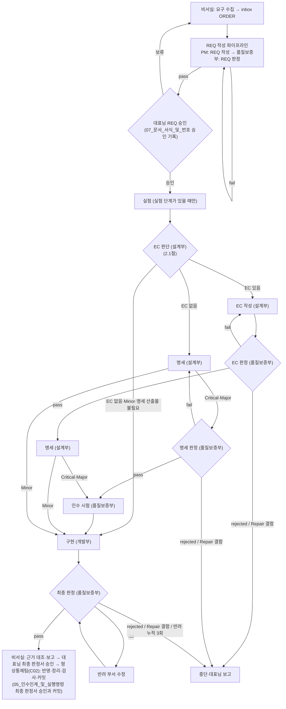

<!-- 생성물: 손으로 고치지 않는다. 원천은 Workflow/data/guide_layers.json이 고른 절이며 생성 명령은 build_guides.py다 -->

# 전역 공통: 안전장치 핵심

<!-- 원천: 사용자 전역 지침, 갱신 표기 [갱신: 2026-10-06 · v29], 추출 SHA-256 b975e60035794fc735dd98ffcf3fa4daac02ad8fac79954cb0a69704edafe561, 생성 근거 세션 주입 사본(갱신 표기 v29) -->
아래는 사용자 전역 지침이 하위 지침으로 바꿀 수 없다고 정한 항목(불변 예외)의 원문이다.

### 4. 보안 및 불변 데이터 보호

* API 키, 비밀번호, 접속 토큰, 개인정보는 대화창·화면에 노출하거나 파일로 내보내지 않는다. 인증 정보는 대리 입력하지 않고 사용자가 직접 입력하게 한다.

* 기밀, 식별 정보, 비공개 데이터는 공개 저장소나 외부 산출물에 넣기 전에 승인을 받는다.

* 사람이 확정했거나 마감 날짜가 지정된 기록은 수정하지 않고 새 기록을 추가(Append)한다.

* 외부 원자료는 본 지침의 문체 기준으로 교정하지 않고 원형을 보존한다.

* 파일 삭제·덮어쓰기 전 사용자 승인: 기존 파일의 삭제와 덮어쓰기는 대상 경로 목록을 제시하고 승인을 받는다. 승인 시점에 목록을 확정할 수 없으면 실측한 뒤 목록을 제시하고 승인을 받는다. 승인 목록 밖 대상, 승인 뒤 사용자가 수정한 파일은 별도로 승인을 받는다. 새 파일 생성은 승인 없이 하되 기록 직전에 경로를 알린다.

* Git 커밋 및 푸시는 명시적 요청 시에만 수행: 커밋과 푸시(Push)는 각각 사용자의 명시적 요청이 있을 때만 수행한다.

* 지침 문서 수정 전 사용자 승인: 위 계층의 지침 문서와 저장소의 서비스별 지침 파일(`CLAUDE.md`, `GEMINI.md`, `.agents/rules/` 등)은 수정안을 제시하고 승인을 받은 뒤 수정한다. 절의 신설·삭제·이동, 문구, 버전 번호, 오탈자 수정을 포함한다. 사용자가 제시한 수정안을 임의로 재구성하지 않는다.

# 표준 공통: 표준 공통 핵심

<!-- 원천: AGENTS.md 「문서 지도」 -->
## 0. 문서 지도

| 알고 싶은 것 | 원천 문서 · 절 |
| :--- | :--- |
| 용어의 뜻, 표준의 목적 | `Workflow/01_표준_개요` 「용어」 |
| 조직 표(부·팀·파트와 코드), 부서별 책임·산출물, 구역과 관리 책임, 팀 폴더 구조, 작업 구역(파트별 쓰기 경로), 옛 이름·옛 경로의 대응 | `Workflow/02_부서_구조_및_작업구역` |
| 분류와 단계, 통과 조건과 판정 기준(배치 판정 포함), 판정 전 점검, 중단 조건, 핫픽스·기획 트랙, 실험실, 시험실, 부적합 관리, 프로세스 맵 | `Workflow/03_라이프사이클` |
| 모델·effort, 지시문과 인계 패킷, 계층형 지침과 세션별 구성 | `Workflow/04_모델_운용` |
| 인수인계 순서와 판정 전제 제외 커밋, 실행 명령, 보고, 최종 승인 커밋, 비서실 실행 절차, 작업 큐, 형상통제 절차와 전수 대응표 | `Workflow/05_인수인계_및_실행명령` |
| 권한 설정, 커밋 전 검사(형상통제 대조 포함), 생성·반영 명령, 판정 전 점검 명령, 검사 장치 대장, 거버넌스 파일 개정 절차, 배포본 | `Workflow/06_통제장치_및_배포` |
| 문서 이름·번호·버전·머리말·리비전 태그, 추적 관계, 커밋 메시지 | `Workflow/07_문서_서식_및_번호` |
| 서식 본문 | `Workflow/templates/` |

<!-- 원천: AGENTS.md 「불변 원칙」 항목: 「승인 전 착수 금지」「범위 통제」「거버넌스 구역」「생성과 판정의 분리」「단순성 우선」「추측 금지」「단일 원천」「추적성」 -->
1. **승인 전 착수 금지**: REQ 머리말 `approved:`가 비어 있으면 명세·코드를 수정하지 않고 커밋하지 않는다. 승인 전에는 `Workflow/02_부서_구조_및_작업구역` 「작업 구역」의 승인 전 구역과 비서실 승인을 받은 `Lab/` 경로에서만 작업한다. 핫픽스는 REQ 대신 대표님 사전 승인과 HOTFIX `confirmed:`를 따른다(`Workflow/03_라이프사이클` 「핫픽스 트랙」). 승인 필드의 기재 방법은 `Workflow/07_문서_서식_및_번호` 「승인 기록」을 따른다.
2. **범위 통제**: 승인된 REQ `scope:` 밖의 파일은 수정하지 않는다. scope는 사용자 전역 지침 「파일 삭제·덮어쓰기 전 사용자 승인」의 승인 목록으로 본다. scope 밖 파일이 필요하면 멈추고 보고한다. `Lab/`의 파이프라인 밖 사용은 REQ가 없으므로 이 항 대신 비서실이 승인한 범위(`Workflow/03_라이프사이클` 「실험실」) 안에서만 쓴다. 파이프라인 안의 실험 단계는 이 항을 그대로 따른다.
3. **거버넌스 구역**: 거버넌스 파일은 `AGENTS.md`, `CLAUDE.md`, `setup.cmd`, `.gitattributes`, `.gitignore`, `.claude/`, `.githooks/`, `Departments/Development/Implementation/assets/scripts/`, `Workflow/`이다. 에이전트는 거버넌스 파일과 `CEO/`를 직접 수정하지 않는다. 예외는 최종 판정서 승인 뒤 형상통제팀(C02)이 결과서의 반영 명령대로 적용본을 반영하는 것(`Workflow/05_인수인계_및_실행명령` 「최종 판정서 승인과 커밋」)과, 전역 지침 원본이 바뀌어 형상통제팀(C01)이 다시 생성한 생성물을 대표님 승인 뒤 원천과 일치하는 것에 한해 반영하는 것(`Workflow/05_인수인계_및_실행명령` 「형상통제 절차」)뿐이다. 개정 절차는 `Workflow/06_통제장치_및_배포` 「거버넌스 파일 개정 절차」를 따른다. 이 목록의 원천은 이 항이다.
4. **생성과 판정의 분리**: 작성한 세션은 스스로 판정하지 않는다. 판정은 Claude Code의 독립된 품질보증부 서브에이전트가 `Workflow/04_모델_운용`이 정한 모델로 수행한다. 그 밖의 세션이 작성한 판정서는 무효다.

6. **단순성 우선**: 요청하지 않은 기능, 쓰지 않는 추상화, 실측 없는 최적화를 더하지 않는다.
7. **추측 금지**: 요구나 명세가 여러 뜻으로 읽히면 임의로 진행하지 않고 반려 사유를 밝혀 반려하거나 보고한다.

9. **단일 원천**: 같은 규칙을 두 문서에 다시 적지 않는다. 다른 문서는 원천의 문서명과 절 제목을 참조한다. 매뉴얼과 이 문서가 어긋나면 이 문서를 따르고 대표님께 보고한다.
10. **추적성**: 대표님 지시부터 ORDER, REQ, 판정, 승인, 커밋까지와 ORDER를 거치지 않는 작업(핫픽스, 요청 커밋)에서, 각 기록이 어느 기록의 어느 버전에서 나왔는지 기록만으로 찾을 수 있게 남긴다. 세부(추적 식별자, 추적 관계, 다른 안건 기록의 참조, 적용 시점)는 `Workflow/07_문서_서식_및_번호` 「문서 체계」를 원천으로 따른다.

# 부 지침: 설계부

<!-- 원천: AGENTS.md 「조직·구역과 권한 한계」 행: 「대표실」「설계부」 -->
| 부서 | 폴더 | 권한 한계 |
| :--- | :--- | :--- |
| 대표실 | `CEO/` | AI는 읽기만 한다 |
| 설계부 | `Departments/Design/` | 코드를 작성하지 않는다 |

<!-- 원천: Workflow/02_부서_구조_및_작업구역.md 「부서별 책임과 산출물」 행: 「설계부」 -->
| 부서 | 서브에이전트 | 책임 | 산출물 (부서 폴더 기준, 팀 폴더부터) |
| :--- | :--- | :--- | :--- |
| 설계부 | `engineering` | EC 판단(모든 REQ), EC 작성, 고객 제품 PRD·TAD 작성·개정(화면의 구조·동작 명세(화면 목록, 화면 흐름, 입력과 반응) 포함), 거버넌스 적용본(매뉴얼·규정, 계층 구성표·전수 대응표) 작성 | `EC/docs/EC-*`, `EC/results/`(설계부 결과서. EC 판단 기록 포함), `EC/workspace/`, `Spec/docs/prd/`, `Spec/docs/tad/`, `Spec/assets/live/`(설계 파라미터), `Spec/workspace/`(적용본) |

<!-- 원천: Workflow/02_부서_구조_및_작업구역.md 「팀 폴더와 공통 하위폴더」 -->
## 3. 팀 폴더와 공통 하위폴더

부서 폴더(`Departments/<부>/`) 아래에 팀 폴더(2.2절 「팀 폴더」 열)를 두어 「부 → 팀」 두 단계로 나눈다. 팀 폴더 안에는 공통 하위 폴더 `docs/`(정제된 문서: 기획서, 명세, 안건), `assets/`(실제 자산: 코드, 테스트, 스크립트, 파라미터, 조사 자료), `results/`(공식 결과서와 판정서), `workspace/`(중간 산출물, 메모, 거버넌스 적용본) 가운데 그 팀이 쓰는 것만 둔다. 파트 폴더는 두지 않는다. 한 파트만 계속 쓰는 자산은 팀 폴더 아래 용도 이름의 하위 폴더에 둔다(예: `Departments/Quality/Test/assets/acceptance/`). 대기 팀 폴더는 만들지 않고 그 팀의 파트를 활성으로 바꾸는 안건에서 만든다. 활성 파트가 있는 팀이 없는 운영부·마케팅부는 부서 폴더 바로 아래 `.gitkeep` 하나만 둔다. 지금 활성 팀 폴더와 하위 폴더는 아래와 같다.

```text
Departments/
├── Secretariat/
│   ├── Secretary/        # 비서팀(S01~S03)
│   │   ├── assets/inbox/      # ORDER, 승인 기록, 요청 기록, 종결 기록, 요구 메모
│   │   ├── assets/research/   # 조사 자료
│   │   ├── assets/planning/   # 아이디어 백로그, 기획안
│   │   ├── assets/briefings/  # 브리핑
│   │   ├── assets/queue/      # 작업 큐
│   │   ├── workspace/연락/    # 연락 파일(기록)
│   │   └── workspace/셸작업/  # 셸 작업 지시·결과 파일
│   ├── PM/               # PM팀(P01·P02)
│   │   ├── docs/requests/     # REQ
│   │   └── workspace/         # PM 실행 기록
│   └── ConfigControl/    # 형상통제팀(C01~C03). 두 하위 폴더는 첫 기록 때 생기며 그 전에는 .gitkeep만
│       ├── results/           # 기준선 기록, 형상통제 기록
│       └── workspace/         # 지침 재생성 작업
├── Design/
│   ├── EC/               # EC팀(E01·E02)
│   │   ├── docs/              # EC
│   │   ├── results/           # 설계부 결과서(RPT)
│   │   └── workspace/
│   └── Spec/             # 명세팀(E03·E04)
│       ├── docs/prd/, docs/tad/   # PRD·TAD
│       ├── assets/live/           # 설계 파라미터
│       └── workspace/             # 설계부 거버넌스 적용본
├── Development/
│   ├── Implementation/   # 구현팀(V01·V02)
│   │   ├── assets/scripts/    # 커밋 전 검사 등 검사·준비 명령, 검사 장치 대장(거버넌스 구역)
│   │   ├── assets/src/, assets/tests/
│   │   ├── results/           # 개발부 결과서(DEV)
│   │   └── workspace/         # 개발부 거버넌스 적용본, 일회성 파일
│   └── Hotfix/           # 핫픽스팀(V03)
│       └── results/           # HOTFIX
├── Quality/
│   ├── Review/           # 판정팀(Q01~Q05)
│   │   ├── results/           # 판정서(RES)
│   │   └── workspace/
│   ├── Nonconformance/   # 부적합관리팀(Q06)
│   │   └── docs/              # 부적합 기록(NCR)
│   └── Test/             # 시험팀(Q07)
│       ├── assets/acceptance/ # 인수 시험
│       └── results/           # 인수 시험 절차서(ACC)
├── Operations/.gitkeep   # 대기 팀만 있음(배포팀 Release, 보안팀 Security)
└── Marketing/.gitkeep    # 대기 팀만 있음(디자인팀 VisualDesign, 콘텐츠팀 Content, 홍보팀 Promotion)
```

- 결과서는 번호 묶음(버전)이 한 폴더에 있어야 「가장 높은 번호가 현행본」이 성립하므로 기록 종류마다 한 폴더를 둔다. 설계부 결과서는 모든 안건의 첫 버전을 EC 판단(E01)이 만들므로 `Departments/Design/EC/results/`에 두고 명세(E03)가 다음 버전을 같은 폴더에 쓴다. 개발부 결과서는 실험(X01)과 구현(V01)이 함께 `Departments/Development/Implementation/results/`에 쓴다. 대기 팀의 결과서 위치는 그 단계를 맡은 파트의 팀 `results/`다(`Departments/<부>/<팀>/results/`. 예: 보안 점검 결과서는 `Departments/Operations/Security/results/`, 시각 디자인 단계의 마케팅부 결과서는 `Departments/Marketing/VisualDesign/results/`). 시각 디자인 문서는 `Departments/Marketing/VisualDesign/docs/DESIGN.md`, 런타임 파라미터는 `Departments/Operations/Release/assets/live/`에 둔다.
- 요청 기록·종결 기록은 형상통제팀(C02)·PM이 쓰지만 비서팀 `assets/inbox/`에 둔다. 종결 기록을 읽는 위치(커밋 전 검사와 `Workflow/03_라이프사이클` 「다른 안건이 진행 중일 때의 REQ 작성」 4항)와 판정 전제 제외 범위를 한 폴더로 두기 위해서다. 쓰기 권한은 4절 표가 정한다.

빈 폴더는 `.gitkeep`으로 유지한다. 비서팀 `assets/`에는 바로 아래에 파일을 두지 않고 하위 폴더(`inbox/`, `research/`, `planning/`, `briefings/`, `queue/`)에만 둔다. 최종 산출물은 팀 폴더의 `docs/`, `assets/`, `results/`에만 둔다.

<!-- 원천: Workflow/02_부서_구조_및_작업구역.md 「작업 구역」 -->
## 4. 작업 구역

파트는 2.2절의 코드다. 파트의 일을 맡는 세션은 2.2절 「파트의 일을 맡는 세션」을 따른다. 이 표를 지키는지는 REQ `scope:` 대조(`Workflow/06_통제장치_및_배포` 「커밋 전 검사」), PM의 단계별 확인(`Workflow/03_라이프사이클` 「원스톱 파이프라인」 4항), 판정의 범위 대조(`Workflow/03_라이프사이클` 「단계별 통과 조건과 판정 기준」 최종 판정 기준 2)로 본다. 커밋 전 검사는 작성 주체를 대조하지 않으므로, 같은 `scope:` 안에서 다른 부서·팀·파트의 위치에 쓴 파일은 기계가 잡지 않는다.

| 구분 | 수정할 수 있는 경로 | 수정 주체(파트) |
| :--- | :--- | :--- |
| ORDER(REQ 승인 전) | `Departments/Secretariat/Secretary/assets/inbox/`(ORDER) | S01(그 ORDER의 담당 세션. `Workflow/05_인수인계_및_실행명령` 「비서실 동시 운용」) |
| 작업 큐 | `Departments/Secretariat/Secretary/assets/queue/`(작업 큐. `Workflow/05_인수인계_및_실행명령` 「작업 큐」) | S01 |
| 조사 자료·브리핑 | `Departments/Secretariat/Secretary/assets/research/`, `Departments/Secretariat/Secretary/assets/briefings/` | S02 |
| 기획 자료 | `Departments/Secretariat/Secretary/assets/planning/`(아이디어 백로그, 기획안) | S01 |
| 승인 기재 | `Departments/Secretariat/Secretary/assets/inbox/`(승인 기록), 대상 REQ의 승인 필드와 「결정」 열, 대상 HOTFIX의 `confirmed:`(`Workflow/07_문서_서식_및_번호` 「승인 기록」) | S01 |
| 요청 기록 | `Departments/Secretariat/Secretary/assets/inbox/`(요청 기록. `Workflow/05_인수인계_및_실행명령` 「비서실 실행 절차」의 「요청 커밋」) | C02 |
| 종결 기록 | `Departments/Secretariat/Secretary/assets/inbox/`(종결 기록. `Workflow/07_문서_서식_및_번호` 「종결 기록」) | 그 안건을 끝내는 커밋을 하는 C02·P02. 커밋 없이 끝난 안건은 대표님 결정을 받은 S01 |
| 셸 작업 지시 | `Departments/Secretariat/Secretary/workspace/셸작업/`(지시 파일, 결과 파일. `Workflow/05_인수인계_및_실행명령` 「셸 작업 지시」) | 지시 파일은 S01(저장소 파일을 수정할 수 있는 비서실 세션), 결과 파일은 그 지시를 처리한 비서실 세션(S01·C02. 예외는 `Workflow/05_인수인계_및_실행명령` 「셸 작업 지시」 7항) |
| 연락 기록 | `Departments/Secretariat/Secretary/workspace/연락/` | 없음(시범이 끝난 기록이며 새로 쓰지 않는다) |
| REQ 작성 | `Departments/Secretariat/PM/docs/requests/`, `Departments/Secretariat/PM/workspace/`, ORDER 머리말 `related_req` 필드 | P01(REQ 승인 전. 승인된 REQ의 새 버전도 그 버전의 승인 전에 쓴다) |
| 실행 기록 | `Departments/Secretariat/PM/workspace/실행기록_REQ-*.md`(`Workflow/05_인수인계_및_실행명령` 「PM 실행 기록」) | P01(만들 때)·P02(REQ 승인 전과 뒤) |
| REQ 판정 | `Departments/Quality/Review/results/`(REQ 판정서), `Departments/Quality/Review/workspace/` | Q01(REQ 승인 전) |
| 판정 | `Departments/Quality/Review/results/`, `Departments/Quality/Review/workspace/` | Q02~Q05(REQ 승인 뒤) |
| 부적합 기록 | `Departments/Quality/Nonconformance/docs/`(REQ 승인 전과 뒤) | Q01~Q06(판정 `fail`·`rejected`의 기록은 그 판정 파트, 판정 없는 중단의 기록은 Q06) |
| 인수 시험 | `Departments/Quality/Test/assets/acceptance/`, `Departments/Quality/Test/results/`(ACC), `Departments/Quality/Test/workspace/` | Q07(REQ 승인 뒤의 인수 시험 단계와 인수 시험 수정) |
| EC 판단 | `Departments/Design/EC/results/`(설계부 결과서) | E01 |
| EC 작성 | `Departments/Design/EC/docs/`(EC), `Departments/Design/EC/workspace/` | E02 |
| 명세 | `Departments/Design/Spec/workspace/`(적용본), `Departments/Design/Spec/docs/`·`Departments/Design/Spec/assets/`(PRD·TAD·설계 파라미터. REQ `scope:` 안), `Departments/Design/EC/results/`(설계부 결과서 다음 버전), 명세 단계의 EC 머리말 `status:`·`gate:` | E03·E04 |
| 구현 | REQ `scope:` 가운데 구현 단계의 경로(거버넌스 파일 제외), `Departments/Development/Implementation/results/`, `Departments/Development/Implementation/workspace/` | V01·V02 |
| 실험 | REQ `scope:`의 `Lab/` 실험 폴더, 실험을 맡은 부의 결과서 위치(설계부 `Departments/Design/EC/results/`, 개발부 `Departments/Development/Implementation/results/`, 운영부·마케팅부는 그 부의 결과서 위치) | X01 |
| 핫픽스 | 대표님이 사전 승인한 대상 파일(`deny` 경로 제외. `Workflow/06_통제장치_및_배포` 「비서실·핫픽스 세션의 권한」)과 `Departments/Development/Hotfix/results/`(HOTFIX) | V03 |
| 운영부(대기) | `Departments/Operations/Release/`(O01), `Departments/Operations/Security/`(O02) 아래 REQ `scope:` 안의 경로와 그 팀의 `results/`·`workspace/` | O01·O02 |
| 마케팅부(대기) | `Departments/Marketing/VisualDesign/`(M01), `Departments/Marketing/Content/`(M02·M03), `Departments/Marketing/Promotion/`(M04) 아래 REQ `scope:` 안의 경로와 그 팀의 `results/`·`workspace/` | M01~M04 |
| 최종 승인 뒤 반영 | 최종 판정서를 받은 결과서의 반영 명령 대상과 삭제 대상, 승인받은 최종 판정서의 「삭제 대상」, 기준선 기록(`Departments/Secretariat/ConfigControl/results/`)(`Workflow/05_인수인계_및_실행명령` 「최종 판정서 승인과 커밋」) | C02 |
| 형상통제 | `Departments/Secretariat/ConfigControl/workspace/`(지침 재생성 작업), `Departments/Secretariat/ConfigControl/results/`(기준선 기록, 형상통제 기록), 지침 재생성 반영 대상(`.claude/guides/**`, `.claude/agents/part-*.md`. 대표님 승인 뒤 원천과 일치하는 생성물만. `Workflow/05_인수인계_및_실행명령` 「형상통제 절차」) | C01(기준선 기록은 「최종 승인 뒤 반영」 행의 C02도) |
| 외부감사실 | `Audits/` | S02(비서실 세션)나 저장소 밖 세션 |
| 실험실 | `Lab/` 아래 실험 폴더 | 대표님, 비서실, 비서실 승인을 받은 조직. 승인 주체·범위·기록과 파이프라인 안의 실험 단계는 `Workflow/03_라이프사이클` 「실험실」 |
| 대표님 전용 | `CEO/`, 거버넌스 파일(「최종 승인 뒤 반영」 행과 「형상통제」 행의 지침 재생성 반영 대상 제외), `_archive/` | 대표님 |

- 커밋 전 검사가 scope 대조에서 빼는 경로는 이 표와 별개의 구현 목록이며, 원천은 `check_standard.py`다(`Workflow/06_통제장치_및_배포` 「커밋 전 검사」).

<!-- 원천: Workflow/04_모델_운용.md 「모델 메타데이터 기록」 -->
## 4. 모델 메타데이터 기록

공식 문서(REQ, EC, DEV, RES, HOTFIX)의 머리말에 작성하거나 판정한 모델과 effort를 아래 기준으로 적는다.

- **모델**: 확인할 수 없으면 `"확인 불가"`로 적는다. 단, RES의 `auditor.model`에는 `"확인 불가"`를 적지 않는다. 판정서를 작성하는 세션이 자기 실행 모델을 확인할 수 없으면 판정서를 발행하지 않고 오케스트레이터에 보고한다.
- **effort(REQ, EC, DEV, RES, HOTFIX)**: 실행 명령 지시문의 effort 값을 출처와 함께 `"<값> (실행 명령 기준)"`으로 적는다(예: `"medium (실행 명령 기준)"`). PM은 자기 지시문의 표기(`Workflow/05_인수인계_및_실행명령` 「실행 명령」), 서브에이전트는 PM 지시문의 표기(3절 1항), 핫픽스팀(V03)은 핫픽스 실행 명령 지시문의 표기를 출처로 쓴다. 출처에서 값을 얻을 수 없을 때만 `"확인 불가"`로 적는다.
- **기준 모델·effort**: 판정서는 9절 「기준 모델·effort」에 판정 지시문의 유효 값 표(3절 1항)와 판정 세션 자신의 실행 모델·effort를 적고, 하향 확인을 거친 칸(1.4절 4항)이 있으면 그 칸과 확인 시각을 따로 적는다. HOTFIX는 1절 「기준 모델·effort」 항에 V03 칸 「분류 없음」의 유효 값과 출처, CEO 설정 `saved_at`을 적는다. 판정이 없는 커밋(최종 승인 커밋, 요청 커밋, PM 커밋)은 커밋 메시지 근거 줄 `Model-Effort`에 커밋한 세션의 모델과 effort를 남긴다(`Workflow/07_문서_서식_및_번호` 「번호와 버전」의 「커밋 메시지」).
- **`REQ-031` 커밋 전의 HOTFIX**: 비서실이 실행 명령 없이 작성했으므로 실제 적용한 effort를 적었다. 고치지 않는다.

```yaml
author:            # RES는 auditor:
  agent: "Design"
  model: "Claude Opus 5.5"
  effort: "medium (실행 명령 기준)"
```

<!-- 원천: Workflow/06_통제장치_및_배포.md 「무인 실행 권한」 -->
### 2.1 무인 실행 권한

- 파이프라인은 `--permission-mode acceptEdits`로 파일 편집 확인을 생략한다. 이 모드에서도 2절의 `deny`(거버넌스 파일·`CEO/`·`_archive/` 쓰기 차단)와 `ask`(삭제·이동·커밋·푸시 확인)는 그대로 적용된다.
- 표준 절차의 조회·검사·시험 명령은 `allow`에 등록되어 있어 확인 없이 실행된다. 목록의 원천은 `settings.json`이다.
- 임시 Git 저장소가 필요한 시험은 팀 `workspace/`의 Python 스크립트로 작성해 `allow` 규칙(`Bash(python Departments/*/*/workspace/*)`)으로 실행한다. 이 규칙은 에이전트가 작성한 스크립트를 확인 없이 실행하게 하므로 사실상 임의 명령 실행을 허용한다. 대표님이 이 완화를 승인했으며(v02 REQ-002), `deny`·`ask`와, 승인되었고 끝나지 않은 REQ와 확인되었고 끝나지 않은 HOTFIX의 `scope:`로 변경을 대조하는 커밋 전 검사(4절 순서 7)가 위험을 줄인다. 이 규칙으로 실행하는 스크립트 안의 명령(`git commit`·`git push`, 삭제·이동 포함)은 `ask`를 거치지 않으므로, 스크립트가 이 저장소에 커밋하거나 파일을 지울 수 있는 경로가 남는다. 이 경로는 막지 않으며, 위의 대표님 승인과 커밋 전 검사로 위험을 줄인다.
- 이 규칙으로 실행하는 스크립트 안에서 `allow` 밖이거나 `ask` 대상인 명령(이 저장소의 커밋·푸시·삭제·이동, `claude` 실행 등)을 실행하지 않는다. 예외는 운영체제 임시 폴더나 pytest `tmp_path` 아래에 만든 시험 저장소 안의 명령이다(인수 시험·단위 시험의 임시 Git 저장소). 위반은 판정에서 결함으로 본다.
- **명령 도구**: 조회·검사·시험 명령은 Bash 도구로 실행한다. Bash 도구가 거부되면 PowerShell 도구로 대신한다. PowerShell 도구에는 `Bash(...)` 규칙이 적용되지 않으므로, `settings.json`은 표준 절차의 Git 조회, 커밋 전 검사, 인수 시험 실행을 `PowerShell(...)` 규칙으로 따로 등록한다. PowerShell의 시각 조회(`Get-Date`)는 Claude Code가 기본으로 허용하는 읽기 전용 명령이므로 등록하지 않는다. PowerShell 도구로 내리는 `git commit`·`git push`와 삭제·이동은 `PowerShell(...)` 규칙으로 `ask`에 따로 등록한다(2절 「`ask`」).
- **명령 형태**: 권한 규칙은 명령 앞부분의 문자열로 맞추고, 묶은 명령은 하위 명령마다 따로 검사한다(근거 `Departments/Development/Implementation/results/DEV-019_v01.md` 6절). 그래서 명령 형태는 아래 원리 하나로 정한다.
  - **원리**: 명령은 저장소 루트(작업 폴더)에서 실행하고, 그 앞부분(묶었으면 하위 명령마다)이 `allow` 규칙이나 Claude Code가 기본으로 허용하는 읽기 전용 명령과 글자 그대로 맞아야 한다. 이 원리를 벗어나면 `allow`에 있는 명령도 권한 확인 요청이 된다.
  - **원리를 벗어나는 형태의 예**: 아래는 예일 뿐이며, 예에 없는 형태도 원리를 벗어나면 같다.
    - ① 작업 폴더를 바꾸거나 다른 폴더를 가리키는 앞부분: `cd <폴더>`, `git -C <경로>`
    - ② 프로그램 이름과 하위 명령 사이의 전역 옵션: `git -c <설정>`, `git --no-pager`. Git 명령은 `git` 바로 뒤에 하위 명령(`status`, `diff`, `log`, `show`, `ls-files`)을 쓴다. 경로의 한글 표시 설정(`core.quotepath`)은 `setup.cmd`가 저장소 설정으로 넣으므로 명령행에 붙이지 않는다.
    - ③ 명령 앞의 환경 변수 대입: `NAME=값 명령`
    - ④ `allow` 규칙에도 기본 읽기 전용 명령에도 들지 않는 하위 명령을 `;`·`&&`·`|`로 묶음(예: `echo "exit=$?"`를 덧붙임)과 셸 구문(변수 대입, 중괄호 묶음, `while`·`for` 반복문, `xargs`)
    - ⑤ PowerShell 도구의 하위 식(`$(...)`)과 괄호 식
  - **경로와 세션 기본 안내**: 명령의 경로는 저장소 루트 기준 상대 경로로 적는다. 절대 경로를 쓰라는 세션 기본 안내는 파일 도구(Read·Write·Edit 등)의 경로에만 적용하며, 이 원리보다 앞서지 않는다.
  - **PowerShell 도구**: 같은 원리를 따른다. 명령은 `PowerShell(...)` 규칙의 앞부분(예: `git status `, `python -m pytest `)이나 기본으로 허용하는 읽기 전용 명령(예: `Get-Date`)으로 시작한다.
  - **원리 안에서 할 수 없는 묶음·반복**: 여러 파일의 반복 처리, 결과 가공처럼 묶음·반복이 필요하면 `allow` 규칙을 더하지 않고 이미 있는 규칙 안의 경로로 실행한다. 검색은 Grep·Glob 도구나 인자를 나열한 단독 `grep` 명령(`Bash(grep *)`)으로 하고, 그 밖은 팀 `workspace/`의 일회성 Python 스크립트를 `Bash(python Departments/*/*/workspace/*)` 규칙으로 실행한다. 스크립트 이름은 `Workflow/07_문서_서식_및_번호` 「번호와 버전」의 「팀 `workspace/` 파일」 항을 따른다.
  - **커밋 해시 조회**: `git rev-parse`는 `allow`에 없어 권한 확인 요청이 된다. HEAD의 커밋 해시는 `git log -1 --format=%H`로 조회한다(`Bash(git log*)`, `PowerShell(git log *)`). 5절 2항의 기준 커밋 조회도 이 명령으로 한다.
  - **문서가 지정하는 명령**: EC, 결과서, 적용본, 인수 시험 절차서(ACC) 등 문서가 뒤 단계의 Claude Code 세션(PM·서브에이전트)에 실행을 지정하는 명령도 이 원리를 따른다. EC 판정·명세 판정이 이를 확인한다(`Workflow/03_라이프사이클` 「단계별 통과 조건과 판정 기준」). 형상통제팀(C02)이 실행하는 반영 명령은 결과서가 정하는 명령이지만 Claude Code 세션에 무인 실행을 지정하는 명령이 아니므로 대상이 아니다. Claude Code로 연 세션에서 반영 명령을 실행하면 확인 화면이 뜬다(2.2절).
- 판정 세션이 명령을 실행하지 못했을 때의 처리는 `Workflow/03_라이프사이클` 「판정 세션의 명령 실행」을, 판정 세션 밖 서브에이전트가 명령을 실행하지 못했을 때의 처리는 같은 문서 「판정 세션 밖의 명령 실행」을 따른다.

<!-- 원천: Workflow/07_문서_서식_및_번호.md 「문서 체계」 행: 「EC」「PRD」「TAD」「RPT」「계층 구성표」「전수 대응표」 -->
| 문서 | 이름 | 작성 주체 | 위치와 파일명 | 서식 |
| :--- | :--- | :--- | :--- | :--- |
| EC | 엔지니어링 변경 계획서 | 설계부 | `Departments/Design/EC/docs/EC-xxx_vNN.md` | `EC_TEMPLATE.md` |
| PRD | 제품 요구사항 정의서 | 설계부 | `Departments/Design/Spec/docs/prd/<번호>_<주제>.md` | `PRD_TEMPLATE.md` |
| TAD | 기술 아키텍처 명세서 | 설계부 | `Departments/Design/Spec/docs/tad/<번호>_<주제>.md` | `TAD_TEMPLATE.md` |
| RPT | 부서 결과서 | 설계부·운영부·마케팅부 | 설계부 `Departments/Design/EC/results/RPT-xxx_vNN.md`, 운영부·마케팅부 `Departments/<부>/<팀>/results/RPT-xxx_vNN.md`(그 단계를 맡은 파트의 팀. 예: 보안 점검 `Departments/Operations/Security/results/`, 시각 디자인 `Departments/Marketing/VisualDesign/results/`) | `DEV_TEMPLATE.md`(머리말 `author.agent`와 제목을 부서에 맞게 바꾼다) |
| 계층 구성표 | 계층 구성표 | 설계부(그 배치를 바꾸는 안건의 설계 적용본) | `Workflow/data/guide_layers.json`(버전 없음) | 없음(형식은 `Workflow/04_모델_운용` 「계층형 지침」 3항) |
| 전수 대응표 | 전수 대응표 | 설계부(설계 적용본). 관리는 형상통제팀(C01) | `Workflow/data/migration_map.json`(버전 없음) | 없음(형식은 `Workflow/05_인수인계_및_실행명령` 「형상통제 절차」 3항) |

<!-- 원천: Workflow/07_문서_서식_및_번호.md 「문서 체계」 항목: 「서식 위치」「추적 관계」「추적 식별자」「다른 안건 기록의 참조」 -->
- **서식 위치**: 서식은 모두 `Workflow/templates/`에 둔다. 다른 곳에 서식 사본을 두지 않는다.
- **추적 관계**: ORDER(`related_req`) → REQ(`source_order`) → RES-REQ → (승인) → RPT 「EC 판단」 절 → (EC가 있을 때) EC → RES-EC → PRD·TAD(`related_req`)·RPT → (명세 판정이 있을 때) RES-SPEC → (시각 디자인 단계가 있을 때) 시각 디자인 문서(문서 하단 개정 이력 「안건」 열)·마케팅부 RPT → RES-DESIGN → ACC → DEV → RES → 커밋(2절 「커밋 메시지」의 근거 줄). ORDER를 뺀 문서는 모두 같은 안건 번호를 쓴다. ORDER 번호는 2절을 따른다. 이 사슬 밖의 기록은 아래 표의 연결 자리로 이어진다.

  | 기록 | 이어지는 기록 | 연결 자리 |
  | :--- | :--- | :--- |
  | 기획안 | 그 기획안에서 발행한 ORDER | ORDER 「출처 기획안」 줄 |
  | 조사 자료, 외부 보고서(AUDIT) | 그 자료를 근거로 삼은 ORDER | ORDER 「근거 자료」 줄의 경로 |
  | 실험 파일(파이프라인 밖) | 실험 승인, 그 실험으로 발행한 ORDER, 커밋 | 실험 폴더의 `실험승인.md`(`Workflow/03_라이프사이클` 「실험실」), ORDER 「근거 자료」 줄의 실험 폴더 경로, 요청 커밋의 근거 줄 `Request-Record` |
  | 실험 파일(실험 단계) | REQ, 실험한 부서의 결과서 | REQ `scope:`의 실험 폴더, 결과서 6절 「실험 결과」(`Workflow/03_라이프사이클` 「실험 단계」) |
  | 승인 기록(REQ·HOTFIX) | 승인한 REQ·HOTFIX 버전 | 대상 파일 승인 필드 줄 끝 주석의 승인 기록 경로(3.1절 4항 2) |
  | 승인 기록(최종 판정서) | 승인한 최종 판정서, 커밋 | 승인 기록 파일명의 대상 파일명(3.1절 4항), 커밋 근거 줄 `Approval-Record` |
  | 브리핑 | 요약한 원천 문서 | 브리핑 작성 정보의 원천 문서 경로(`Workflow/05_인수인계_및_실행명령` 「브리핑」 2항). 승인 브리핑은 파일명 주제의 REQ 번호(2절)로 그 안건과도 이어진다 |
  | HOTFIX | 결함을 들여온 안건, 승인 기록, 커밋 | 머리말 `origin`, `confirmed:` 줄 끝 주석(대리 기재일 때), 커밋 근거 줄 `Confirmed-HOTFIX` |
  | 요청 기록 | 요청 커밋 | 커밋 근거 줄 `Request-Record` |
  | 종결 기록 | 끝난 REQ·HOTFIX, 끝낸 커밋 | 파일명의 기록 이름과 「대상 기록」 항목, 「끝낸 커밋」 항목(「이 기록을 더한 커밋」이면 `git log --diff-filter=A --format=%H -- <종결 기록 경로>`)(1.1절 4항) |
  | NCR | 판정서나 PM 실행 기록 | 머리말 `source` |
  | CEO 설정 파일 | 그 설정으로 실행한 판정서·HOTFIX | 판정서 9절·HOTFIX 1절 「기준 모델·effort」의 CEO 설정 `saved_at`(`Workflow/04_모델_운용` 「모델 메타데이터 기록」) |
  | 기준선 기록 | 그 기록을 넣은 커밋(최종 승인 커밋이나 지침 재생성 반영 커밋) | 파일 이름의 기록 이름(`REQ-xxx`나 `C01반영`)과 내용의 `head`, `git log --diff-filter=A --format=%H -- <기준선 기록 경로>` |
  | 형상통제 기록(지침 재생성) | 그 반영의 요청 커밋 | 요청 커밋의 근거 줄 `Request-Record`와 그 요청 기록의 커밋할 경로 목록 |
  | 「기록」 승인 기록 | 그 기록으로 고친 모델 매트릭스의 커밋 | 요청 커밋의 근거 줄 `Request-Record`와 그 요청 기록의 커밋할 경로 목록(승인 기록 경로와 모델 매트릭스 경로. 4절 「모델 ID 갱신의 예외」) |

- **추적 식별자**: 대표님 요구 하나는 ORDER 번호와 그 ORDER의 요구 항목 번호를 `-`로 이은 추적 식별자 `ORD-<ORDER 번호>-<요구 항목 번호>`(예: `ORD-006-12`)로 가리킨다. REQ 체크리스트 번호(REQ 서식 5절)와 최종 판정서의 체크리스트 대조 번호(판정서 서식 3절)는 그 요구 항목 번호를 그대로 이어받으며, REQ 머리말 `source_order`의 ORDER 번호와 합쳐 추적 식별자가 된다. 그래서 두 문서 안에서는 번호만 적는다. ORDER에는 파생 번호가 없으므로 추적 식별자의 끝 번호는 파생 번호가 아니다. ORDER를 거치지 않는 작업은 그 기록의 이름(HOTFIX 번호, 요청 기록 파일명)으로 가리킨다.
- **다른 안건 기록의 참조**: 다른 안건이 정한 규정을 근거로 들 때는 그 규정이 있는 현행 원천 문서와 절(예: `Workflow/03_라이프사이클` 「재작업 구분」)을 적고, 그 안건의 기록(REQ, EC, 결과서, 판정서 등)을 버전으로 가리키지 않는다. 다른 안건 기록의 버전은 그 버전에 대한 사실(승인, 판정, 결정, 커밋)을 적을 때만 쓴다(예: 「`REQ-019_v03` D1(권고안)이 정한 처리 순서」). 같은 안건 안의 기록과 `scope:`의 기록 문서(3절)는 이 항목의 대상이 아니다.

<!-- 원천: Workflow/07_문서_서식_및_번호.md 「번호와 버전」 행: 「기본」「파생 안건」 -->
| 구분 | 형식 | 예 |
| :--- | :--- | :--- |
| 기본 | `<종류>-<세 자리 번호>_v<두 자리 버전>.md` | `REQ-007_v01.md`, `RES-007_v01.md` |
| 파생 안건 | `<종류>-<세 자리 번호>-<파생 번호>_v<두 자리 버전>.md` | `REQ-007-1_v01.md`, `RES-007-1_v01.md` |

<!-- 원천: Workflow/07_문서_서식_및_번호.md 「번호와 버전」 항목: 「번호」「팀 `workspace/` 파일」「파생 번호」「버전」「서식」「PRD·TAD·시각 디자인 문서」 -->
- **번호**: REQ 번호가 원천이다. EC·DEV·RPT·RES는 같은 번호를 쓴다. 새 REQ 번호는 `Departments/Secretariat/PM/docs/requests/`의 가장 큰 번호에 1을 더한다.

- **팀 `workspace/` 파일**: 안건을 위해 팀 직속 `workspace/`에 만드는 파일과 폴더는 이름을 그 안건의 REQ 번호와 `_`로 시작한다(예: `REQ-014_복사_20261009a.py`, `REQ-008_실측_v01/`. 파생 안건은 `REQ-xxx-n_`). PM 실행 기록은 「실행 기록」 항을 따른다. 일회성 파일의 판단과 정리는 `Workflow/03_라이프사이클` 「단계별 통과 조건과 판정 기준」의 최종 판정 기준 7을 따른다.
- **파생 번호**: 원 안건에서 미결로 남거나 새로 생긴 작업에 `1`부터 붙인다(`Workflow/03_라이프사이클` 「진행 중 변경과 파생 안건」).
- **버전**: 내용이 바뀌면 새 파일로 저장하고 버전을 올린다. 가장 높은 버전이 현행본이다. 판정에서 지적을 받아 고친 문서와 재판정 판정서도 새 버전으로 저장한다. 이전 버전은 지우지 않는다.

- **PRD·TAD·시각 디자인 문서**: 제품 명세와 시각 디자인 문서는 버전 번호 없는 파일명 하나로 유지하고 개정 이력은 Git과 문서 하단 개정 이력 표로 관리한다.
- **서식**: `*_TEMPLATE.*`(`.md`, `.html`)에는 번호와 버전을 붙이지 않는다.

<!-- 원천: Workflow/07_문서_서식_및_번호.md 「머리말」 -->
## 3. 머리말

- **머리말 형식**: 공식 문서는 `---`로 감싼 YAML 머리말로 시작한다. 브리핑은 예외이며 작성 정보를 본문 맨 끝에 적는다(`Workflow/05_인수인계_및_실행명령` 「브리핑」). 시각 디자인 문서도 예외이며 업계 통용 형식을 따르고, 안건과의 연결은 문서 하단 개정 이력 표(4절)로 남긴다.
- **날짜·시각 형식**: 날짜는 `"YYYY-MM-DD"`, 시각은 `"YYYY-MM-DDTHH:MM:SS+09:00"` 문자열이다. **`approved:`와 `confirmed:`는 시각 형식만 허용한다.** 형식은 커밋 전 검사에서 확인한다.
- **목록 필드**: 목록 필드(`scope:`, `workflow:`, `related_req:`, `causes:`, `proposals:`)는 두 칸 들여쓰기 뒤 `- `로 시작한다. 폴더 항목은 끝에 `/`를 붙이지 않는다(예: `Workflow`).
- **scope의 기록 문서**: `scope:`에 적는 기록 문서(EC 등)는 버전과 확장자 없이 적는다(예: `Departments/Design/EC/docs/EC-007`). 새 버전이 생겨도 scope를 고치지 않기 위해서다.
- **작성·판정 모델**: 작성·판정 모델은 `Workflow/04_모델_운용` 「모델 메타데이터 기록」대로 적는다.

| 문서 | 필수 머리말 필드 |
| :--- | :--- |
| ORDER | `order_id`, `created`, `ceo_checked_at`(대표님이 ORDER 내용을 확인한 시각. 비어 있을 수 있다), `classification_proposal`(`Critical`·`Major`·`Minor`. 비서실의 제안이며 확정은 REQ `classification`. 정의 기준은 `Workflow/03_라이프사이클` 「분류별 단계」. ORDER에는 모델 등급 필드를 두지 않는다), `related_req`(이 ORDER로 작성한 REQ의 버전 없는 이름 목록) |
| REQ | `task_id`, `classification`(`Critical`·`Major`·`Minor`. 정의 기준과 분류별 단계·기본 모델 등급은 `Workflow/03_라이프사이클` 「분류별 단계」, 근거는 REQ 서식 2절 「분류 근거」), `created`, `created_at`(그 버전 파일을 PM이 처음 저장할 때 조회한 시각. 형식 `YYYY-MM-DDTHH:MM:SS+09:00`. 기재 방법은 `Workflow/03_라이프사이클` 「REQ 작성 파이프라인」 1항, 쓰임과 적용 시점은 같은 문서 「원스톱 착수 조건」 5·8항), `source_order`(이 REQ 버전을 작성할 때 근거로 삼은 ORDER 파일의 저장소 루트 기준 경로와 버전. 1절 「요청 원문」의 출처와 같다. 추적 식별자는 1절), `approved`(3.1절 「승인 기록」), `author`, `workflow`(단계는 `Workflow/03_라이프사이클` 「분류별 단계」. EC 판단으로 실행 여부가 정해지는 단계도 적는다), `scope`(모든 분류에서 `Departments/Design/EC/docs/EC-xxx` 포함. EC 판단 결과와 관계없다) |
| EC | `ec_id`, `task_id`, `created`, `author`, `status`(`draft`·`approved`), `gate`(`approved`일 때 근거 판정서 경로), `scope`(REQ `scope`의 부분집합) |
| PRD | `doc_type`, `title`, `updated`, `related_req` |
| TAD | `doc_type`, `title`, `updated`, `related_req`, `related_prd` |
| DEV·RPT | `task_id`, `created`, `author` |
| RES | `task_id`, `gate`(`REQ`·`EC`·`SPEC`·`DESIGN`·`FINAL`), `result`(`pass`·`fail`·`rejected`), `completed_at`(판정을 마칠 때 조회한 시각. 조회·기재 방법과 조회하지 못했을 때의 처리는 `Workflow/03_라이프사이클` 「판정 세션의 명령 실행」), `auditor` |
| ACC | `task_id`, `created`, `author`(`Workflow/04_모델_운용` 「모델 메타데이터 기록」의 DEV와 같은 형식), `test_dir`(이 ACC가 기록하는 인수 시험 폴더 경로. 시험을 바꾸지 않은 수정 버전은 직전 ACC와 같은 폴더. 「대상 없음」이면 `""`), `has_tests`(`yes`·`no`) |
| NCR | `task_id`, `recorded_at`(기록 시각), `author`(ACC와 같은 형식), `event`(`fail`·`rejected`·`stop`. `stop`은 판정 없이 멈춘 중단), `source`(판정서 경로. `event`가 `stop`이면 PM 실행 기록 경로), `stop`(`Workflow/03_라이프사이클` 「중단 조건」 번호. 없으면 `""`), `causes`(원인 분류 코드 목록), `proposals`(개정을 제안한 원인 분류 코드 목록. 없으면 빈 목록) |
| HOTFIX | `hotfix_id`, `created`, `author`(`Workflow/04_모델_운용` 「모델 메타데이터 기록」. 핫픽스팀(V03) 세션이 작성한다), `origin`(결함을 들여온 안건의 기록 이름과 버전. 예: `REQ-024_v03`, `HOTFIX-005_v01`. 알 수 없으면 「확인 불가」), `confirmed`(3.1절 「승인 기록」), `scope`(대상 조건은 `Workflow/03_라이프사이클` 「핫픽스 트랙」) |
| 조사 자료 | `created`(조사 날짜. 파일명의 `YYYYMMDD`와 같다), `author`(`agent`, `model`: 조사한 모델, `session`: 작성 세션의 세션 식별자(`Workflow/05_인수인계_및_실행명령` 「비서실 동시 운용」)) |
| 아이디어 백로그·기획안 | `created`(v01 작성 날짜. 파일명의 `YYYYMMDD`와 같다), `author`(`agent`, `model`: 작성한 모델, `session`: 작성 세션의 세션 식별자(`Workflow/05_인수인계_및_실행명령` 「비서실 동시 운용」)) |
| 실행 기록 | `task_id`, `created` |
| AUDIT | `audit_id`, `created`, `auditor`(비서실이 작성하면 `session` 포함) |

- **NCR의 시각 필드**: NCR은 개정 제안의 건수를 기록 순서로 세므로(`Workflow/03_라이프사이클` 「부적합 관리」) `created` 대신 시각 필드 `recorded_at`을 쓴다. 원인과 제안을 머리말에 두어 기존 기록을 머리말만 읽고 대조할 수 있게 한다.
- ORDER의 `ceo_checked_at`은 승인 필드가 아니며 REQ 작성의 착수 조건이 아니다. 3.1절 「승인 기록」의 대상이 아니다.
- ORDER의 `related_req`는 PM이 REQ를 처음 작성할 때 더한다. 이 갱신은 같은 파일에서 하며 버전을 올리지 않는다(아래 EC `status:`·`gate:` 갱신과 같다).
- 조사 자료의 이름(1절, 2절)과 머리말(이 표) 규칙은 REQ-012 반영 뒤 새로 작성하는 파일부터 적용한다. 그 전에 작성한 파일에는 소급하지 않는다.

**EC 상태 전이**

```text
draft ──(최신 RES-xxx-EC result: pass)──▶ approved
draft ──(최신 RES-xxx-EC result: fail)──▶ EC 새 버전(draft) 작성 후 재판정
```

- `status:`는 설계부가 명세 단계를 시작할 때 바꾼다. `approved`로 바꿀 때 `gate:`에 판정서 경로를 함께 적는다. 최신 판정이 `pass`가 아니면 `approved`로 바꾸지 않는다.
- `status:`·`gate:` 갱신은 같은 파일에서 하며 버전을 올리지 않는다. 본문을 바꾸면 새 버전으로 저장하고 다시 판정한다.

**`result` 값**

| 값 | 뜻 |
| :--- | :--- |
| `pass` | 판정 기준의 결함이 없다. 완성도를 보증하지 않는다 |
| `fail` | 결함이 있다. 해당 부서가 고친 뒤 다시 판정한다 |
| `rejected` | 안건 자체가 성립하지 않는다(요구 모순, 여러 뜻으로 읽힘 등) |

### 3.1 승인 기록

승인 필드(REQ `approved:`, HOTFIX `confirmed:`)와 REQ 「결정 사항 및 선택지」 표의 「결정」 열의 기재 규칙, 최종 판정서 승인의 기록 규칙, CEO 설정과 「기록」의 승인 기록(10항)은 이 절이 원천이다.

1. **승인의 정의**: 승인은 대표님의 의사 표시다. 승인 필드와 「결정」 열은 그 의사를 기록한 것이다.
2. **승인 문구**: 대표님의 승인 문구에는 대상 파일명과 버전이 들어 있어야 한다. REQ는 결정(D번호별 결정 또는 「전부 권고안」)도 들어 있어야 한다. 예: 「REQ-007_v06 승인, D1~D5 권고안」, 「HOTFIX-003_v01 확인」. 최종 판정서 승인 문구에도 대상 파일명과 버전이 들어 있어야 한다(예: 「RES-007_v02 승인」). 승인 문구에 「문체 반영」을 덧붙일 수 있다(`Workflow/03_라이프사이클` 「판정 지적의 구분과 문체 지적 처리」). 대표님 본인이 REQ 승인 필드를 기재하면서 「문체 반영」을 지시할 때는 승인 필드 줄 끝 주석에 `# 문체 반영`을 적는다. 필요한 항목이 빠진 문구는 승인으로 보지 않고 대표님께 되묻는다.
3. **기재 주체**: 대표님 본인, 또는 승인 문구를 대표님에게서 직접 받은 비서실이다. 다른 에이전트나 세션이 전달한 문구는 근거가 되지 않는다. PM과 서브에이전트는 승인 필드와 「결정」 열을 기재하지 않는다. 7항의 문체 반영본은 예외다.
   - 셸을 실행할 수 있는 비서실 세션이 PM을 실행하는 동안 대표님이 그 세션에 준 답은 그 세션이 대표님에게서 직접 받은 문구로 보고 그 세션이 기재한다. 그 세션은 PM 출력을 고치지 않고 원문 그대로 대표님께 전달한다.
   - 대표님이 실행 명령을 직접 실행한 경로에서 PM 세션에 직접 답한 승인 문구는 PM이 기재하지 않는다. 대표님이 그 문구를 비서실 세션에 다시 주거나 본인이 기재한다.
4. **기재 순서**: 대표님 본인이 기재할 때는 이 순서를 생략한다. 최종 판정서 승인은 승인 필드가 없으므로 1만 한다. 이때 파일명은 `승인기록_<YYYYMMDD>_RES-xxx_vNN.md`이고, 문구를 대표님에게서 직접 받은 비서실이 작성하며, 그 안건의 커밋에 넣는다(`Workflow/05_인수인계_및_실행명령` 「최종 판정서 승인과 커밋」). 7항의 문체 반영본은 예외다.
   1. `Departments/Secretariat/Secretary/assets/inbox/승인기록_<YYYYMMDD>_<대상 파일명>.md`를 작성한다. 승인 문구 원문, 문구를 받은 시각, 대상 파일 경로와 버전, 기재한 세션(세션 식별자, `Workflow/05_인수인계_및_실행명령` 「비서실 동시 운용」)과 모델을 적는다.
   2. 대상 파일의 승인 필드와, REQ이면 「결정」 열을 기재한다. 승인 필드 값은 문구를 받은 시각이다. 승인 필드 줄 끝의 서식 주석은 `# 대리 기재: <세션>, 근거 <승인 기록 경로>` 주석으로 바꾼다.
5. **대조**: 대표님은 최종 판정서를 승인하기 전에(HOTFIX는 커밋 전에) 대리 기재된 승인 필드와 「결정」 열을 승인 기록과 대조한다. 7항의 문체 반영본은 승인 필드가 직전 버전 값과 같은지와 대조 판정서가 `pass`인지를 대조한다.
6. **「결정」 열의 확정 시점**: 기재 주체(대표님 본인 또는 대리 기재)와 관계없이, REQ의 「결정」 열은 승인 필드와 같은 기재 작업에서 확정한다. 「결정」 열을 비워 두거나 승인 필드보다 나중에 채우는 방식으로 승인 필드를 기재하지 않는다. 승인 필드를 기재한 뒤 결정을 바꾸려면 REQ 새 버전을 작성한다(2절 「승인과 버전」). 7항의 문체 반영본은 예외다.
7. **문체 반영본의 승인 필드**: 「문체 반영」 승인으로 만든 REQ 새 버전(문체 반영본)은 `approved: ""`로 작성하고, 「결정」 열은 직전 버전 값을 그대로 옮긴다. `Workflow/03_라이프사이클` 「판정 지적의 구분과 문체 지적 처리」의 대조가 `pass`이면 PM이 같은 파일에서 버전을 올리지 않고 직전 버전의 `approved:` 값을 그대로 기재하고, 줄 끝 주석을 `# 문체 반영본: 승인 근거 <직전 버전 경로>, 대조 <대조 판정서 경로>`로 적는다. 이 기재는 새 승인 문구를 받아 하는 기재가 아니라 직전 버전에 이미 기록된 승인(직전 버전의 승인 필드와, 대리 기재였으면 그 승인 기록)을 옮겨 적는 것이다. 그래서 아래 예외를 둔다.
   1. 3항(기재 주체): 문체 반영본의 승인 필드는 PM이 직전 버전의 승인 필드(대리 기재였으면 그 승인 기록도)를 근거로 기재한다. 승인 문구를 대표님에게서 직접 받았는지와 관계없다.
   2. 4항(기재 순서): 새 승인 기록을 만들지 않고(4항 1 생략), 승인 필드 줄 끝 주석은 4항 2의 대리 기재 주석 대신 위 문체 반영본 주석을 쓴다.
   3. 5항(대조): 대표님의 대조 대상에 문체 반영본의 승인 필드를 더한다. 대조 내용은 5항 둘째 문장이다.
   4. 6항(「결정」 열의 확정 시점): 「결정」 열은 문체 반영본을 작성할 때 직전 버전 값으로 옮기고, 승인 필드는 대조 `pass` 뒤에 기재한다.
8. **대안 선택의 기록**: 대표님이 REQ 승인 문구(2항)에서 결정 표의 권고안이 아닌 선택지나 수정안을 고르면, 그 결정을 「결정」 열에 기록하고 REQ 새 버전을 작성하지 않는다. 이 기록은 6항대로 승인 필드와 같은 기재 작업에서 한다. 승인 필드를 기재한 뒤 대표님이 결정을 바꾸면(중단 조건으로 멈춘 뒤의 답에서 결정 표의 선택을 바꾸는 경우 포함) 이 항이 아니라 6항을 따라 REQ 새 버전을 작성한다. 기재 주체는 3항을 따른다. 「결정」 열과 체크리스트·실행 계획의 관계는 `Workflow/03_라이프사이클` 「REQ 작성 파이프라인」 1항 「결정과 체크리스트」를 따른다.
9. **실험 단계의 승인**: REQ `workflow:`에 실험 단계가 있으면 그 REQ의 승인(4항의 승인 기록과 승인 필드 기재, 또는 대표님 본인의 승인 필드 기재)이 실험 단계의 `Lab/` 사용 승인(`Workflow/03_라이프사이클` 「실험실」)을 겸한다. 실험 단계에는 따로 실험실 승인을 받거나 기록하지 않으며, 파이프라인은 실험실 승인 때문에 멈추지 않는다.
10. **CEO 설정과 「기록」의 승인 기록**: 모델·effort의 「기본값 밖 사용」은 REQ 「결정」 열 밖에 CEO 설정으로도 승인된다(`Workflow/04_모델_운용` 「기본값 밖 사용」). 아래 두 기록은 대표님 조작으로 대시보드가 쓰는 승인 기록이며, 3항(기재 주체)과 4항(비서실이 `Departments/Secretariat/Secretary/assets/inbox/`에 쓰는 기재 순서)의 예외다. 비서실과 그 밖의 AI 세션은 두 기록을 쓰거나 고치지 않고 읽기만 한다.
    1. **저장된 CEO 설정 파일**: 「저장」된 `CEO/settings/model_settings.json`은 그 파일에 적힌 칸의 승인 기록의 한 형식이다. 별도 승인 기록을 남기지 않는다. 승인 시각은 `saved_at`이며, 효력과 범위는 `Workflow/04_모델_운용` 「CEO 설정」을 따른다. 「새로고침(기본값으로)」으로 비우면 그 승인은 다음 실행부터 효력을 잃는다.
    2. **「기록」의 승인 기록**: 작성 주체는 대표님(대표님 조작으로 대시보드가 쓴다)이고, 위치와 이름은 `CEO/settings/records/승인기록_<YYYYMMDDTHHMMSS>_모델매트릭스.json`(시각은 한국 시간)이다. UTF-8 JSON이며 `recorded_at`(`YYYY-MM-DDTHH:MM:SS+09:00`), `recorded_by`(「대표님(대시보드 「기록」)」), `matrix`(모델 매트릭스 경로 `Workflow/data/model_matrix.json`), `changes`(바꾼 칸마다 `part`, `role`, `class`, `before`, `after`. `before`·`after`는 `{ "model", "effort" }`)를 둔다. 작성 뒤 고치지 않는다. 이 기록이 그 모델 매트릭스 수정의 승인이자 개정 기록이다(4절 「모델 ID 갱신의 예외」).

<!-- 원천: Workflow/03_라이프사이클.md 「판정 세션 밖의 명령 실행」 -->
### 5.4 판정 세션 밖의 명령 실행

판정 세션 밖 서브에이전트가 명령을 실행하지 못했을 때의 처리는 이 절이 원천이다. 명령 도구와 형태, 권한은 `Workflow/06_통제장치_및_배포` 「무인 실행 권한」을 따른다.

1. **대상**: 판정 세션 밖 서브에이전트, 곧 설계부·개발부·운영부 서브에이전트와 판정 밖 품질보증부 세션(인수 시험, 인수 시험 수정, 부적합 기록)이 그 단계의 작업을 위해 실행하는 명령이다. 판정 세션(5.2절 1항)의 명령과 마케팅부 서브에이전트의 명령은 대상이 아니다. `ask` 목록 명령(삭제·이동·커밋·푸시)의 권한 확인 요청도 대상이 아니며 7절 5항 첫 문장대로 멈춘다.
2. **실행하지 못함**: `allow` 규칙과 맞지 않는 명령(명령 형태 때문에 맞지 않은 경우 포함)이 권한 거부되었거나, 권한 확인 요청이 승인되지 않아 실행되지 않은 경우다. 명령이 실행되어 실패한 경우(종료 코드가 0이 아님)는 여기에 들지 않는다. 권한 확인 요청이 승인되어 실행된 명령은 실행한 명령으로 보고 작업을 계속하며, 5항의 자리에 적는다.
3. **대신할 수 있을 때**: 실행하지 못한 명령이 얻으려던 값(예: 커밋 해시, 변경 목록, 검색 결과, 종료 코드와 출력, 시각)과 같은 값을 다른 허용 명령·도구로 얻는다. 같은 대상에 `allow` 규칙에 맞는 다른 형태나 다른 도구로 닿는 것만 대신이다(예: `cd`를 붙인 명령 대신 저장소 루트 기준 상대 경로의 같은 명령, `git rev-parse HEAD` 대신 `git log -1 --format=%H`, 반복문 대신 Grep 도구, Bash 도구 대신 PowerShell 도구). 파일 열람으로 값을 짐작하는 것(예: `.git/HEAD`를 열어 기준 커밋을 짐작함), 수동 확인, 추정처럼 명령 결과를 다른 근거로 바꾸는 것은 대신이 아니다. 대신했으면 5항의 자리에 적고 작업을 계속한다.
4. **대신할 수 없을 때**: 그 명령에 기대는 값은 채우지 않고, 그 단계의 산출물을 작성해 5항의 자리에 시도한 대신 수단과 그 결과를 적은 뒤 오케스트레이터에 보고한다. 오케스트레이터는 그 단계의 산출물을 받은 뒤 7절 5항으로 멈춘다.
5. **기록 자리**: 그 단계에서 작성하는 산출물의 「실행하지 못한 명령」 표다. 결과서(RPT·DEV)는 서식 `Workflow/templates/DEV_TEMPLATE.md` 5절, EC는 `EC_TEMPLATE.md` 6절, 인수 시험 절차서는 `ACC_TEMPLATE.md` 7절, 부적합 기록은 `NCR_TEMPLATE.md` 6절이다. 명령마다 명령 원문, 도구, 메시지 원문, 대신한 수단과 그 결과를 적는다. 대신하지 못했으면 마지막 칸을 「대신하지 못함」으로 시작하고, 권한 확인 요청이 승인되어 실행했으면 마지막 칸에 「확인 요청 승인 뒤 실행」을 적는다. 없으면 「없음」을 적는다.
6. **오케스트레이터의 확인**: 오케스트레이터는 판정 세션 밖 서브에이전트의 산출물을 받을 때(4절 4항) 5항의 표를 확인한다. 마지막 칸이 「대신하지 못함」으로 시작하는 행이 있거나, 오케스트레이터가 그 단계에서 알게 된 권한 확인 요청(서브에이전트의 보고 포함)이 표에 없으면 7절 5항으로 멈춘다.
7. **적용 시점**: 이 절, 7절 5항 셋째·넷째 문장, 5절 표 「EC 판정」 행 ⑦과 「명세 판정」 행 ⑧은 `REQ-025` 커밋 뒤에 기동하는 PM 세션(실행 명령으로 기동하는 파이프라인 실행)부터 적용한다. 이미 실행 중인 PM 세션은 기동 때의 규정으로 진행한다. 이미 작성된 산출물(결과서, EC, ACC, NCR)은 바꾸지 않는다.

<!-- 원천: Workflow/04_모델_운용.md 「타깃 컨텍스트 규칙」 항목: 「매뉴얼 읽기」「인계 패킷」 -->
2. **매뉴얼 읽기**: 매뉴얼은 필요한 절만 찾아 읽는다. 각 매뉴얼 첫머리의 「이 문서가 정하는 것」으로 읽을 문서를 고른다. 파트 카드로 기동한 서브에이전트는 카드에 실린 지침을 따르고, 카드 끝 「필요할 때 읽는 문서」의 문서와 절은 필요할 때 찾아 읽는다(5절 5항).

5. **인계 패킷**: 작성 단계는 다음 작성 단계에 인계 패킷(서식 `Workflow/templates/DEV_TEMPLATE.md` 11절. 받는 단계, 읽을 문서 표, 핵심 요약)을 결과서에 적어 넘긴다. 넘기는 단계는 실험(X01) → EC 판단(E01), EC 판단(E01) → EC 작성(E02)이나 명세(E03·E04), 명세(E03·E04) → 구현(V01·V02)이다. EC 작성은 EC가 인계 문서이므로 패킷을 두지 않는다. PM은 받는 단계의 지시문 「대상 파일 경로」에 그 결과서 경로를 넣는다(1항 안에서 넘긴다). 받는 단계는 패킷의 목록부터 읽되, 패킷이 REQ·EC 등 원천 문서를 대신하지 않는다. 판정 단계와 인수 시험 단계에는 패킷을 넘기지 않는다. 작성 과정의 요약이 독립 판정과 독립 시험 작성에 섞이지 않게 하기 위해서다(4항, `AGENTS.md` 「불변 원칙」 4항).

# 팀 지침: 명세팀

<!-- 원천: Workflow/03_라이프사이클.md 「단계별 통과 조건과 판정 기준」 행: 「명세」 -->
| 단계 | 부서 | 입력 | 산출물 | 통과 조건 |
| :--- | :--- | :--- | :--- | :--- |
| 명세 | 설계부 | EC가 있으면 판정 `pass`인 EC, 없으면 승인된 REQ와 설계부 결과서 「EC 판단」 절(실험 단계가 있으면 실험 결과서 포함). 화면의 구조·동작 명세를 쓰면 5.5절 5항의 시각 디자인 문서 | PRD·TAD, 적용본, 설계부 결과서 | EC가 있으면 시작할 때 EC 머리말을 `Workflow/07_문서_서식_및_번호` 「머리말」의 EC 상태 전이대로 바꾼다. 설계부 결과서에 「EC 판단」 절을 그대로 옮긴다. EC가 없는 Critical·Major이면 설계부 결과서에 「구현 계획」 절(서식 `DEV_TEMPLATE.md` 9절)과, REQ 「결정」 열의 결정마다 행이 있는 「결정 반영 대조」 절(같은 서식 10절)이 있다. EC가 없는 Minor이면 「결정 반영 대조」 절이 있다 |

<!-- 원천: Workflow/03_라이프사이클.md 「판정 전 점검」 행: 「E03·E04」 -->
| 작성 파트 | 산출물 | 스크립트 항목 | 사람이 확인하는 항목 |
| :--- | :--- | :--- | :--- |
| E03·E04 | 명세 산출물(PRD·TAD, 적용본), 설계부 결과서 | ①②③④ | 5절 표 「명세」 행 통과 조건, 「명세 판정」 행 ①~⑧, 최종 판정 기준 5·6·11 |

<!-- 원천: Workflow/03_라이프사이클.md 「판정 전 점검」 항목: 「실행」「판정과의 관계」「적용 시점」 -->
- **실행**: 작성 파트는 산출물을 넘기기 전에 `python Departments/Development/Implementation/assets/scripts/check_prejudge.py <문서 경로> [--req <REQ 경로>] [--applied <적용본 폴더>]`를 실행해 `[FAIL]`을 없앤다. 결과서가 있는 단계는 결과서 3절 「검증 결과」에 명령, 시각, 결과 원문을 적는다. 스크립트를 실행하지 못한 서브에이전트는 5.4절대로 처리한다.
- **판정과의 관계**: 이 점검은 판정이 아니며 판정을 대신하지 않는다. 「사람이 확인하는 항목」은 판정 기준의 위치만 가리키며 기준 문장은 그 원천 절에 둔다.
- **적용 시점**: `Workflow/02_부서_구조_및_작업구역` 「부서별 책임과 산출물」의 `REQ-034` 적용 시점 항목을 따른다.

<!-- 원천: Workflow/07_문서_서식_및_번호.md 「개정 이력과 리비전 태그」 -->
## 4. 개정 이력과 리비전 태그

- **대상**: 버전 번호 없이 고쳐 쓰는 문서(`AGENTS.md`, `Workflow/` 매뉴얼, PRD·TAD, 시각 디자인 문서)는 하단에 개정 이력 표를 둔다. 열은 `| 안건 | 일자 | 변경 요지 |`이고, 「안건」에는 그 개정을 승인한 기록의 번호와 버전(예: `REQ-007_v02`, `HOTFIX-003_v01`)을 적는다. `Workflow/data/`의 데이터 파일(프로세스 맵 `process_map.json`, 모델 매트릭스 `model_matrix.json`, 계층 구성표 `guide_layers.json`, 전수 대응표 `migration_map.json`)은 Markdown이 아니므로 개정 이력 표와 리비전 태그를 두지 않는다. 데이터 파일을 고친 기록은 그 형식의 원천 매뉴얼(프로세스 맵은 `Workflow/03_라이프사이클`, 모델 매트릭스와 계층 구성표는 `Workflow/04_모델_운용`, 전수 대응표는 `Workflow/05_인수인계_및_실행명령`)의 개정 이력 행에 적는다. 생성 지침(`.claude/guides/**`, `.claude/agents/part-*.md`)도 개정 이력 표와 리비전 태그를 두지 않는다. 원천은 생성 명령이 고른 원천 절이며, 그 원천 절의 개정 이력이 기록이다. 예외는 모델 매트릭스의 「기록」이며, 그 승인 기록이 개정 기록이다(아래 「모델 ID 갱신의 예외」).
- **리비전 태그**: 개정한 H2·H3 제목 끝에 공백 하나와 `(안건 번호_버전)`을 붙인다. 예: `## 4. 작업 구역 (REQ-xxx_vNN)`. 파생 안건이면 `(REQ-xxx-n_vNN)`이다.
- **절차**
  1. **실변경 식별**: 구현을 마친 뒤 실제로 바뀐 H2·H3 절을 찾는다. 원본 문서는 `git diff HEAD`, 파일 전체 거버넌스 적용본은 `git diff --no-index <원본> <적용본>`으로 대조한다. 변경 파일 적용본(`Workflow/06_통제장치_및_배포` 「거버넌스 파일 개정 절차」 2항)은 변경 파일에 담긴 블록(교체·추가·삭제한 블록)이 실변경 절이다.
  2. **이전 태그 제거**: 문서 전체에서 정규식 `\s*\((REQ|HOTFIX)-\d{3}(-\d+)?_v\d{2}\)`에 맞는 태그를 지운다.
  3. **현행 태그 부착**: 실제로 바뀐 절의 제목 끝에만 현행 태그를 붙인다. 바뀌지 않은 절에는 붙이지 않는다.
  4. **개정 이력 추가**: 개정 이력 표에 한 행을 더한다.
  5. **판정**: 최종 판정에서 `git diff`의 실변경 절과 태그, 개정 이력을 대조한다. 누락·오부착·이전 태그 잔존이 있으면 `fail`이다.
- **모델 ID 갱신의 예외**: `Workflow/04_모델_운용` 「모델 등급과 기본 모델」 표에서 등급 배정을 그대로 두고 기본 모델을 같은 모델의 더 새 버전으로 바꾸는 갱신(기본 모델 이름의 버전과 모델 ID만 바뀌는 갱신)은 ORDER·REQ를 거치지 않는다. ① 새 버전이 나오면 비서실이 새 모델 ID와 그 표의 고칠 행을 대표님께 보고한다. ② 대표님이 그 표를 직접 고친다. 에이전트의 수정이 아니므로 `AGENTS.md` 「불변 원칙」 3항에 걸리지 않는다. ③ 대표님은 같은 수정에서 `Workflow/04_모델_운용` 개정 이력에 한 행을 더한다. 「안건」 열은 `CEO`, 「변경 요지」는 「<이전 ID> → <새 ID>」다. 리비전 태그는 붙이지도 지우지도 않는다. ④ 커밋은 대표님 요청으로 `Workflow/05_인수인계_및_실행명령` 1절 「커밋」 항의 판정 전제 제외 커밋(메시지는 2절 「커밋 메시지」의 `[CEO]` 형식)으로 하며, `--no-verify`가 필요하면 5항을 따른다. 갱신의 적용 시점과 모델 대조의 기준은 `Workflow/04_모델_운용` 「모델 등급과 기본 모델」을 따른다. 이 항은 이 절 「대상」 항의 「안건」 열 규칙과 「절차」 항에 대한 예외다.
  - **모델 매트릭스의 「기록」**: 모델 매트릭스(`Workflow/data/model_matrix.json`)의 칸 값(파트·역할·분류별 모델 등급과 effort의 기본값)을 대표님이 대시보드 「기록」으로 고치는 수정도 이 예외로 하며 ORDER·REQ를 거치지 않는다. ① 대시보드가 대표님 조작으로 「기록」 승인 기록(3.1절 10항 2)을 쓰고, 모델 매트릭스의 그 칸을 CEO 설정 값으로 고치며, CEO 설정 파일에서 그 칸을 뺀다(`Workflow/04_모델_운용` 「CEO 설정」). ② 이 수정은 대표님이 직접 고친 것으로 보며 판정 파이프라인을 거치지 않는다. 에이전트의 수정이 아니므로 `AGENTS.md` 「불변 원칙」 3항에 걸리지 않는다. ③ 리비전 태그와 `Workflow/04_모델_운용` 개정 이력 행을 더하지 않으며, ①의 승인 기록이 개정 기록이다. ④ 커밋은 대표님 요청으로 형상통제팀(C02)이 `Workflow/05_인수인계_및_실행명령` 「비서실 실행 절차」의 「요청 커밋」으로 한다. `CEO/` 변경(승인 기록, CEO 설정 파일)과 모델 매트릭스를 한 커밋에 섞지 못하므로(`Workflow/06_통제장치_및_배포` 「커밋 전 검사」의 「대표님 전용 구역의 커밋」) 요청 기록만 담은 커밋, `CEO/` 변경만 담은 커밋, 모델 매트릭스만 담은 커밋으로 나눈다(「요청 커밋」 예외 (바)). 모델 매트릭스 커밋은 REQ 없는 거버넌스 파일 수정이므로 요청 원문에 대표님의 `--no-verify` 지시가 있어야 커밋한다(「요청 커밋」 예외 (나), `AGENTS.md` 「불변 원칙」 5항). ⑤ 칸 값 밖의 변경(칸의 추가·삭제, 형식, 역할의 구성)과 REQ로 기본값을 바꾸는 변경은 REQ와 적용본으로 한다.

# 파트 지침: E03

<!-- 원천: AGENTS.md 「불변 원칙」 항목: 「규칙 비대화 방지」 -->
8. **규칙 비대화 방지**: 새 규칙은 사고의 근본 원인이 입증되고 플랫폼 기본 기능으로 막을 수 없을 때만 더한다. 사고 이력이 없거나 기본 기능으로 대신할 수 있는 규칙은 없애거나 권고로 낮춘다. REQ 하나에는 목적 하나만 담는다.

<!-- 원천: Workflow/01_표준_개요.md 「구성 수단」 -->
## 2. 구성 수단

1. **문서 체계**: 모든 작업은 승인된 안건(REQ)에서 시작해 최종 판정서(RES)로 끝난다. 긴급 결함은 핫픽스 기록(HOTFIX)으로 처리한다.
2. **폴더 체계**: 부서 폴더 아래에 팀 폴더를 두어 작업 공간을 나누고, 팀 폴더는 같은 공통 하위폴더 가운데 쓰는 것만 둔다(`Workflow/02_부서_구조_및_작업구역` 「팀 폴더와 공통 하위폴더」).
3. **기계적 통제**: Claude Code 권한 설정과 커밋 전 검사로 규칙 위반을 막는다.
4. **독립 판정**: 품질 판정은 작성 세션과 분리된 Claude Code 품질보증부 서브에이전트가 수행한다.

<!-- 원천: Workflow/01_표준_개요.md 「표준 구역과 고객 작업 구역」 -->
## 3. 표준 구역과 고객 작업 구역

이 저장소는 신규 프로젝트의 출발점으로 복제해 쓰는 상품이다. 내용을 아래 네 구역으로 나눈다.

| 구역 | 경로 | 내용 |
| :--- | :--- | :--- |
| 표준 구역 | 거버넌스 파일(`AGENTS.md` 「불변 원칙」 3항의 목록) | 표준 자체의 규정, 매뉴얼, 서식, 통제 장치 |
| 고객 작업 구역 | `Departments/`(거버넌스 경로 제외), `Audits/`, `Lab/`, `Storage/` | 이 저장소로 만드는 제품의 안건, 명세, 코드, 판정서, 인수 시험, 부적합 기록, 외부 보고서, 실험 파일, 자료실(서버실·패키지 자리) 내용 |
| 대표님 구역 | `CEO/` | 대표님 전용 자료(권한 한계는 `AGENTS.md` 「조직·구역과 권한 한계」) |
| 보관 구역 | `_archive/` | 지난 버전의 기록. 대표님만 수정한다(`Workflow/02_부서_구조_및_작업구역` 「작업 구역」) |

- 표준 자체의 설계를 제품 명세(PRD·TAD)로 작성하지 않는다. 표준 개정 안건의 기록(REQ·EC·결과서·판정서)은 다른 안건과 같은 위치에 둔다.
- 표준을 개정한 기록(REQ·RES 등)은 배포본에서 뺀다(`Workflow/06_통제장치_및_배포` 「배포본과 업데이트 패키지」).

<!-- 원천: Workflow/01_표준_개요.md 「용어」 -->
## 4. 용어

| 용어 | 뜻 | 쓰지 않는 말 |
| :--- | :--- | :--- |
| 조직 | 일하는 주체다. 대표실(대표님)과 6부(비서실, 설계부, 개발부, 품질보증부, 운영부, 마케팅부)다. 부(비서실은 실) 아래에 팀을, 팀 아래에 파트를 두고 파트마다 코드(예: `E01`)를 붙인다. 시각 디자인은 조직이 아니라 마케팅부의 기능이다. 부·팀·파트와 코드는 `Workflow/02_부서_구조_및_작업구역` 「조직 표」, 배치 원칙은 같은 문서 「구역과 관리 책임」, 권한 한계는 `AGENTS.md` 「조직·구역과 권한 한계」를 따른다. 옛 이름으로 적힌 기록은 `Workflow/02_부서_구조_및_작업구역` 「옛 이름과 새 이름의 대응」으로 읽는다 | — |
| 구역 | 저장소 루트 바로 아래의 폴더 가운데 `Departments/`와 숨김 폴더를 뺀 것이다. 정규 규칙 밖이거나 독립해야 하는 자리이며 조직이 아니다. 목록과 관리 책임 조직은 `Workflow/02_부서_구조_및_작업구역` 「구역과 관리 책임」을 따른다. 3절의 네 구역(표준 구역 등)은 배포 관점에서 저장소 내용을 나눈 것이고, `Workflow/02_부서_구조_및_작업구역` 「작업 구역」은 누가 언제 어디를 수정할 수 있는지를 나눈 것이다. 같은 폴더를 세 말이 다르게 부르는 것은 관점의 차이다 | — |
| 기능 | 조직이 하는 일이다. 그 조직 안에서 하며 조직이나 구역을 따로 두지 않는다. 분류는 `Workflow/02_부서_구조_및_작업구역` 「부서별 책임과 산출물」을 따른다 | — |
| 실험실 | 버리는 코드와 시안을 만드는 구역(`Lab/`)이다. 권한 한계는 `AGENTS.md` 「조직·구역과 권한 한계」, 사용 절차는 `Workflow/03_라이프사이클` 「실험실」을 따른다 | — |
| 실험 단계 | REQ `workflow:`에 적어 원스톱 파이프라인 안에서 `Lab/`을 쓰는 선택 단계다. 원천은 `Workflow/03_라이프사이클` 「실험 단계」 | — |
| 시험실 | 품질보증부의 기능이며 조직이나 구역이 아니다. 명세 뒤·구현 전에 인수 시험을 작성하고 실행하며, 산출물은 품질보증부 폴더(`Departments/Quality/`)에 둔다. 명세 전의 실험은 실험실(`Lab/`)에서, 명세 뒤의 시험은 시험실에서 한다. 원천은 `Workflow/03_라이프사이클` 「시험실」 | — |
| 인수 시험 | REQ 체크리스트 가운데 실행으로 확인하는 항목을 근거로 품질보증부가 작성하는 시험이다. 개발부는 고치지 않고 통과시킨다. 원천은 `Workflow/03_라이프사이클` 「시험실」 | — |
| 부적합 관리 | 품질보증부의 기능이다. 부적합마다 원인과 재발 방지책을 부적합 기록에 남기고, 쌓인 기록을 근거로 표준 개정을 제안한다. 대상·주체·시점·제안 기준은 `Workflow/03_라이프사이클` 「부적합 관리」를 따른다 | — |
| 시각 디자인 | 마케팅부의 기능이다. 브랜드 자산(로고, 글꼴, 색, 썸네일 톤)과 화면의 시각 규칙(색, 글꼴, 간격, 구성 요소의 모양)을 만들고 시각 디자인 문서로 정리한다. 화면의 구조·동작 명세(화면 목록, 화면 흐름, 입력과 반응)는 설계부가 맡는다. 담당은 `Workflow/02_부서_구조_및_작업구역` 「부서별 책임과 산출물」을 따른다 | — |
| 시각 디자인 문서 | 시각 디자인 기능의 산출물로, 업계에서 화면·시각 디자인 체계를 적는 문서의 통용 이름인 `DESIGN.md`를 쓴다. 설계부 서브에이전트 정의(`.claude/agents/engineering.md`)와 다른 문서다. 위치·작성 부서·버전은 `Workflow/07_문서_서식_및_번호` 「문서 체계」, 작성·판정과 입력은 `Workflow/03_라이프사이클` 「시각 디자인 단계」를 따른다 | — |
| 자료실 | 서버실(`Storage/server/`)과 패키지 자리(`Storage/package/`)를 두는 구역(`Storage/`)이다 | 창고(`Storage/`를 가리킬 때) |
| 외부감사실 | 외부 보고서를 두는 구역(`Audits/`)이다. 감사·검토는 비서실 세션이나 저장소 밖 세션이 한다 | 외부 검토(`Audits/` 구역을 가리킬 때) |
| 외부 보고서 | 비서실 세션이나 저장소 밖 세션이 한 외부 감사·검토의 결과를 하나로 담는 보고서(AUDIT)다. 위치·서식은 `Workflow/07_문서_서식_및_번호` 「문서 체계」를 따른다 | 외부 검토 보고서 |
| 비서실 | 대표님과 대화하며 요구를 모아 ORDER를 작성하고, 기획 트랙을 수행하고, 결과를 보고하는 AI 세션이다. 비서실은 하나이며, 어떤 서비스로 세션을 열지는 대표님이 일에 따라 그때그때 정한다. Claude Code 세션도 비서실이 될 수 있다. 같은 서비스의 여러 세션과 서로 다른 서비스의 세션을 동시에 쓸 수 있다. 셸이 필요한 절차는 셸을 실행할 수 있는 비서실 세션이, 저장소 파일 수정이 필요한 절차는 저장소 파일을 수정할 수 있는 비서실 세션이 맡는다. 비서실 세션은 PM·부서의 일을 하지 않으며 Claude Code 서브에이전트가 아니다. 팀·파트는 `Workflow/02_부서_구조_및_작업구역` 「조직 표」, 책무와 수정 범위는 같은 문서 「비서실과 PM의 책무」, 운영 방식은 `Workflow/05_인수인계_및_실행명령` 「비서실 운영 방식」을 따른다 | 창구(비서실을 가리킬 때) |
| PM | 실행 명령으로 기동한 Claude Code 메인 세션. ORDER로 REQ와 체크리스트를 작성하고, 파이프라인을 지휘해 서브에이전트를 순서대로 기동하고 인계하며, 안건마다 실행 기록을 남긴다. 「오케스트레이터」는 PM의 다른 호칭이다. 책무와 수정 범위는 `Workflow/02_부서_구조_및_작업구역` 「비서실과 PM의 책무」를 따른다 | 비서실 세션(REQ를 작성하는 주체를 가리킬 때) |
| ORDER | 비서실이 대표님 지시를 정리한 작업 지시서. PM이 REQ를 작성하는 입력이며 승인 필드가 없다. 위치·서식·번호는 `Workflow/07_문서_서식_및_번호` 「문서 체계」·「번호와 버전」을 따른다 | 요구 메모(ORDER를 가리킬 때) |
| 작업 큐 | ORDER·REQ의 처리 순서와 ORDER·REQ마다의 담당 비서실 세션, 진행 상태, 실행 위치를 한 곳에 둔 비서팀(S01)의 기록이다. 위치는 `Departments/Secretariat/Secretary/assets/queue/`이며, 원천은 `Workflow/05_인수인계_및_실행명령` 「작업 큐」 | 처리 순서 대장, 대장(작업 큐를 가리킬 때) |
| 기획 트랙 | 대표님이 아이디어 덤프·기획을 요청하면 비서실이 아이디어 백로그와 기획안을 작성하고 대표님의 Go / Hold / Kill 결정을 받아 Go 항목을 ORDER로 넘기는 절차. 원천은 `Workflow/03_라이프사이클` 「기획 트랙」 | — |
| 브리핑 | 비서실이 대표님께 보고하려고 작성하는 HTML 시각 자료. 종류는 조사·승인·진행 현황·기획 브리핑이다. 원천은 `Workflow/05_인수인계_및_실행명령` 「브리핑」 | — |
| 실행 기록 | PM이 안건마다 남기는 진행 이력. 참고 자료이며 공식 진행 상태의 근거가 아니다. 원천은 `Workflow/05_인수인계_및_실행명령` 「PM 실행 기록」 | — |
| 비서실 실행 절차 | 비서실이 저장소나 셸에서 하는 작업의 공통 규칙, 호출 문구, 고정 절차(승인 기록, 최종 승인 커밋, 요청 커밋, 요청 푸시, 핫픽스, PM 기동), 여러 세션의 동시 운용, 운영 방식, 셸 작업 지시. 원천은 `Workflow/05_인수인계_및_실행명령` 「비서실 실행 절차」 | — |
| 호출 문구 | 고정 절차의 이름과 그 절차가 받는 대상 값만 담은 한 줄 지시. 비서실 세션과 관계없이 같다 | — |
| 담당 세션 | 한 안건에서 비서실이 작성하는 문서(ORDER와 그 새 버전, 그 안건의 브리핑)를 고치는 비서실의 세션. 그 ORDER를 작성한 세션이며 대표님 지시로만 바뀐다 | — |
| 일회성 파일 | 안건을 위해 팀 `workspace/`에 만든 파일 가운데 적용본 폴더와 PM 실행 기록을 뺀 것. 그 안건의 최종 판정서 「삭제 대상」에 적혀 최종 판정서 승인 뒤 커밋 때 정리된다 | — |
| 독립 세션 | 이전 단계의 대화 내용 없이 새로 기동한 서브에이전트 | — |
| 인계 패킷 | 작성 단계가 다음 작성 단계에 넘기는, 읽을 문서 목록과 핵심 요약이다. 넘기는 단계는 `Workflow/04_모델_운용` 「타깃 컨텍스트 규칙」, 서식은 `Workflow/templates/DEV_TEMPLATE.md` 11절 | — |
| 프로세스 맵 | 표준 절차 전체를 트랙·단계·파트·역할·입력·산출물·원천 절로 이은 데이터 파일(`Workflow/data/process_map.json`)이다. 파트마다 어느 단계에서 무엇을 읽고 무엇을 내놓는지 찾는 데 쓴다. 원천은 `Workflow/03_라이프사이클` 「프로세스 맵」 | 공정 지도 |
| 계층형 지침 | 지침을 전역 공통 → 표준 공통 → 부 → 팀 → 파트로 나눠 세션마다 필요한 계층만 싣는 구성이다. 계층마다 실리는 범위와 세션별 구성의 원천은 `Workflow/04_모델_운용` 「계층형 지침」 | — |
| 파트 카드 | 서브에이전트 파트의 생성된 정의 파일(`.claude/agents/part-<코드 소문자>.md`)이다. 원천은 `Workflow/04_모델_운용` 「계층형 지침」 | — |
| 안전장치 핵심 | 원본 전역 지침의 불변 예외 항목을 글자 그대로 옮긴 생성물(`.claude/guides/core/safety.md`)이다. 원천은 `Workflow/04_모델_운용` 「계층형 지침」 | — |
| 표준 공통 핵심 | `AGENTS.md`에서 서브에이전트에 적용되는 원칙과 문서 지도를 옮긴 생성물(`.claude/guides/core/standard.md`)이다. 원천은 `Workflow/04_모델_운용` 「계층형 지침」 | — |
| 전수 대응표 | v04 기준본 규정의 단위마다 처리, v05 원천 절, 실리는 곳, 담당 REQ를 적은 데이터 파일(`Workflow/data/migration_map.json`)이다. 원천은 `Workflow/05_인수인계_및_실행명령` 「형상통제 절차」 | — |
| 기준선 | 커밋 때의 원천과 생성물의 대응 상태를 남긴 기록이다. 원천은 `Workflow/05_인수인계_및_실행명령` 「형상통제 절차」 | — |
| 설계 단계 | 설계부가 맡는 원스톱 파이프라인 단계를 묶어 부르는 말. 해당 단계는 `Workflow/03_라이프사이클` 「분류별 단계」가 원천이다 | — |
| EC | 엔지니어링 변경(Engineering Change) 계획서. 뜻, 붙이는 기준, 판단은 `Workflow/03_라이프사이클` 「EC 적용 기준」이 원천이다 | — |
| EC 판단 | 설계부가 EC를 붙일지 판단해 기록하는 단계. 원천은 `Workflow/03_라이프사이클` 「EC 적용 기준」 | — |
| 분류 | REQ의 중요도와 난이도로 정하는 값(Critical·Major·Minor). 후속 단계의 품질 평가 단계와 모델 등급을 정한다. 정의 기준과 분류별 단계·기본 모델 등급은 `Workflow/03_라이프사이클` 「분류별 단계」가 원천이다 | 등급(분류를 가리킬 때) |
| 모델 등급 | 모델을 나누는 단계(최고급·고급·중급). 등급별 모델, 단계별 모델, 기본값 밖 사용은 `Workflow/04_모델_운용` 「모델」이 원천이다 | — |
| 모델 매트릭스 | 파트 × 역할 × 분류마다 모델 등급과 effort의 기본값을 둔 데이터 파일(`Workflow/data/model_matrix.json`)이다. 칸 값의 원천은 이 파일이고, 형식과 읽는 법은 `Workflow/04_모델_운용` 「단계별 모델」이 원천이다 | 모델·effort 원장, 원장(모델 매트릭스를 가리킬 때) |
| CEO 설정 | 대표님이 대시보드로 정한 모델·effort 설정이다. 파일을 가리킬 때는 CEO 설정 파일(`CEO/settings/model_settings.json`)이라고 한다. 저장하면 다음 실행부터 모델 매트릭스의 기본값 위에 적용된다. 원천은 `Workflow/04_모델_운용` 「CEO 설정」 | 대표님 설정 파일, 대표님 설정(CEO 설정을 가리킬 때) |
| REQ 판정 | 승인 전 REQ의 품질 판정. 판정서 `RES-xxx-REQ` | REQ 검토 |
| EC 판정 | EC의 품질 판정. 판정서 `RES-xxx-EC` | 1차 게이트, 사전 승인(EC 판정을 가리킬 때) |
| 명세 판정 | 명세 단계 산출물의 품질 판정. 판정서 `RES-xxx-SPEC`. 실행 조건과 기준은 `Workflow/03_라이프사이클` 「단계별 통과 조건과 판정 기준」 | — |
| 시각 디자인 판정 | 시각 디자인 문서의 품질 판정. 판정서 `RES-xxx-DESIGN`. 실행 조건과 기준은 `Workflow/03_라이프사이클` 「시각 디자인 단계」·「단계별 통과 조건과 판정 기준」 | — |
| 최종 판정 | 구현 결과의 품질 판정. 판정서 `RES-xxx` | 2차 게이트, 삼중 검수 |
| 체크리스트 | REQ 「검증 및 완료 기준」 절의 번호 목록(작성 기준은 `Workflow/03_라이프사이클` 「REQ 작성 파이프라인」) | 점검표, 전수 점검표 |
| 추적성 | 대표님 지시부터 커밋까지와 ORDER를 거치지 않는 작업에서 각 기록이 어느 기록의 어느 버전에서 나왔는지 기록만으로 찾을 수 있는 성질이다. 원칙은 `AGENTS.md` 「불변 원칙」, 세부는 `Workflow/07_문서_서식_및_번호` 「문서 체계」가 원천이다 | — |
| 추적 식별자 | 대표님 요구 하나를 ORDER 번호와 그 ORDER의 요구 항목 번호로 가리키는 이름(예: `ORD-006-12`)이다. 원천은 `Workflow/07_문서_서식_및_번호` 「문서 체계」 | — |
| 종결 기록 | REQ·HOTFIX가 언제 어떤 경로(커밋, 흡수, 중단 뒤 종료)로 끝났는지 남기는 기록이다. 커밋된 종결 기록이 있는 안건을 끝난 안건으로 본다. 원천은 `Workflow/07_문서_서식_및_번호` 「종결 기록」 | — |
| 파생 안건 | 원 안건에서 미결로 남거나 새로 생긴 작업. 번호는 `REQ-xxx-n` | 재의뢰 |
| Rework·Repair | 판정자가 판정 결함마다 붙이는 재작업 구분이다. Rework는 반려 부서가 대표님 승인 없이 고치는 결함, Repair는 파이프라인을 멈추고 대표님 결정과 REQ 재승인을 거쳐 고치는 결함이다. 별도 문서 없이 판정서 결함 목록의 태그로만 기록한다. 대상, 판단 기준, 처리는 `Workflow/03_라이프사이클` 「재작업 구분」이 원천이다 | 재작업 절차서 |
| 적용본 | 거버넌스 파일을 고쳐 쓴 사본. 담당 팀 `workspace/`에 작성하고 최종 판정서 승인 뒤 원본에 반영한다(`Workflow/05_인수인계_및_실행명령` 「최종 판정서 승인과 커밋」) | 개정안(적용본을 가리킬 때) |
| 변경 파일 | 이미 있는 Markdown 거버넌스 파일의 바뀐 절만 담은 적용본(`<원본 파일명(확장자 앞)>.변경.md`)이다. 원천은 `Workflow/06_통제장치_및_배포` 「거버넌스 파일 개정 절차」 | — |
| 배포본 | 신규 프로젝트용으로 내보내는 저장소 묶음. 푸는 자리는 `Storage/package/sample/`이다 | sample(파일명 `vibe_sample.tar`, 폴더명 `Storage/package/sample/` 제외), Package_sample(옛 폴더명) |
| 업데이트 패키지 | 기존 프로젝트에 덮어쓰는 표준 구역 파일 묶음. 푸는 자리는 `Storage/package/update/`이다 | Update_Package·Package_update(옛 폴더명) |

<!-- 원천: Workflow/02_부서_구조_및_작업구역.md 「저장소 구조」 -->
## 1. 저장소 구조

```text
[저장소 루트]
├── AGENTS.md            # 최상위 규정
├── CLAUDE.md            # Claude Code 진입 파일 (@AGENTS.md 한 줄)
├── setup.cmd            # 최초 1회: Git 초기화, 훅 경로 설정, 설치 점검, 첫 커밋
├── .gitattributes       # 줄바꿈 규칙, 배포본 제외 규칙
├── .gitignore
├── .claude/             # settings.json(권한), agents/(부서 정의, 파트 카드), guides/(생성 지침)
├── .githooks/           # pre-commit(커밋 전 check_standard.py 실행), commit-msg(커밋 메시지 검사)
├── Workflow/            # 매뉴얼 01~07, templates/(서식), data/(프로세스 맵, 모델 매트릭스, 계층 구성표, 전수 대응표)
├── Audits/              # 외부감사실. 외부 보고서
├── CEO/References/      # 대표님 전용 자료 (CEO/ 전체가 대표님 구역)
├── Departments/         # 부서·팀 작업 공간 (3절)
├── Lab/                 # 실험실. 실험 폴더마다 하위 폴더 (Workflow/03 「실험실」)
├── Storage/             # 자료실
│   ├── server/          # 서버실. .gitkeep만 추적
│   └── package/
│       ├── sample/      # 배포본을 푸는 자리. .gitkeep만 추적 (Workflow/06 「배포본과 업데이트 패키지」)
│       └── update/      # 업데이트 패키지를 푸는 자리. .gitkeep만 추적 (같은 절)
└── _archive/            # 지난 버전 기록 (읽기 전용)
```

### 1.1 구역과 관리 책임

조직(비서실과 부서)과 그 기능은 정규 규칙(REQ·scope·판정)을 따르므로 `Departments/` 안에 둔다. 정규 규칙 밖이거나 독립해야 하는 구역은 저장소 루트에 둔다. 구역마다 관리 책임 조직을 하나씩 정한다.

| 구역 | 경로 | 쓰임 | 관리 책임 조직 |
| :--- | :--- | :--- | :--- |
| 표준 | `Workflow/` | 매뉴얼과 서식 | 대표실 |
| 대표님 자료 | `CEO/` | 대표님 전용 자료 | 대표실 |
| 보관 | `_archive/` | 지난 버전 기록 | 대표실 |
| 외부감사실 | `Audits/` | 외부 보고서 | 비서실 |
| 실험실 | `Lab/` | 버리는 코드와 시안 | 비서실 |
| 자료실 | `Storage/` | 서버실(`server/`)과 패키지 자리(`package/sample/`, `package/update/`) | 운영부 |

- 관리 책임은 그 구역의 쓰임과 정리를 책임지는 것이며, 수정 권한(4절)을 바꾸지 않는다.

<!-- 원천: Workflow/02_부서_구조_및_작업구역.md 「부서별 책임과 산출물」 항목: 「기능」 -->
- **기능**: 기능은 조직이 하는 일이며 그 조직의 폴더에서 한다. 시험실·부적합 관리는 품질보증부의 기능(시험팀, 부적합관리팀)이고, 보안은 운영부의 기능(보안팀)이며, 시각 디자인은 마케팅부의 기능(디자인팀)이다. 시험실·부적합 관리의 내용은 `Workflow/03_라이프사이클` 「시험실」·「부적합 관리」를 따른다. 시각 디자인 문서의 작성·판정과 입력은 `Workflow/03_라이프사이클` 「시각 디자인 단계」를 따른다.

<!-- 원천: Workflow/03_라이프사이클.md 「전체 흐름」 -->
## 1. 전체 흐름



대표님은 REQ 승인과 최종 승인 두 시점에만 개입한다. 그 사이는 「중단 조건」에 해당할 때만 멈춘다. ORDER는 기획 트랙(10절)에서 대표님이 Go로 정한 기획안에서 발행될 수도 있다. 기획 트랙의 대표님 결정은 ORDER 발행 전의 일이며 이 흐름의 개입 시점이 아니다.

시각 디자인 문서를 처음 만들거나 바꾸는 안건은 명세(명세 판정이 있으면 그 뒤)와 인수 시험(Minor는 구현) 사이에 시각 디자인과 시각 디자인 판정을 거친다(5.5절). 선택 단계이므로 흐름도에는 그리지 않는다.

<!-- 원천: Workflow/03_라이프사이클.md 「프로세스 맵」 -->
## 14. 프로세스 맵

프로세스 맵의 위치·형식, 범위, 원천 관계, 관리, 검사는 이 절이 원천이다.

1. **위치와 형식**: `Workflow/data/process_map.json`(UTF-8, BOM 없음) 하나에 JSON으로 둔다. 검사 스크립트와 대시보드(단일 HTML)가 그대로 읽을 수 있게 하기 위해서다. 최상위 키는 `tracks`, `steps`, `artifacts` 세 가지다.
   - `tracks`: `{ "id", "name", "starts", "source" }`의 목록이다. `starts`는 그 트랙의 시작 단계 `id` 목록이며 하나 이상이다. 트랙의 첫 단계와, 그 트랙 안에서 앞 단계 없이 따로 시작하는 절차의 첫 단계를 모두 넣는다. 매뉴얼이 순서를 정하지 않은 절차끼리는 `next`로 잇지 않고 각각 `starts`에 넣는다. 순서를 지어내지 않기 위해서다.
   - `steps`: `{ "id", "track", "name", "parts", "actor", "role", "classes", "optional", "condition", "inputs", "outputs", "next", "end", "source", "reads" }`의 목록이다.
     - `parts`: 파트 코드 목록(`Workflow/02_부서_구조_및_작업구역` 「조직 표」의 코드). 대표님이나 실험실 사용 조직처럼 파트가 아닌 주체의 단계는 빈 목록으로 두고 `actor`에 「대표님」 또는 「승인받은 조직」을 적는다. 파트가 있는 단계는 `actor`를 두지 않는다.
     - `role`: 「작성」·「판정」·「기록」 가운데 하나다. 파트가 있는 단계에만 둔다. 뜻은 `Workflow/04_모델_운용` 「단계별 모델」 2항이다.
     - `classes`: 그 단계를 실행하는 세션이 모델 매트릭스에서 읽는 분류 키의 목록이며, 값은 `Critical`·`Major`·`Minor`·`분류 없음`이다. 빈 목록은 쓰지 않는다. ① 안건 분류로 실행 여부가 정해지는 단계(REQ 작성 파이프라인, 원스톱 파이프라인, 최종 판정 뒤 승인과 커밋의 단계와 PM 기동)는 2절 표대로 그 단계가 실행되는 분류다. ② 핫픽스 트랙의 단계는 `분류 없음`이다(핫픽스에는 분류가 없다). ③ 안건 분류가 정해지기 전이거나 안건과 관계없는 단계(ORDER 작성, 작업 큐 갱신, 셸 작업 지시, 조사 자료·브리핑·외부 보고서, 기획 트랙, 파이프라인 밖 실험실, 요청 커밋, 요청 푸시, 지침 통합과 프로세스 맵 관리, 형상 현황판)는 `분류 없음`이다. ④ 여러 트랙이 함께 쓰는 단계(승인 기록 등)는 트랙별로 ①~③을 적용한 값의 합집합이다. ⑤ 파트가 없는 단계도 ①~④로 적는다.
     - `optional`(참·거짓)과 `condition`(실행 조건 문장. 조건이 없으면 빈 문자열).
     - `inputs`·`outputs`: `artifacts`의 `id` 목록.
     - `next`: 다음 단계 `id` 목록이다. 트랙을 넘어도 된다. 기본 연결과 함께 `fail`·반려·중단 경로(1절 흐름도와 8절)와 선택·조건 단계를 건너뛰는 경로도 넣는다. 반려 경로의 다음 단계는 그 산출물을 쓴 단계다. 다음 단계가 없는 단계는 빈 목록으로 두고 `"end": true`를 적는다. `next`가 있는 단계에는 `end`를 두지 않는다.
     - `source`: 그 단계의 규정 원천 `{ "doc", "section" }` 목록이다. `doc`은 저장소 루트 기준 경로, `section`은 그 문서의 H2·H3 제목에서 앞 번호와 리비전 태그를 뗀 글자다. 서식 파일처럼 절을 가리키지 않으면 `section`을 두지 않는다.
     - `reads`: 그 단계의 파트가 읽는 것이다. 형식은 `source`와 같고 `source`의 항목을 모두 포함하며, 그 단계가 쓰는 서식과 판정 기준 절을 더한다.
   - `artifacts`: `{ "id", "name", "location", "external" }`의 목록이다. `location`은 `Workflow/07_문서_서식_및_번호` 「문서 체계」의 위치 글자(파트 쓰기 경로는 `Workflow/02_부서_구조_및_작업구역` 「작업 구역」)를 쓴다. 대표님 지시·승인 문구, 대화창 보고, 커밋처럼 파일이 아닌 것은 `"external": true`로 두고 `location`을 두지 않는다.
   - 파트 이름과 상태는 프로세스 맵에 적지 않는다. 검사와 대시보드가 `Workflow/02_부서_구조_및_작업구역` 「조직 표」에서 읽는다.
2. **범위**: 표준이 정한 절차 전체를 넣는다. REQ 작성 파이프라인, 원스톱 파이프라인(선택 단계 포함), 최종 판정 뒤 승인과 커밋, 핫픽스 트랙, 기획 트랙, 실험실(파이프라인 밖), 비서실의 고정 절차와 그 밖의 일, 형상통제팀의 절차(커밋·푸시, 지침 통합과 프로세스 맵 관리, 형상 현황판)가 든다. 활성 파트는 모두 단계 하나 이상에 들고, 대기 파트도 그 파트가 맡을 단계에 넣는다.
3. **원천 관계**: 프로세스 맵은 단계의 목록이며 규칙의 원천이 아니다. 각 단계의 규칙은 그 단계 `source`가 가리키는 매뉴얼 절을 따르고, 프로세스 맵과 매뉴얼 절이 어긋나면 매뉴얼 절을 따른다. 모델 매트릭스의 칸(파트, 역할)과 분류 집합은 프로세스 맵의 `parts`·`role`·`classes`로 정한다(`Workflow/04_모델_운용` 「단계별 모델」).
4. **관리**: 형상통제팀 C01이 맡는다. 절차(단계, 맡는 파트, 역할, 입력, 산출물, 원천 절 제목)를 바꾸는 안건은 그 안건의 설계 적용본으로 프로세스 맵을 함께 고친다. 프로세스 맵과 생성 지침의 파트 대조를 포함한 C01의 생성·대조 절차는 `Workflow/05_인수인계_및_실행명령` 「형상통제 절차」를 따른다. 프로세스 맵은 Markdown이 아니므로 개정 이력 표와 리비전 태그를 두지 않고, 고친 안건은 이 문서 개정 이력 행에 적는다(`Workflow/07_문서_서식_및_번호` 「개정 이력과 리비전 태그」).
5. **검사**: 연결·누락 검사(`check_process_map.py`)가 커밋 전 검사 순서 9로 실행된다(`Workflow/06_통제장치_및_배포` 「커밋 전 검사」). 검사는 오류를 `[WARN]`으로만 출력하고 커밋을 막지 않으므로, 오류가 남은 채 커밋될 수 있다. 오류를 본 세션은 그 안건의 `scope:` 안이면 그 안건의 산출물에서 고치고, 고칠 수 없으면 보고에 적는다.

<!-- 원천: Workflow/04_모델_운용.md 「모델 사용 규칙」 -->
#### 1.1.2 모델 사용 규칙

- 모델은 항상 최신 버전을 쓴다.
- 기본 모델의 모델 ID는 1.1.1절 표에만 적고, 실행 명령·서식·서브에이전트 정의·모델 매트릭스는 그 표를 따른다.
- 기본 effort는 등급과 관계없이 `medium`이다(2절).
- **실행 도구의 모델 제한**: 현행 실행 도구가 Claude Code이므로, REQ 작성 파이프라인과 원스톱 파이프라인의 모든 세션과 판정에는 Claude Code에서 실행할 수 있는 모델만 쓴다. 1.1.1절 표 가운데 Claude Code에서 실행할 수 없는 모델(Astra, Sol급, Gemini Pro급, GPT Luna급, Gemini Flash급)은 두 파이프라인과 판정에 쓰지 않는다. 등급표는 그대로 둔다. 다른 실행 도구의 도입은 ORDER·REQ로 정한다.
- **갱신**
  - ① 등급 배정을 그대로 두고 기본 모델을 같은 모델의 더 새 버전으로 바꾸는 갱신은 `Workflow/07_문서_서식_및_번호` 「개정 이력과 리비전 태그」의 「모델 ID 갱신의 예외」를 따른다. 등급 배정이나 모델 계열을 바꾸는 변경은 ORDER·REQ로 한다. 모델 매트릭스 칸의 등급 변경은 1.4절 「기록」(같은 예외)이나 REQ로 한다.
  - ② **적용 시점**: 갱신은 원천 문서를 고친 뒤 기동하는 PM 세션(`Workflow/05_인수인계_및_실행명령` 「실행 명령」의 실행 명령으로 기동하는 파이프라인 실행)부터 적용한다. PM은 시작할 때 1.1.1절 표를 읽고 그 값을 그 실행이 끝날 때까지 쓴다(실행 명령의 `--model`과 1.2절의 호출 인자). 이미 실행 중인 PM 세션과 그 세션이 띄우는 서브에이전트는, 갱신 뒤에 띄우는 것을 포함해 그 PM 세션을 기동할 때의 값으로 실행한다. 이는 REQ 작성 파이프라인과 원스톱 파이프라인에 같다.
  - ③ **대조 기준**: 1.2절 「판정서 모델 대조」와 `Workflow/03_라이프사이클` 최종 판정 기준 10에서는 1.1.1절 표의 현행 값과 함께, 이 문서 개정 이력 가운데 일자가 그 안건 REQ 첫 버전(`_v01`) 머리말 `created:`의 날짜와 같거나 뒤인 `CEO` 행의 이전 ID(머리말에 모델 이름을 적었으면 그 ID의 모델 이름)도 맞는 것으로 본다. 두 파이프라인에 같은 기준을 쓴다.

<!-- 원천: Workflow/04_모델_운용.md 「계층형 지침」 -->
## 5. 계층형 지침

계층형 지침의 계층과 예산, 원천과 생성물의 관계, 계층 구성표의 형식, 안전장치 핵심과 표준 공통 핵심, 세션별 구성은 이 절이 원천이다. 생성 명령과 형상통제 대조의 동작은 `Workflow/06_통제장치_및_배포` 「생성·반영 명령」·「형상통제 대조」, 형상통제팀의 대조·재생성·기준선 절차는 `Workflow/05_인수인계_및_실행명령` 「형상통제 절차」를 따른다.

1. **계층과 예산**: 계층은 「전역 공통 → 표준 공통 → 부 → 팀 → 파트」 다섯 가지이며, 위 계층일수록 얇게 둔다. 부·팀 계층에는 그 아래 모든 파트(대기 파트 포함)에 적용되는 규정만 두고, 한 파트에만 적용되는 규정은 파트 계층에 둔다. 계층마다 본문 글자 수의 상한을 계층 구성표 `budgets`에 둔다(전역 1,000자, 표준 1,000자, 부 500자, 팀 2,000자, 파트 1,500자). 본문 글자 수는 선택자로 옮긴 원천 글자의 Python `len()` 합이며 생성물의 머리 줄·출처 줄·`refs` 목록은 넣지 않는다. 「전역」 상한은 안전장치 핵심에 쓴다. 상한을 넘어도 커밋을 막지 않으며, 형상통제 대조가 「예산 초과」로 출력하고 기준선 기록에 남긴다.
2. **원천과 생성물**: 규정 문장의 원천은 각 매뉴얼 절과 `AGENTS.md` 절이다. 생성물(안전장치 핵심 `.claude/guides/core/safety.md`, 표준 공통 핵심 `.claude/guides/core/standard.md`, 부·팀·파트 지침 `.claude/guides/depts/<부 폴더>.md`·`.claude/guides/teams/<팀 폴더>.md`·`.claude/guides/parts/<코드>.md`, 파트 카드 `.claude/agents/part-<코드 소문자>.md`)은 계층 구성표가 고른 원천 글자를 그대로 옮긴 것이며 규정의 원천이 아니다. 생성물과 원천이 어긋나면 원천을 따른다.
   - 생성물은 손으로 고치지 않고 생성 명령으로만 만든다. 원천(계층 구성표, 구성표가 고른 원천 절, `Workflow/02_부서_구조_및_작업구역` 「조직 표」, 프로세스 맵)을 바꾸는 안건은 같은 안건의 구현 단계에서 생성물 적용본을 함께 만든다(`Workflow/06_통제장치_및_배포` 「거버넌스 파일 개정 절차」). 원천이 저장소 밖 전역 지침 원본이면 형상통제팀(C01)이 다시 생성해 반영한다(`Workflow/05_인수인계_및_실행명령` 「형상통제 절차」).
   - 부·팀 지침은 그 계층만 담고, 파트 지침은 그 파트의 부 → 팀 → 파트 계층을 차례로 담는다. 부·팀·파트 지침은 모든 파트(활성·대기)에 만들고, 파트 카드는 서브에이전트 파트에만 만든다.
   - 생성물 폴더 이름에는 Claude Code가 자동으로 읽는 이름(`rules`, `commands`, `skills` 등)을 쓰지 않는다. 계층 밖 지침이 자동으로 실리는 것을 막기 위해서다.
3. **계층 구성표**: `Workflow/data/guide_layers.json`(UTF-8, BOM 없음) 하나에 JSON으로 둔다. 구성표는 규정의 배치를 정하는 설계 판단이므로 그 배치를 바꾸는 안건의 설계 적용본으로 고친다. Markdown이 아니므로 개정 이력 표와 리비전 태그를 두지 않고, 고친 안건은 이 문서 개정 이력 행에 적는다(`Workflow/07_문서_서식_및_번호` 「개정 이력과 리비전 태그」).
   - 최상위 키: `budgets`, `standard`, `depts`, `teams`, `parts`, `excluded_sections` 여섯 가지다. `standard`는 선택자 목록이다. `depts`·`teams`·`parts`는 `{ "<이름 또는 코드>": { "select": [선택자], "refs": [참조] } }`이며, 부·팀 이름은 「조직 표」의 「부」·「팀」 열 글자, 파트는 코드다. `parts`의 항목에는 `"card": true|false`를 두고 서브에이전트 파트만 `true`로 한다. 부·팀·파트의 소속과 카드 설명은 「조직 표」에서 읽고 구성표에 적지 않는다.
   - **선택자**: `{ "doc": "<저장소 루트 기준 경로>", "section": "<제목>" }`이며, 아래 둘 가운데 하나를 더할 수 있다. `section`은 그 문서 H2·H3·H4 제목에서 앞 번호와 리비전 태그를 뗀 글자이며, 같은 제목이 한 문서에 둘 이상이면 오류다.
     - `"items": ["<항목 표제>", …]`: 그 절 자신의 본문 안 맨 앞 단계 번호 항목·목록 항목 가운데 표제가 같은 것(하위 줄 포함)만 고른다. 표제는 항목 첫머리의 굵은 글자(`**…**`) 안의 글자이고, 굵은 글자가 없으면 표시 기호 뒤 첫 30자다. 번호가 아니라 표제로 고르는 이유는 항목이 끼어들거나 번호가 바뀌어도 다른 항목을 조용히 고르지 않게 하기 위해서다.
     - `"rows": ["<첫 칸 글자>", …]`: 그 절 자신의 본문 안 표 가운데 첫 칸 글자가 같은 행만 고른다. 표 머리 줄과 구분 줄을 함께 옮긴다.
   - **덮는 범위**: 선택자 사이, 선택자와 절·전수 대응표 원천 사이의 관계는 이 정의만 쓴다. 「절 S의 줄」은 S의 제목 줄부터 다음 같은 단계 이하 제목 줄 앞까지이고(하위 절 포함), 「절 S 자신의 본문」은 S의 제목 줄 다음부터 S의 첫 하위 제목 줄 앞까지다. 절 선택자(`items`·`rows` 없음)는 절 S의 줄 전체를 덮고, `items`·`rows` 선택자는 절 S 자신의 본문 안의 고른 항목·행만 덮는다. 하위 절의 항목·행은 `items`·`rows`의 대상이 아니며, 절 S 자신의 본문에 그 표제의 항목이나 그 첫 칸의 행이 없으면 오류다. 「A가 B를 포함한다」는 A가 덮는 범위가 B가 덮는 범위(B가 절이면 그 절의 줄 전체)를 모두 담는다는 뜻이고, 「A와 B가 겹친다」는 둘의 덮는 범위에 공통 줄이 하나라도 있다는 뜻이다.
   - **`refs`**: `{doc[, section]}` 목록이다. 파트 지침과 파트 카드 끝 「필요할 때 읽는 문서」에 경로와 절 제목만 적는다. 규정을 싣는 것이 아니므로 전수 대응표 「실리는 곳」 검사에서 실린 것으로 보지 않는다.
   - **`excluded_sections`**: 생성물에 실으면 안 되는 절 `{doc, section}` 목록이다. 개정 이력 절, `Workflow/02_부서_구조_및_작업구역` 「옛 이름과 새 이름의 대응」, 이 문서 「기본 모델 표」를 넣는다. 「기본 모델 표」는 대표님이 「모델 ID 갱신의 예외」로 직접 고치는 표여서, 넣으면 그 수정마다 생성물이 어긋나기 때문이다. 그 표를 쓰는 규정은 「모델 사용 규칙」에 두며 제외 절이 아니다. 선택자의 덮는 범위가 제외 절의 줄과 한 줄이라도 겹치면 오류다(제외 절을 하위 절로 품는 상위 절 전체를 고르는 것 포함).
   - **배치 규칙**: ① 표준 공통은 4항의 선택자만 둔다. ② 부·팀 계층은 1항의 범위만 둔다. ③ 한 파트의 사슬(표준 공통 → 부 → 팀 → 파트) 안의 어느 두 선택자도 덮는 범위가 겹치면 안 된다(중복). 같은 절을 두 번 고르는 것, 절 전체와 그 절의 항목·행을 함께 고르는 것, 상위 절 전체와 그 하위 절(이나 하위 절의 항목·행)을 함께 고르는 것이 모두 중복이다. ④ 프로세스 맵에서 그 파트가 든 모든 단계의 `reads` 가운데 절 S를 가리키는 것마다, 그 파트의 사슬 안에 ⓐ S를 포함하는 절 선택자 ⓑ S를 `section`으로 둔 `items`·`rows` 선택자 ⓒ S 자신이나 S의 상위 절, 또는 S가 든 문서 전체(`section` 없음)를 가리키는 `refs` 가운데 하나가 있어야 한다(누락). S의 상위 절을 `section`으로 둔 `items`·`rows` 선택자와 S의 하위 절만 고른 선택자는 S를 덮은 것으로 보지 않는다. 절을 가리키지 않는 `reads`(서식 파일 등)는 그 파일을 가리키는 `refs`가 있어야 한다.
4. **안전장치 핵심과 표준 공통 핵심**
   - 안전장치 핵심: 원본 전역 지침에서 「불변 예외:」로 시작하는 목록 항목을 찾고, 그 아래 들여쓴 하위 항목의 「…」 안 글자를 항목 이름으로 읽는다. 이름마다 ① 제목(H2~H4)에 그 이름이 있으면 그 절 전체(다음 같은 단계 이하 제목 앞까지) ② 없으면 `* <이름>:` 또는 `- <이름>:`로 시작하는 목록 항목과 그 하위 줄을 목록 순서대로 옮긴다. 하나도 찾지 못한 이름이 있으면 오류다. 생성물 표시 줄 다음에 원천 표시(갱신 표기, 추출 SHA-256, 생성 근거)와 본문 앞 한 줄 「아래는 사용자 전역 지침이 하위 지침으로 바꿀 수 없다고 정한 항목(불변 예외)의 원문이다.」를 두며, 그 밖의 글자는 원문뿐이다. 불변 예외 밖의 항목은 넣지 않는다.
   - 표준 공통 핵심: 구성표 `standard`는 `AGENTS.md` 「문서 지도」 절 전체와 「불변 원칙」의 항목 「승인 전 착수 금지」, 「범위 통제」, 「거버넌스 구역」, 「생성과 판정의 분리」, 「단순성 우선」, 「추측 금지」, 「단일 원천」, 「추적성」만 고른다. 서브에이전트가 하지 않는 일의 원칙(「커밋·푸시」)과 「규칙 비대화 방지」는 넣지 않는다.
5. **세션별 구성**
   - ① **서브에이전트 파트**(E01, E02, E03, V01, Q01, Q02, Q03, Q05, Q06, Q07, X01): 파트 카드 하나가 다섯 계층을 모두 담는다. 카드 머리말은 `name: part-<코드 소문자>`, `description`(「조직 표」의 「<부> <팀> <코드> <파트>: <주요 업무>」), `model: inherit`, `disallowedTools: Agent`, `omitClaudeMd: true`다. `omitClaudeMd: true`는 전역 지침과 프로젝트 지침(`CLAUDE.md`·`AGENTS.md`)을 싣지 않게 한다(근거 `Departments/Development/Implementation/results/DEV-034_v01.md` 6절 ①). 그래서 「전역 공통」은 안전장치 핵심, 「표준 공통」은 표준 공통 핵심이다. 카드 본문은 안전장치 핵심 → 표준 공통 핵심 → 부 지침 → 팀 지침 → 파트 지침 → 「필요할 때 읽는 문서」(구성표 `refs`) 순서다. X01은 팀이 없고 부가 실행마다 정해지며 실험 파일에는 조직마다의 작성 제한이 적용되지 않으므로 부·팀 계층을 두지 않고, 카드의 그 자리에 「해당 없음」과 사유를 적는다. 판정과 범위 통제의 한계는 표준 공통 핵심과 X01 파트 지침에 실린다.
   - ② **PM(P01·P02)**: 전역 지침을 지금처럼 싣는다. PM 본 세션에서 전역 지침만 빼는 설정은 동작을 확인하지 못했으므로(같은 결과서 6절 ②) 그 설정을 두지 않고 안전장치 핵심도 싣지 않는다. `CLAUDE.md`를 거쳐 `AGENTS.md`(표준 공통)를 싣고, 일을 시작할 때 자기 파트 지침(`.claude/guides/parts/P01.md` 또는 `P02.md`. 부·팀·파트 계층)을 읽는다. 읽기 규정의 위치는 `Workflow/03_라이프사이클` 「REQ 작성 파이프라인」 1항(P01)과 「원스톱 파이프라인」 1항(P02)이다.
   - ③ **핫픽스팀(V03)·형상통제팀(C01~C03)**: `AGENTS.md`를 싣는다. Claude Code 세션은 `CLAUDE.md`를 거쳐 싣고, `AGENTS.md`를 자동으로 싣지 않는 서비스는 일을 시작할 때 직접 읽는다. 표준 공통 핵심은 싣지 않는다. 전역 지침 제외 설정이 없으므로 전역 지침은 그 서비스의 방식대로 적용되며 안전장치 핵심을 따로 싣지 않는다. 일을 시작할 때 자기 파트 지침을 읽고, 한 세션이 여러 파트의 일을 하면 시작하는 일의 파트마다 읽는다. 읽기 규정의 위치는 `Workflow/03_라이프사이클` 「핫픽스 트랙」 2항(V03)과 `Workflow/05_인수인계_및_실행명령` 「공통 규칙」(C01~C03)이다.
   - ④ **비서팀(S01~S03)**: 저장소 파일을 읽을 수 있는 비서팀 세션은 일을 시작할 때 `AGENTS.md`와 자기 파트 지침을 읽는다(`Workflow/05_인수인계_및_실행명령` 「공통 규칙」). 저장소 파일을 읽을 수 없는 세션에는 생성물이 실리지 않으며, 지금처럼 필요한 매뉴얼 절을 찾아 읽는다.
   - ⑤ **대기 파트**(E04, V02, Q04, O01, O02, M01~M04): 부·팀·파트 지침은 만들고 파트 카드는 만들지 않는다. 대기 파트의 일은 그 부의 서브에이전트(부서 정의)가 맡으며, 그 파트를 활성으로 바꾸는 안건이 카드를 더한다.
   - ⑥ **전역 지침 제외 설정**: 전역 지침을 빼는 설정을 들이는 안건은 그 설정으로 전역 지침이 빠지는 세션마다 안전장치 핵심을 싣는다. 그 설정이 `AGENTS.md`도 빼면 쓰지 않는다.
6. **적용 시점**: `Workflow/02_부서_구조_및_작업구역` 「부서별 책임과 산출물」의 `REQ-034` 적용 시점 항목을 따른다.

<!-- 원천: Workflow/05_인수인계_및_실행명령.md 「형상통제 절차」 -->
### 8.8 형상통제 절차

형상통제팀의 지침 재생성 반영, 기준선 기록, 전수 대응표의 형식·단위·관리, 규정 누락 결함 대조, 형상통제 기록은 이 절이 원천이다. 계층과 생성물의 관계는 `Workflow/04_모델_운용` 「계층형 지침」, 대조·생성·반영 명령의 동작은 `Workflow/06_통제장치_및_배포` 「형상통제 대조」·「생성·반영 명령」을 따른다.

1. **지침 재생성 반영**: 생성물의 원천이 저장소 밖 전역 지침 원본일 때(안전장치 핵심) 형상통제팀(C01)이 아래 순서로 한다. 고정 절차는 8.3절 「지침 재생성 반영」이다.
   - ① **시작**: 대표님이 전역 지침을 바꿨다고 알리거나, C01이 `python Departments/Development/Implementation/assets/scripts/check_config.py --global-source "<원본 경로>"`로 어긋남을 찾을 때 시작한다. 원본을 읽는 명령은 대표님께 무엇을 왜 읽는지 알리고 실행한다(권한 확인 화면은 대표님이 승인한다. 8.3절 「권한 확인 화면」).
   - ② **다시 생성**: `python Departments/Development/Implementation/assets/scripts/build_guides.py --out Departments/Secretariat/ConfigControl/workspace/<YYYYMMDDTHHMMSS>_지침재생성 --global-source "<원본 경로>"`로 다시 생성한다. 시각은 한국 시간이다.
   - ③ **승인**: `git diff --no-index .claude/guides Departments/Secretariat/ConfigControl/workspace/<YYYYMMDDTHHMMSS>_지침재생성/guides`와, 파트 카드마다 `git diff --no-index .claude/agents/part-<코드 소문자>.md Departments/Secretariat/ConfigControl/workspace/<YYYYMMDDTHHMMSS>_지침재생성/agents/part-<코드 소문자>.md`의 변경분을 대표님께 보이고, 원본(`.claude/` 아래)을 고치기 전에 승인을 받는다. 승인 문구 원문, 받은 시각, 변경분 요약을 형상통제 기록(5항. 주제 `지침재생성`)에 적는다.
   - ④ **반영**: 승인 뒤 C01이 바뀐 파일을 원본 위치로 셸 `cp`로 복사한다. `deny`는 `Edit`·`Write` 도구만 막으므로 C02의 적용본 반영과 같은 방식이며 확인 화면이 뜬다(`Workflow/06_통제장치_및_배포` 「비서실·핫픽스 세션의 권한」). 반영 뒤 `check_config.py --global-source "<원본 경로>"`가 오류 없이 끝나야 하며, 오류가 있으면 멈추고 8.1절 「실패와 정지」대로 보고한다. 이 반영은 원천과 일치하는 생성물에 한해 `AGENTS.md` 「불변 원칙」 3항의 예외다.
   - ⑤ **기준선**: 2항대로 기준선을 기록한다(기록 이름 `C01반영`).
   - ⑥ **커밋**: 대표님 요청으로 형상통제팀(C02)이 8.3절 「요청 커밋」으로 한다. REQ 없는 거버넌스 파일 수정이므로 요청 원문에 대표님의 `--no-verify` 지시가 있어야 하고(「요청 커밋」 예외 (나)), 그 커밋에는 반영한 생성물, 기준선 기록, 형상통제 기록만 담으며, 요청 기록은 예외 (바)대로 먼저 따로 커밋한다. `--no-verify`가 커밋 전 검사를 건너뛰므로 ④의 대조 결과를 요청 기록과 보고에 적는다.
2. **기준선 기록**
   - **시점**: ① 「최종 승인 커밋」에서 반영한 변경에 원천(계층 구성표, 구성표가 고른 원천 문서, `Workflow/02_부서_구조_및_작업구역` 「조직 표」, 프로세스 맵)이나 생성물이 있을 때(1.1절 4번 끝) ② 1항 ⑤.
   - **방법**: `python Departments/Development/Implementation/assets/scripts/build_guides.py --out Departments/Secretariat/ConfigControl/results/기준선_<YYYYMMDDTHHMMSS>_<기록 이름>.json --baseline --record <기록 이름>`. 기록 이름은 최종 승인 커밋이면 그 안건의 기록 이름(`REQ-xxx`), 1항이면 `C01반영`이다. 시각은 한국 시간이다.
   - **내용**: JSON(UTF-8)으로 `recorded_at`, `record`, `head`(기록할 때의 HEAD 해시), `manifest_sha256`, `sources`(고른 원천마다 `doc`, `section`, `sha256`), `generated`(생성물마다 `path`, `sha256`), `global`(갱신 표기, 추출 SHA-256), `budget`(계층마다 이름, 글자 수, 상한, 초과 여부), `check`(형상통제 대조의 결과 요약과 오류 수)를 둔다. 작성 뒤 고치지 않는다.
   - **주체와 커밋**: 최종 승인 커밋은 C02가 기록해 그 커밋에 넣고(1.1절 6번 ⑫), 1항은 C01이 기록한다. 기준선 기록은 팀 직속 `results/`이므로 커밋 전 검사의 scope 대조에서 빠진다(`Workflow/06_통제장치_및_배포` 「커밋 전 검사」 순서 6).
3. **전수 대응표**
   - **위치와 관리**: `Workflow/data/migration_map.json`(UTF-8, BOM 없음) 하나에 JSON으로 둔다. v04 기준본의 규정이 v05의 어느 원천 절로 옮겨지고 어느 계층에 실리는지를 단위마다 적는다. 관리 주체는 형상통제팀(C01)이다. 원천 절을 옮기거나 제목을 바꾸거나 규정을 바꾸는 안건은 그 안건의 설계 적용본으로 대응표의 해당 행을 고치고, 그 안건이 바꾼 규정의 행은 처리를 「개정」으로, 담당을 그 안건으로 고친다. Markdown이 아니므로 개정 이력 표와 리비전 태그를 두지 않고, 고친 안건은 이 문서 개정 이력 행에 적는다.
   - **최상위 키**: `baseline_commit`(기준본 커밋 `d6fff5a324e6757f1c156b0aea22df56640eb8dd`. v05 이력의 복제 시점 커밋), `targets`(기준본 대상 문서 목록), `rows`(행 목록) 세 가지다. `targets`는 기준본 커밋 트리의 `AGENTS.md`, `CLAUDE.md`, `Workflow/01_표준_개요.md`~`Workflow/07_문서_서식_및_번호.md`, `Workflow/templates/` 아래 모든 파일, `.claude/agents/` 아래 모든 파일이다. 규정을 실행하는 장치 파일과 전역 지침 파일은 넣지 않는다.
   - **단위**: 기준본 파일 내용(`git show <기준본>:<경로>`)을 줄 번호 1부터 센다. Markdown(`.md`)은 아래와 같다. ① 첫 줄이 `---`인 머리말은 열 0에서 시작하는 줄마다 한 단위이며, 뒤따르는 들여쓴 줄과 `- ` 줄은 그 단위에 든다. ② 코드 울타리(```` ``` ````) 블록은 블록 전체가 한 단위다. ③ 제목 줄(`#`으로 시작), 빈 줄, 머리말 밖의 `---` 줄은 단위가 아니다. ④ 표는 머리 줄과 구분 줄을 빼고 데이터 행마다 한 단위다. ⑤ 열 0에서 `- `, `* `, `+ `, `<숫자>. `로 시작하는 줄은 맨 앞 단계 항목이며, 다음 맨 앞 단계 항목·제목·열 0의 표·열 0의 문단(빈 줄 뒤 들여쓰지 않은 줄) 앞까지의 줄(들여쓴 하위 항목, 이어지는 줄, 들여쓴 표·코드 포함)이 한 단위다. ⑥ `>`로 시작하는 줄이 이어진 묶음은 한 단위다. ⑦ 그 밖의 이어진 비어 있지 않은 줄 묶음(번호 없는 문단)은 한 단위다. Markdown이 아닌 파일은 빈 줄로 나뉜 줄 묶음마다 한 단위다. 한 단위 안에 규정이 여럿이어도 한 행으로 두고, 처리가 다른 부분이 섞인 단위만 행을 나눈다.
   - **행 필드**: `id`(`<경로>:<시작 줄>`. 처리가 다른 부분이 섞여 나눈 행은 `<경로>:<시작 줄>#1`, `#2`…로 적고 `note`에 나눈 범위를 적는다), `heading`(그 단위 앞의 가장 가까운 H2·H3 제목 줄에서 앞의 `#`들과 공백 한 칸을 뗀 글자. 번호와 리비전 태그를 떼지 않는다. 없으면 빈 문자열), `excerpt`(단위 첫 줄의 앞 40자. 문자 단위), `kind`, `kind_note`, `action`, `note`, `source`, `loaded_in`, `owner`, `status`다. `heading`·`excerpt`는 기준본 글자 그대로다.
     - `kind`는 「규정」·「비규정」이다. 작성자·세션에게 무엇을 하거나 하지 말라고 정하는 문장이 하나라도 있으면 「규정」이다. 서식의 빈칸 설명·예시만 있으면 「비규정」이고, 섞인 단위는 「규정」으로 둔다. `kind_note`에는 비규정의 사유(「개정 이력」, 「서식 빈칸 설명」, 「예시」, 「안내문」 등)나, 섞인 단위를 「규정」으로 둘 때 「섞임: <요지>」를 적는다.
     - `action`은 「규정」이면 「이관」(내용을 바꾸지 않고 원천 절로 옮김. 같은 내용을 여러 곳에 적은 중복 서술을 한 원천 절로 모으는 것 포함), 「개정」(ORDER 요구 항목이 바꾼 규정), 「통합」(내용이 다른 규정을 하나로 합침), 「안전장치 핵심으로 대체」(안전장치 핵심과 내용이 같은 규정), 「삭제」 가운데 하나다. 「비규정」이면 「보관」(개정 이력 같은 기록. 그 문서에 그대로 둠)이나 「정리」(설명·예시·서식 본문·안내문. 사유를 적고 바꾸거나 지울 수 있음)다.
     - `note`: 「개정」은 근거 요구 항목의 추적 식별자(예: `ORD-012-5`), 「통합」·「삭제」·「정리」는 사유, 그 밖은 빈 문자열이다.
     - `source`: 「이관」·「개정」·「통합」은 v05 원천 `{ "doc", "section"[, "item" | "row"] }`(선택자와 같은 형식이며 덮는 범위도 같다. `Workflow/04_모델_운용` 「계층형 지침」 3항), 「안전장치 핵심으로 대체」는 `{ "safety": "<불변 예외 항목 이름>" }`, 「보관」은 그 기록이 남는 위치 `{ "doc", "section" }`, 「삭제」·「정리」는 `null`이다.
     - `loaded_in`: 「표준 공통」, 「부:<부 이름>」, 「팀:<팀 이름>」, 「파트:<코드>」, 「안전장치 핵심」, 「원천 절만」의 목록이다. 「규정」 가운데 「삭제」가 아닌 행은 하나 이상이고, 「비규정」 행은 빈 목록이다. 「원천 절만」은 싣는 에이전트가 없는 규정(대표님이 직접 하는 절차, 저장소 밖 세션의 규정)에만 쓰고 다른 값과 함께 쓰지 않는다. 대표님이 직접 하는 절차(`Workflow/07_문서_서식_및_번호` 「모델 ID 갱신의 예외」)로만 고치는 `Workflow/04_모델_운용` 「기본 모델 표」의 행이 이에 든다. 에이전트는 그 표를 싣지 않고, 실린 규정(같은 문서 「모델 사용 규칙」의 「갱신」 ②)대로 쓸 때마다 원천 표에서 읽는다. 에이전트에 적용되는 규정은 계층 구성표의 제외 절에 있다는 이유로 「원천 절만」으로 두지 않는다. 「안전장치 핵심으로 대체」 행은 「안전장치 핵심」이다.
     - `owner`: 「개정」 행은 그 규정을 바꾼 REQ의 기록 이름, 그 밖의 행은 대응표를 만든 `REQ-034`다. 요구 항목 9·10의 새 REQ가 바꿀 행은 그 요구 항목의 추적 식별자(`ORD-012-9`·`ORD-012-10`)다. 행이 없는 단위는 `REQ-034` 담당으로 본다.
     - `status`: 「완료」·「개정 예정」이다. 「개정 예정」 행은 그 행을 바꾸는 REQ가 `owner`를 자기 기록 이름으로, `status`를 「완료」로 고친다.
   - **승인**: 「통합」·「삭제」 행은 사유를 `note`에 적고, 그 행을 맡은 REQ의 최종 판정서 승인 브리핑에 행 목록을 실어 최종 판정서 승인과 함께 대표님 승인을 받는다. 승인 기록은 그 REQ 최종 승인 커밋의 근거 줄 `Approval-Record`로 찾는다.
   - **검사와 확인**: 형상통제 대조의 이관 검사(`Workflow/06_통제장치_및_배포` 「형상통제 대조」)가 커밋 때 커밋하는 REQ가 담당인 행을 확인한다. C01은 v05 전환 전에 `python Departments/Development/Implementation/assets/scripts/check_config.py`(옵션 없음. 모든 행)로 전체를 확인하고, 「통합」·「삭제」 행마다 담당 REQ의 최종 승인 커밋 근거 줄 `Approval-Record`를 대조해 형상통제 기록(주제 `전수대응표확인`)에 적는다.
   - **배치 판정**: 대응표의 행을 맡은 안건의 최종 판정은 `Workflow/03_라이프사이클` 「단계별 통과 조건과 판정 기준」의 최종 판정 기준 11을 따른다.
4. **규정 누락 결함 대조**: v05 전환 전에 형상통제팀(C01)이 같은 안건의 v04·v05 판정서 결함 목록을 결함마다 대조해, 규정 누락이 원인인 결함을 가린다. ⓐ v05에서만 나온 결함과 ⓑ v04에서만 지적된 결함마다 그 결함의 근거 규정을 전수 대응표 행으로 찾고, 그 행의 「실리는 곳」에 그 단계를 맡은 파트(ⓑ는 v05에서 그 단계를 판정한 파트)가 없으면 「규정 누락이 원인인 결함」으로 센다. 대조 결과는 형상통제 기록(주제 `규정누락대조`)으로 남기고 대표님께 보고한다. 결함을 찾는 판정이 아니며 커밋을 막지 않는다.
5. **형상통제 기록**: `Departments/Secretariat/ConfigControl/results/형상통제기록_<YYYYMMDD>_<주제>.md`(날짜는 한국 시간)이다. 머리말 없이 기록 세션(8.4절 세션 식별자)과 모델, 작성 시각(`YYYY-MM-DDTHH:MM:SS+09:00`), 기록 내용을 목록으로 적는다. 버전을 붙이지 않고 작성 뒤 고치지 않으며, 같은 날 같은 주제가 둘이면 주제 끝에 `-2`부터 붙인다. 이 방식은 사용자 전역 지침 「버전 관리」에 대한 이 저장소의 규정이다.
6. **적용 시점**: `Workflow/02_부서_구조_및_작업구역` 「부서별 책임과 산출물」의 `REQ-034` 적용 시점 항목을 따른다.

<!-- 원천: Workflow/06_통제장치_및_배포.md 「거버넌스 파일 개정 절차」 -->
## 5. 거버넌스 파일 개정 절차

1. PM이 개정 REQ의 `scope:`에 대상 거버넌스 파일을 기재하고, REQ 판정을 거쳐 대표님 승인을 받는다.
2. 담당 부서가 자기 팀 `workspace/<REQ 번호>_적용본_v01/`에 원본과 같은 상대 경로로 적용본을 작성한다. 설계부는 `AGENTS.md`·`CLAUDE.md`·`Workflow/`를, 개발부는 `setup.cmd`·`.gitattributes`·`.gitignore`·`.claude/`·`.githooks/`·`Departments/Development/Implementation/assets/scripts/`를 맡는다. `deny` 규칙과 이름이 같은 파일·폴더는 이름 끝에 `.적용본`을 붙인다(예: `Workflow.적용본/`, `.claude.적용본/`). 파일별 반영 명령 목록을 자기 결과서에 적는다. 결과서에는 적용본의 기준 커밋(적용본을 복사해 시작한 원본의 커밋 해시)을 적는다. 기준 커밋의 조회 명령은 2.1절 「명령 형태」의 「커밋 해시 조회」를 따른다.
   - **변경 파일**: 이미 있는 Markdown 거버넌스 파일(`AGENTS.md`, `Workflow/`의 매뉴얼과 서식)의 적용본은 바뀐 절만 담는 변경 파일로 쓴다. 이름은 원본과 같은 상대 경로의 `<원본 파일명에서 확장자를 뗀 이름>.변경.md`다(예: `Workflow.적용본/03_라이프사이클.변경.md`, `AGENTS.변경.md`. `.적용본` 규칙은 이름이 `deny` 규칙과 같은 파일·폴더에만 적용한다). 새 파일, Markdown이 아닌 파일(JSON, Python, `settings.json` 등), 생성물은 파일 전체로 쓴다.
   - **블록과 지시**: 원본은 첫 H2 앞의 「머리」와, H1~H3 제목 줄부터 다음 H1~H3 제목 줄 앞까지의 블록으로 나뉜다(H4 이하는 그 블록에 든다). 블록 이름은 제목에서 앞 번호와 리비전 태그를 뗀 글자다. 변경 파일은 아래 지시 줄과 그 뒤 내용의 연속이다. ① `<!-- 변경: 교체 「<블록 이름>」 -->` 뒤에 새 블록 전체(같은 단계 제목 줄로 시작) ② `<!-- 변경: 뒤에 추가 「<블록 이름>」 -->` 뒤에 그 블록 다음에 넣을 블록 하나 이상 ③ `<!-- 변경: 삭제 「<블록 이름>」 -->`(내용 없음) ④ `<!-- 변경: 머리 -->` 뒤에 새 머리 전체 ⑤ `<!-- 변경: 이력 추가 -->` 뒤에 개정 이력 표의 구분 줄 바로 다음(맨 위 행)에 넣을 행. 반영과 대조는 4.7절 2항의 명령으로 한다.
   - **생성물**: 원천(계층 구성표, 구성표가 고른 원천 절, `Workflow/02_부서_구조_및_작업구역` 「조직 표」, 프로세스 맵)을 바꾸는 안건은 구현 단계에서 개발부가 생성 명령(4.7절 1항)으로 생성물 적용본을 만든다. 설계 적용본을 `--overlay`로 주고 `--out <개발 적용본>/.claude.적용본`으로 쓴다. 생성물은 손으로 고치지 않는다(`Workflow/04_모델_운용` 「계층형 지침」 2항).
3. 구현 단계에서 개발부 서브에이전트가 개정된 규칙과 `check_standard.py`·`settings.json`(적용본 포함)이 어긋나지 않는지 대조해 `DEV-xxx`에 적는다. 서브에이전트 정의 파일(`.claude/agents/`. 부서 정의와 파트 카드)을 고치거나 만드는 개정은 대상 정의 파일 목록을 `.claude/agents/`의 파일 전체와 대조하고, 대상에서 빼는 파일마다 사유를 `DEV-xxx`에 적는다. 생성물 적용본이 있으면 적용본 폴더를 `--overlay`로 준 형상통제 대조(4.6절) 결과를 함께 적는다.
4. 품질보증부 서브에이전트가 최종 판정(명세 판정이 있으면 명세 판정도)에서 적용본을 판정한다. 판정 지적을 반영하면 폴더 버전을 올린다(`_v02`).
5. 최종 판정서 승인 뒤 `Workflow/05_인수인계_및_실행명령` 「최종 판정서 승인과 커밋」대로 적용본을 원본 위치에 반영한다. 파일 전체 적용본은 복사하고 `.적용본`은 반영할 때 뗀다. 변경 파일은 4.7절 2항의 `--write` 반영 명령으로 반영한다.

<!-- 원천: Workflow/06_통제장치_및_배포.md 「생성·반영 명령」 -->
### 4.7 생성·반영 명령

생성물과 기준선 기록을 만드는 명령(`build_guides.py`)과 변경 파일 적용본을 반영·출력·대조하는 명령(`apply_delta.py`)의 동작은 이 절이 원천이다. 두 명령은 파일을 쓰므로 4.3절 1항의 「파일 쓰기 없음」 대상이 아니며, 쓰는 곳은 이 절이 정한다. 명령 안에는 커밋·삭제·이동·Git 설정 변경을 하는 명령이 없다.

1. **생성 명령**(`build_guides.py`)
   - 명령: `python Departments/Development/Implementation/assets/scripts/build_guides.py --out <폴더> [--overlay <폴더>]… [--global-source <파일>]`. 기준선 기록은 `python Departments/Development/Implementation/assets/scripts/build_guides.py --out <파일> --baseline --record <기록 이름> [--overlay <폴더>]…`이다(`Workflow/05_인수인계_및_실행명령` 「형상통제 절차」 2항). `--out`은 첫 인자로 둔다. `allow` 규칙을 `--out`으로 시작하는 형태로만 등록하기 때문이다.
   - 쓰는 곳: `--out` 아래뿐이다. `--out`이 거버넌스 경로(`AGENTS.md` 「불변 원칙」 3항 목록)나 `CEO/`·`_archive/` 안이면 쓰지 않고 `[FAIL]`·종료 코드 1로 끝낸다. 생성물이 원본에 바로 쓰이지 않고 적용본이나 형상통제팀 작업 폴더를 거쳐 판정·승인 뒤 반영되게 하기 위해서다.
   - `--overlay`: 적용본 폴더다. `<폴더>/<경로>`의 파일을 원본 대신 읽는다. 첫 경로 이름과 파일 이름 끝의 `.적용본`은 떼고 맞춘다(예: `Workflow.적용본/03_라이프사이클.md` → `Workflow/03_라이프사이클.md`). `.변경.md` 파일은 2항의 반영 규칙으로 원본에 적용한 내용을 읽는다. 여러 번 주면 앞의 폴더가 이긴다.
   - `--global-source`: 그 파일에서 안전장치 핵심을 새로 추출한다(`Workflow/04_모델_운용` 「계층형 지침」 4항). 주지 않으면 원본(또는 overlay)의 안전장치 핵심 본문을 그대로 쓴다. 원본 전역 지침이 바뀔 때 형상통제팀(C01)이 쓰고, 그 밖에는 안전장치 핵심을 처음 만들 때만 쓴다.
   - 읽는 것: 계층 구성표, `Workflow/02_부서_구조_및_작업구역` 「조직 표」(부·팀·파트 이름, 소속, 상태, 주요 업무), 선택자가 가리키는 원천 문서, 안전장치 핵심(또는 `--global-source` 파일).
   - 생성물(`--out` 기준. 원본 위치는 `.claude/` 아래이며, 개발 적용본에 쓸 때는 `--out <개발 적용본>/.claude.적용본`으로 준다): `guides/core/safety.md`, `guides/core/standard.md`, `guides/depts/<부 폴더>.md`(부 폴더 이름은 `Departments/` 아래 폴더 이름), `guides/teams/<팀 폴더>.md`(「조직 표」의 「팀 폴더」 열), `guides/parts/<코드>.md`, `agents/part-<코드 소문자>.md`(구성표 `card: true`인 파트만). 구성과 카드 머리말은 `Workflow/04_모델_운용` 「계층형 지침」 2·5항을 따른다.
   - 형식: 모든 생성물의 첫 줄(카드는 머리말 다음 줄)은 `<!-- 생성물: 손으로 고치지 않는다. 원천은 Workflow/data/guide_layers.json이 고른 절이며 생성 명령은 build_guides.py다 -->`다. 옮긴 원천마다 앞에 출처 줄 `<!-- 원천: <doc> 「<section>」[ 항목: <표제>…| 행: <첫 칸>…] -->`을 둔다. 원천 글자는 그대로 옮기되 옮긴 제목 줄의 리비전 태그만 뗀다(다른 안건의 태그 정리 때마다 생성물이 바뀌지 않게 하기 위해서다). 출력은 UTF-8(BOM 없음), LF이고, 같은 입력이면 같은 바이트다.
   - 오류: 선택자의 문서·절·항목·행이 없음(항목·행은 그 절 자신의 본문 기준), 덮는 범위가 `excluded_sections`의 절과 겹치는 선택자, 같은 제목이 한 문서에 둘 이상, 조직 표에 없는 코드, 배치 규칙 ③(중복)·④(누락) 위반(`Workflow/04_모델_운용` 「계층형 지침」 3항)은 `[FAIL]`과 원인·조치를 출력하고 종료 코드 1로 끝내며 생성물을 쓰지 않는다.
2. **변경 파일 반영 명령**(`apply_delta.py`)
   - 명령: `python Departments/Development/Implementation/assets/scripts/apply_delta.py --print "<변경 파일>" "<원본>"`(반영 결과를 출력만 함), `--check`(반영 결과에서 교체·추가·삭제하지 않은 블록이 제목 줄의 리비전 태그를 뺀 나머지까지 원본과 같은지 확인. 종료 코드 0·1), `--write`(원본에 씀). 반영 명령 표에는 `python -I Departments/Development/Implementation/assets/scripts/apply_delta.py --write "<변경 파일>" "<원본>"`으로 적는다. `-I`로 `allow` 규칙과 맞지 않게 하여 형상통제팀(C02)의 반영 때 확인 화면이 뜨게 하기 위해서다(2.2절 2항 표 첫 행).
   - 반영 규칙: 변경 파일의 지시(5절 2항)를 차례로 적용하고, 마지막에 교체·추가하지 않은 블록의 제목 줄에서 리비전 태그(`Workflow/07_문서_서식_및_번호` 「개정 이력과 리비전 태그」 절차 2의 정규식)를 지운다. 없는 블록 이름, 한 문서에 같은 블록 이름이 둘 이상, 교체 내용이 제목 줄로 시작하지 않음은 오류이며 원본을 쓰지 않는다.
   - 다른 명령의 읽기: `check_process_map.py --workflow-dir`, `build_guides.py`·`check_config.py --overlay`, `check_prejudge.py --applied`는 `.변경.md`를 이 명령의 함수로 원본에 적용한 내용으로 읽는다.

# 필요할 때 읽는 문서

- `Workflow/01_표준_개요.md` 「용어」
- `Workflow/templates/DEV_TEMPLATE.md`
- `Workflow/03_라이프사이클.md` 「시각 디자인 단계」
- `Workflow/templates/PRD_TEMPLATE.md`
- `Workflow/templates/TAD_TEMPLATE.md`
