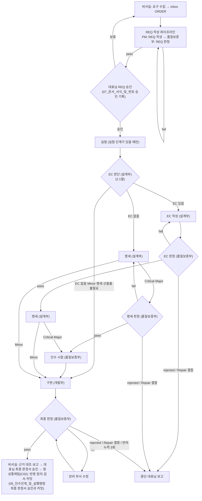

<!-- 생성물: 손으로 고치지 않는다. 원천은 Workflow/data/guide_layers.json이 고른 절이며 생성 명령은 build_guides.py다 -->

# 파트 지침 묶음: C01 지침 통합

# 부 지침: 비서실

<!-- 원천: AGENTS.md 「조직·구역과 권한 한계」 행: 「대표실」「비서실」 -->
| 부서 | 폴더 | 권한 한계 |
| :--- | :--- | :--- |
| 대표실 | `CEO/` | AI는 읽기만 한다 |
| 비서실 | `Departments/Secretariat/` | 비서실 세션은 코드·명세·REQ·EC·판정서를 쓰지 않고 부서 서브에이전트를 기동하지 않는다. 예외는 형상통제팀의 반영(최종 판정서 승인 뒤 C02, 지침 재생성 반영 C01)이다. PM은 REQ·체크리스트·실행 기록 등 `Workflow/02_부서_구조_및_작업구역` 「작업 구역」이 정한 경로에 쓰며, 코드·명세·판정서를 쓰지 않는다. 비서실과 PM의 정의는 `Workflow/01_표준_개요` 「용어」, 책무는 `Workflow/02_부서_구조_및_작업구역` 「비서실과 PM의 책무」를 따른다 |

<!-- 원천: Workflow/02_부서_구조_및_작업구역.md 「부서별 책임과 산출물」 행: 「비서실」 -->
| 부서 | 서브에이전트 | 책임 | 산출물 (부서 폴더 기준, 팀 폴더부터) |
| :--- | :--- | :--- | :--- |
| 비서실 | —(비서실 세션과 PM(실행 명령으로 기동한 Claude Code 메인 세션)은 서브에이전트가 아니다) | 비서실: ORDER 작성, 작업 큐 관리, 핫픽스 사전 승인과 핫픽스팀 세션 기동, 기획 트랙 수행, 조사 자료·브리핑 작성, 셸 작업 지시, 형상통제(최종 판정서 승인 뒤 반영·기준선 기록·커밋, 요청 커밋, 요청받은 푸시, 지침 통합(생성물 대조, 지침 재생성 반영, 전수 대응표 관리)과 프로세스 맵 관리, 형상 현황판). PM: REQ와 체크리스트 작성, 실행 기록 작성 | `PM/docs/requests/REQ-*`(PM), `PM/workspace/실행기록_REQ-*`(PM), `Secretary/assets/inbox/`(ORDER, 승인 기록, 요청 기록, 종결 기록), `Secretary/assets/queue/`(작업 큐, 비서실), `Secretary/assets/research/`(조사 자료, 비서실), `Secretary/assets/planning/`(아이디어 백로그·기획안, 비서실), `Secretary/assets/briefings/`(브리핑, 비서실), `Secretary/workspace/셸작업/`(셸 작업 지시·결과 파일, 비서실), `Secretary/workspace/연락/`(연락 파일. 시범이 끝난 기록), `ConfigControl/results/`(기준선 기록, 형상통제 기록, 형상통제팀), `ConfigControl/workspace/`(지침 재생성 작업, 형상통제팀) |

<!-- 원천: Workflow/02_부서_구조_및_작업구역.md 「비서실과 PM의 책무」 -->
### 2.1 비서실과 PM의 책무

| 주체 | 책무 |
| :--- | :--- |
| 비서실(비서팀 S01~S03, 형상통제팀 C01~C03) | ① (S01) 대표님과 대화해 요구를 모으고 `Departments/Secretariat/Secretary/assets/inbox/`에 ORDER를 작성한다. ORDER 머리말 `classification_proposal`에 분류를 제안한다(정의 기준은 `Workflow/03_라이프사이클` 「분류별 단계」). 모델 등급은 분류로 정해지므로 ORDER에 적지 않는다. ORDER를 발행하기 전에 작업 큐로 겹침과 충돌을 확인한다(⑯) ② (S01) PM 실행 명령을 전달한다. 셸을 실행할 수 있는 비서실 세션은 직접 실행하고, 실행할 수 없는 세션은 명령문 전문을 대표님께 제시하거나 셸 작업 지시 파일로 넘긴다(`Workflow/05_인수인계_및_실행명령` 「비서실 세션의 명령 전달 방식」) ③ (S03) 최종 판정서의 체크리스트 번호별 근거를 대조해 대표님께 보고한다. 보고에 대조할 승인 기록 경로와 결과서의 반영 대상 목록(반영 명령 표의 원본 경로와 삭제 대상)과 최종 판정서의 「삭제 대상」을 함께 적는다 ④ (S01) 핫픽스의 사전 승인을 대표님께 요청하고, 승인을 받으면 핫픽스팀(V03) 세션을 기동한다. 수정·검증·HOTFIX 작성은 V03이 한다(`Workflow/03_라이프사이클` 「핫픽스 트랙」) ⑤ (S01) 대표님에게서 직접 받은 승인 문구로 승인 기록을 남기고 승인 필드와 「결정」 열을 기재한다(`Workflow/07_문서_서식_및_번호` 「승인 기록」) ⑥ (S02) 외부 보고서(AUDIT)를 작성한다 ⑦ (C02) 형상통제팀은 최종 판정서 승인 뒤 적용본 반영·기준선 기록·정리·스테이징·커밋 전 검사·커밋을 한다(`Workflow/05_인수인계_및_실행명령` 「최종 판정서 승인과 커밋」) ⑧ (S02) 조사 자료를 `Departments/Secretariat/Secretary/assets/research/`에, 브리핑을 `Departments/Secretariat/Secretary/assets/briefings/`에 작성한다. 조사 자료의 이름과 머리말은 `Workflow/07_문서_서식_및_번호` 「문서 체계」·「머리말」을 따른다. 브리핑의 요건·종류·작성 시점은 `Workflow/05_인수인계_및_실행명령` 「브리핑」을 따른다 ⑨ (S01) 대표님이 아이디어 덤프·기획 단계·기획을 요청하면 기획 트랙을 수행한다(`Workflow/03_라이프사이클` 「기획 트랙」) ⑩ (C02) 형상통제팀은 대표님이 요청한 그 밖의 커밋(「요청 커밋」)과, 대표님이 따로 명시적으로 요청한 푸시를 한다(`Workflow/05_인수인계_및_실행명령` 1절 「커밋」·「푸시」 항) ⑪ (S01) 실험실(`Lab/`)을 관리한다(사용 승인과 정리. 절차는 `Workflow/03_라이프사이클` 「실험실」) ⑫ (S01) 운영부의 보안 점검 결과를 대표님께 보고한다(`Workflow/05_인수인계_및_실행명령` 「완료 보고」 8항) ⑬ REQ·HOTFIX를 끝내는 커밋을 하는 형상통제팀(C02)과, 커밋 없는 종결(흡수, 중단 뒤 종료)의 대표님 결정을 대표님에게서 직접 받은 비서실 세션(S01)은 종결 기록을 작성한다(`Workflow/07_문서_서식_및_번호` 「종결 기록」) ⑭ (S01) 원스톱 실행 명령을 안내하거나 실행하기 전에 착수 순서와 실행 중인 안건(클라우드 세션 포함)을 확인하고, 다른 안건과의 겹침으로 멈춘 REQ 작성 명령·REQ 새 버전 명령을 진행 중이던 안건이 끝난 뒤 다시 안내하거나 실행한다(`Workflow/03_라이프사이클` 「원스톱 착수 조건」·「다른 안건이 진행 중일 때의 REQ 작성」) ⑮ (C01·C03) 형상통제팀은 지침 통합과 프로세스 맵 관리(C01. `Workflow/03_라이프사이클` 「프로세스 맵」)와 형상 현황판(C03)을 맡는다. C01의 절차는 `Workflow/05_인수인계_및_실행명령` 「형상통제 절차」를 따르고, C03의 절차는 그 일을 정하는 뒤 안건이 정한다 ⑯ (S01) 작업 큐를 관리한다. ORDER·REQ의 처리 순서를 작업 큐에 적고, 새 ORDER 발행이나 순서 변경 전에 작업 큐로 겹침과 충돌을 확인한다(`Workflow/05_인수인계_및_실행명령` 「작업 큐」) |
| PM(비서실 PM팀 P01·P02. 실행 명령으로 기동한 Claude Code 메인 세션) | ① ORDER로 REQ와 체크리스트를 작성하고 분류를 REQ 머리말 `classification:`에 확정하고, 그 근거와(ORDER 제안과 다르면) 다른 사유를 REQ에 적는다(`Workflow/03_라이프사이클` 「REQ 작성 파이프라인」 1항 「분류 근거」). REQ를 처음 작성할 때 ORDER 머리말 `related_req`에 그 REQ 이름을 더한다(`Workflow/03_라이프사이클` 「REQ 작성 파이프라인」) ② REQ 작성 파이프라인과 원스톱 파이프라인을 지휘한다. 서브에이전트를 단계마다 정해진 모델로(`Workflow/04_모델_운용` 「단계별 모델」) 순서대로 기동·인계하고 진행 상태를 보고한다 ③ REQ 판정 `fail` 때와, 최종 판정 반려 누적 뒤 대표님이 격상이나 모델·effort 승인을 정했을 때(`Workflow/03_라이프사이클` 「반려와 격상」) REQ 새 버전을 작성한다 ④ 안건마다 실행 기록을 작성한다(`Workflow/05_인수인계_및_실행명령` 「PM 실행 기록」) ⑤ 대표님 요청으로 REQ·HOTFIX를 끝내는 커밋을 하면 그 안건의 종결 기록을 작성한다(`Workflow/07_문서_서식_및_번호` 「종결 기록」) ⑥ REQ 작성 명령·REQ 새 버전 명령으로 기동되면 REQ 파일을 저장하기 전에 다른 안건과의 겹침을, 원스톱 실행 명령으로 기동되면 첫 단계 전에 착수 조건을 판단한다(`Workflow/03_라이프사이클` 「다른 안건이 진행 중일 때의 REQ 작성」·「원스톱 착수 조건」) |

- 비서실은 ORDER, 작업 큐(4절), 승인 기록, 요청 기록(4절), 종결 기록(4절), 승인 필드와 「결정」 열(4절), 외부 보고서, 조사 자료, 아이디어 백로그, 기획안, 브리핑(4절), 최종 판정서 승인 뒤 형상통제팀(C02)의 반영 명령 대상(거버넌스 파일 포함)과 정리 대상(4절), 실험실(`Lab/`)(4절), 셸 작업 지시·결과 파일(4절), 형상통제팀의 형상통제 기록·기준선 기록과 지침 재생성 반영 대상(4절) 외에는 저장소 파일을 수정하지 않는다. 비서실의 외부 보고서는 외부감사실(`Audits/`)에 둔다. PM이 수정할 수 있는 경로는 4절을 따른다.
- 비서실 세션의 능력과 경계: 셸이 필요한 절차는 셸을 실행할 수 있는 비서실 세션이, 저장소 파일 수정이 필요한 절차는 저장소 파일을 수정할 수 있는 비서실 세션이 맡고, 형상통제팀(C01~C03)은 두 가지를 모두 할 수 있는 비서실 세션이 맡는다. 능력의 확인과 능력이 없을 때의 처리는 `Workflow/05_인수인계_및_실행명령` 「공통 규칙」 11항을 따른다. 비서실 세션은 셸을 실행할 수 있어도 PM·부서의 일(REQ·EC·명세·코드·판정서 작성, 부서 서브에이전트 기동)과 핫픽스팀(V03)의 일(핫픽스 대상 파일 수정, HOTFIX 작성)을 직접 하지 않고, PM 지시문이나 핫픽스 실행 명령을 실행해 별도 세션에 맡긴다.
- 비서실이 저장소나 셸에서 하는 작업의 공통 규칙과 고정 절차, 비서실의 여러 세션을 함께 쓸 때의 담당과 기록은 `Workflow/05_인수인계_및_실행명령` 「비서실 실행 절차」를 따른다.
- 승인 필드(`approved:`, `confirmed:`)와 REQ 「결정」 열의 기재 주체와 방법은 `Workflow/07_문서_서식_및_번호` 「승인 기록」을 따른다.

<!-- 원천: Workflow/02_부서_구조_및_작업구역.md 「조직 표」 -->
### 2.2 조직 표

부·팀·파트의 이름, 코드, 팀 폴더 이름, 주요 업무, 상태는 이 절이 원천이다.

- **명명 규칙**: 「실」은 대표실과 비서실에만 쓰고, 그 밖의 부는 「○○부」로 쓴다. 모든 파트는 팀에 속한다(예외 X01). 팀 이름은 맡는 일로 짓고 부 이름과 같은 이름을 쓰지 않는다(예외: 비서실 비서팀). 파트 이름은 업무를 나타내는 명사구 하나다. 코드는 부 머리글자(설계부 E, 개발부 V, 품질보증부 Q, 운영부 O, 마케팅부 M. 비서실은 팀 머리글자 S·P·C, 실험은 X)와 두 자리 번호이며, 폐지한 코드는 다시 쓰지 않는다.

- **팀 폴더 이름**: 팀의 영문 이름이며, 부서 폴더처럼 영문 대문자로 시작하는 단어를 이어 쓴다. 디자인팀은 부서 폴더 `Design`과 헷갈리지 않게 `VisualDesign`으로 한다. 폴더 구조는 3절을 따른다.

| 부 | 팀 | 팀 폴더 | 코드 | 파트 | 주요 업무 | 상태 |
| :--- | :--- | :--- | :---: | :--- | :--- | :---: |
| 비서실 | 비서팀 | `Secretary` | S01 | 요청 접수 | 요구 수집, ORDER 작성, 분류 제안, 작업 큐 관리, PM 실행 명령 전달과 PM 기동, 승인 기록, 핫픽스 사전 승인 요청과 핫픽스팀 세션 기동, 셸 작업 지시, 기획 트랙, 실험실 관리, 보안 점검 결과 보고 | 활성 |
| 비서실 | 비서팀 | `Secretary` | S02 | 조사 보고 | 조사 자료, 브리핑, 외부 보고서 | 활성 |
| 비서실 | 비서팀 | `Secretary` | S03 | 최종 판정 보고 | 최종 판정서의 체크리스트 번호별 근거 대조와 대표님 보고 | 활성 |
| 비서실 | PM팀 | `PM` | P01 | REQ 작성 | REQ와 체크리스트 작성, 분류 확정, REQ 판정 기동, REQ 새 버전 | 활성 |
| 비서실 | PM팀 | `PM` | P02 | 실행 지휘 | 원스톱 파이프라인 지휘, 중단 판단, 실행 기록 | 활성 |
| 비서실 | 형상통제팀 | `ConfigControl` | C01 | 지침 통합 | 나뉜 지침과 원천(매뉴얼 절)의 대조, 지침 재생성 반영, 누락·중복 검사, 기준선 기록, 전수 대응표 관리, 프로세스 맵 관리(`Workflow/03_라이프사이클` 「프로세스 맵」). 생성·대조 절차는 `Workflow/05_인수인계_및_실행명령` 「형상통제 절차」 | 활성 |
| 비서실 | 형상통제팀 | `ConfigControl` | C02 | 저장소 반영 | 고정 절차 「최종 승인 커밋」(적용본 반영·기준선 기록·정리 포함), 「요청 커밋」, 「요청 푸시」 | 활성 |
| 비서실 | 형상통제팀 | `ConfigControl` | C03 | 형상 현황판 | 대시보드 생성, 지표 집계. 절차는 그 일을 정하는 뒤 안건이 정한다 | 활성 |
| 설계부 | EC팀 | `EC` | E01 | EC 판단 | EC 필요 여부 판단(모든 안건) | 활성 |
| 설계부 | EC팀 | `EC` | E02 | EC 작성 | EC 작성, 재작업 | 활성 |
| 설계부 | 명세팀 | `Spec` | E03 | 거버넌스 명세 작성 | 매뉴얼·규정의 거버넌스 적용본 | 활성 |
| 설계부 | 명세팀 | `Spec` | E04 | 제품 명세 작성 | PRD·TAD, 콘텐츠 스토리보드 | 대기 |
| 개발부 | 구현팀 | `Implementation` | V01 | 구현 | 구현과 테스트, 명세 대조, 적용본(스크립트·설정), 리팩토링 | 활성 |
| 개발부 | 구현팀 | `Implementation` | V02 | 제품 화면 구현 | 시각 디자인 문서를 따르는 화면 구현 | 대기 |
| 개발부 | 핫픽스팀 | `Hotfix` | V03 | 핫픽스 | 기존 기능의 결함·오탈자 수정, 검증, HOTFIX 작성 | 활성 |
| 품질보증부 | 판정팀 | `Review` | Q01 | REQ 판정 | REQ 판정·재판정, 문체 반영본 대조 | 활성 |
| 품질보증부 | 판정팀 | `Review` | Q02 | EC 판정 | EC 판정·재판정 | 활성 |
| 품질보증부 | 판정팀 | `Review` | Q03 | 명세 판정 | Critical·Major의 「EC 없음」 안건 명세 판정 | 활성 |
| 품질보증부 | 판정팀 | `Review` | Q04 | 시각 디자인 판정 | 시각 디자인 문서(`DESIGN.md`)의 판정 | 대기 |
| 품질보증부 | 판정팀 | `Review` | Q05 | 최종 판정 | 최종 판정, 인수 시험 재실행과 해시 대조 | 활성 |
| 품질보증부 | 부적합관리팀 | `Nonconformance` | Q06 | 중단 부적합 기록 | 판정 없이 멈춘 중단(중단 조건 1·5·6·8)의 부적합 기록과 표준 개정 제안 | 활성 |
| 품질보증부 | 시험팀 | `Test` | Q07 | 인수 시험 | 시험실 업무(인수 시험 작성, 구현 전 실행, 인수 시험 수정) | 활성 |
| 운영부 | 배포팀 | `Release` | O01 | 운영 배포 | 런타임 파라미터, 배포 묶음, 운영 기록 | 대기 |
| 운영부 | 보안팀 | `Security` | O02 | 보안 점검 | 보안 정책 점검, 키 보관 위치·교체 절차 관리, 정기 점검 | 대기 |
| 마케팅부 | 디자인팀 | `VisualDesign` | M01 | 시각 디자인 | 브랜드 자산과 화면의 시각 규칙, 시각 디자인 문서 | 대기 |
| 마케팅부 | 콘텐츠팀 | `Content` | M02 | 콘텐츠 기획 | 콘텐츠 전략, 기획안 | 대기 |
| 마케팅부 | 콘텐츠팀 | `Content` | M03 | 콘텐츠 제작 | 영상, 그래픽, 카피 제작 | 대기 |
| 마케팅부 | 홍보팀 | `Promotion` | M04 | 홍보 | 홍보 자산 | 대기 |
| (실행마다 정해짐) | — | — | X01 | 실험 | 실험 단계(REQ가 정한 부가 맡는다. `Workflow/03_라이프사이클` 「실험 단계」) | 활성 |

- **집계**: 6부(비서실, 설계부, 개발부, 품질보증부, 운영부, 마케팅부), 15팀(비서팀, PM팀, 형상통제팀, EC팀, 명세팀, 구현팀, 핫픽스팀, 판정팀, 부적합관리팀, 시험팀, 배포팀, 보안팀, 디자인팀, 콘텐츠팀, 홍보팀), 29파트(활성 20, 대기 9)다. 대표실은 부가 아니다.
- **상태**: 활성은 지금 이 저장소의 절차에서 일을 맡는 파트이고, 대기는 지금 맡은 일이 없는 파트다. 대기 파트의 일이 생기면 그 안건에서 활성 파트와 같이 처리한다. 상태를 바꾸려면 이 표를 고치는 안건으로 한다.
- **파트의 일을 맡는 세션**: 비서팀·형상통제팀 파트는 비서실 세션이, PM팀 파트는 PM이 맡는다. 핫픽스팀(V03)은 핫픽스 실행 명령으로 기동한 세션이 맡는다(`Workflow/03_라이프사이클` 「핫픽스 트랙」). 서브에이전트 파트(E01, E02, E03, V01, Q01, Q02, Q03, Q05, Q06, Q07, X01)는 파트 카드가, 대기 파트는 그 부의 서브에이전트(2절 표의 서브에이전트 칸)가 맡는다. 세션마다 싣고 읽는 지침은 `Workflow/04_모델_운용` 「계층형 지침」을 따른다.

<!-- 원천: Workflow/02_부서_구조_및_작업구역.md 「팀 폴더와 공통 하위폴더」 -->
## 3. 팀 폴더와 공통 하위폴더

부서 폴더(`Departments/<부>/`) 아래에 팀 폴더(2.2절 「팀 폴더」 열)를 두어 「부 → 팀」 두 단계로 나눈다. 팀 폴더 안에는 공통 하위 폴더 `docs/`(정제된 문서: 기획서, 명세, 안건), `assets/`(실제 자산: 코드, 테스트, 스크립트, 파라미터, 조사 자료), `results/`(공식 결과서와 판정서), `workspace/`(중간 산출물, 메모, 거버넌스 적용본) 가운데 그 팀이 쓰는 것만 둔다. 파트 폴더는 두지 않는다. 한 파트만 계속 쓰는 자산은 팀 폴더 아래 용도 이름의 하위 폴더에 둔다(예: `Departments/Quality/Test/assets/acceptance/`). 대기 팀 폴더는 만들지 않고 그 팀의 파트를 활성으로 바꾸는 안건에서 만든다. 활성 파트가 있는 팀이 없는 운영부·마케팅부는 부서 폴더 바로 아래 `.gitkeep` 하나만 둔다. 지금 활성 팀 폴더와 하위 폴더는 아래와 같다.

```text
Departments/
├── Secretariat/
│   ├── Secretary/        # 비서팀(S01~S03)
│   │   ├── assets/inbox/      # ORDER, 승인 기록, 요청 기록, 종결 기록, 요구 메모
│   │   ├── assets/research/   # 조사 자료
│   │   ├── assets/planning/   # 아이디어 백로그, 기획안
│   │   ├── assets/briefings/  # 브리핑
│   │   ├── assets/queue/      # 작업 큐
│   │   ├── workspace/연락/    # 연락 파일(기록)
│   │   └── workspace/셸작업/  # 셸 작업 지시·결과 파일
│   ├── PM/               # PM팀(P01·P02)
│   │   ├── docs/requests/     # REQ
│   │   └── workspace/         # PM 실행 기록
│   └── ConfigControl/    # 형상통제팀(C01~C03). 두 하위 폴더는 첫 기록 때 생기며 그 전에는 .gitkeep만
│       ├── results/           # 기준선 기록, 형상통제 기록
│       └── workspace/         # 지침 재생성 작업
├── Design/
│   ├── EC/               # EC팀(E01·E02)
│   │   ├── docs/              # EC
│   │   ├── results/           # 설계부 결과서(RPT)
│   │   └── workspace/
│   └── Spec/             # 명세팀(E03·E04)
│       ├── docs/prd/, docs/tad/   # PRD·TAD
│       ├── assets/live/           # 설계 파라미터
│       └── workspace/             # 설계부 거버넌스 적용본
├── Development/
│   ├── Implementation/   # 구현팀(V01·V02)
│   │   ├── assets/scripts/    # 커밋 전 검사 등 검사·준비 명령, 검사 장치 대장(거버넌스 구역)
│   │   ├── assets/src/, assets/tests/
│   │   ├── results/           # 개발부 결과서(DEV)
│   │   └── workspace/         # 개발부 거버넌스 적용본, 일회성 파일
│   └── Hotfix/           # 핫픽스팀(V03)
│       └── results/           # HOTFIX
├── Quality/
│   ├── Review/           # 판정팀(Q01~Q05)
│   │   ├── results/           # 판정서(RES)
│   │   └── workspace/
│   ├── Nonconformance/   # 부적합관리팀(Q06)
│   │   └── docs/              # 부적합 기록(NCR)
│   └── Test/             # 시험팀(Q07)
│       ├── assets/acceptance/ # 인수 시험
│       └── results/           # 인수 시험 절차서(ACC)
├── Operations/.gitkeep   # 대기 팀만 있음(배포팀 Release, 보안팀 Security)
└── Marketing/.gitkeep    # 대기 팀만 있음(디자인팀 VisualDesign, 콘텐츠팀 Content, 홍보팀 Promotion)
```

- 결과서는 번호 묶음(버전)이 한 폴더에 있어야 「가장 높은 번호가 현행본」이 성립하므로 기록 종류마다 한 폴더를 둔다. 설계부 결과서는 모든 안건의 첫 버전을 EC 판단(E01)이 만들므로 `Departments/Design/EC/results/`에 두고 명세(E03)가 다음 버전을 같은 폴더에 쓴다. 개발부 결과서는 실험(X01)과 구현(V01)이 함께 `Departments/Development/Implementation/results/`에 쓴다. 대기 팀의 결과서 위치는 그 단계를 맡은 파트의 팀 `results/`다(`Departments/<부>/<팀>/results/`. 예: 보안 점검 결과서는 `Departments/Operations/Security/results/`, 시각 디자인 단계의 마케팅부 결과서는 `Departments/Marketing/VisualDesign/results/`). 시각 디자인 문서는 `Departments/Marketing/VisualDesign/docs/DESIGN.md`, 런타임 파라미터는 `Departments/Operations/Release/assets/live/`에 둔다.
- 요청 기록·종결 기록은 형상통제팀(C02)·PM이 쓰지만 비서팀 `assets/inbox/`에 둔다. 종결 기록을 읽는 위치(커밋 전 검사와 `Workflow/03_라이프사이클` 「다른 안건이 진행 중일 때의 REQ 작성」 4항)와 판정 전제 제외 범위를 한 폴더로 두기 위해서다. 쓰기 권한은 4절 표가 정한다.

빈 폴더는 `.gitkeep`으로 유지한다. 비서팀 `assets/`에는 바로 아래에 파일을 두지 않고 하위 폴더(`inbox/`, `research/`, `planning/`, `briefings/`, `queue/`)에만 둔다. 최종 산출물은 팀 폴더의 `docs/`, `assets/`, `results/`에만 둔다.

<!-- 원천: Workflow/02_부서_구조_및_작업구역.md 「작업 구역」 -->
## 4. 작업 구역

파트는 2.2절의 코드다. 파트의 일을 맡는 세션은 2.2절 「파트의 일을 맡는 세션」을 따른다. 이 표를 지키는지는 REQ `scope:` 대조(`Workflow/06_통제장치_및_배포` 「커밋 전 검사」), PM의 단계별 확인(`Workflow/03_라이프사이클` 「원스톱 파이프라인」 4항), 판정의 범위 대조(`Workflow/03_라이프사이클` 「단계별 통과 조건과 판정 기준」 최종 판정 기준 2)로 본다. 커밋 전 검사는 작성 주체를 대조하지 않으므로, 같은 `scope:` 안에서 다른 부서·팀·파트의 위치에 쓴 파일은 기계가 잡지 않는다.

| 구분 | 수정할 수 있는 경로 | 수정 주체(파트) |
| :--- | :--- | :--- |
| ORDER(REQ 승인 전) | `Departments/Secretariat/Secretary/assets/inbox/`(ORDER) | S01(그 ORDER의 담당 세션. `Workflow/05_인수인계_및_실행명령` 「비서실 동시 운용」) |
| 작업 큐 | `Departments/Secretariat/Secretary/assets/queue/`(작업 큐. `Workflow/05_인수인계_및_실행명령` 「작업 큐」) | S01 |
| 조사 자료·브리핑 | `Departments/Secretariat/Secretary/assets/research/`, `Departments/Secretariat/Secretary/assets/briefings/` | S02 |
| 기획 자료 | `Departments/Secretariat/Secretary/assets/planning/`(아이디어 백로그, 기획안) | S01 |
| 승인 기재 | `Departments/Secretariat/Secretary/assets/inbox/`(승인 기록), 대상 REQ의 승인 필드와 「결정」 열, 대상 HOTFIX의 `confirmed:`(`Workflow/07_문서_서식_및_번호` 「승인 기록」) | S01 |
| 요청 기록 | `Departments/Secretariat/Secretary/assets/inbox/`(요청 기록. `Workflow/05_인수인계_및_실행명령` 「비서실 실행 절차」의 「요청 커밋」) | C02 |
| 종결 기록 | `Departments/Secretariat/Secretary/assets/inbox/`(종결 기록. `Workflow/07_문서_서식_및_번호` 「종결 기록」) | 그 안건을 끝내는 커밋을 하는 C02·P02. 커밋 없이 끝난 안건은 대표님 결정을 받은 S01 |
| 셸 작업 지시 | `Departments/Secretariat/Secretary/workspace/셸작업/`(지시 파일, 결과 파일. `Workflow/05_인수인계_및_실행명령` 「셸 작업 지시」) | 지시 파일은 S01(저장소 파일을 수정할 수 있는 비서실 세션), 결과 파일은 그 지시를 처리한 비서실 세션(S01·C02. 예외는 `Workflow/05_인수인계_및_실행명령` 「셸 작업 지시」 7항) |
| 연락 기록 | `Departments/Secretariat/Secretary/workspace/연락/` | 없음(시범이 끝난 기록이며 새로 쓰지 않는다) |
| REQ 작성 | `Departments/Secretariat/PM/docs/requests/`, `Departments/Secretariat/PM/workspace/`, ORDER 머리말 `related_req` 필드 | P01(REQ 승인 전. 승인된 REQ의 새 버전도 그 버전의 승인 전에 쓴다) |
| 실행 기록 | `Departments/Secretariat/PM/workspace/실행기록_REQ-*.md`(`Workflow/05_인수인계_및_실행명령` 「PM 실행 기록」) | P01(만들 때)·P02(REQ 승인 전과 뒤) |
| REQ 판정 | `Departments/Quality/Review/results/`(REQ 판정서), `Departments/Quality/Review/workspace/` | Q01(REQ 승인 전) |
| 판정 | `Departments/Quality/Review/results/`, `Departments/Quality/Review/workspace/` | Q02~Q05(REQ 승인 뒤) |
| 부적합 기록 | `Departments/Quality/Nonconformance/docs/`(REQ 승인 전과 뒤) | Q01~Q06(판정 `fail`·`rejected`의 기록은 그 판정 파트, 판정 없는 중단의 기록은 Q06) |
| 인수 시험 | `Departments/Quality/Test/assets/acceptance/`, `Departments/Quality/Test/results/`(ACC), `Departments/Quality/Test/workspace/` | Q07(REQ 승인 뒤의 인수 시험 단계와 인수 시험 수정) |
| EC 판단 | `Departments/Design/EC/results/`(설계부 결과서) | E01 |
| EC 작성 | `Departments/Design/EC/docs/`(EC), `Departments/Design/EC/workspace/` | E02 |
| 명세 | `Departments/Design/Spec/workspace/`(적용본), `Departments/Design/Spec/docs/`·`Departments/Design/Spec/assets/`(PRD·TAD·설계 파라미터. REQ `scope:` 안), `Departments/Design/EC/results/`(설계부 결과서 다음 버전), 명세 단계의 EC 머리말 `status:`·`gate:` | E03·E04 |
| 구현 | REQ `scope:` 가운데 구현 단계의 경로(거버넌스 파일 제외), `Departments/Development/Implementation/results/`, `Departments/Development/Implementation/workspace/` | V01·V02 |
| 실험 | REQ `scope:`의 `Lab/` 실험 폴더, 실험을 맡은 부의 결과서 위치(설계부 `Departments/Design/EC/results/`, 개발부 `Departments/Development/Implementation/results/`, 운영부·마케팅부는 그 부의 결과서 위치) | X01 |
| 핫픽스 | 대표님이 사전 승인한 대상 파일(`deny` 경로 제외. `Workflow/06_통제장치_및_배포` 「비서실·핫픽스 세션의 권한」)과 `Departments/Development/Hotfix/results/`(HOTFIX) | V03 |
| 운영부(대기) | `Departments/Operations/Release/`(O01), `Departments/Operations/Security/`(O02) 아래 REQ `scope:` 안의 경로와 그 팀의 `results/`·`workspace/` | O01·O02 |
| 마케팅부(대기) | `Departments/Marketing/VisualDesign/`(M01), `Departments/Marketing/Content/`(M02·M03), `Departments/Marketing/Promotion/`(M04) 아래 REQ `scope:` 안의 경로와 그 팀의 `results/`·`workspace/` | M01~M04 |
| 최종 승인 뒤 반영 | 최종 판정서를 받은 결과서의 반영 명령 대상과 삭제 대상, 승인받은 최종 판정서의 「삭제 대상」, 기준선 기록(`Departments/Secretariat/ConfigControl/results/`)(`Workflow/05_인수인계_및_실행명령` 「최종 판정서 승인과 커밋」) | C02 |
| 형상통제 | `Departments/Secretariat/ConfigControl/workspace/`(지침 재생성 작업), `Departments/Secretariat/ConfigControl/results/`(기준선 기록, 형상통제 기록), 지침 재생성 반영 대상(`.claude/guides/**`, `.claude/agents/part-*.md`. 대표님 승인 뒤 원천과 일치하는 생성물만. `Workflow/05_인수인계_및_실행명령` 「형상통제 절차」) | C01(기준선 기록은 「최종 승인 뒤 반영」 행의 C02도) |
| 외부감사실 | `Audits/` | S02(비서실 세션)나 저장소 밖 세션 |
| 실험실 | `Lab/` 아래 실험 폴더 | 대표님, 비서실, 비서실 승인을 받은 조직. 승인 주체·범위·기록과 파이프라인 안의 실험 단계는 `Workflow/03_라이프사이클` 「실험실」 |
| 대표님 전용 | `CEO/`, 거버넌스 파일(「최종 승인 뒤 반영」 행과 「형상통제」 행의 지침 재생성 반영 대상 제외), `_archive/` | 대표님 |

- 커밋 전 검사가 scope 대조에서 빼는 경로는 이 표와 별개의 구현 목록이며, 원천은 `check_standard.py`다(`Workflow/06_통제장치_및_배포` 「커밋 전 검사」).

<!-- 원천: Workflow/03_라이프사이클.md 「전체 흐름」 -->
## 1. 전체 흐름



대표님은 REQ 승인과 최종 승인 두 시점에만 개입한다. 그 사이는 「중단 조건」에 해당할 때만 멈춘다. ORDER는 기획 트랙(10절)에서 대표님이 Go로 정한 기획안에서 발행될 수도 있다. 기획 트랙의 대표님 결정은 ORDER 발행 전의 일이며 이 흐름의 개입 시점이 아니다.

시각 디자인 문서를 처음 만들거나 바꾸는 안건은 명세(명세 판정이 있으면 그 뒤)와 인수 시험(Minor는 구현) 사이에 시각 디자인과 시각 디자인 판정을 거친다(5.5절). 선택 단계이므로 흐름도에는 그리지 않는다.

<!-- 원천: Workflow/04_모델_운용.md 「모델 메타데이터 기록」 -->
## 4. 모델 메타데이터 기록

공식 문서(REQ, EC, DEV, RES, HOTFIX)의 머리말에 작성하거나 판정한 모델과 effort를 아래 기준으로 적는다.

- **모델**: 확인할 수 없으면 `"확인 불가"`로 적는다. 단, RES의 `auditor.model`에는 `"확인 불가"`를 적지 않는다. 판정서를 작성하는 세션이 자기 실행 모델을 확인할 수 없으면 판정서를 발행하지 않고 오케스트레이터에 보고한다.
- **effort(REQ, EC, DEV, RES, HOTFIX)**: 실행 명령 지시문의 effort 값을 출처와 함께 `"<값> (실행 명령 기준)"`으로 적는다(예: `"medium (실행 명령 기준)"`). PM은 자기 지시문의 표기(`Workflow/05_인수인계_및_실행명령` 「실행 명령」), 서브에이전트는 PM 지시문의 표기(3절 1항), 핫픽스팀(V03)은 핫픽스 실행 명령 지시문의 표기를 출처로 쓴다. 출처에서 값을 얻을 수 없을 때만 `"확인 불가"`로 적는다.
- **기준 모델·effort**: 판정서는 9절 「기준 모델·effort」에 판정 지시문의 유효 값 표(3절 1항)와 판정 세션 자신의 실행 모델·effort를 적고, 하향 확인을 거친 칸(1.4절 4항)이 있으면 그 칸과 확인 시각을 따로 적는다. HOTFIX는 1절 「기준 모델·effort」 항에 V03 칸 「분류 없음」의 유효 값과 출처, CEO 설정 `saved_at`을 적는다. 판정이 없는 커밋(최종 승인 커밋, 요청 커밋, PM 커밋)은 커밋 메시지 근거 줄 `Model-Effort`에 커밋한 세션의 모델과 effort를 남긴다(`Workflow/07_문서_서식_및_번호` 「번호와 버전」의 「커밋 메시지」).
- **`REQ-031` 커밋 전의 HOTFIX**: 비서실이 실행 명령 없이 작성했으므로 실제 적용한 effort를 적었다. 고치지 않는다.

```yaml
author:            # RES는 auditor:
  agent: "Design"
  model: "Claude Opus 5.5"
  effort: "medium (실행 명령 기준)"
```

<!-- 원천: Workflow/05_인수인계_및_실행명령.md 「인수인계 순서」 -->
## 1. 인수인계 순서

```text
① 비서실: 대표님과 대화해 요구를 모으고 Departments/Secretariat/Secretary/assets/inbox/에 ORDER 작성
② 비서실: 「REQ 작성 명령」 안내 또는 실행
③ PM(실행 명령으로 기동한 Claude Code 메인 세션): REQ 작성 → REQ 판정 → REQ 경로와 판정서 경로 보고
④ 비서실: REQ 승인 브리핑 작성(6절) → 대표님: REQ와 승인 브리핑 확인 → 승인(직접 기재 또는 채팅 승인, Workflow/07_문서_서식_및_번호 「승인 기록」)
⑤ 비서실: 「원스톱 실행 명령」 안내 또는 실행
⑥ PM(실행 명령으로 기동한 Claude Code 메인 세션): workflow: 끝까지 무인 진행 → 최종 판정서 경로 보고
⑦ 비서실: 최종 판정서의 체크리스트 번호별 근거를 대조해 대표님께 보고(승인 기록 경로, 반영 대상 목록과 삭제 대상 목록(결과서와 최종 판정서), 승인 브리핑 경로 포함)
⑧ 대표님: 최종 판정서와 git diff 확인, 대리 기재된 승인 필드 대조 → 최종 판정서 승인
⑨ 형상통제팀(C02): 1.1절대로 적용본 반영 → 정리 → 스테이징 → 커밋 전 검사 → 커밋 → 완료 보고
```

- **커밋**: 최종 판정서 승인 뒤의 커밋은 1.1절을 따른다. 그 밖의 커밋은 아래와 같다. 대표님이 저장소 루트에서 직접 `git add`와 `git commit -m "<메시지>"`를 실행하거나, 형상통제팀(C02)이나 PM에 커밋을 명시적으로 요청한다. 메시지 형식은 `Workflow/07_문서_서식_및_번호` 「번호와 버전」을 따른다. 커밋 전 검사가 실패하면 원인을 해결한 뒤 다시 커밋한다. 비밀정보 검출로 실패하면 `Workflow/06_통제장치_및_배포` 「비밀정보 검출」 항대로 처리한다. 형상통제팀(C02)이 하는 커밋은 8절 「요청 커밋」 절차를 따른다. REQ·HOTFIX를 끝내는 커밋에는 그 안건의 종결 기록을 함께 넣는다(`Workflow/07_문서_서식_및_번호` 「종결 기록」). 판정 전제(`AGENTS.md` 「불변 원칙」 5항의 최종 판정 `pass`와 대표님 최종 승인)에서 제외하는 커밋은 아래뿐이다.
  - ① REQ 없이 대표님이 직접 수정한 거버넌스 파일·`CEO/`·`_archive/`의 커밋
  - ② 대표님 직접 지시로 형상통제팀(C02)이 하는 `Audits/`·`Departments/Secretariat/Secretary/assets/`·`Departments/Secretariat/Secretary/workspace/연락/`·`Departments/Secretariat/Secretary/workspace/셸작업/` 변경 커밋
  - ③ 대표님 요청으로 형상통제팀(C02)이 하는 `Lab/` 변경만 담은 커밋
  - ④ 형상통제팀의 지침 재생성 반영 커밋(8.8절 1항 ⑥)
  - ⑤ 형상통제팀 기록(`Departments/Secretariat/ConfigControl/results/`)만 담은 커밋
- **푸시**: 대표님이 따로 명시적으로 요청한 푸시는 형상통제팀(C02)이 한다. 셸을 실행할 수 없는 비서실 세션은 「요청 푸시」 호출 문구를 셸 작업 지시 파일(8.6절)로 남기거나 명령문을 대표님께 제시한다. 1.1절의 최종 판정서 승인 뒤 커밋 절차에는 푸시를 넣지 않는다. 형상통제팀(C02)이 하는 푸시는 8절 「요청 푸시」 절차를 따른다.
- 실행 위치는 저장소 루트다. 루트 밖에서 실행하면 `CLAUDE.md`와 `.claude/` 설정이 적용되지 않는다.
- 파이프라인이 중단 조건으로 멈추면 대표님이 결정한 뒤 같은 명령을 다시 실행한다. 다른 안건과의 겹침이나 착수 조건으로 멈춘 경우(`Workflow/03_라이프사이클` 「중단 조건」 11·12항)의 다시 실행은 같은 문서 「다른 안건이 진행 중일 때의 REQ 작성」·「원스톱 착수 조건」을 따른다. 오케스트레이터는 기존 산출물(각 문서의 최신 버전과 머리말 `status:`, `result:`)로 진행 위치를 판단해 이어서 진행한다.
- 공식 진행 상태는 각 단계 산출물과 종결 기록(`Workflow/07_문서_서식_및_번호` 「종결 기록」)으로만 판단한다. 안건이 끝났는지는 커밋된 종결 기록으로 판단한다. 비서실의 메모와 대화는 근거로 쓰지 않는다. PM 실행 기록(7절)도 근거로 쓰지 않는다.

### 1.1 최종 판정서 승인과 커밋

형상통제팀(C02)의 실행 순서·예외·보고는 8절 「최종 승인 커밋」 절차를 따른다.

1. **원칙**: 대표님이 최종 판정서(`RES-xxx_vNN`)를 승인하면 형상통제팀(C02)이 커밋까지 진행한다. 승인 문구를 커밋의 명시적 요청으로 보고, 결과서 반영 명령 표의 덮어쓰기·삭제 승인과 그 최종 판정서 「삭제 대상」 목록의 삭제 승인으로도 본다. 푸시는 이 절차에 넣지 않고 대표님이 따로 정한다. PM은 이 절차에서 커밋하지 않는다.
2. **문구를 받은 세션과 승인 기록**: 문구를 대표님에게서 직접 받은 비서실 세션이 승인 기록을 작성한다(`Workflow/07_문서_서식_및_번호` 「승인 기록」). 커밋은 형상통제팀(C02)이 한다. 문구를 직접 받은 세션이 셸을 실행하고 저장소 파일을 수정할 수 있으면 그 세션이 C02로서 이어서 한다. 그런 세션이 아니면 승인 기록만 남기고 커밋하지 않으며, 「최종 승인 커밋」 호출 문구를 셸 작업 지시 파일(8.6절)로 남기거나 대표님께 드리거나 1절 「커밋」 항의 다른 경로를 쓴다. 지시 파일에는 승인 문구를 넣지 않으므로, 대표님은 그 지시를 처리하는 C02 세션에 승인 문구를 직접 입력한다(8.6절).
3. **「문체 반영」**: 승인 문구에 「문체 반영」이 있으면 원스톱 실행 명령을 다시 실행해 `Workflow/03_라이프사이클` 「판정 지적의 구분과 문체 지적 처리」 5항을 마치고, 대조 `pass`를 확인한 뒤 4번으로 간다. 대표님 재승인은 받지 않는다.
4. **적용본 반영**: 최종 판정을 받은 결과서(RPT·DEV)의 반영 명령대로 반영한다. 반영 명령에는 파일 전체 적용본의 복사와 변경 파일 적용본의 반영(`apply_delta.py --write`. `Workflow/06_통제장치_및_배포` 「생성·반영 명령」)이 있다. 3번의 대조를 거쳤으면 대조 `pass`를 받은 최신 버전 결과서의 반영 명령(새 적용본 폴더)대로 반영한다. 반영 전에 원본마다 `git diff --stat <기준 커밋> HEAD -- <원본 경로>`가 비어 있는지 확인한다. 기준 커밋은 결과서에 적힌 값이다(`Workflow/06_통제장치_및_배포` 「거버넌스 파일 개정 절차」 2항). 비어 있지 않으면 반영하지 않고 5절의 상세 보고를 한다. 반영 전에 `prepare_final_commit.py`를 실행해 반영 목록과 삭제 목록을 얻는다(`Workflow/06_통제장치_및_배포` 「준비·판단 명령」). 형상통제팀(C02)은 그 반영 목록과 삭제 목록을 그대로 쓰고, 명령이 실패하거나 실행되지 않으면 손으로 대신하지 않고 멈춰 5절의 상세 보고를 한다. 반영을 마친 뒤 6번 스테이징 앞에, 반영한 변경에 원천(계층 구성표, 구성표가 고른 원천 문서, `Workflow/02_부서_구조_및_작업구역` 「조직 표」, 프로세스 맵)이나 생성물이 있으면 8.8절 2항대로 기준선 기록을 남긴다. 기준선 기록 명령이 실패하면 멈춰 5절의 상세 보고를 한다.
5. **정리**: 결과서에 적힌 삭제 대상과, 승인받은 최종 판정서의 「삭제 대상」을 처리한다. 추적 중인 파일은 `git rm -- <경로>`로, 추적하지 않는 파일은 `rm -- <경로>`로 지운다.
6. **스테이징**: 스테이징 앞에 `Workflow/07_문서_서식_및_번호` 「종결 기록」대로 그 안건의 종결 기록을 작성한다. 날짜와 관계없이 같은 기록 이름의 종결 기록이 이미 있으면 새로 쓰지 않는다. 그 안건의 변경만 스테이징한다. 「그 안건의 변경」은 작업 트리의 변경 가운데 아래 ①~⑫에 해당하는 것이다. 형상통제팀(C02)은 종결 기록 작성 뒤 `prepare_final_commit.py`를 다시 실행해 그 스테이징 목록을 그대로 쓰고, 분류하지 못한 변경은 스테이징하지 않고 보고에 적는다. 분류 기준은 아래 ①~⑫이다. 명령이 실패하거나 실행되지 않으면 손으로 분류하지 않고 멈춰 5절의 상세 보고를 한다. ①~⑫에 들지 않는 변경(다른 안건의 파일, 안건 번호가 없는 파일)은 스테이징하지 않고 보고에 적는다. 그 가운데 비서실 산출물(어느 안건의 승인 브리핑도 ORDER 근거 자료도 아닌 조사 자료·브리핑, REQ가 아직 없는 ORDER 등)은 대표님이 요청하면 8.3절 「요청 커밋」으로 커밋한다.
   - ① `Workflow/07_문서_서식_및_번호` 「문서 체계」의 파일명에서 안건 번호 자리(`xxx`. 파생 안건은 파생 번호까지 포함)가 그 안건 번호와 같은 REQ, EC, DEV, RPT, RES(REQ 판정, EC 판정, 명세 판정, 시각 디자인 판정, 최종 판정), ACC, NCR. 승인을 받은 최종 판정서 자신과, 있으면 「문체 반영」으로 생긴 새 버전(REQ, 결과서)과 대조 판정서도 여기에 들어간다
   - ② 그 안건의 승인 기록(REQ 승인 기록과 최종 판정서 승인 기록. 파일명은 `Workflow/07_문서_서식_및_번호` 「승인 기록」 4항)
   - ③ 머리말 `related_req`에 그 안건의 REQ가 있는 ORDER의 모든 버전(같은 `ORD-xxx` 번호의 `_v01`부터 최신 버전까지. 버전마다 `related_req` 기재 여부와 관계없다)
   - ④ 팀 `workspace/`의 그 안건 적용본 폴더(`<REQ 번호>_적용본_vNN/`. 「문체 반영」으로 생긴 다음 버전 포함) 아래 파일
   - ⑤ ①의 결과서(RPT·DEV) 「변경 파일」 절에 적힌 경로
   - ⑥ REQ·EC `scope:` 안의 변경(REQ `scope:`의 `Lab/` 경로 안 실험 파일 포함. `Workflow/03_라이프사이클` 「실험 단계」), 4번의 반영 명령으로 바뀐 원본 경로, 5번의 정리로 지운 경로
   - ⑦ 그 안건의 PM 실행 기록(`Departments/Secretariat/PM/workspace/실행기록_REQ-xxx.md`. 7절)
   - ⑧ 그 안건의 인수 시험 폴더(`Departments/Quality/Test/assets/acceptance/<REQ 번호>_vNN/`, 모든 버전) 아래 파일. 폴더 안 파일 이름에는 안건 번호가 없으므로 폴더 이름으로 고른다
   - ⑨ 그 안건의 승인 브리핑: `Departments/Secretariat/Secretary/assets/briefings/`에서 파일명의 주제가 그 안건의 REQ 번호와 `_`로 시작하는 브리핑(모든 버전. 이름 규칙은 `Workflow/07_문서_서식_및_번호` 「번호와 버전」). 접두어는 `_`까지 비교한다(`REQ-014_`는 `REQ-014-1_`과 일치하지 않는다)
   - ⑩ ③의 ORDER 「근거 자료」 줄에 경로가 적힌 조사 자료(`Departments/Secretariat/Secretary/assets/research/` 아래 파일)
   - ⑪ 그 안건의 종결 기록(`Departments/Secretariat/Secretary/assets/inbox/종결기록_<YYYYMMDD>_<기록 이름>.md`. 이름은 `Workflow/07_문서_서식_및_번호` 「번호와 버전」의 「종결 기록」 항)
   - ⑫ 그 안건의 기준선 기록(`Departments/Secretariat/ConfigControl/results/기준선_<14자리 시각>_<그 안건의 기록 이름>.json`. 4번 끝과 8.8절 2항)
7. **커밋 전 검사**: 따로 실행하지 않는다. 8번 커밋 때 훅(pre-commit의 `check_standard.py --staged`, commit-msg의 `check_commit_msg.py`)이 실행하며, 훅이 출력한 결과로 판단한다. 커밋 전 검사는 스테이징한 변경만 검사하므로 다른 안건이 진행 중이어도 이 안건의 검사 결과에 영향이 없다.
8. **커밋**: `Workflow/07_문서_서식_및_번호` 「번호와 버전」의 「커밋 메시지」대로 제목 줄과 근거 줄을 적어 커밋한다(예: `git commit -m "<제목 줄>" -m "<근거 줄(줄마다 줄바꿈)>"`). 메시지는 6번에서 다시 실행한 `prepare_final_commit.py`가 만든 것을 그대로 쓴다. 예외로, 근거 줄 `Model-Effort`의 자리 줄(`<`·`>`로 감싼 자리)만 이 세션의 모델과 effort로 채운다(`Workflow/07_문서_서식_및_번호` 「번호와 버전」의 「커밋 메시지」). 채우지 않으면 커밋 메시지 검사가 실패한다. 커밋 때 훅이 실패하면 `--no-verify`를 쓰지 않고 멈춰 5절의 상세 보고를 한다.
9. **완료 보고**: 5절대로 요약 보고하고, 커밋 해시, 종결 기록 경로(6번), 스테이징하지 않은 변경(6번), 「대표님이 할 일: 푸시 여부 결정」을 적는다.

<!-- 원천: Workflow/05_인수인계_및_실행명령.md 「완료 보고」 -->
## 5. 완료 보고

1. **적용 대상**: PM, 비서실 세션, 핫픽스팀(V03) 세션의 작업 완료 보고에 적용한다. 4절의 진행 문구는 이 절과 별개다.
2. **요약 보고(기본)**: 결론(상태: 완료·중단·실패·대기 가운데 하나, 다음 단계), 요약, 대표님이 할 일(없으면 「없음」)만 적는다. 결론은 최상단에만 둔다. 통상 승인(REQ 승인, 최종 판정서 승인)과 REQ 「결정 사항 및 선택지」 표의 결정이 필요하면 「대표님이 할 일」에 적는다.
3. **상세 보고 조건**: 아래 두 경우에만 상세 보고를 하고, 그 밖은 요약 보고를 한다.
   - ① 문제 상황: PM의 파이프라인이 `Workflow/03_라이프사이클` 「중단 조건」으로 멈춘 경우(판정 `rejected`, 재판정 한도 초과 포함), 비서실 세션이나 V03이 파이프라인 밖에서 하는 작업(핫픽스, 1.1절의 적용본 반영·정리·스테이징·커밋 전 검사·커밋 등)이 실패하거나 끝내지 못하고 멈춘 경우
   - ② 대표님 의결이 필요할 때: 작업은 끝났으나 통상 승인과 REQ 결정 표의 결정 밖에서 대표님이 정해야 할 사항이 판정서나 결과서에 적힌 경우
4. **상세 보고 형식**: 결론을 최상단과 최하단에 두고, 본문은 사용자 전역 지침 「작업 보고 형식」 순서(① 요약 ② 작업 내역 ③ 검증 결과 ④ 잔여 작업 및 위험)를 따른다.
5. **경로로 대신할 것**: 실행 로그와 명령 원문은 보고에 넣지 않고 그 결과가 적힌 파일 경로로 대신한다. 문서 경로(REQ, 판정서, 적용본)는 요약 보고에 남긴다.
6. **비서실의 재작성**: 비서실은 PM의 보고를 그대로 옮겨 붙이지 않고 이 양식으로 다시 작성한다.
7. **표준 개정 제안**: PM은 그 실행에서 작성된 부적합 기록(`Workflow/03_라이프사이클` 「부적합 관리」)의 `proposals:`가 비어 있지 않으면 완료 보고(중단 보고 포함)의 요약에 제안이 있다는 사실과 기록 경로를, 「대표님이 할 일」에 「표준 개정 제안 검토(ORDER 발행 여부)」를 적는다. 이 제안은 3항의 상세 보고 조건이 아니다. 비서실은 6항대로 다시 작성해 대표님께 보고한다.
8. **보안 점검 결과**: `workflow:`에 `Operations: 보안 점검`이 있는 안건이면, PM은 최종 판정을 거친 뒤의 완료 보고 요약에 운영부 결과서(`Departments/Operations/Security/results/RPT-xxx_vNN.md`) 경로와 발견된 위험 건수를 적는다. 발견된 위험이 있으면 3항 ②의 상세 보고를 하고 「대표님이 할 일」에 위험마다 조치 결정을 적는다. 비서실은 6항대로 다시 작성해 대표님께 보고한다.

<!-- 원천: Workflow/06_통제장치_및_배포.md 「무인 실행 권한」 -->
### 2.1 무인 실행 권한

- 파이프라인은 `--permission-mode acceptEdits`로 파일 편집 확인을 생략한다. 이 모드에서도 2절의 `deny`(거버넌스 파일·`CEO/`·`_archive/` 쓰기 차단)와 `ask`(삭제·이동·커밋·푸시 확인)는 그대로 적용된다.
- 표준 절차의 조회·검사·시험 명령은 `allow`에 등록되어 있어 확인 없이 실행된다. 목록의 원천은 `settings.json`이다.
- 임시 Git 저장소가 필요한 시험은 팀 `workspace/`의 Python 스크립트로 작성해 `allow` 규칙(`Bash(python Departments/*/*/workspace/*)`)으로 실행한다. 이 규칙은 에이전트가 작성한 스크립트를 확인 없이 실행하게 하므로 사실상 임의 명령 실행을 허용한다. 대표님이 이 완화를 승인했으며(v02 REQ-002), `deny`·`ask`와, 승인되었고 끝나지 않은 REQ와 확인되었고 끝나지 않은 HOTFIX의 `scope:`로 변경을 대조하는 커밋 전 검사(4절 순서 7)가 위험을 줄인다. 이 규칙으로 실행하는 스크립트 안의 명령(`git commit`·`git push`, 삭제·이동 포함)은 `ask`를 거치지 않으므로, 스크립트가 이 저장소에 커밋하거나 파일을 지울 수 있는 경로가 남는다. 이 경로는 막지 않으며, 위의 대표님 승인과 커밋 전 검사로 위험을 줄인다.
- 이 규칙으로 실행하는 스크립트 안에서 `allow` 밖이거나 `ask` 대상인 명령(이 저장소의 커밋·푸시·삭제·이동, `claude` 실행 등)을 실행하지 않는다. 예외는 운영체제 임시 폴더나 pytest `tmp_path` 아래에 만든 시험 저장소 안의 명령이다(인수 시험·단위 시험의 임시 Git 저장소). 위반은 판정에서 결함으로 본다.
- **명령 도구**: 조회·검사·시험 명령은 Bash 도구로 실행한다. Bash 도구가 거부되면 PowerShell 도구로 대신한다. PowerShell 도구에는 `Bash(...)` 규칙이 적용되지 않으므로, `settings.json`은 표준 절차의 Git 조회, 커밋 전 검사, 인수 시험 실행을 `PowerShell(...)` 규칙으로 따로 등록한다. PowerShell의 시각 조회(`Get-Date`)는 Claude Code가 기본으로 허용하는 읽기 전용 명령이므로 등록하지 않는다. PowerShell 도구로 내리는 `git commit`·`git push`와 삭제·이동은 `PowerShell(...)` 규칙으로 `ask`에 따로 등록한다(2절 「`ask`」).
- **명령 형태**: 권한 규칙은 명령 앞부분의 문자열로 맞추고, 묶은 명령은 하위 명령마다 따로 검사한다(근거 `Departments/Development/Implementation/results/DEV-019_v01.md` 6절). 그래서 명령 형태는 아래 원리 하나로 정한다.
  - **원리**: 명령은 저장소 루트(작업 폴더)에서 실행하고, 그 앞부분(묶었으면 하위 명령마다)이 `allow` 규칙이나 Claude Code가 기본으로 허용하는 읽기 전용 명령과 글자 그대로 맞아야 한다. 이 원리를 벗어나면 `allow`에 있는 명령도 권한 확인 요청이 된다.
  - **원리를 벗어나는 형태의 예**: 아래는 예일 뿐이며, 예에 없는 형태도 원리를 벗어나면 같다.
    - ① 작업 폴더를 바꾸거나 다른 폴더를 가리키는 앞부분: `cd <폴더>`, `git -C <경로>`
    - ② 프로그램 이름과 하위 명령 사이의 전역 옵션: `git -c <설정>`, `git --no-pager`. Git 명령은 `git` 바로 뒤에 하위 명령(`status`, `diff`, `log`, `show`, `ls-files`)을 쓴다. 경로의 한글 표시 설정(`core.quotepath`)은 `setup.cmd`가 저장소 설정으로 넣으므로 명령행에 붙이지 않는다.
    - ③ 명령 앞의 환경 변수 대입: `NAME=값 명령`
    - ④ `allow` 규칙에도 기본 읽기 전용 명령에도 들지 않는 하위 명령을 `;`·`&&`·`|`로 묶음(예: `echo "exit=$?"`를 덧붙임)과 셸 구문(변수 대입, 중괄호 묶음, `while`·`for` 반복문, `xargs`)
    - ⑤ PowerShell 도구의 하위 식(`$(...)`)과 괄호 식
  - **경로와 세션 기본 안내**: 명령의 경로는 저장소 루트 기준 상대 경로로 적는다. 절대 경로를 쓰라는 세션 기본 안내는 파일 도구(Read·Write·Edit 등)의 경로에만 적용하며, 이 원리보다 앞서지 않는다.
  - **PowerShell 도구**: 같은 원리를 따른다. 명령은 `PowerShell(...)` 규칙의 앞부분(예: `git status `, `python -m pytest `)이나 기본으로 허용하는 읽기 전용 명령(예: `Get-Date`)으로 시작한다.
  - **원리 안에서 할 수 없는 묶음·반복**: 여러 파일의 반복 처리, 결과 가공처럼 묶음·반복이 필요하면 `allow` 규칙을 더하지 않고 이미 있는 규칙 안의 경로로 실행한다. 검색은 Grep·Glob 도구나 인자를 나열한 단독 `grep` 명령(`Bash(grep *)`)으로 하고, 그 밖은 팀 `workspace/`의 일회성 Python 스크립트를 `Bash(python Departments/*/*/workspace/*)` 규칙으로 실행한다. 스크립트 이름은 `Workflow/07_문서_서식_및_번호` 「번호와 버전」의 「팀 `workspace/` 파일」 항을 따른다.
  - **커밋 해시 조회**: `git rev-parse`는 `allow`에 없어 권한 확인 요청이 된다. HEAD의 커밋 해시는 `git log -1 --format=%H`로 조회한다(`Bash(git log*)`, `PowerShell(git log *)`). 5절 2항의 기준 커밋 조회도 이 명령으로 한다.
  - **문서가 지정하는 명령**: EC, 결과서, 적용본, 인수 시험 절차서(ACC) 등 문서가 뒤 단계의 Claude Code 세션(PM·서브에이전트)에 실행을 지정하는 명령도 이 원리를 따른다. EC 판정·명세 판정이 이를 확인한다(`Workflow/03_라이프사이클` 「단계별 통과 조건과 판정 기준」). 형상통제팀(C02)이 실행하는 반영 명령은 결과서가 정하는 명령이지만 Claude Code 세션에 무인 실행을 지정하는 명령이 아니므로 대상이 아니다. Claude Code로 연 세션에서 반영 명령을 실행하면 확인 화면이 뜬다(2.2절).
- 판정 세션이 명령을 실행하지 못했을 때의 처리는 `Workflow/03_라이프사이클` 「판정 세션의 명령 실행」을, 판정 세션 밖 서브에이전트가 명령을 실행하지 못했을 때의 처리는 같은 문서 「판정 세션 밖의 명령 실행」을 따른다.

<!-- 원천: Workflow/07_문서_서식_및_번호.md 「문서 체계」 -->
## 1. 문서 체계

| 문서 | 이름 | 작성 주체 | 위치와 파일명 | 서식 |
| :--- | :--- | :--- | :--- | :--- |
| ORDER | 오더 | 비서실 | `Departments/Secretariat/Secretary/assets/inbox/ORD-xxx_vNN.md` | `ORDER_TEMPLATE.md` |
| REQ | 공식 안건 | PM | `Departments/Secretariat/PM/docs/requests/REQ-xxx_vNN.md` | `REQ_TEMPLATE.md` |
| EC | 엔지니어링 변경 계획서 | 설계부 | `Departments/Design/EC/docs/EC-xxx_vNN.md` | `EC_TEMPLATE.md` |
| PRD | 제품 요구사항 정의서 | 설계부 | `Departments/Design/Spec/docs/prd/<번호>_<주제>.md` | `PRD_TEMPLATE.md` |
| TAD | 기술 아키텍처 명세서 | 설계부 | `Departments/Design/Spec/docs/tad/<번호>_<주제>.md` | `TAD_TEMPLATE.md` |
| 시각 디자인 문서 | 시각 디자인 문서(`DESIGN.md`) | 마케팅부 | `Departments/Marketing/VisualDesign/docs/DESIGN.md`(프로젝트마다 하나. 파일명에 버전을 붙이지 않는다) | 없음(업계 통용 형식을 따른다) |
| DEV | 개발부 결과서 | 개발부 | `Departments/Development/Implementation/results/DEV-xxx_vNN.md` | `DEV_TEMPLATE.md` |
| RPT | 부서 결과서 | 설계부·운영부·마케팅부 | 설계부 `Departments/Design/EC/results/RPT-xxx_vNN.md`, 운영부·마케팅부 `Departments/<부>/<팀>/results/RPT-xxx_vNN.md`(그 단계를 맡은 파트의 팀. 예: 보안 점검 `Departments/Operations/Security/results/`, 시각 디자인 `Departments/Marketing/VisualDesign/results/`) | `DEV_TEMPLATE.md`(머리말 `author.agent`와 제목을 부서에 맞게 바꾼다) |
| RES | 판정서 | 품질보증부 | `Departments/Quality/Review/results/RES-xxx-REQ_vNN.md`(REQ 판정), `RES-xxx-EC_vNN.md`(EC 판정), `RES-xxx-SPEC_vNN.md`(명세 판정), `RES-xxx-DESIGN_vNN.md`(시각 디자인 판정), `RES-xxx_vNN.md`(최종 판정) | `RES_TEMPLATE.md` |
| 인수 시험 | 인수 시험 | 품질보증부 | `Departments/Quality/Test/assets/acceptance/<REQ 번호>_vNN/test_*.py` | 없음(pytest 파일) |
| ACC | 인수 시험 절차서 | 품질보증부 | `Departments/Quality/Test/results/ACC-xxx_vNN.md` | `ACC_TEMPLATE.md` |
| NCR | 부적합 기록 | 품질보증부 | `Departments/Quality/Nonconformance/docs/NCR-xxx_NN.md`(버전 없음) | `NCR_TEMPLATE.md` |
| HOTFIX | 핫픽스 기록 | 개발부(핫픽스팀 V03) | `Departments/Development/Hotfix/results/HOTFIX-xxx_vNN.md` | `HOTFIX_TEMPLATE.md` |
| 셸 작업 지시·결과 | 셸 작업 지시 파일, 셸 작업 결과 파일 | 비서실 | `Departments/Secretariat/Secretary/workspace/셸작업/<시각>_<작업 번호>_지시.md`, `<시각>_<작업 번호>_결과-<지시 시각>.md`(대표님 직접 지시는 `결과-직접`). 시각은 한국 시간 `YYYYMMDDTHHMMSS`, 작업 번호는 ORD·REQ·HOTFIX 번호이며 없으면 `없음`. 버전 없음 | 없음(적을 항목은 `Workflow/05_인수인계_및_실행명령` 「셸 작업 지시」) |
| 요청 기록 | 요청 기록 | 형상통제팀(C02) | `Departments/Secretariat/Secretary/assets/inbox/요청기록_YYYYMMDD_<주제>.md`(버전 없음) | 없음(적을 항목은 `Workflow/05_인수인계_및_실행명령` 「비서실 실행 절차」의 「요청 커밋」) |
| 종결 기록 | 종결 기록 | 그 안건을 끝내는 커밋을 하는 주체(형상통제팀(C02), PM, 대표님). 커밋 없이 끝난 안건은 비서실 세션 | `Departments/Secretariat/Secretary/assets/inbox/종결기록_YYYYMMDD_<기록 이름>.md`(버전 없음) | 없음(적을 항목은 1.1절) |
| 작업 큐 | 작업 큐 | 비서실(비서팀 S01) | `Departments/Secretariat/Secretary/assets/queue/작업큐_vNN.md` | `QUEUE_TEMPLATE.md` |
| 조사 자료 | 조사 자료 | 비서실 | `Departments/Secretariat/Secretary/assets/research/조사_YYYYMMDD_<주제>_vNN.md` | 없음 |
| 아이디어 백로그 | 아이디어 백로그 | 비서실 | `Departments/Secretariat/Secretary/assets/planning/백로그_YYYYMMDD_<주제>_vNN.md` | `BACKLOG_TEMPLATE.md` |
| 기획안 | 기획안 | 비서실 | `Departments/Secretariat/Secretary/assets/planning/기획안_YYYYMMDD_<주제>_vNN.md` | `PLAN_TEMPLATE.md` |
| 브리핑 | 브리핑 | 비서실 | `Departments/Secretariat/Secretary/assets/briefings/브리핑_YYYYMMDD_<주제>_vNN.html` | `BRIEFING_TEMPLATE.html` |
| 실행 기록 | PM 실행 기록 | PM | `Departments/Secretariat/PM/workspace/실행기록_REQ-xxx.md`(버전 없음) | 없음 |
| PM 지시문 | PM 지시문 | 비서실 | 파일로 저장하지 않는다(`Workflow/05_인수인계_및_실행명령` 「비서실 세션의 명령 전달 방식」) | `PM_DIRECTIVE_TEMPLATE.md` |
| AUDIT | 외부 보고서 | 비서실 세션이나 저장소 밖 세션 | `Audits/AUDIT_YYYYMMDD_<주제>_vNN.md` | `AUDIT_TEMPLATE.md` |
| 계층 구성표 | 계층 구성표 | 설계부(그 배치를 바꾸는 안건의 설계 적용본) | `Workflow/data/guide_layers.json`(버전 없음) | 없음(형식은 `Workflow/04_모델_운용` 「계층형 지침」 3항) |
| 생성 지침 | 안전장치 핵심, 표준 공통 핵심, 부·팀·파트 지침, 파트 카드 | 개발부(생성 명령. 전역 지침이 원천이면 형상통제팀 C01) | `.claude/guides/core/`, `.claude/guides/depts/`, `.claude/guides/teams/`, `.claude/guides/parts/`, `.claude/agents/part-<코드 소문자>.md`(버전 없음) | 없음(구성은 `Workflow/04_모델_운용` 「계층형 지침」, 생성은 `Workflow/06_통제장치_및_배포` 「생성·반영 명령」) |
| 전수 대응표 | 전수 대응표 | 설계부(설계 적용본). 관리는 형상통제팀(C01) | `Workflow/data/migration_map.json`(버전 없음) | 없음(형식은 `Workflow/05_인수인계_및_실행명령` 「형상통제 절차」 3항) |
| 기준선 기록 | 기준선 기록 | 형상통제팀(최종 승인 커밋은 C02, 지침 재생성 반영은 C01) | `Departments/Secretariat/ConfigControl/results/기준선_<YYYYMMDDTHHMMSS>_<기록 이름>.json`(버전 없음) | 없음(내용은 `Workflow/05_인수인계_및_실행명령` 「형상통제 절차」 2항) |
| 형상통제 기록 | 형상통제 기록 | 형상통제팀(C01) | `Departments/Secretariat/ConfigControl/results/형상통제기록_<YYYYMMDD>_<주제>.md`(버전 없음) | 없음(적을 항목은 `Workflow/05_인수인계_및_실행명령` 「형상통제 절차」 5항) |

- **서식 위치**: 서식은 모두 `Workflow/templates/`에 둔다. 다른 곳에 서식 사본을 두지 않는다.
- **추적 관계**: ORDER(`related_req`) → REQ(`source_order`) → RES-REQ → (승인) → RPT 「EC 판단」 절 → (EC가 있을 때) EC → RES-EC → PRD·TAD(`related_req`)·RPT → (명세 판정이 있을 때) RES-SPEC → (시각 디자인 단계가 있을 때) 시각 디자인 문서(문서 하단 개정 이력 「안건」 열)·마케팅부 RPT → RES-DESIGN → ACC → DEV → RES → 커밋(2절 「커밋 메시지」의 근거 줄). ORDER를 뺀 문서는 모두 같은 안건 번호를 쓴다. ORDER 번호는 2절을 따른다. 이 사슬 밖의 기록은 아래 표의 연결 자리로 이어진다.

  | 기록 | 이어지는 기록 | 연결 자리 |
  | :--- | :--- | :--- |
  | 기획안 | 그 기획안에서 발행한 ORDER | ORDER 「출처 기획안」 줄 |
  | 조사 자료, 외부 보고서(AUDIT) | 그 자료를 근거로 삼은 ORDER | ORDER 「근거 자료」 줄의 경로 |
  | 실험 파일(파이프라인 밖) | 실험 승인, 그 실험으로 발행한 ORDER, 커밋 | 실험 폴더의 `실험승인.md`(`Workflow/03_라이프사이클` 「실험실」), ORDER 「근거 자료」 줄의 실험 폴더 경로, 요청 커밋의 근거 줄 `Request-Record` |
  | 실험 파일(실험 단계) | REQ, 실험한 부서의 결과서 | REQ `scope:`의 실험 폴더, 결과서 6절 「실험 결과」(`Workflow/03_라이프사이클` 「실험 단계」) |
  | 승인 기록(REQ·HOTFIX) | 승인한 REQ·HOTFIX 버전 | 대상 파일 승인 필드 줄 끝 주석의 승인 기록 경로(3.1절 4항 2) |
  | 승인 기록(최종 판정서) | 승인한 최종 판정서, 커밋 | 승인 기록 파일명의 대상 파일명(3.1절 4항), 커밋 근거 줄 `Approval-Record` |
  | 브리핑 | 요약한 원천 문서 | 브리핑 작성 정보의 원천 문서 경로(`Workflow/05_인수인계_및_실행명령` 「브리핑」 2항). 승인 브리핑은 파일명 주제의 REQ 번호(2절)로 그 안건과도 이어진다 |
  | HOTFIX | 결함을 들여온 안건, 승인 기록, 커밋 | 머리말 `origin`, `confirmed:` 줄 끝 주석(대리 기재일 때), 커밋 근거 줄 `Confirmed-HOTFIX` |
  | 요청 기록 | 요청 커밋 | 커밋 근거 줄 `Request-Record` |
  | 종결 기록 | 끝난 REQ·HOTFIX, 끝낸 커밋 | 파일명의 기록 이름과 「대상 기록」 항목, 「끝낸 커밋」 항목(「이 기록을 더한 커밋」이면 `git log --diff-filter=A --format=%H -- <종결 기록 경로>`)(1.1절 4항) |
  | NCR | 판정서나 PM 실행 기록 | 머리말 `source` |
  | CEO 설정 파일 | 그 설정으로 실행한 판정서·HOTFIX | 판정서 9절·HOTFIX 1절 「기준 모델·effort」의 CEO 설정 `saved_at`(`Workflow/04_모델_운용` 「모델 메타데이터 기록」) |
  | 기준선 기록 | 그 기록을 넣은 커밋(최종 승인 커밋이나 지침 재생성 반영 커밋) | 파일 이름의 기록 이름(`REQ-xxx`나 `C01반영`)과 내용의 `head`, `git log --diff-filter=A --format=%H -- <기준선 기록 경로>` |
  | 형상통제 기록(지침 재생성) | 그 반영의 요청 커밋 | 요청 커밋의 근거 줄 `Request-Record`와 그 요청 기록의 커밋할 경로 목록 |
  | 「기록」 승인 기록 | 그 기록으로 고친 모델 매트릭스의 커밋 | 요청 커밋의 근거 줄 `Request-Record`와 그 요청 기록의 커밋할 경로 목록(승인 기록 경로와 모델 매트릭스 경로. 4절 「모델 ID 갱신의 예외」) |

- **추적 식별자**: 대표님 요구 하나는 ORDER 번호와 그 ORDER의 요구 항목 번호를 `-`로 이은 추적 식별자 `ORD-<ORDER 번호>-<요구 항목 번호>`(예: `ORD-006-12`)로 가리킨다. REQ 체크리스트 번호(REQ 서식 5절)와 최종 판정서의 체크리스트 대조 번호(판정서 서식 3절)는 그 요구 항목 번호를 그대로 이어받으며, REQ 머리말 `source_order`의 ORDER 번호와 합쳐 추적 식별자가 된다. 그래서 두 문서 안에서는 번호만 적는다. ORDER에는 파생 번호가 없으므로 추적 식별자의 끝 번호는 파생 번호가 아니다. ORDER를 거치지 않는 작업은 그 기록의 이름(HOTFIX 번호, 요청 기록 파일명)으로 가리킨다.
- **다른 안건 기록의 참조**: 다른 안건이 정한 규정을 근거로 들 때는 그 규정이 있는 현행 원천 문서와 절(예: `Workflow/03_라이프사이클` 「재작업 구분」)을 적고, 그 안건의 기록(REQ, EC, 결과서, 판정서 등)을 버전으로 가리키지 않는다. 다른 안건 기록의 버전은 그 버전에 대한 사실(승인, 판정, 결정, 커밋)을 적을 때만 쓴다(예: 「`REQ-019_v03` D1(권고안)이 정한 처리 순서」). 같은 안건 안의 기록과 `scope:`의 기록 문서(3절)는 이 항목의 대상이 아니다.
- **추적 규정의 적용 시점**: 이 절의 추적 관계 표·추적 식별자·다른 안건 기록의 참조, 2절의 승인 브리핑 이름·「요청 기록」·「커밋 메시지」의 근거 줄, 3절의 REQ `source_order`·HOTFIX `origin`, ORDER 서식의 「근거 자료」 줄, `Workflow/03_라이프사이클` 「판정 세션의 명령 실행」 6항, `Workflow/05_인수인계_및_실행명령` 「최종 판정서 승인과 커밋」 6번 ⑨⑩과 「비서실 실행 절차」의 요청 기록은 `REQ-026` 커밋 뒤에 첫 버전을 작성하는 기록(ORDER, REQ, HOTFIX, 판정서, 브리핑 등)과 `REQ-026` 커밋 뒤에 하는 커밋부터 적용한다. 이미 작성된 기록과 이미 한 커밋, `REQ-026` 자신의 기록과 커밋은 바꾸지 않으며 적용하지 않는다. `REQ-026` 커밋 때 커밋되지 않은 비서실 산출물은 `Workflow/05_인수인계_및_실행명령` 「최종 판정서 승인과 커밋」 6번 ⑨⑩으로 안건 커밋에 넣지 않고 대표님 요청에 따른 「요청 커밋」으로 남긴다.

### 1.1 종결 기록

REQ·HOTFIX가 끝났는지와 언제 어떤 경로로 끝났는지는 이 절이 원천이다.

1. **끝난 안건**: 아래 (가)·(나) 가운데 하나에 해당하고 그 종결 기록이 커밋된 REQ·HOTFIX다. 판단은 기록 이름(번호) 단위이며 버전과 관계없다. 파생 안건은 원 안건과 따로 판단한다.
   - (가) 그 안건을 끝내는 커밋을 마친 것: REQ는 최종 판정서 승인 뒤의 커밋(`Workflow/05_인수인계_및_실행명령` 「최종 판정서 승인과 커밋」 또는 같은 문서 1절 「커밋」 항의 다른 경로), HOTFIX는 `confirmed:` 기재 뒤의 커밋(핫픽스 커밋)이다. 한 안건의 커밋이 둘 이상이면 마지막 커밋이 끝내는 커밋이다.
   - (나) 커밋 없이 끝난 것: 다른 안건에 흡수된 것, 중단 조건(`Workflow/03_라이프사이클` 「중단 조건」. 판정 `rejected` 포함)으로 멈춘 뒤 더 진행하지 않기로 한 것이다.
   - 판정 `fail` 뒤 고쳐서 계속하는 안건과, 멈춘 뒤 대표님 결정으로 계속하는 안건(REQ 새 버전 포함)은 끝난 것이 아니다.
2. **효력**: 커밋된 종결 기록이 있는 안건만 끝난 것으로 본다. 커밋 전 검사(`Workflow/06_통제장치_및_배포` 「커밋 전 검사」)와 공식 진행 상태(`Workflow/05_인수인계_및_실행명령` 1절)는 같은 기록으로 판단한다. 커밋하지 않은 종결 기록은 효력이 없으므로, 그 안건을 끝내는 커밋에 종결 기록을 함께 넣어도 그 커밋의 커밋 전 검사에서는 그 안건이 통과 근거로 남는다.
3. **위치·이름**: 1절 표의 「종결 기록」 행과 2절 「종결 기록」 항을 따른다.
4. **항목**: 머리말 없이 아래 항목을 목록으로 적고, 작성 뒤 고치지 않는다. 아래의 「8항의 기록」은 8항대로 `REQ-028` 구현 단계에서 개발부가 작성하는 종결 기록이다.
   - 대상 기록: 끝난 REQ·HOTFIX의 최신 버전 경로
   - 종결 경로: `커밋`, `흡수`, `중단 뒤 종료` 가운데 하나
   - 커밋 종류: 종결 경로가 `커밋`이면 `최종 승인 커밋`, `핫픽스 커밋`, `대표님 직접 커밋`, `PM 커밋` 가운데 하나. 8항의 기록에서 확인할 수 없으면 「확인 불가」. 종결 경로가 `커밋`이 아니면 「해당 없음」
   - 끝낸 커밋: 그 커밋에 함께 넣으면 「이 기록을 더한 커밋」으로 적는다. 커밋 해시는 `git log --diff-filter=A --format=%H -- <종결 기록 경로>`로 찾고, 끝난 시각은 그 커밋의 커밋 시각으로 본다. 8항의 기록은 끝낸 커밋의 40자리 해시를 적는다. 커밋 없이 끝났으면 「해당 없음」
   - 근거: 커밋으로 끝난 REQ는 최종 판정서 경로와(있으면) 그 승인 기록 경로, HOTFIX는 `confirmed:`가 기재된 HOTFIX 경로. 커밋 없이 끝났으면 대표님 결정 문구 원문과 문구를 받은 시각(`YYYY-MM-DDTHH:MM:SS+09:00`. 끝난 시각으로 본다), 흡수면 흡수한 안건(기록 이름이나 커밋). 8항의 기록이 이미 기록된 결정을 근거로 삼으면 그 기록의 경로와 줄(예: 커밋 메시지, 개정 이력 행)
   - 작성 주체: 비서실은 세션 식별자(`Workflow/05_인수인계_및_실행명령` 「비서실 동시 운용」)와 모델, PM은 「PM」과 모델, 대표님은 「대표님」, 8항의 기록은 작성 부서와 모델
   - 작성 시각: `YYYY-MM-DDTHH:MM:SS+09:00`
5. **커밋 없는 종결의 결정**: 흡수와 중단 뒤 종료는 대표님이 정한다. 비서실은 흡수로 보이는 안건과 중단 뒤 멈춘 안건을 대표님께 보고해 결정을 받는다. 결정 문구에는 대상 기록 이름과 끝낸다는 뜻(흡수면 흡수한 안건)이 들어 있어야 하고, 빠지면 결정으로 보지 않고 대표님께 되묻는다. 다른 세션·에이전트가 전한 문구는 근거로 쓰지 않는다(3.1절 「승인 기록」 2·3항과 같은 처리).
6. **기록 주체와 시점**

   | 끝나는 경로 | 기록 주체 | 시점 |
   | :--- | :--- | :--- |
   | 최종 승인 커밋 | 그 커밋을 하는 형상통제팀(C02) | `Workflow/05_인수인계_및_실행명령` 1.1절 6번 스테이징 앞. 그 커밋에 넣는다 |
   | 핫픽스 커밋(형상통제팀) | 그 커밋을 하는 형상통제팀(C02) | `Workflow/05_인수인계_및_실행명령` 「요청 커밋」 3)의 요청 기록 뒤. 그 커밋에 넣는다 |
   | 대표님 직접 커밋 | 대표님 | 그 커밋에 넣는다 |
   | PM 커밋(대표님 요청) | PM | 그 커밋에 넣는다 |
   | 흡수, 중단 뒤 종료 | 5항의 결정 문구를 대표님에게서 직접 받은 비서실 세션(저장소 파일을 수정할 수 있는 세션) | 결정을 받은 뒤. 커밋은 대표님 요청으로 `Workflow/05_인수인계_및_실행명령` 「요청 커밋」 1)의 (가)로 한다 |

   - 날짜와 관계없이 같은 기록 이름의 종결 기록이 있으면 새로 쓰지 않는다.
7. **다시 열지 않음**: 끝난 안건은 다시 열지 않으며, 종결 기록을 고치거나 취소하는 경로를 두지 않는다. 다시 할 일은 `Workflow/03_라이프사이클` 「진행 중 변경과 파생 안건」을 따른다.
8. **적용 시점**: 이 절과 이 절을 가리키는 규정은 `REQ-028` 커밋부터 적용한다. `REQ-028` 자신의 종결 기록은 그 최종 승인 커밋에서 비서실이 반영된 `Workflow/05_인수인계_및_실행명령` 1.1절 6번대로 작성해 그 커밋에 넣는다. `REQ-028` 커밋 전에 끝난 기록(지금 `Departments/Secretariat/PM/docs/requests/`·`Departments/Development/Hotfix/results/`에 있는 REQ·HOTFIX)의 종결 기록은 `REQ-028` 구현 단계에서 개발부가 작성해 `REQ-028` 커밋에 넣는다. 이미 있는 REQ·HOTFIX 파일은 바꾸지 않는다.

<!-- 원천: Workflow/07_문서_서식_및_번호.md 「번호와 버전」 -->
## 2. 번호와 버전

| 구분 | 형식 | 예 |
| :--- | :--- | :--- |
| 기본 | `<종류>-<세 자리 번호>_v<두 자리 버전>.md` | `REQ-007_v01.md`, `RES-007_v01.md` |
| 파생 안건 | `<종류>-<세 자리 번호>-<파생 번호>_v<두 자리 버전>.md` | `REQ-007-1_v01.md`, `RES-007-1_v01.md` |
| 판정 구분 | 번호 뒤에 `-REQ`·`-EC`·`-SPEC`·`-DESIGN`을 붙인다 | `RES-007-REQ_v01.md`, `RES-007-1-EC_v02.md`, `RES-007-SPEC_v01.md`, `RES-007-DESIGN_v01.md` |

- **번호**: REQ 번호가 원천이다. EC·DEV·RPT·RES는 같은 번호를 쓴다. 새 REQ 번호는 `Departments/Secretariat/PM/docs/requests/`의 가장 큰 번호에 1을 더한다.
- **HOTFIX**: REQ와 별도의 세 자리 번호를 쓴다. 새 번호는 `Departments/Development/Hotfix/results/`의 가장 큰 HOTFIX 번호에 1을 더한다(없으면 「시작 번호」 항의 번호). 파일을 저장하기 직전에 그 폴더를 다시 조회해 같은 번호가 생겼으면 다음 번호를 쓴다.
- **ORDER**: REQ와 별도의 세 자리 번호를 쓴다. 문서 종류 부분은 `ORD`다(예: `ORD-001_v01.md`). 새 번호는 `Departments/Secretariat/Secretary/assets/inbox/`의 가장 큰 ORDER 번호에 1을 더한다(없으면 「시작 번호」 항의 번호). 파일을 저장하기 직전에 그 폴더를 다시 조회해 같은 번호가 생겼으면 다음 번호를 쓴다.
- **시작 번호**: 표준 저장소(이 저장소)는 v02 기록(`_archive/v02/`)과 겹치지 않게 REQ `007`, HOTFIX `003`부터 썼다. v04 하드포크 때 v03의 REQ-007~010을 이관해 같은 번호로 계속 쓰고, REQ-011은 v04 개정에 흡수되어 종결되었으므로 다음 새 REQ 번호는 `012`다. 배포본으로 시작한 신규 프로젝트는 REQ와 HOTFIX 둘 다 `001`부터 쓴다. ORDER는 이 저장소와 신규 프로젝트 모두 `001`부터 쓴다. 서식의 `007`·`003`은 예시다. v05 저장소의 예외: 이 저장소(v05)는 v04 저장소와 번호가 겹치지 않도록 `REQ-031` 커밋 뒤에 받는 새 REQ·HOTFIX 번호를 `101`부터 쓴다. 「번호」·「HOTFIX」 항대로 구한 번호가 `101`보다 작으면 `101`을 쓴다. `REQ-031` 커밋 전에 받은 번호(`REQ-031`~`REQ-035`)는 그대로 쓴다. ORDER 번호는 이 예외 없이 「ORDER」 항을 따른다. v04와 함께 운영하는 동안 새 ORDER는 이 저장소에만 두므로 v04와 겹치지 않기 때문이다.
- **AUDIT**: 비정기 작업이므로 번호 대신 날짜를 쓴다.
- **조사 자료·아이디어 백로그·기획안·브리핑**: 번호 대신 날짜(`YYYYMMDD`)를 쓴다. 조사 자료는 조사 날짜, 그 밖은 v01을 작성한 날짜이며 새 버전에서도 바꾸지 않는다. 승인 브리핑(`Workflow/05_인수인계_및_실행명령` 「브리핑」)의 `<주제>`는 REQ 승인이면 `<REQ 번호>_REQ승인`, 최종 판정서 승인이면 `<REQ 번호>_최종승인`으로 시작한다(예: `브리핑_20261011_REQ-026_REQ승인_v01.html`).
- **작업 큐**: 번호와 날짜를 쓰지 않고 `작업큐_vNN.md`로 쓴다. 작업 큐는 하나이며 가장 높은 버전이 현행본이다. 버전을 올리는 시점은 「비서실 산출물의 버전」 항을 따른다.
- **실행 기록**: 번호 자리에 그 안건의 REQ 번호(`REQ-xxx`, 파생 안건은 `REQ-xxx-n`)를 쓰고 버전을 붙이지 않는다(`Workflow/05_인수인계_및_실행명령` 「PM 실행 기록」).
- **요청 기록**: 번호 대신 요청을 받은 날짜(`YYYYMMDD`)와 주제를 쓰고 버전을 붙이지 않는다. 작성 뒤 고치지 않는다. 같은 이름의 파일이 있으면 주제를 바꾼다. 이 방식은 사용자 전역 지침 「버전 관리」에 대한 이 저장소의 규정이다.
- **종결 기록**: 번호 대신 작성 날짜(`YYYYMMDD`, KST)와 끝난 REQ·HOTFIX의 기록 이름을 쓰고 버전을 붙이지 않는다. 기록 이름은 그 기록 파일명에서 `_v<버전>.md`를 뗀 것이다(`REQ-xxx`, `REQ-xxx-n`, `HOTFIX-xxx`. 예: `종결기록_20261013_REQ-011.md`). 파일명 형식은 정규식 `^종결기록_\d{8}_((?:REQ|HOTFIX)-\d{3}(?:-\d+)?)\.md$`이며, `Departments/Secretariat/Secretary/assets/inbox/` 바로 아래에 둔다. 안건 하나에 파일 하나이며 작성 뒤 고치지 않는다. 커밋 전 검사가 이 형식을 확인한다(`Workflow/06_통제장치_및_배포` 「커밋 전 검사」 순서 6). 이 방식은 사용자 전역 지침 「버전 관리」에 대한 이 저장소의 규정이다.
- **기준선 기록**: 번호 대신 기록한 시각(`YYYYMMDDTHHMMSS`, 한국 시간)과 기록 이름(최종 승인 커밋이면 그 안건의 기록 이름 `REQ-xxx`, 지침 재생성 반영이면 `C01반영`)을 쓰고 버전을 붙이지 않는다(예: `기준선_20261020T101500_REQ-101.json`). 작성 뒤 고치지 않는다. 이 방식은 사용자 전역 지침 「버전 관리」에 대한 이 저장소의 규정이다.
- **형상통제 기록**: 번호 대신 작성 날짜(`YYYYMMDD`, 한국 시간)와 주제를 쓰고 버전을 붙이지 않는다. 같은 날 같은 주제가 둘이면 주제 끝에 `-2`부터 붙인다. 작성 뒤 고치지 않는다. 이 방식은 사용자 전역 지침 「버전 관리」에 대한 이 저장소의 규정이다.
- **인수 시험**: 폴더 이름은 `<REQ 번호>_vNN`이다(파생 안건은 `REQ-xxx-n_vNN`). 폴더 버전은 시험을 바꿀 때만 올리며 ACC 버전과 다를 수 있다. 현행 ACC는 가장 높은 버전의 ACC이고, 현행 인수 시험은 현행 ACC 머리말 `test_dir`이 가리키는 폴더다. 시험을 바꾸면 새 버전 폴더와 새 ACC를 만들고, 시험을 바꾸지 않고 판단만 적으면 새 ACC만 만든다. 이전 버전은 지우지 않는다. 「대상 없음」이면 폴더를 만들지 않는다.
- **부적합 기록**: 번호 자리에 그 안건 번호를 쓰고, 뒤에 그 안건의 부적합 기록 가운데 가장 큰 일련번호에 1을 더한 두 자리 번호를 붙인다(없으면 `01`. 예: `NCR-019_01.md`, 파생 안건 `NCR-019-1_01.md`). 버전을 붙이지 않고 작성 뒤 고치지 않는다. 이 방식은 사용자 전역 지침 「버전 관리」에 대한 이 저장소의 규정이다.
- **팀 `workspace/` 파일**: 안건을 위해 팀 직속 `workspace/`에 만드는 파일과 폴더는 이름을 그 안건의 REQ 번호와 `_`로 시작한다(예: `REQ-014_복사_20261009a.py`, `REQ-008_실측_v01/`. 파생 안건은 `REQ-xxx-n_`). PM 실행 기록은 「실행 기록」 항을 따른다. 일회성 파일의 판단과 정리는 `Workflow/03_라이프사이클` 「단계별 통과 조건과 판정 기준」의 최종 판정 기준 7을 따른다.
- **파생 번호**: 원 안건에서 미결로 남거나 새로 생긴 작업에 `1`부터 붙인다(`Workflow/03_라이프사이클` 「진행 중 변경과 파생 안건」).
- **버전**: 내용이 바뀌면 새 파일로 저장하고 버전을 올린다. 가장 높은 버전이 현행본이다. 판정에서 지적을 받아 고친 문서와 재판정 판정서도 새 버전으로 저장한다. 이전 버전은 지우지 않는다.
- **비서실 산출물의 버전**: 대상은 ORDER, 작업 큐, 조사 자료, 브리핑, 아이디어 백로그, 기획안이다. 수정하는 때에 그 파일이 「보인 뒤」가 아니면 버전을 올리지 않고 같은 파일을 고친다(판정 결과 반영 포함). 「보인 뒤」이거나 승인 뒤이면 새 버전으로 저장한다. 「보인 뒤」는 비서실이 대표님께 그 파일(경로나 내용)을 보고한 뒤다. ORDER에 `ceo_checked_at`이 기재되어 있으면 보인 시점은 그 시각이다(보고한 때보다 우선한다). 판단은 수정하는 때의 상태(보고 여부, `ceo_checked_at` 기재 여부)로 한다. ORDER `related_req`·`ceo_checked_at` 기재, ORDER 「담당 세션」 줄의 변경 기재(`Workflow/05_인수인계_및_실행명령` 「비서실 동시 운용」)와, 기획안 「대표님 결정」 표와 아이디어 백로그 「상태」 열의 결정 기재(「발행한 ORDER」 기재 포함. `Workflow/03_라이프사이클` 「기획 트랙」)는 「보인 뒤」에도 버전을 올리지 않는다. HOTFIX와 승인 기록은 대상이 아니다. 이 항은 사용자 전역 지침 「버전 관리」에 대한 이 저장소의 규정이며, 그 밖의 문서(REQ, EC, 명세, DEV, 판정서 등)는 「버전」 항을 따른다.
- **승인과 버전**: `approved:`는 그 버전에만 효력이 있다. REQ 새 버전은 `approved: ""`로 시작하고, REQ 판정과 대표님 재승인을 다시 받는다. 예외로, 「문체 반영」 승인으로 만든 REQ 새 버전(문체 반영본)은 REQ 판정과 대표님 재승인 대신 `Workflow/03_라이프사이클` 「판정 지적의 구분과 문체 지적 처리」의 대조를 받고, 승인 필드는 3.1절 7항대로 기재한다. 재승인 방법은 3.1절 「승인 기록」을 따른다.
- **PRD·TAD·시각 디자인 문서**: 제품 명세와 시각 디자인 문서는 버전 번호 없는 파일명 하나로 유지하고 개정 이력은 Git과 문서 하단 개정 이력 표로 관리한다.
- **서식**: `*_TEMPLATE.*`(`.md`, `.html`)에는 번호와 버전을 붙이지 않는다.
- **커밋 메시지**: 제목 줄과 근거 줄로 쓴다.
  - **제목 줄**: `feat: [REQ-007] 요약`, `fix: [HOTFIX-003] 요약`. 제목 줄에는 버전을 적지 않는다. REQ·HOTFIX 없는 커밋은 `<유형>: [CEO] <요약>`으로 쓴다(예: `docs: [CEO] 비서실 research에 조사 자료 추가`). `[CEO]`는 대표님 직접 지시 커밋을 뜻하며 커밋 종류와 관계없이 같다. `<유형>`은 REQ 커밋과 같이 변경 성격에 맞게 적는다.
  - **근거 줄**: 커밋 하나에서 그 커밋이 반영한 승인본을 찾기 위해, 제목 줄 뒤 빈 줄 하나를 두고 근거 기록을 `<키>: <저장소 루트 기준 경로>`로 한 줄에 하나씩 적는다(`Follows`와 `Model-Effort`는 경로가 아니다. 아래 두 항목). REQ·HOTFIX 커밋은 커밋하는 주체와 관계없이 적는다. `[CEO]` 커밋은 형상통제팀(C02)이 하는 요청 커밋(`Workflow/05_인수인계_및_실행명령` 「요청 커밋」)만 적고, 대표님이 직접 하는 커밋에는 요구하지 않는다. `Request-Record`는 형상통제팀(C02)이 「요청 커밋」으로 하는 커밋에만 적는다(요청 기록은 그 절차에서만 작성한다).

    | 커밋 | 근거 줄 |
    | :--- | :--- |
    | REQ 커밋 | `Approved-REQ: <그 안건 REQ의 최신 버전(승인 필드가 기재된 버전)>`, `Approved-RES: <대표님이 승인한 최종 판정서>`, `Approval-Record: <그 최종 판정서의 승인 기록>`. 「문체 반영」 대조를 거쳤으면 `Style-Check-RES: <대조 판정서>`를 더한다 |
    | HOTFIX 커밋 | `Confirmed-HOTFIX: <confirmed:가 기재된 HOTFIX 버전>`. 형상통제팀(C02)이 「요청 커밋」으로 하면 `Request-Record: <요청 기록>`을 더한다 |
    | 형상통제팀(C02)의 그 밖의 요청 커밋 | `Request-Record: <요청 기록>` |

  - **같은 안건의 여러 커밋**: 같은 REQ·HOTFIX·요청 기록의 커밋이 둘 이상이면, 둘째 커밋부터 요약에 그 커밋이 담은 것을 적고(예: `docs: [REQ-022] 최종 판정서 추가`) 근거 줄 끝에 `Follows: <같은 안건 직전 커밋의 짧은 해시>`를 더한다. 커밋마다 담은 파일은 `git show --name-status --format= <커밋>`으로 확인한다.
  - **실행 모델·effort 줄**: 형상통제팀(C02)과 PM이 하는 커밋(최종 승인 커밋, 요청 커밋, PM 커밋)은 근거 줄 끝(`Follows`가 있으면 그 앞)에 `Model-Effort: <커밋한 세션의 모델 ID 또는 모델 이름> / <effort 또는 「확인 불가」>`를 적는다. 판정이 없는 일의 실제 사용 모델·effort를 남기기 위해서다(`Workflow/04_모델_운용` 「모델 메타데이터 기록」). 값은 경로가 아니다. 대표님이 직접 하는 커밋에는 요구하지 않는다. 최종 승인 커밋은 준비 명령이 이 줄의 자리(`<`·`>`로 감싼 자리)를 만들고 C02가 채운다(`Workflow/05_인수인계_및_실행명령` 「최종 판정서 승인과 커밋」 8번).
  - **근거 줄의 키와 트레일러**: 근거 줄의 키는 위 표와 「같은 안건의 여러 커밋」·「실행 모델·effort 줄」이 정한 `Approved-REQ`, `Approved-RES`, `Approval-Record`, `Style-Check-RES`, `Confirmed-HOTFIX`, `Request-Record`, `Follows`, `Model-Effort`뿐이다. `Co-Authored-By:`로 시작하는 줄(대소문자 무시)은 Git 트레일러이며 근거 줄이 아니다.
  - **최종 승인 커밋의 제목 줄**: 최종 승인 커밋의 제목 줄 유형은 `feat`로 하고 요약은 REQ 제목(REQ 최신 버전 H1 제목에서 `REQ-xxx: ` 뒤 문구)으로 한다(준비 명령이 만든다. `Workflow/06_통제장치_및_배포` 「준비·판단 명령」).
  - **검사**: 커밋 메시지 검사(`Workflow/06_통제장치_및_배포` 「커밋 메시지 검사」)가 커밋 때 이 항을 확인한다.
  - `setup.cmd`가 만드는 첫 커밋(`chore: 바이브 코딩 표준 v05 초기화`)은 예외다.

<!-- 원천: Workflow/07_문서_서식_및_번호.md 「머리말」 -->
## 3. 머리말

- **머리말 형식**: 공식 문서는 `---`로 감싼 YAML 머리말로 시작한다. 브리핑은 예외이며 작성 정보를 본문 맨 끝에 적는다(`Workflow/05_인수인계_및_실행명령` 「브리핑」). 시각 디자인 문서도 예외이며 업계 통용 형식을 따르고, 안건과의 연결은 문서 하단 개정 이력 표(4절)로 남긴다.
- **날짜·시각 형식**: 날짜는 `"YYYY-MM-DD"`, 시각은 `"YYYY-MM-DDTHH:MM:SS+09:00"` 문자열이다. **`approved:`와 `confirmed:`는 시각 형식만 허용한다.** 형식은 커밋 전 검사에서 확인한다.
- **목록 필드**: 목록 필드(`scope:`, `workflow:`, `related_req:`, `causes:`, `proposals:`)는 두 칸 들여쓰기 뒤 `- `로 시작한다. 폴더 항목은 끝에 `/`를 붙이지 않는다(예: `Workflow`).
- **scope의 기록 문서**: `scope:`에 적는 기록 문서(EC 등)는 버전과 확장자 없이 적는다(예: `Departments/Design/EC/docs/EC-007`). 새 버전이 생겨도 scope를 고치지 않기 위해서다.
- **작성·판정 모델**: 작성·판정 모델은 `Workflow/04_모델_운용` 「모델 메타데이터 기록」대로 적는다.

| 문서 | 필수 머리말 필드 |
| :--- | :--- |
| ORDER | `order_id`, `created`, `ceo_checked_at`(대표님이 ORDER 내용을 확인한 시각. 비어 있을 수 있다), `classification_proposal`(`Critical`·`Major`·`Minor`. 비서실의 제안이며 확정은 REQ `classification`. 정의 기준은 `Workflow/03_라이프사이클` 「분류별 단계」. ORDER에는 모델 등급 필드를 두지 않는다), `related_req`(이 ORDER로 작성한 REQ의 버전 없는 이름 목록) |
| REQ | `task_id`, `classification`(`Critical`·`Major`·`Minor`. 정의 기준과 분류별 단계·기본 모델 등급은 `Workflow/03_라이프사이클` 「분류별 단계」, 근거는 REQ 서식 2절 「분류 근거」), `created`, `created_at`(그 버전 파일을 PM이 처음 저장할 때 조회한 시각. 형식 `YYYY-MM-DDTHH:MM:SS+09:00`. 기재 방법은 `Workflow/03_라이프사이클` 「REQ 작성 파이프라인」 1항, 쓰임과 적용 시점은 같은 문서 「원스톱 착수 조건」 5·8항), `source_order`(이 REQ 버전을 작성할 때 근거로 삼은 ORDER 파일의 저장소 루트 기준 경로와 버전. 1절 「요청 원문」의 출처와 같다. 추적 식별자는 1절), `approved`(3.1절 「승인 기록」), `author`, `workflow`(단계는 `Workflow/03_라이프사이클` 「분류별 단계」. EC 판단으로 실행 여부가 정해지는 단계도 적는다), `scope`(모든 분류에서 `Departments/Design/EC/docs/EC-xxx` 포함. EC 판단 결과와 관계없다) |
| EC | `ec_id`, `task_id`, `created`, `author`, `status`(`draft`·`approved`), `gate`(`approved`일 때 근거 판정서 경로), `scope`(REQ `scope`의 부분집합) |
| PRD | `doc_type`, `title`, `updated`, `related_req` |
| TAD | `doc_type`, `title`, `updated`, `related_req`, `related_prd` |
| DEV·RPT | `task_id`, `created`, `author` |
| RES | `task_id`, `gate`(`REQ`·`EC`·`SPEC`·`DESIGN`·`FINAL`), `result`(`pass`·`fail`·`rejected`), `completed_at`(판정을 마칠 때 조회한 시각. 조회·기재 방법과 조회하지 못했을 때의 처리는 `Workflow/03_라이프사이클` 「판정 세션의 명령 실행」), `auditor` |
| ACC | `task_id`, `created`, `author`(`Workflow/04_모델_운용` 「모델 메타데이터 기록」의 DEV와 같은 형식), `test_dir`(이 ACC가 기록하는 인수 시험 폴더 경로. 시험을 바꾸지 않은 수정 버전은 직전 ACC와 같은 폴더. 「대상 없음」이면 `""`), `has_tests`(`yes`·`no`) |
| NCR | `task_id`, `recorded_at`(기록 시각), `author`(ACC와 같은 형식), `event`(`fail`·`rejected`·`stop`. `stop`은 판정 없이 멈춘 중단), `source`(판정서 경로. `event`가 `stop`이면 PM 실행 기록 경로), `stop`(`Workflow/03_라이프사이클` 「중단 조건」 번호. 없으면 `""`), `causes`(원인 분류 코드 목록), `proposals`(개정을 제안한 원인 분류 코드 목록. 없으면 빈 목록) |
| HOTFIX | `hotfix_id`, `created`, `author`(`Workflow/04_모델_운용` 「모델 메타데이터 기록」. 핫픽스팀(V03) 세션이 작성한다), `origin`(결함을 들여온 안건의 기록 이름과 버전. 예: `REQ-024_v03`, `HOTFIX-005_v01`. 알 수 없으면 「확인 불가」), `confirmed`(3.1절 「승인 기록」), `scope`(대상 조건은 `Workflow/03_라이프사이클` 「핫픽스 트랙」) |
| 조사 자료 | `created`(조사 날짜. 파일명의 `YYYYMMDD`와 같다), `author`(`agent`, `model`: 조사한 모델, `session`: 작성 세션의 세션 식별자(`Workflow/05_인수인계_및_실행명령` 「비서실 동시 운용」)) |
| 아이디어 백로그·기획안 | `created`(v01 작성 날짜. 파일명의 `YYYYMMDD`와 같다), `author`(`agent`, `model`: 작성한 모델, `session`: 작성 세션의 세션 식별자(`Workflow/05_인수인계_및_실행명령` 「비서실 동시 운용」)) |
| 실행 기록 | `task_id`, `created` |
| AUDIT | `audit_id`, `created`, `auditor`(비서실이 작성하면 `session` 포함) |

- **NCR의 시각 필드**: NCR은 개정 제안의 건수를 기록 순서로 세므로(`Workflow/03_라이프사이클` 「부적합 관리」) `created` 대신 시각 필드 `recorded_at`을 쓴다. 원인과 제안을 머리말에 두어 기존 기록을 머리말만 읽고 대조할 수 있게 한다.
- ORDER의 `ceo_checked_at`은 승인 필드가 아니며 REQ 작성의 착수 조건이 아니다. 3.1절 「승인 기록」의 대상이 아니다.
- ORDER의 `related_req`는 PM이 REQ를 처음 작성할 때 더한다. 이 갱신은 같은 파일에서 하며 버전을 올리지 않는다(아래 EC `status:`·`gate:` 갱신과 같다).
- 조사 자료의 이름(1절, 2절)과 머리말(이 표) 규칙은 REQ-012 반영 뒤 새로 작성하는 파일부터 적용한다. 그 전에 작성한 파일에는 소급하지 않는다.

**EC 상태 전이**

```text
draft ──(최신 RES-xxx-EC result: pass)──▶ approved
draft ──(최신 RES-xxx-EC result: fail)──▶ EC 새 버전(draft) 작성 후 재판정
```

- `status:`는 설계부가 명세 단계를 시작할 때 바꾼다. `approved`로 바꿀 때 `gate:`에 판정서 경로를 함께 적는다. 최신 판정이 `pass`가 아니면 `approved`로 바꾸지 않는다.
- `status:`·`gate:` 갱신은 같은 파일에서 하며 버전을 올리지 않는다. 본문을 바꾸면 새 버전으로 저장하고 다시 판정한다.

**`result` 값**

| 값 | 뜻 |
| :--- | :--- |
| `pass` | 판정 기준의 결함이 없다. 완성도를 보증하지 않는다 |
| `fail` | 결함이 있다. 해당 부서가 고친 뒤 다시 판정한다 |
| `rejected` | 안건 자체가 성립하지 않는다(요구 모순, 여러 뜻으로 읽힘 등) |

### 3.1 승인 기록

승인 필드(REQ `approved:`, HOTFIX `confirmed:`)와 REQ 「결정 사항 및 선택지」 표의 「결정」 열의 기재 규칙, 최종 판정서 승인의 기록 규칙, CEO 설정과 「기록」의 승인 기록(10항)은 이 절이 원천이다.

1. **승인의 정의**: 승인은 대표님의 의사 표시다. 승인 필드와 「결정」 열은 그 의사를 기록한 것이다.
2. **승인 문구**: 대표님의 승인 문구에는 대상 파일명과 버전이 들어 있어야 한다. REQ는 결정(D번호별 결정 또는 「전부 권고안」)도 들어 있어야 한다. 예: 「REQ-007_v06 승인, D1~D5 권고안」, 「HOTFIX-003_v01 확인」. 최종 판정서 승인 문구에도 대상 파일명과 버전이 들어 있어야 한다(예: 「RES-007_v02 승인」). 승인 문구에 「문체 반영」을 덧붙일 수 있다(`Workflow/03_라이프사이클` 「판정 지적의 구분과 문체 지적 처리」). 대표님 본인이 REQ 승인 필드를 기재하면서 「문체 반영」을 지시할 때는 승인 필드 줄 끝 주석에 `# 문체 반영`을 적는다. 필요한 항목이 빠진 문구는 승인으로 보지 않고 대표님께 되묻는다.
3. **기재 주체**: 대표님 본인, 또는 승인 문구를 대표님에게서 직접 받은 비서실이다. 다른 에이전트나 세션이 전달한 문구는 근거가 되지 않는다. PM과 서브에이전트는 승인 필드와 「결정」 열을 기재하지 않는다. 7항의 문체 반영본은 예외다.
   - 셸을 실행할 수 있는 비서실 세션이 PM을 실행하는 동안 대표님이 그 세션에 준 답은 그 세션이 대표님에게서 직접 받은 문구로 보고 그 세션이 기재한다. 그 세션은 PM 출력을 고치지 않고 원문 그대로 대표님께 전달한다.
   - 대표님이 실행 명령을 직접 실행한 경로에서 PM 세션에 직접 답한 승인 문구는 PM이 기재하지 않는다. 대표님이 그 문구를 비서실 세션에 다시 주거나 본인이 기재한다.
4. **기재 순서**: 대표님 본인이 기재할 때는 이 순서를 생략한다. 최종 판정서 승인은 승인 필드가 없으므로 1만 한다. 이때 파일명은 `승인기록_<YYYYMMDD>_RES-xxx_vNN.md`이고, 문구를 대표님에게서 직접 받은 비서실이 작성하며, 그 안건의 커밋에 넣는다(`Workflow/05_인수인계_및_실행명령` 「최종 판정서 승인과 커밋」). 7항의 문체 반영본은 예외다.
   1. `Departments/Secretariat/Secretary/assets/inbox/승인기록_<YYYYMMDD>_<대상 파일명>.md`를 작성한다. 승인 문구 원문, 문구를 받은 시각, 대상 파일 경로와 버전, 기재한 세션(세션 식별자, `Workflow/05_인수인계_및_실행명령` 「비서실 동시 운용」)과 모델을 적는다.
   2. 대상 파일의 승인 필드와, REQ이면 「결정」 열을 기재한다. 승인 필드 값은 문구를 받은 시각이다. 승인 필드 줄 끝의 서식 주석은 `# 대리 기재: <세션>, 근거 <승인 기록 경로>` 주석으로 바꾼다.
5. **대조**: 대표님은 최종 판정서를 승인하기 전에(HOTFIX는 커밋 전에) 대리 기재된 승인 필드와 「결정」 열을 승인 기록과 대조한다. 7항의 문체 반영본은 승인 필드가 직전 버전 값과 같은지와 대조 판정서가 `pass`인지를 대조한다.
6. **「결정」 열의 확정 시점**: 기재 주체(대표님 본인 또는 대리 기재)와 관계없이, REQ의 「결정」 열은 승인 필드와 같은 기재 작업에서 확정한다. 「결정」 열을 비워 두거나 승인 필드보다 나중에 채우는 방식으로 승인 필드를 기재하지 않는다. 승인 필드를 기재한 뒤 결정을 바꾸려면 REQ 새 버전을 작성한다(2절 「승인과 버전」). 7항의 문체 반영본은 예외다.
7. **문체 반영본의 승인 필드**: 「문체 반영」 승인으로 만든 REQ 새 버전(문체 반영본)은 `approved: ""`로 작성하고, 「결정」 열은 직전 버전 값을 그대로 옮긴다. `Workflow/03_라이프사이클` 「판정 지적의 구분과 문체 지적 처리」의 대조가 `pass`이면 PM이 같은 파일에서 버전을 올리지 않고 직전 버전의 `approved:` 값을 그대로 기재하고, 줄 끝 주석을 `# 문체 반영본: 승인 근거 <직전 버전 경로>, 대조 <대조 판정서 경로>`로 적는다. 이 기재는 새 승인 문구를 받아 하는 기재가 아니라 직전 버전에 이미 기록된 승인(직전 버전의 승인 필드와, 대리 기재였으면 그 승인 기록)을 옮겨 적는 것이다. 그래서 아래 예외를 둔다.
   1. 3항(기재 주체): 문체 반영본의 승인 필드는 PM이 직전 버전의 승인 필드(대리 기재였으면 그 승인 기록도)를 근거로 기재한다. 승인 문구를 대표님에게서 직접 받았는지와 관계없다.
   2. 4항(기재 순서): 새 승인 기록을 만들지 않고(4항 1 생략), 승인 필드 줄 끝 주석은 4항 2의 대리 기재 주석 대신 위 문체 반영본 주석을 쓴다.
   3. 5항(대조): 대표님의 대조 대상에 문체 반영본의 승인 필드를 더한다. 대조 내용은 5항 둘째 문장이다.
   4. 6항(「결정」 열의 확정 시점): 「결정」 열은 문체 반영본을 작성할 때 직전 버전 값으로 옮기고, 승인 필드는 대조 `pass` 뒤에 기재한다.
8. **대안 선택의 기록**: 대표님이 REQ 승인 문구(2항)에서 결정 표의 권고안이 아닌 선택지나 수정안을 고르면, 그 결정을 「결정」 열에 기록하고 REQ 새 버전을 작성하지 않는다. 이 기록은 6항대로 승인 필드와 같은 기재 작업에서 한다. 승인 필드를 기재한 뒤 대표님이 결정을 바꾸면(중단 조건으로 멈춘 뒤의 답에서 결정 표의 선택을 바꾸는 경우 포함) 이 항이 아니라 6항을 따라 REQ 새 버전을 작성한다. 기재 주체는 3항을 따른다. 「결정」 열과 체크리스트·실행 계획의 관계는 `Workflow/03_라이프사이클` 「REQ 작성 파이프라인」 1항 「결정과 체크리스트」를 따른다.
9. **실험 단계의 승인**: REQ `workflow:`에 실험 단계가 있으면 그 REQ의 승인(4항의 승인 기록과 승인 필드 기재, 또는 대표님 본인의 승인 필드 기재)이 실험 단계의 `Lab/` 사용 승인(`Workflow/03_라이프사이클` 「실험실」)을 겸한다. 실험 단계에는 따로 실험실 승인을 받거나 기록하지 않으며, 파이프라인은 실험실 승인 때문에 멈추지 않는다.
10. **CEO 설정과 「기록」의 승인 기록**: 모델·effort의 「기본값 밖 사용」은 REQ 「결정」 열 밖에 CEO 설정으로도 승인된다(`Workflow/04_모델_운용` 「기본값 밖 사용」). 아래 두 기록은 대표님 조작으로 대시보드가 쓰는 승인 기록이며, 3항(기재 주체)과 4항(비서실이 `Departments/Secretariat/Secretary/assets/inbox/`에 쓰는 기재 순서)의 예외다. 비서실과 그 밖의 AI 세션은 두 기록을 쓰거나 고치지 않고 읽기만 한다.
    1. **저장된 CEO 설정 파일**: 「저장」된 `CEO/settings/model_settings.json`은 그 파일에 적힌 칸의 승인 기록의 한 형식이다. 별도 승인 기록을 남기지 않는다. 승인 시각은 `saved_at`이며, 효력과 범위는 `Workflow/04_모델_운용` 「CEO 설정」을 따른다. 「새로고침(기본값으로)」으로 비우면 그 승인은 다음 실행부터 효력을 잃는다.
    2. **「기록」의 승인 기록**: 작성 주체는 대표님(대표님 조작으로 대시보드가 쓴다)이고, 위치와 이름은 `CEO/settings/records/승인기록_<YYYYMMDDTHHMMSS>_모델매트릭스.json`(시각은 한국 시간)이다. UTF-8 JSON이며 `recorded_at`(`YYYY-MM-DDTHH:MM:SS+09:00`), `recorded_by`(「대표님(대시보드 「기록」)」), `matrix`(모델 매트릭스 경로 `Workflow/data/model_matrix.json`), `changes`(바꾼 칸마다 `part`, `role`, `class`, `before`, `after`. `before`·`after`는 `{ "model", "effort" }`)를 둔다. 작성 뒤 고치지 않는다. 이 기록이 그 모델 매트릭스 수정의 승인이자 개정 기록이다(4절 「모델 ID 갱신의 예외」).

# 팀 지침: 형상통제팀

<!-- 원천: Workflow/04_모델_운용.md 「타깃 컨텍스트 규칙」 항목: 「매뉴얼 읽기」 -->
2. **매뉴얼 읽기**: 매뉴얼은 필요한 절만 찾아 읽는다. 각 매뉴얼 첫머리의 「이 문서가 정하는 것」으로 읽을 문서를 고른다. 파트 카드로 기동한 서브에이전트는 카드에 실린 지침을 따르고, 카드 끝 「필요할 때 읽는 문서」의 문서와 절은 필요할 때 찾아 읽는다(5절 5항).

<!-- 원천: Workflow/05_인수인계_및_실행명령.md 「공통 규칙」 -->
### 8.1 공통 규칙

1. **적용 범위**: 비서실이 저장소 파일을 수정하거나 셸 명령을 실행하는 모든 작업에 적용한다. 고정 절차(8.3절)가 없는 작업(ORDER 작성, 조사 자료·브리핑 작성, 기획 트랙)도 포함한다.
2. **상위 규정**: 이 절과 8.2~8.4절은 사용자 전역 지침의 하위 지침으로 바꿀 수 없는 항목과 `AGENTS.md` 「불변 원칙」을 완화하지 않는다. 어긋나 보이면 그 규정을 따르고 멈춘 뒤 보고한다.
3. **실행 대상**: 대표님이 보낸 호출 문구나 대표님 지시만 실행하고, 그 대상 밖 작업을 더하지 않는다. 호출 문구의 발신자 규칙은 8.2절을 따른다.
4. **금지 명령**: 아래 명령은 대표님이 명령을 지정해 직접 지시한 경우 외에는 쓰지 않는다. 표준 문서가 명령을 적어 둔 절차를 대표님이 지시한 경우(예: `Workflow/06_통제장치_및_배포` 「배포본과 업데이트 패키지」의 비우기 명령)는 그 명령을 지정한 지시로 본다. `--no-verify`는 `AGENTS.md` 「불변 원칙」 5항을 따른다.
   - ① 작업 트리·스테이징을 되돌리거나 치우는 명령: `git reset`, `git checkout -- <경로>`, `git restore`, `git clean`, `git stash`
   - ② 이력을 고치는 명령: `git commit --amend`, `git rebase`
   - ③ 경로를 지정하지 않는 스테이징·커밋: `git add -A`, `git add .`, `git commit -a`
   - ④ 강제 푸시: `git push --force`, `git push -f`, `git push --force-with-lease`
   - ⑤ 폴더 단위 삭제(`rm -r` 등). 삭제는 승인된 목록의 파일 경로마다 한다
5. **실패와 정지**
   - 실패는 다음 가운데 하나다. ① 종료 코드가 0이 아니다 ② 출력에 `[FAIL]`, `error:`, `fatal:`이 있다 ③ 절차가 정한 확인 결과가 기대와 다르다(예: 커밋된 파일 목록이 스테이징한 목록과 다르다) ④ 권한 확인을 대표님이 거부했다. `[WARN]`은 실패가 아니며 보고에 적는다.
   - 실패하거나 고정 절차에 없는 상황이 생기면 그 단계에서 멈춘다. 이미 한 변경을 되돌리지 않고, 다른 명령·옵션으로 우회하거나 다시 시도하지 않으며, 5절 3항 ①의 상세 보고를 한다.
   - 상세 보고에는 멈춘 단계, 실행한 명령, 종료 코드, 출력 원문, 멈춘 때의 `git status --porcelain -uall` 결과를 적는다.
   - 커밋 전 검사가 비밀정보 검출로 실패하면 보고 항목과 그 뒤 처리는 `Workflow/06_통제장치_및_배포` 「비밀정보 검출」 항을 따른다. 검사 출력에는 값이 들어가지 않으므로 출력 원문을 그대로 적는다.
6. **한글 인코딩**: 파일은 BOM 없는 UTF-8로 쓴다. 셸 명령은 Git Bash로 실행한다. 커밋 뒤 `git log -1 --format=%B`로 메시지(제목 줄과 근거 줄)의 한글이 그대로인지 확인하고, 깨졌으면 실패로 본다(4항 ②에 따라 메시지를 고치지 않고 보고한다).
7. **덮어쓰기 전 대조**: 기존 파일을 고치기 직전에 그 파일을 다시 읽어 마지막으로 읽은 내용과 같은지 확인한다. 다르면 고치지 않고 멈춘 뒤 보고한다.
8. **Git 작업**
   - 시작 전 확인: 절차가 원본 파일이나 인덱스를 처음 바꾸기 전과 푸시하기 전에 `git diff --cached --name-only` 결과가 비어 있는지 확인한다. 확인 위치는 8.3절 각 절차의 「순서」가 정한다(「최종 승인 커밋」은 1.1절 4번 반영 앞, 「요청 커밋」은 스테이징 앞, 「요청 푸시」는 푸시 앞). 결과가 비어 있지 않으면 다른 세션이나 대표님이 Git 작업 중인 것으로 보고 멈춘 뒤 보고한다.
   - 시작 전 확인을 마친 뒤 그 절차가 스스로 실행한 `git rm`·`git add`로 생긴 인덱스 변경은 다시 확인하지 않는다.
   - 스테이징은 경로를 지정해 한다.
   - 커밋 뒤 `git show --name-status --format= HEAD`의 파일 목록이 스테이징한 목록(「최종 승인 커밋」은 1.1절 5번 정리에서 `git rm`으로 지운 경로 포함)과 같은지 확인한다. 같은 확인에서 6항의 `git log -1 --format=%B` 결과의 근거 줄이 `Workflow/07_문서_서식_및_번호` 「번호와 버전」의 「커밋 메시지」와 맞는지도 확인한다. 빠졌거나 다르면 실패로 본다(4항 ②에 따라 메시지를 고치지 않고 보고한다).
9. **보고**: 5절 「완료 보고」를 따른다. 고정 절차마다 보고에 넣을 항목은 8.3절 표 「보고」 열이다.
10. **판정 생략**: 판정받은 고정 절차(최종 판정을 받아 표준에 반영된 8.3절의 절차. 이 절차를 만든 안건과 뒤에 만들거나 고친 안건의 절차를 모두 포함한다)에 대상 값만 채운 호출 문구는 판정하지 않는다. 고정 절차 밖의 지시를 더한 지시문은 이 예외가 아니며 사용자 전역 지침 「생성과 판정의 분리」를 따른다. 이 규정은 그 지침에 대한 이 저장소의 예외다.
11. **능력 확인**: 비서실 세션은 셸이 필요한 절차나 저장소 파일 수정이 필요한 절차를 시작할 때마다, 그 세션에 셸 실행 도구와 파일 쓰기 도구가 있어 그 일을 할 수 있는지 스스로 확인한다. 할 수 없으면 아래대로 처리한다. ① 셸이 필요한 절차: 명령문이나 호출 문구의 전문을 셸 작업 지시 파일(8.6절)로 남기거나 대표님께 제시한다(2절, 8.2절 3항) ② 핫픽스: 사전 승인까지만 받고 핫픽스팀(V03) 세션의 기동은 셸을 실행할 수 있는 비서실 세션이 이어받는다(`Workflow/03_라이프사이클` 「핫픽스 트랙」 2항) ③ 승인 기록: 기록하지 않고 대표님께 안내한다(8.3절 「승인 기록」 예외 (마)).
12. **지침 읽기**: 저장소 파일을 읽을 수 있는 비서실 세션은 일을 시작할 때 `AGENTS.md`와, 시작하는 일을 맡는 파트(`Workflow/02_부서_구조_및_작업구역` 「조직 표」)의 파트 지침(`.claude/guides/parts/<코드>.md`)을 읽는다. Claude Code 세션은 `AGENTS.md`를 `CLAUDE.md`로 싣고, `AGENTS.md`를 자동으로 싣지 않는 서비스는 직접 읽는다. 한 세션이 여러 파트의 일을 하면 시작하는 일의 파트마다 읽는다. 저장소 파일을 읽을 수 없는 세션에는 생성물이 실리지 않으며, 지금처럼 필요한 매뉴얼 절을 찾아 읽는다(`Workflow/04_모델_운용` 「계층형 지침」 5항).

<!-- 원천: Workflow/05_인수인계_및_실행명령.md 「호출 문구」 -->
### 8.2 호출 문구

1. **정의와 형식**: 호출 문구는 비서실이 다른 비서실에 고정 절차의 실행을 맡기는 한 줄 지시다. 형식은 아래와 같다. 항목은 8.3절 표 「대상 값」 열의 이름 그대로 쓰고, 다른 지시를 더하지 않는다. 비서실 세션과 관계없이 같다. 파일로 저장하지 않고 서식 파일도 두지 않는다.
   ```text
   Workflow/05_인수인계_및_실행명령.md 「비서실 실행 절차」의 「<절차 이름>」 절차를 실행하라. <항목>: <값> / <항목>: <값>
   ```
2. **값**: 승인 문구와 요청 원문 값은 대표님 말을 원문 그대로 옮긴다.
3. **셸을 실행할 수 없는 비서실 세션**: 셸이 필요한 절차(8.3절 표 「수행 주체」가 셸을 실행할 수 있는 비서실 세션이거나 형상통제팀인 절차)의 호출 문구 전문을 셸 작업 지시 파일(8.6절)의 「실행할 문구」로 남기고, 대표님이 셸을 실행할 수 있는 비서실 세션에 맡긴다. 저장소 파일을 수정할 수 없어 지시 파일을 쓸 수 없으면 호출 문구 전문을 대표님께 드리고, 대표님이 그 세션에 그대로 전달한다.
4. **발신자**: 비서실은 대표님이 보낸 호출 문구만 실행하며, 대표님이 보낸 호출 문구 안의 승인 문구·요청은 대표님에게서 직접 받은 것으로 본다. 다른 세션·에이전트가 직접 보낸 호출 문구는 실행하지 않고 대표님께 확인한다.
5. **실행하지 않는 경우**: 값이 빠졌거나 형식이 맞지 않거나 절차 이름이 8.3절에 없으면 실행하지 않고 되묻는다. 호출 문구 없이 승인 문구만 받은 경우는 8.3절 「승인 기록」의 예외를 따른다.

<!-- 원천: Workflow/05_인수인계_및_실행명령.md 「고정 절차」 -->
### 8.3 고정 절차

| 절차 | 대상 작업 | 규칙의 원천 | 대상 값 | 수행 주체 | 보고 |
| :--- | :--- | :--- | :--- | :--- | :--- |
| 승인 기록 | REQ 승인, 최종 판정서 승인, HOTFIX 확인의 기록과 대리 기재 | `Workflow/07_문서_서식_및_번호` 「승인 기록」 | 승인 문구, 대상 파일 경로 | 저장소 파일을 수정할 수 있는 비서실 세션 가운데 승인 문구를 대표님에게서 직접 받은 세션(비서팀 S01) | 승인 기록 경로, 기재한 필드 |
| 최종 승인 커밋 | 최종 판정서 승인 뒤 반영·기준선 기록·정리·스테이징·커밋 전 검사·커밋 | 1.1절, 8.8절 2항 | 승인 문구, 최종 판정서 경로 | 형상통제팀(C02. 셸을 실행하고 저장소 파일을 수정할 수 있는 비서실 세션) | 1.1절 9번 |
| 요청 커밋 | 대표님이 요청한 그 밖의 커밋 | 1절 「커밋」 항, `AGENTS.md` 「불변 원칙」 5항 | 요청 원문, 커밋할 경로 목록, 커밋 메시지 | 형상통제팀(C02. 셸을 실행하고 저장소 파일을 수정할 수 있는 비서실 세션) | 요청 기록 경로, 종결 기록 경로(HOTFIX 커밋), 커밋 해시, 스테이징하지 않은 변경, 「대표님이 할 일: 푸시 여부 결정」 |
| 요청 푸시 | 대표님이 따로 요청한 푸시 | 1절 「푸시」 항 | 요청 원문, 원격과 브랜치(생략하면 `origin`과 현재 브랜치) | 형상통제팀(C02. 셸을 실행하고 저장소 파일을 수정할 수 있는 비서실 세션) | 올린 커밋 범위 |
| 핫픽스 | 핫픽스 사전 승인 확인과 핫픽스팀(V03) 세션 기동 | `Workflow/03_라이프사이클` 「핫픽스 트랙」, 3.1절 | 지시 원문, 사전 승인된 대상 파일 목록, 사전 승인 문구 | 셸을 실행할 수 있는 비서실 세션(비서팀 S01) | HOTFIX 경로, 「대표님이 할 일: 사후 확인」 |
| PM 기동 | PM 지시문 실행 | 2절, 3절 | PM 지시문 | 셸을 실행할 수 있는 비서실 세션(비서팀 S01) | 5절 6항대로 다시 작성한 PM 보고 |
| 지침 재생성 반영 | 전역 지침 원본이 바뀐 뒤 생성물의 재생성, 대표님 승인, 반영, 기준선 기록 | 8.8절 1·2항 | 요청 원문, 원본 전역 지침 경로 | 형상통제팀(C01. 셸을 실행하고 저장소 파일을 수정할 수 있는 비서실 세션) | 형상통제 기록 경로, 기준선 기록 경로, 반영 뒤 대조 결과, 「대표님이 할 일: 요청 커밋 지시(`--no-verify` 지시 포함)」 |

각 절차의 「순서」는 원천 절의 항 번호를 참조하며, 원천 규칙을 다시 적지 않는다.

**모든 절차의 예외**
- **권한 확인 화면**: 비서실 세션 자신의 권한 확인 화면이나 PM 세션의 권한 확인 요청(`Workflow/06_통제장치_및_배포` 「무인 실행 권한」)을 비서실이 스스로 승인하지 않는다. 무엇을 왜 실행하려는지 대표님께 알리고 답을 기다린다. 대표님이 거부하면 그 단계에서 멈추고 8.1절 「실패와 정지」대로 보고한다. Claude Code로 연 비서실 세션에서는 형상통제팀(C02)의 커밋·푸시도 `ask` 규칙으로 실행 전 확인 화면이 뜬다. 승인 문구를 받아 하는 커밋이어도 이 화면은 대표님이 다시 승인한다(`Workflow/06_통제장치_및_배포` 「비서실·핫픽스 세션의 권한」).
- **세션 종료 조건**: 절차는 보고를 마치면 끝난다. 끝난 뒤 다음 절차를 스스로 시작하지 않는다. 예외는 각 절차의 「순서」가 다음 절차로 이어진다고 정한 경우(「승인 기록」 → 「최종 승인 커밋」, 「최종 승인 커밋」 순서 2)(1.1절 3번)의 「PM 기동」)뿐이다. 실패나 정지로 멈추면 그 보고로 끝나고 대표님 지시를 기다린다. 세션이 절차 도중에 끝나면, 다음 세션은 같은 호출 문구로 다시 시작하고 끝난 단계(승인 기록 파일, 반영된 원본, 커밋)를 산출물과 `git status --porcelain -uall`·`git log`로 확인해 건너뛴다.

**승인 기록**
- 순서: 1) `Workflow/07_문서_서식_및_번호` 「승인 기록」 2항의 문구 요건 확인 2) 3항의 기재 주체 확인 3) 같은 대상의 승인 기록이 있는지 확인 4) 4항 1의 승인 기록 작성(「기재 세션」은 8.4절 세션 식별자) 5) REQ·HOTFIX이면 4항 2와 6·8항대로 승인 필드와 「결정」 열 기재 6) 보고. 대상이 최종 판정서이고 이 비서실이 셸을 실행할 수 있으면 「최종 승인 커밋」으로 이어서 하고, 실행할 수 없으면 「최종 승인 커밋」 호출 문구 전문을 대표님께 드린다(8.2절 3항).
- 예외: (가) 승인 문구의 직접 입력: 호출 문구 없이 승인 문구만 받으면 대상 파일 종류로 정한다. REQ·HOTFIX는 이 절차, 최종 판정서는 이 절차 뒤 위 6)대로 한다. (나) 같은 대상의 승인 기록이 이미 있으면 새로 쓰거나 덮어쓰지 않는다. 받은 문구와 기록의 대상 파일명·버전·결정이 같으면 기존 기록을 근거로 다음 단계로 가고, 다르면 멈추고 보고한다. (다) 다른 세션·에이전트가 전한 문구는 근거로 쓰지 않는다(「승인 기록」 3항). (라) 대상 파일의 승인 필드가 이미 채워져 있으면 덮어쓰지 않고 보고한다. (마) 저장소 파일을 수정할 수 없는 비서실 세션이 문구를 받으면 기록하지 않고 「승인 기록」 3항대로 대표님께 안내한다.

**최종 승인 커밋**
- 순서: 1) 「승인 기록」(1.1절 2번. 「승인 기록」 절차의 6)에서 이어 온 경우는 건너뛴다) 2) 문구에 「문체 반영」이 있으면 1.1절 3번(원스톱 실행 명령은 「PM 기동」 절차로 실행) 3) 8.1절 「Git 작업」의 시작 전 확인 뒤 반영 전 준비 명령 실행(1.1절 4번)과 1.1절 4번 반영, 반영 뒤 기준선 기록(1.1절 4번 끝, 8.8절 2항) 4) 1.1절 5번 정리 5) 종결 기록 작성 뒤 스테이징 전 준비 명령 재실행과 1.1절 6번 스테이징(순서 4)에서 `git rm`으로 지운 경로는 이미 스테이징되어 있으며, 시작 전 확인을 다시 하지 않는다) 6) 1.1절 7번(따로 실행하지 않음) 7) 1.1절 8번 커밋과 8.1절 「Git 작업」·「한글 인코딩」의 커밋 뒤 확인 8) 1.1절 9번 보고.
- 예외: (가) 미추적 파일 삭제: 1.1절 5번 정리는 결과서 「삭제 대상」과 승인받은 최종 판정서 「삭제 대상」의 경로만 지운다. 목록 밖 미추적 파일은 지우지 않고 1.1절 6번대로 보고에 적는다. (나) 목록의 경로가 없으면 건너뛰고 보고에 적는다. (다) 최종 판정서 목록의 경로가 `Workflow/03_라이프사이클` 「단계별 통과 조건과 판정 기준」의 최종 판정 기준 7(일회성 파일 기준)에 맞지 않으면(팀 직속 `workspace/` 밖, 적용본 폴더 등) 지우지 않고 멈춘 뒤 보고한다. (라) 「문체 반영」으로 새로 생긴 일회성 파일은 승인받은 목록에 없으므로 지우지 않고 보고에 적는다. (마) 1.1절 6번의 종결 기록이 이미 있으면(세션이 절차 도중에 끝나 다시 시작한 경우 등) 새로 쓰지 않는다. 기존 기록의 대상 기록이 같으면 그 기록을 쓰고, 다르면 멈추고 보고한다.

**요청 커밋**
- 순서: 1) 커밋 종류 확인: (가) 1절 「커밋」 항이 판정 전제에서 제외한 커밋(대표님 요청으로 형상통제팀(C02)이 하는 `Lab/` 변경만 담은 커밋, 형상통제팀의 지침 재생성 반영 커밋 포함) (나) `confirmed:`가 기재된 HOTFIX의 커밋 2) 8.1절 「Git 작업」의 시작 전 확인 3) 요청 기록 작성: `Workflow/07_문서_서식_및_번호` 「문서 체계」의 이름으로 아래 항목을 목록으로 적는다(머리말 없음, 작성 뒤 고치지 않음). 요청 원문(대표님 말 원문 그대로), 요청을 받은 시각(`YYYY-MM-DDTHH:MM:SS+09:00`), 커밋 종류(1)의 (가)·(나)), 커밋할 경로 목록, 커밋 메시지 제목 줄, 기록 세션(8.4절 세션 식별자)과 모델. HOTFIX 커밋(1)의 (나))이면 이어서 그 HOTFIX의 종결 기록을 작성한다(`Workflow/07_문서_서식_및_번호` 「종결 기록」) 4) 대상 값의 경로와 요청 기록(HOTFIX 커밋이면 종결 기록도)만 스테이징 5) 커밋 전 검사는 따로 실행하지 않는다(1.1절 7번과 같다) 6) `Workflow/07_문서_서식_및_번호` 「번호와 버전」의 「커밋 메시지」대로 제목 줄과 근거 줄(`Request-Record`, HOTFIX이면 `Confirmed-HOTFIX`도, 그리고 이 세션의 모델과 effort를 적은 `Model-Effort`)을 적어 커밋 7) 8.1절 「Git 작업」·「한글 인코딩」의 커밋 뒤 확인 8) 보고.
- 예외: (가) 판정 전제 제외 밖의 커밋: 1)의 (가)(나)가 아니면 커밋하지 않고 보고한다(최종 판정서 승인 뒤 「최종 승인 커밋」을 쓰거나 REQ가 필요하다). (나) REQ 없는 거버넌스 파일·`_archive/` 수정처럼 `--no-verify`가 필요하면, 요청 원문에 대표님이 `--no-verify`를 직접 지시한 경우만 `git commit --no-verify`로 커밋하며, 그 커밋에는 그 대상만 담는다(`AGENTS.md` 「불변 원칙」 5항, `Workflow/06_통제장치_및_배포` 「커밋 전 검사」). 지시가 없으면 커밋 때 훅의 실패로 멈춘다. (다) 대상 값 밖의 변경은 스테이징하지 않고 보고에 적는다. 대상 값의 경로에 변경이 없으면 보고에 적는다. (라) 미추적 파일은 대상 값에 있을 때만 스테이징하고, 지우지 않는다. 3)의 요청 기록과 종결 기록은 대상 값과 관계없이 스테이징한다((바)의 경우는 그 절차를 따른다). (마) `Lab/` 커밋에는 `Lab/` 변경만 담는다. 커밋 전에 스테이징 목록(`git diff --cached --name-only`)이 모두 `Lab/` 아래인지 확인하고, 그 밖의 경로가 있으면 스테이징에서 빼고 나눠 커밋한다. 섞인 커밋은 `Lab/` 경로와 나머지가 모두 승인되었고 끝나지 않은 REQ 하나의 `scope:` 안에 있지 않으면 커밋 때 훅(pre-commit의 `check_standard.py --staged`)이 실패하지만, 그런 REQ가 있으면 훅을 통과하므로 훅에 맡기지 않는다. (바) 요청 기록을 함께 담을 수 없는 커밋: (나)의 `--no-verify` 커밋, (마)의 `Lab/` 커밋, `CEO/` 변경을 담는 커밋(`CEO/` 변경과 그 밖의 변경을 섞으면 커밋 때 훅(pre-commit의 `check_standard.py --staged`)이 실패한다. `Workflow/06_통제장치_및_배포` 「대표님 전용 구역의 커밋」)은 그 대상만 담으므로, 4)에서 요청 기록을 스테이징하지 않는다. 대신 3) 뒤에 요청 기록만 스테이징해 5)~7)을 거쳐 먼저 커밋하고(제목 줄 `docs: [CEO] 요청 기록 추가`, 근거 줄 `Request-Record`), 그 뒤 대상의 경로만 스테이징해 4)~7)을 거친다. 두 커밋의 근거 줄 `Request-Record`는 같은 요청 기록을 가리키며, 대상 커밋은 근거 줄 끝에 `Follows: <요청 기록 커밋의 짧은 해시>`를 더한다. (사) 같은 요청의 요청 기록이 이미 있으면(세션이 절차 도중에 끝나 다시 시작한 경우 등) 새로 쓰거나 덮어쓰지 않는다. 받은 요청 원문과 기록의 요청 원문이 같으면 기존 기록을 쓰고, 다르면 멈추고 보고한다.

**요청 푸시**
- 순서: 1) 8.1절 「Git 작업」의 시작 전 확인 2) 올릴 커밋 목록 확인(`git log --oneline <원격>/<브랜치>..HEAD`) 3) `git push <원격> <브랜치>` 4) `git status -sb`로 원격과 같아졌는지 확인 5) 보고.
- 예외: 원격이 앞서 있어 거부되면 강제 푸시나 병합 없이 멈추고 보고한다. 인증 정보 입력이 필요하면 대표님이 직접 입력한다(사용자 전역 지침 「보안 및 불변 데이터 보호」).

**핫픽스**
- 순서: 1) 「핫픽스 트랙」 1항 사전 승인 확인(대상 값에 없으면 사전 승인부터 받는다) 2) 저장소 루트에서 `python Departments/Development/Implementation/assets/scripts/resolve_model.py --hotfix --part V03`을 실행해 V03의 유효 값을 구하고, 3.1절 형식과 지시문에 대상 값(지시 원문, 대상 파일, 사전 승인 시각과 이 세션의 세션 식별자)과 그 유효 값(`--model`·`--effort`, 지시문의 effort 표기)을 채운 핫픽스 실행 명령을 만든다. 명령이 실패하면 V03을 기동하지 않고 출력과 함께 대표님께 보고한다 3) 저장소 루트에서 실행 4) V03이 끝날 때(완료 보고 또는 중단 보고)까지 기다리며, V03 출력을 고치지 않고 원문 그대로 대표님께 전달 5) V03 보고를 5절 6항대로 다시 작성해 보고. 사후 확인의 기재는 「승인 기록」, 커밋은 형상통제팀(C02)의 「요청 커밋」으로 한다.
- 예외: 대상 조건에 어긋나면 V03을 기동하지 않고 정규 REQ 전환이 필요하다고 보고한다. V03이 승인 목록 밖 파일을 고쳐야 한다고 보고하면 멈추고 1항의 사전 승인을 다시 받는다. V03의 질문 중계, 강제 종료, 보고 없는 종료는 「PM 기동」 예외 (가)~(다)와 같다.

**PM 기동**
- 순서: 1) PM 지시문이 3절 형식과 3절 표의 지시문에 대상 파일, 모델 ID, effort만 채운 것인지 확인(2절 「PM 지시문」 항. 다르면 실행하지 않고 되묻는다) 2) PM 지시문이 원스톱 실행 명령이면 `Workflow/03_라이프사이클` 「원스톱 착수 조건」 3·4항의 비서실 확인(클라우드 세션을 포함한 실행 중인 다른 안건, 착수 순서). 확인할 수 없으면 실행하지 않고 보고한다 2-1) 저장소 루트에서 `python Departments/Development/Implementation/assets/scripts/check_env.py`를 실행해 종료 코드 0을 확인한다(`Workflow/06_통제장치_및_배포` 「설치·PM 기동 전 점검」). 0이 아니면 PM을 기동하지 않고 출력의 안내와 함께 대표님께 보고한다 2-2) 저장소 루트에서 `python Departments/Development/Implementation/assets/scripts/resolve_model.py --class <분류> --part <P01 또는 P02>`(격상한 안건이면 `--escalated`, 「결정」 열이 모델·effort를 승인했으면 `--approved-model`·`--approved-effort`를 더한다. 분류와 파트는 `Workflow/04_모델_운용` 「단계별 모델」 5항과 「PM의 책임」 ①)를 실행해 PM 파트의 유효 값이 PM 지시문의 모델 ID·effort와 같은지 확인한다. 명령이 실패하면 PM을 기동하지 않고 출력과 함께 대표님께 보고하고, 값이 다르면 실행하지 않고 되묻는다 3) 저장소 루트에서 실행 4) PM이 끝날 때(완료 보고 또는 중단 보고)까지 기다리며, 실행 중의 PM 출력을 고치지 않고 원문 그대로 대표님께 전달(`Workflow/07_문서_서식_및_번호` 「승인 기록」 3항) 5) PM의 완료 보고나 중단 보고를 5절 6항대로 다시 작성해 보고.
- 예외: (가) PM 질문 중계: PM의 질문은 원문 그대로 대표님께, 대표님 답은 원문 그대로 PM에 전달한다. 비서실이 대신 답하거나 답을 고치지 않는다. 답에 승인 문구가 있으면 「승인 기록」으로 기록한다(`Workflow/07_문서_서식_및_번호` 「승인 기록」 3항). (나) PM을 강제로 끝내지 않는다. 대표님이 지시한 경우만 끝낸다. (다) PM 프로세스가 완료 보고나 중단 보고 없이 끝나면 다시 실행하지 않고 8.1절 「실패와 정지」대로 보고한다.

**지침 재생성 반영**
- 순서: 1) 8.8절 1항 ①의 시작 확인과 원본 대조 2) 8.8절 1항 ② 다시 생성 3) 8.8절 1항 ③ 변경분 제시와 대표님 승인, 형상통제 기록 작성 4) 8.1절 「Git 작업」의 시작 전 확인 뒤 8.8절 1항 ④ 반영과 반영 뒤 대조 5) 8.8절 1항 ⑤ 기준선 기록 6) 보고. 커밋은 대표님 요청으로 「요청 커밋」으로 한다(8.8절 1항 ⑥).
- 예외: (가) 다시 생성한 결과가 지금 생성물과 같으면(변경분 없음) 반영하지 않고 형상통제 기록과 보고에 적는다. (나) 대표님이 승인하지 않으면 반영하지 않고 형상통제 기록에 그 말씀을 적은 뒤 보고한다. (다) 원천이 저장소 안의 매뉴얼 절이면 이 절차를 쓰지 않는다. 그 원천을 바꾸는 안건이 생성물을 함께 만든다(`Workflow/04_모델_운용` 「계층형 지침」 2항).

<!-- 원천: Workflow/05_인수인계_및_실행명령.md 「비서실 동시 운용」 -->
### 8.4 비서실 동시 운용

1. **대상**: 비서실 세션 여러 개를 함께 쓰는 경우다. 같은 서비스의 세션이든 서로 다른 서비스의 세션이든 같다.
2. **세션 식별자**: 형식은 `<서비스>·<세션 이름>`이다(예: `Antigravity·세션2`). `<서비스>`는 그 세션을 연 서비스 이름이다(예: `코워크`, `Antigravity`, `Claude Code`). 세션 이름은 대표님이 그 세션에 붙인 이름이고, 붙이지 않았으면 그 세션이 처음 저장소 파일을 작성한 시각(`YYYYMMDDTHHMM`)이며, 그 세션에서는 같은 이름을 계속 쓴다. 기록 위치는 ORDER 작성 정보 「담당 세션」, 조사 자료·아이디어 백로그·기획안 머리말 `author.session`, 브리핑 작성 정보, 승인 기록 「기재 세션」(`Workflow/07_문서_서식_및_번호` 「승인 기록」 4항 1), 요청 기록 「기록 세션」(8.3절 「요청 커밋」), 종결 기록 「작성 주체」(`Workflow/07_문서_서식_및_번호` 「종결 기록」), `REQ-031` 커밋 전에 비서실이 작성한 HOTFIX의 머리말 `author.session`, 실험실 승인 기록 「승인 세션」(`Workflow/03_라이프사이클` 「실험실」), AUDIT 머리말 `auditor.session`, 형상통제 기록의 기록 세션(8.8절 5항)이다.
3. **담당 세션**
   - ① 그 안건에서 비서실이 작성하는 문서(ORDER와 그 새 버전, 그 안건의 브리핑)는 그 ORDER를 작성한 세션(담당 세션)만 고친다.
   - ② 담당을 바꾸려면 대표님이 지시하고, 새 담당 세션이 ORDER 「담당 세션」 줄에 바꾼 시각과 새 세션 식별자를 더한다.
   - ③ 승인 기록과 승인 필드·「결정」 열 기재는 승인 문구를 대표님에게서 직접 받은 비서실이 한다(`Workflow/07_문서_서식_및_번호` 「승인 기록」 3항).
   - ④ 셸이 필요한 작업은 기존 규정이 정한 주체가 한다. 최종 판정서 승인 뒤 반영·정리·커밋, 그 밖의 커밋, 푸시는 형상통제팀(C02), PM 기동과 핫픽스팀(V03) 기동은 셸을 실행할 수 있는 비서실 세션이다(1절 「커밋」·「푸시」 항, 1.1절 1·2번, 2절, 8.3절).
   - ⑤ 셸을 실행할 수 없는 담당 세션이 호출 문구나 셸 작업 지시 파일로 ④의 작업을 넘기는 것은 담당 변경이 아니다.
   - ③④⑤는 담당 세션의 몫이 아니다.
4. **번호와 주제의 충돌 방지**: 새 ORDER·HOTFIX의 번호는 `Workflow/07_문서_서식_및_번호` 「번호와 버전」의 ORDER·HOTFIX 항을 따른다. 새 조사 자료·아이디어 백로그·기획안·브리핑·AUDIT를 만들기 전에 `Departments/Secretariat/Secretary/assets/research/`, `planning/`, `briefings/`, `Audits/`에서 같은 주제의 파일을 찾는다. 있으면 새 파일을 만들지 않고 그 경로와 작성 세션을 대표님께 알린 뒤 지시를 따른다.
5. **같은 파일과 Git 작업**: 8.1절 「덮어쓰기 전 대조」와 「Git 작업」을 따른다.

<!-- 원천: Workflow/05_인수인계_및_실행명령.md 「비서실 운영 방식」 -->
### 8.5 비서실 운영 방식

1. **하나의 비서실**: 비서실은 하나다. 세션마다 다른 비서(이름·역할)를 두지 않고, 대표님이 일에 따라 그 일을 할 수 있는 서비스를 골라 세션을 연다. 세션 식별자(8.4절)는 세션을 구별하는 이름이며 다른 비서를 뜻하지 않는다.
2. **운영 기본값(예시)**: 지금의 기본값은 대화·분석·문서 작성(ORDER, 조사 자료, 브리핑)은 Claude 대화 세션(코워크, claude.ai 채팅), 셸 작업(커밋, 푸시, PM 기동, 핫픽스팀 기동)은 Antigravity다. 이 기본값은 예시이며 절차의 주체를 정하지 않는다. 절차의 주체는 능력(8.1절 11항)으로 정하고, 대표님이 다른 서비스(Claude Code 포함)를 고르면 그 세션도 같은 비서실이다.
3. **확인 기록**: 코워크 세션이 대표님 PC에서 셸 명령을 실행할 수 없음은 2026-10-06 확인했다(코워크 세션의 기능 목록에 셸 실행 기능 없음). 화면 조작으로 터미널에 입력하는 방식은 표준 절차로 쓰지 않는다.
4. **셸 작업 넘기기**: 셸을 실행할 수 없는 세션에서 셸이 필요한 작업은 8.6절의 셸 작업 지시로 넘긴다.

<!-- 원천: Workflow/05_인수인계_및_실행명령.md 「셸 작업 지시」 -->
### 8.6 셸 작업 지시

셸을 실행할 수 없는 비서실 세션이 셸이 필요한 작업을 셸을 실행할 수 있는 비서실 세션에 넘기는 방법은 이 절이 원천이다. 파일의 이름과 위치는 `Workflow/07_문서_서식_및_번호` 「문서 체계」를 따른다.

1. **지시 파일**: 저장소 파일을 수정할 수 있는 비서실 세션이 쓴다. 대표님 지시 원문(원문 그대로, 받은 시각), 할 일, 실행할 문구(호출 문구나 명령 전문. 알림이면 「없음」), 승인 필요(「없음」, 또는 필요한 승인의 종류와 대상. 승인 문구 원문은 적지 않는다), 관련 파일을 적는다.
2. **맡기는 문구**: 대표님은 셸을 실행할 수 있는 비서실 세션에 아래 문구를 입력해 맡긴다. 한 번 입력하면 지시 파일 하나를 처리한다.

   > 셸 작업 처리. 규칙은 Workflow/05_인수인계_및_실행명령.md 「셸 작업 지시」를 따른다.

3. **처리 대상**: 결과 파일이 없는 지시 파일 가운데 파일 이름의 시각이 가장 이른 것 하나다. 처리하는 세션은 그 파일 본문을 요약하거나 바꿔 쓰지 않고 글자 그대로 대표님께 보이고, 아래 두 조건을 확인한다. ① 「실행할 문구」가 3절의 REQ 작성 명령이나 REQ 새 버전 명령이거나 「없음」이다 ② 「승인 필요」가 「없음」이다.
4. **한 번 입력 처리**: 두 조건을 갖추면 바로 실행한다. 명령은 8.3절 「PM 기동」으로 실행하며, 실행할 문구를 고치지 않고 절차에 없는 방식(백그라운드 실행 등)을 더하지 않는다. 알림이면 읽은 뒤 결과 파일만 쓴다. 끝나면 결과 파일을 쓰고 멈추며, 다음 지시 파일은 대표님의 다음 입력으로 처리한다.
5. **그 밖의 지시 파일**: 두 조건 가운데 하나라도 어긋나면(원스톱 실행 명령, 요청 커밋·요청 푸시, 삭제·되돌리기, 그 밖의 명령, 승인이 필요한 파일) 본문을 보인 뒤 아무것도 실행하지 않고 기다린다. 대표님이 바로 다음에 「진행」이라고 하면 표준의 해당 절차(8.3절 등)로 실행한다. 「승인 필요」가 「없음」이 아니면 「진행」만으로 실행하지 않고, 대표님이 그 세션에 직접 입력한 승인을 받은 뒤 실행한다. 그 승인이 `Workflow/07_문서_서식_및_번호` 「승인 기록」의 승인이면 그 절의 문구 요건과 기록을 따른다. 대표님이 실행하지 말라고 하면 결과 파일에 「실행하지 않음」과 그 말씀을 적는다.
6. **발신자 규칙과의 관계**: 대표님의 「셸 작업 처리」 입력과 「진행」은 처리 대상 지시 파일의 「실행할 문구」에 대한 대표님 지시로 본다(8.2절 4항). 지시 파일은 다른 세션이 쓴 파일이므로 승인 문구의 근거가 되지 않는다.
7. **결과 파일**: 결과(완료·실패·실행하지 않음), 요지, 산출물(경로, 커밋 해시)을 적는다. 그 지시를 처리한 비서실 세션이 쓴다. 예외로 지시 파일을 쓴 쪽의 비서실 세션(저장소 파일을 수정할 수 있는 세션)은 실행하지 않기로 한 지시 파일을 닫는 결과 파일(「실행하지 않음」)과, 다른 저장소에서 이미 처리된 지시 파일의 결과 파일을 쓸 수 있다. 대표님이 셸을 실행할 수 있는 비서실 세션에 직접 지시한 셸 작업도 끝나면 결과 파일(`결과-직접`)을 남기며, 승인 문구를 받아 한 일이면 원문 대신 승인 기록 경로를 적는다.
8. **파일 관리**: 지시 파일과 결과 파일은 새로 만들기만 하고 고치거나 지우지 않으며 버전을 붙이지 않는다. 이 방식은 사용자 전역 지침 「버전 관리」에 대한 이 저장소의 규정이다. 커밋은 대표님 요청으로 「요청 커밋」으로 한다.
9. **적용 시점**: 이 절은 `REQ-031` 커밋 뒤에 받은 맡기는 문구부터 적용한다. 그 전에 ORDER가 정한 맡기는 문구(규칙으로 ORDER를 가리키는 문구)를 받으면, 범위와 관계없이 처리 대상 파일의 본문만 보이고 5항처럼 「진행」을 기다린다.

<!-- 원천: Workflow/05_인수인계_및_실행명령.md 「형상통제 절차」 -->
### 8.8 형상통제 절차

형상통제팀의 지침 재생성 반영, 기준선 기록, 전수 대응표의 형식·단위·관리, 규정 누락 결함 대조, 형상통제 기록은 이 절이 원천이다. 계층과 생성물의 관계는 `Workflow/04_모델_운용` 「계층형 지침」, 대조·생성·반영 명령의 동작은 `Workflow/06_통제장치_및_배포` 「형상통제 대조」·「생성·반영 명령」을 따른다.

1. **지침 재생성 반영**: 생성물의 원천이 저장소 밖 전역 지침 원본일 때(안전장치 핵심) 형상통제팀(C01)이 아래 순서로 한다. 고정 절차는 8.3절 「지침 재생성 반영」이다.
   - ① **시작**: 대표님이 전역 지침을 바꿨다고 알리거나, C01이 `python Departments/Development/Implementation/assets/scripts/check_config.py --global-source "<원본 경로>"`로 어긋남을 찾을 때 시작한다. 원본을 읽는 명령은 대표님께 무엇을 왜 읽는지 알리고 실행한다(권한 확인 화면은 대표님이 승인한다. 8.3절 「권한 확인 화면」).
   - ② **다시 생성**: `python Departments/Development/Implementation/assets/scripts/build_guides.py --out Departments/Secretariat/ConfigControl/workspace/<YYYYMMDDTHHMMSS>_지침재생성 --global-source "<원본 경로>"`로 다시 생성한다. 시각은 한국 시간이다.
   - ③ **승인**: `git diff --no-index .claude/guides Departments/Secretariat/ConfigControl/workspace/<YYYYMMDDTHHMMSS>_지침재생성/guides`와, 파트 카드마다 `git diff --no-index .claude/agents/part-<코드 소문자>.md Departments/Secretariat/ConfigControl/workspace/<YYYYMMDDTHHMMSS>_지침재생성/agents/part-<코드 소문자>.md`의 변경분을 대표님께 보이고, 원본(`.claude/` 아래)을 고치기 전에 승인을 받는다. 승인 문구 원문, 받은 시각, 변경분 요약을 형상통제 기록(5항. 주제 `지침재생성`)에 적는다.
   - ④ **반영**: 승인 뒤 C01이 바뀐 파일을 원본 위치로 셸 `cp`로 복사한다. `deny`는 `Edit`·`Write` 도구만 막으므로 C02의 적용본 반영과 같은 방식이며 확인 화면이 뜬다(`Workflow/06_통제장치_및_배포` 「비서실·핫픽스 세션의 권한」). 반영 뒤 `check_config.py --global-source "<원본 경로>"`가 오류 없이 끝나야 하며, 오류가 있으면 멈추고 8.1절 「실패와 정지」대로 보고한다. 이 반영은 원천과 일치하는 생성물에 한해 `AGENTS.md` 「불변 원칙」 3항의 예외다.
   - ⑤ **기준선**: 2항대로 기준선을 기록한다(기록 이름 `C01반영`).
   - ⑥ **커밋**: 대표님 요청으로 형상통제팀(C02)이 8.3절 「요청 커밋」으로 한다. REQ 없는 거버넌스 파일 수정이므로 요청 원문에 대표님의 `--no-verify` 지시가 있어야 하고(「요청 커밋」 예외 (나)), 그 커밋에는 반영한 생성물, 기준선 기록, 형상통제 기록만 담으며, 요청 기록은 예외 (바)대로 먼저 따로 커밋한다. `--no-verify`가 커밋 전 검사를 건너뛰므로 ④의 대조 결과를 요청 기록과 보고에 적는다.
2. **기준선 기록**
   - **시점**: ① 「최종 승인 커밋」에서 반영한 변경에 원천(계층 구성표, 구성표가 고른 원천 문서, `Workflow/02_부서_구조_및_작업구역` 「조직 표」, 프로세스 맵)이나 생성물이 있을 때(1.1절 4번 끝) ② 1항 ⑤.
   - **방법**: `python Departments/Development/Implementation/assets/scripts/build_guides.py --out Departments/Secretariat/ConfigControl/results/기준선_<YYYYMMDDTHHMMSS>_<기록 이름>.json --baseline --record <기록 이름>`. 기록 이름은 최종 승인 커밋이면 그 안건의 기록 이름(`REQ-xxx`), 1항이면 `C01반영`이다. 시각은 한국 시간이다.
   - **내용**: JSON(UTF-8)으로 `recorded_at`, `record`, `head`(기록할 때의 HEAD 해시), `manifest_sha256`, `sources`(고른 원천마다 `doc`, `section`, `sha256`), `generated`(생성물마다 `path`, `sha256`), `global`(갱신 표기, 추출 SHA-256), `budget`(계층마다 이름, 글자 수, 상한, 초과 여부), `check`(형상통제 대조의 결과 요약과 오류 수)를 둔다. 작성 뒤 고치지 않는다.
   - **주체와 커밋**: 최종 승인 커밋은 C02가 기록해 그 커밋에 넣고(1.1절 6번 ⑫), 1항은 C01이 기록한다. 기준선 기록은 팀 직속 `results/`이므로 커밋 전 검사의 scope 대조에서 빠진다(`Workflow/06_통제장치_및_배포` 「커밋 전 검사」 순서 6).
3. **전수 대응표**
   - **위치와 관리**: `Workflow/data/migration_map.json`(UTF-8, BOM 없음) 하나에 JSON으로 둔다. v04 기준본의 규정이 v05의 어느 원천 절로 옮겨지고 어느 계층에 실리는지를 단위마다 적는다. 관리 주체는 형상통제팀(C01)이다. 원천 절을 옮기거나 제목을 바꾸거나 규정을 바꾸는 안건은 그 안건의 설계 적용본으로 대응표의 해당 행을 고치고, 그 안건이 바꾼 규정의 행은 처리를 「개정」으로, 담당을 그 안건으로 고친다. Markdown이 아니므로 개정 이력 표와 리비전 태그를 두지 않고, 고친 안건은 이 문서 개정 이력 행에 적는다.
   - **최상위 키**: `baseline_commit`(기준본 커밋 `d6fff5a324e6757f1c156b0aea22df56640eb8dd`. v05 이력의 복제 시점 커밋), `targets`(기준본 대상 문서 목록), `rows`(행 목록) 세 가지다. `targets`는 기준본 커밋 트리의 `AGENTS.md`, `CLAUDE.md`, `Workflow/01_표준_개요.md`~`Workflow/07_문서_서식_및_번호.md`, `Workflow/templates/` 아래 모든 파일, `.claude/agents/` 아래 모든 파일이다. 규정을 실행하는 장치 파일과 전역 지침 파일은 넣지 않는다.
   - **단위**: 기준본 파일 내용(`git show <기준본>:<경로>`)을 줄 번호 1부터 센다. Markdown(`.md`)은 아래와 같다. ① 첫 줄이 `---`인 머리말은 열 0에서 시작하는 줄마다 한 단위이며, 뒤따르는 들여쓴 줄과 `- ` 줄은 그 단위에 든다. ② 코드 울타리(```` ``` ````) 블록은 블록 전체가 한 단위다. ③ 제목 줄(`#`으로 시작), 빈 줄, 머리말 밖의 `---` 줄은 단위가 아니다. ④ 표는 머리 줄과 구분 줄을 빼고 데이터 행마다 한 단위다. ⑤ 열 0에서 `- `, `* `, `+ `, `<숫자>. `로 시작하는 줄은 맨 앞 단계 항목이며, 다음 맨 앞 단계 항목·제목·열 0의 표·열 0의 문단(빈 줄 뒤 들여쓰지 않은 줄) 앞까지의 줄(들여쓴 하위 항목, 이어지는 줄, 들여쓴 표·코드 포함)이 한 단위다. ⑥ `>`로 시작하는 줄이 이어진 묶음은 한 단위다. ⑦ 그 밖의 이어진 비어 있지 않은 줄 묶음(번호 없는 문단)은 한 단위다. Markdown이 아닌 파일은 빈 줄로 나뉜 줄 묶음마다 한 단위다. 한 단위 안에 규정이 여럿이어도 한 행으로 두고, 처리가 다른 부분이 섞인 단위만 행을 나눈다.
   - **행 필드**: `id`(`<경로>:<시작 줄>`. 처리가 다른 부분이 섞여 나눈 행은 `<경로>:<시작 줄>#1`, `#2`…로 적고 `note`에 나눈 범위를 적는다), `heading`(그 단위 앞의 가장 가까운 H2·H3 제목 줄에서 앞의 `#`들과 공백 한 칸을 뗀 글자. 번호와 리비전 태그를 떼지 않는다. 없으면 빈 문자열), `excerpt`(단위 첫 줄의 앞 40자. 문자 단위), `kind`, `kind_note`, `action`, `note`, `source`, `loaded_in`, `owner`, `status`다. `heading`·`excerpt`는 기준본 글자 그대로다.
     - `kind`는 「규정」·「비규정」이다. 작성자·세션에게 무엇을 하거나 하지 말라고 정하는 문장이 하나라도 있으면 「규정」이다. 서식의 빈칸 설명·예시만 있으면 「비규정」이고, 섞인 단위는 「규정」으로 둔다. `kind_note`에는 비규정의 사유(「개정 이력」, 「서식 빈칸 설명」, 「예시」, 「안내문」 등)나, 섞인 단위를 「규정」으로 둘 때 「섞임: <요지>」를 적는다.
     - `action`은 「규정」이면 「이관」(내용을 바꾸지 않고 원천 절로 옮김. 같은 내용을 여러 곳에 적은 중복 서술을 한 원천 절로 모으는 것 포함), 「개정」(ORDER 요구 항목이 바꾼 규정), 「통합」(내용이 다른 규정을 하나로 합침), 「안전장치 핵심으로 대체」(안전장치 핵심과 내용이 같은 규정), 「삭제」 가운데 하나다. 「비규정」이면 「보관」(개정 이력 같은 기록. 그 문서에 그대로 둠)이나 「정리」(설명·예시·서식 본문·안내문. 사유를 적고 바꾸거나 지울 수 있음)다.
     - `note`: 「개정」은 근거 요구 항목의 추적 식별자(예: `ORD-012-5`), 「통합」·「삭제」·「정리」는 사유, 그 밖은 빈 문자열이다.
     - `source`: 「이관」·「개정」·「통합」은 v05 원천 `{ "doc", "section"[, "item" | "row"] }`(선택자와 같은 형식이며 덮는 범위도 같다. `Workflow/04_모델_운용` 「계층형 지침」 3항), 「안전장치 핵심으로 대체」는 `{ "safety": "<불변 예외 항목 이름>" }`, 「보관」은 그 기록이 남는 위치 `{ "doc", "section" }`, 「삭제」·「정리」는 `null`이다.
     - `loaded_in`: 「표준 공통」, 「부:<부 이름>」, 「팀:<팀 이름>」, 「파트:<코드>」, 「안전장치 핵심」, 「원천 절만」의 목록이다. 「규정」 가운데 「삭제」가 아닌 행은 하나 이상이고, 「비규정」 행은 빈 목록이다. 「원천 절만」은 싣는 에이전트가 없는 규정(대표님이 직접 하는 절차, 저장소 밖 세션의 규정)에만 쓰고 다른 값과 함께 쓰지 않는다. 대표님이 직접 하는 절차(`Workflow/07_문서_서식_및_번호` 「모델 ID 갱신의 예외」)로만 고치는 `Workflow/04_모델_운용` 「기본 모델 표」의 행이 이에 든다. 에이전트는 그 표를 싣지 않고, 실린 규정(같은 문서 「모델 사용 규칙」의 「갱신」 ②)대로 쓸 때마다 원천 표에서 읽는다. 에이전트에 적용되는 규정은 계층 구성표의 제외 절에 있다는 이유로 「원천 절만」으로 두지 않는다. 「안전장치 핵심으로 대체」 행은 「안전장치 핵심」이다.
     - `owner`: 「개정」 행은 그 규정을 바꾼 REQ의 기록 이름, 그 밖의 행은 대응표를 만든 `REQ-034`다. 요구 항목 9·10의 새 REQ가 바꿀 행은 그 요구 항목의 추적 식별자(`ORD-012-9`·`ORD-012-10`)다. 행이 없는 단위는 `REQ-034` 담당으로 본다.
     - `status`: 「완료」·「개정 예정」이다. 「개정 예정」 행은 그 행을 바꾸는 REQ가 `owner`를 자기 기록 이름으로, `status`를 「완료」로 고친다.
   - **승인**: 「통합」·「삭제」 행은 사유를 `note`에 적고, 그 행을 맡은 REQ의 최종 판정서 승인 브리핑에 행 목록을 실어 최종 판정서 승인과 함께 대표님 승인을 받는다. 승인 기록은 그 REQ 최종 승인 커밋의 근거 줄 `Approval-Record`로 찾는다.
   - **검사와 확인**: 형상통제 대조의 이관 검사(`Workflow/06_통제장치_및_배포` 「형상통제 대조」)가 커밋 때 커밋하는 REQ가 담당인 행을 확인한다. C01은 v05 전환 전에 `python Departments/Development/Implementation/assets/scripts/check_config.py`(옵션 없음. 모든 행)로 전체를 확인하고, 「통합」·「삭제」 행마다 담당 REQ의 최종 승인 커밋 근거 줄 `Approval-Record`를 대조해 형상통제 기록(주제 `전수대응표확인`)에 적는다.
   - **배치 판정**: 대응표의 행을 맡은 안건의 최종 판정은 `Workflow/03_라이프사이클` 「단계별 통과 조건과 판정 기준」의 최종 판정 기준 11을 따른다.
4. **규정 누락 결함 대조**: v05 전환 전에 형상통제팀(C01)이 같은 안건의 v04·v05 판정서 결함 목록을 결함마다 대조해, 규정 누락이 원인인 결함을 가린다. ⓐ v05에서만 나온 결함과 ⓑ v04에서만 지적된 결함마다 그 결함의 근거 규정을 전수 대응표 행으로 찾고, 그 행의 「실리는 곳」에 그 단계를 맡은 파트(ⓑ는 v05에서 그 단계를 판정한 파트)가 없으면 「규정 누락이 원인인 결함」으로 센다. 대조 결과는 형상통제 기록(주제 `규정누락대조`)으로 남기고 대표님께 보고한다. 결함을 찾는 판정이 아니며 커밋을 막지 않는다.
5. **형상통제 기록**: `Departments/Secretariat/ConfigControl/results/형상통제기록_<YYYYMMDD>_<주제>.md`(날짜는 한국 시간)이다. 머리말 없이 기록 세션(8.4절 세션 식별자)과 모델, 작성 시각(`YYYY-MM-DDTHH:MM:SS+09:00`), 기록 내용을 목록으로 적는다. 버전을 붙이지 않고 작성 뒤 고치지 않으며, 같은 날 같은 주제가 둘이면 주제 끝에 `-2`부터 붙인다. 이 방식은 사용자 전역 지침 「버전 관리」에 대한 이 저장소의 규정이다.
6. **적용 시점**: `Workflow/02_부서_구조_및_작업구역` 「부서별 책임과 산출물」의 `REQ-034` 적용 시점 항목을 따른다.

<!-- 원천: Workflow/06_통제장치_및_배포.md 「비서실·핫픽스 세션의 권한」 -->
### 2.2 비서실·핫픽스 세션의 권한

Claude Code로 연 비서실 세션과 핫픽스팀(V03) 세션이 권한 설정과 맺는 관계는 이 절이 원천이다.

1. **적용**: 저장소 루트에서 연 Claude Code 세션에는 계층 1(`settings.json`)과 `CLAUDE.md`가 적용된다. PM과 서브에이전트뿐 아니라 Claude Code로 연 비서실 세션(형상통제팀 C02 포함)과 핫픽스 실행 명령으로 기동한 핫픽스팀(V03) 세션도 같다. Claude Code가 아닌 서비스로 연 비서실 세션에는 계층 1이 적용되지 않는다(1절 표).
2. **일과 규칙의 관계**

   | 일 | 맡는 세션 | 관계 |
   | :--- | :--- | :--- |
   | 최종 판정서 승인 뒤 적용본 반영 | 형상통제팀(C02) | `deny`는 그대로 둔다. `deny`는 `Edit`·`Write` 도구만 막으므로 C02는 반영에 두 도구를 쓰지 않고 결과서의 반영 명령(셸의 `cp`)만 실행한다. 반영 명령은 `allow` 규칙과 앞부분이 맞지 않는 형태로 적으므로 확인 화면이 뜬다. Python 스크립트로 하는 반영 명령은 `python -I <스크립트 경로>`처럼 `allow` 규칙과 맞지 않는 형태로 적는다. 반영의 통제는 최종 판정을 받은 결과서의 반영 명령 표와 계층 3(scope 대조)이다 |
   | 정리(삭제), 최종 승인 커밋, 요청 커밋, 요청 푸시 | 형상통제팀(C02) | 삭제·커밋·푸시 명령은 `ask` 목록이거나 `allow`에 없으므로 확인 화면이 뜬다 |
   | PM 기동, 핫픽스팀 기동 | 셸을 실행할 수 있는 비서실 세션 | 실행 명령(`claude ...`)은 `allow`에 넣지 않는다. 확인 화면이 뜬다 |
   | 핫픽스 수정·검증·HOTFIX 작성 | 핫픽스팀(V03) | 대상 파일은 `Edit`·`Write` 도구로 고친다. `deny` 경로는 고치지 않는다(`Workflow/03_라이프사이클` 「핫픽스 트랙」 2항). 검증 명령은 `allow` 규칙 안의 형태로 실행한다(2.1절) |

3. **확인 화면**: 비서실 세션의 확인 화면은 대표님이 승인하며, 비서실 세션이 스스로 승인하지 않는다(`Workflow/05_인수인계_및_실행명령` 「비서실 실행 절차」의 「권한 확인 화면」). V03 세션에서 확인 요청이 생기면 V03은 멈추고 보고한다.
4. **`CLAUDE.md`와 정의 파일의 영향**: `CLAUDE.md`(`@AGENTS.md`)는 Claude Code로 연 비서실 세션과 V03 세션에도 `AGENTS.md`를 싣고, 두 세션은 그 규정을 따른다. `.claude/agents/`의 정의 파일(부서 정의, 파트 카드)은 서브에이전트용이며, 비서실 세션과 V03 세션은 서브에이전트를 기동하지 않으므로 쓰지 않는다. 두 세션은 일을 시작할 때 자기 파트 지침(`.claude/guides/parts/<코드>.md`)을 읽는다(`Workflow/04_모델_운용` 「계층형 지침」 5항). 비서실 세션의 서브에이전트 기동을 막는 설정은 두지 않고 규정(`Workflow/02_부서_구조_및_작업구역` 「비서실과 PM의 책무」)으로 정한다.

<!-- 원천: Workflow/06_통제장치_및_배포.md 「커밋 전 검사 (`check_standard.py`)」 항목: 「대표님 전용 구역의 커밋」「실험실의 커밋」「품질보증부 기록의 커밋」「종결 기록의 커밋」 -->
- **대표님 전용 구역의 커밋**: `CEO/` 변경만 담은 커밋은 일반 커밋으로 커밋 전 검사를 통과한다(순서 3). `CEO/` 변경과 그 밖의 변경을 한 커밋에 섞으면 순서 3에서 실패하므로 나눠 커밋한다. 거버넌스 파일과 `_archive/`도 scope 대조 대상이므로 승인되었고 끝나지 않은 REQ의 scope 안이면 일반 커밋으로 통과한다. REQ 없는 거버넌스 파일·`_archive/` 수정은 `git commit --no-verify`로 커밋하며, 사용 주체는 `AGENTS.md` 「불변 원칙」 5항을 따른다. `--no-verify`는 커밋 전 검사 전체를 건너뛰므로, 이 커밋에는 그 대상 변경(REQ 없는 거버넌스 파일·`_archive/` 수정)만 담고 다른 변경(`CEO/` 변경 포함)을 섞지 않는다. 다른 변경은 따로 일반 커밋으로 만들어 커밋 전 검사를 받는다. `CEO/` 아래 변경은 비밀정보 검출 대상이 아니다(순서 3에서 빠진다). `--no-verify` 커밋은 비밀정보 검출도 건너뛰므로 1.1절 보안 점검이 확인한다.
- **실험실의 커밋**: 파이프라인 밖 실험 파일은 대표님 요청으로 형상통제팀(C02)이 `Lab/` 변경만 담은 일반 커밋으로 커밋하며, 순서 4(비밀정보 검출)를 거친 뒤 순서 5~8을 생략하고 통과한다(순서 3)(`Workflow/05_인수인계_및_실행명령` 「요청 커밋」). 파이프라인 안 실험 단계의 실험 파일은 그 안건의 최종 판정서 승인 뒤 커밋에 함께 들어가며(`Workflow/05_인수인계_및_실행명령` 「최종 판정서 승인과 커밋」 6번 ⑥), 실험 폴더가 그 REQ `scope:` 안에 있으므로 순서 7을 통과한다. `Lab/` 변경과 그 밖의 변경을 섞은 커밋은 `Lab/` 경로를 포함한 변경 전체를 덮는 승인되었고 끝나지 않은 REQ가 없으면 순서 7에서 실패하므로 나눠 커밋한다.
- **품질보증부 기록의 커밋**: 품질보증부의 인수 시험(`Departments/Quality/Test/assets/acceptance/`)과 부적합 기록(`Departments/Quality/Nonconformance/docs/`)은 `WHITELIST_PREFIXES`에 있어 scope 대조에서 빠진다. 그래서 그 안건의 `scope:`에 품질보증부 폴더가 없어도, REQ 판정 `fail`로 생긴 부적합 기록이어도 그 안건의 최종 판정서 승인 뒤 커밋(`Workflow/05_인수인계_및_실행명령` 「최종 판정서 승인과 커밋」 6번 ①·⑧)으로 커밋된다. 커밋 전 검사는 인수 시험을 실행하지 않는다. 인수 시험의 실행은 `Workflow/03_라이프사이클` 「시험실」을 따른다.
- **종결 기록의 커밋**: 종결 기록(`Departments/Secretariat/Secretary/assets/inbox/종결기록_*`)은 `WHITELIST_PREFIXES`의 `Departments/Secretariat/Secretary/assets/`에 있어 scope 대조에서 빠진다. 그 안건을 끝내는 커밋에 함께 넣고(`Workflow/05_인수인계_및_실행명령` 「최종 판정서 승인과 커밋」 6번 ⑪, 「요청 커밋」), 커밋 없이 끝난 안건의 종결 기록은 대표님 요청으로 그 기록만 담은 「요청 커밋」으로 커밋한다. 배포본에서는 `.gitattributes`의 `Departments/Secretariat/Secretary/assets/*/**` 규칙으로 빠진다.

<!-- 원천: Workflow/06_통제장치_및_배포.md 「형상통제 대조」 -->
### 4.6 형상통제 대조

생성물과 원천의 대조, 옛 경로 잔존, 파트 대조, 전수 대응표의 이관 검사를 하는 명령(`check_config.py`)의 동작은 이 절이 원천이다. 계층과 생성물의 규칙은 `Workflow/04_모델_운용` 「계층형 지침」, 전수 대응표의 형식과 단위는 `Workflow/05_인수인계_및_실행명령` 「형상통제 절차」 3항이 원천이며, 명령은 그 구현이다.

1. **명령**: `python Departments/Development/Implementation/assets/scripts/check_config.py [--overlay <폴더>]… [--owner <기록 이름>]… [--global-source <파일>] [--units | --placement <코드>]`. 읽기만 하고 파일을 쓰지 않으며 출력은 UTF-8로 고정한다. 공통 처리(머리말 읽기, `scope:` 일치, 승인 필드, 종결 기록, 내용 읽기, 출력 고정)는 `check_standard.py`의 함수를 쓰고 같은 로직을 다시 구현하지 않는다(4.3절 1항). `--overlay`는 4.7절 1항과 같다.
2. **검사**: 오류마다 `[FAIL] <검사> <위치> <원인>`과 조치를 출력한다.
   - **C1 옛 경로 잔존**
     - ① 대상: `git ls-files`의 추적 파일(`--staged`는 index 내용, 작업 트리 검사는 작업 트리 내용. 작업 트리 검사는 미추적 파일도 대상에 넣는다) 가운데 ②를 뺀 파일이다. 옛 경로가 남으면 오류다.
     - ② 뺄 범위: `CEO/`, `_archive/`, `Lab/`, `Audits/` 아래 전체. 이미 작성된 기록의 위치: 팀 폴더(`Departments/<부>/<팀>/`)의 `results/`·`workspace/` 아래 전체, `Departments/Secretariat/Secretary/assets/`, `Departments/Secretariat/PM/docs/`, `Departments/Design/EC/docs/`, `Departments/Quality/Nonconformance/docs/`, `Departments/Quality/Test/assets/acceptance/`. 생성물(`.claude/guides/**`, `.claude/agents/part-*.md`. 원천이 이미 대상이다)과 전수 대응표(`Workflow/data/migration_map.json`. 기준본 글자를 기록으로 담는다). 줄 단위로 뺄 범위: Markdown 파일에서 제목이 「개정 이력」으로 끝나는 H2 줄부터 파일 끝까지, `Workflow/02_부서_구조_및_작업구역.md`의 2.3절 제목 줄부터 다음 H1~H3 제목 줄 앞까지. 그래서 대상은 거버넌스 파일(개정 이력, 2.3절, 생성물, 전수 대응표 제외), `Storage/` 폴더 자리, `Departments/` 아래 현행 파일(검사 스크립트 폴더, `assets/src/`·`assets/tests/`, PRD·TAD·설계 파라미터 등)이다.
     - ③ 옛 경로: 부서 폴더 바로 아래에 공통 하위 폴더 이름(`assets`, `docs`, `results`, `workspace`)이 오는 경로와, 경로 앞부분 없이 부서 폴더 이름 바로 뒤에 공통 하위 폴더 이름이 오는 경로다. 새 경로는 부서와 하위 폴더 사이에 팀 이름이 있어 맞지 않는다. 패턴의 원천은 `check_config.py`다.
     - ④ 출력: 시작에 `[INFO]`로 뺀 범위와 대상 파일 수를 출력한다. 오류는 맞은 줄마다 `<경로>:<줄 번호>`와 맞은 문자열, 원인(옛 경로가 남음), 조치(`Workflow/02_부서_구조_및_작업구역` 「옛 이름과 새 이름의 대응」대로 새 경로로 고침)를 출력한다.
   - **C2 생성물 대조**: 생성 명령(4.7절 1항)의 함수로 생성물 전체를 메모리에서 다시 만들어, 저장소(또는 overlay)의 생성물과 바이트 단위로 대조한다. 내용이 다른 파일, 만들어져야 하는데 없는 파일, `.claude/guides/` 아래와 `.claude/agents/part-*.md` 가운데 구성표가 만들지 않는 남는 파일이 오류다. 조치는 「원천을 바꾼 안건의 구현 단계에서 생성 명령으로 다시 만든다(5절 2항). 전역 지침이 원천이면 형상통제팀(C01)의 지침 재생성 반영(`Workflow/05_인수인계_및_실행명령` 「형상통제 절차」 1항)」이다. 대표님이 REQ 없이 원천 절을 고쳐 어긋난 경우도 같은 조치를 출력하며, 처리는 대표님이 정한다.
   - **C3 안전장치 핵심 무결성**: 안전장치 핵심 본문의 SHA-256이 그 머리 표시의 추출 SHA-256과 같고, 모든 파트 카드의 안전장치 핵심 부분이 안전장치 핵심 본문과 같다.
   - **C4 파트 대조**: `Workflow/02_부서_구조_및_작업구역` 「조직 표」의 모든 파트에 파트 지침 생성물이 있고, 구성표 `card: true`인 파트가 같은 절 「파트의 일을 맡는 세션」의 서브에이전트 파트와 같으며, 그 파트가 모두 프로세스 맵 단계의 `parts`에 있다. 구성표에 조직 표 밖 코드가 없다. `Workflow/04_모델_운용` 「계층형 지침」 3항 배치 규칙 ③(중복)·④(누락)의 위반이 없다.
   - **C5 이관 검사**: 전수 대응표에서 ① 기준본 `targets`의 모든 단위가 행 하나(또는 `#n`으로 나눈 행들)에 대응하고, 기준본에 없는 `id`의 행이 없으며, `heading`·`excerpt`가 기준본과 같다 ② `kind`·`action`·`owner`·`status`가 허용 값이고, 「규정」 가운데 「삭제」가 아닌 행의 `loaded_in`이 정해져 있다 ③ 「이관」·「개정」·「통합」 행의 `source`(문서·절과 항목·행)가 현행(overlay 포함)에 있고, 「안전장치 핵심으로 대체」 행의 항목이 안전장치 핵심에 있다 ④ `loaded_in`의 계층마다 그 계층의 선택자 하나가 `source`가 덮는 범위를 포함한다(「표준 공통」은 표준 공통 핵심, 「안전장치 핵심」은 안전장치 핵심. `refs`는 실린 것으로 보지 않으며 「원천 절만」은 대상이 아니다) ⑤ 「통합」·「삭제」 행마다 `note`가 비어 있지 않다. 행이 없는 단위의 담당은 `REQ-034`로 본다. `--owner`를 주면 그 기록 이름이 담당인 행만, 주지 않으면 모든 행을 본다.
   - **C6 분량**: 계층별 본문 글자 수(`Workflow/04_모델_운용` 「계층형 지침」 1항)가 `budgets`를 넘으면 `[INFO] 예산 초과 <계층> <이름> <글자 수>/<상한>`을 출력한다. 오류가 아니다.
3. **`--global-source <파일>`**: C2~C6과 함께, 그 파일에서 `Workflow/04_모델_운용` 「계층형 지침」 4항대로 추출한 글자의 SHA-256과 갱신 표기가 안전장치 핵심의 머리 표시와 같은지 대조한다. 다르면 `[FAIL] 안전장치 핵심이 원천과 다름`이고 조치는 형상통제팀(C01)의 지침 재생성 반영이다. 커밋 전 검사(순서 5)는 이 옵션을 쓰지 않는다. 저장소 밖 파일을 커밋 때 읽지 않으며, 원본 대조는 형상통제팀의 절차가 맡기 때문이다.
4. **보조 출력**: `--units`는 기준본 대상 문서의 단위 목록을 한 줄에 하나씩 `id`, `heading`, `excerpt`로 출력하고 다른 검사를 하지 않는다(대응표 작성용). `--placement <코드>`는 전수 대응표에서 「실리는 곳」이 그 파트의 사슬(표준 공통, 그 부, 그 팀, 그 파트)인 행을 출력한다(배치 판정용. `Workflow/03_라이프사이클` 「단계별 통과 조건과 판정 기준」 최종 판정 기준 11).
5. **커밋 전 검사 순서 5**: 실행 조건은 4절 표의 순서 5와 같다. C1~C6을 실행하고 C1~C5 오류가 하나라도 있으면 실패다. `--staged`는 index 내용을, 작업 트리 검사는 작업 트리 내용을 읽는다(순서 4의 내용 읽기와 같은 방식). C5의 담당은 「커밋하는 REQ」, 곧 순서 7과 같은 방법(승인되었고 끝나지 않은 REQ의 `scope:`가 남은 변경 파일을 덮는지)으로 찾은 REQ의 기록 이름이다. 그런 REQ가 없으면(HOTFIX, 요청 커밋 등) C5를 건너뛰고 `[INFO]`를 출력한다. 담당이 아닌 행의 위반은 `[WARN]`으로 출력하고 막지 않는다.
6. **겹침·경계**: 순서 1~4·6~8과는 대상이 다르다. 순서 9는 프로세스 맵 자신의 연결과 모델 매트릭스 칸을 보고, C4는 프로세스 맵과 생성물의 파트 대응을 본다. 커밋 메시지 검사(4.1절)와 겹치지 않는다. 판정 전 점검(4.3절 5항)은 작성 단계의 문서 형식이고, C1~C6은 커밋 대상의 원천·생성물 일치다.

<!-- 원천: Workflow/06_통제장치_및_배포.md 「생성·반영 명령」 -->
### 4.7 생성·반영 명령

생성물과 기준선 기록을 만드는 명령(`build_guides.py`)과 변경 파일 적용본을 반영·출력·대조하는 명령(`apply_delta.py`)의 동작은 이 절이 원천이다. 두 명령은 파일을 쓰므로 4.3절 1항의 「파일 쓰기 없음」 대상이 아니며, 쓰는 곳은 이 절이 정한다. 명령 안에는 커밋·삭제·이동·Git 설정 변경을 하는 명령이 없다.

1. **생성 명령**(`build_guides.py`)
   - 명령: `python Departments/Development/Implementation/assets/scripts/build_guides.py --out <폴더> [--overlay <폴더>]… [--global-source <파일>]`. 기준선 기록은 `python Departments/Development/Implementation/assets/scripts/build_guides.py --out <파일> --baseline --record <기록 이름> [--overlay <폴더>]…`이다(`Workflow/05_인수인계_및_실행명령` 「형상통제 절차」 2항). `--out`은 첫 인자로 둔다. `allow` 규칙을 `--out`으로 시작하는 형태로만 등록하기 때문이다.
   - 쓰는 곳: `--out` 아래뿐이다. `--out`이 거버넌스 경로(`AGENTS.md` 「불변 원칙」 3항 목록)나 `CEO/`·`_archive/` 안이면 쓰지 않고 `[FAIL]`·종료 코드 1로 끝낸다. 생성물이 원본에 바로 쓰이지 않고 적용본이나 형상통제팀 작업 폴더를 거쳐 판정·승인 뒤 반영되게 하기 위해서다.
   - `--overlay`: 적용본 폴더다. `<폴더>/<경로>`의 파일을 원본 대신 읽는다. 첫 경로 이름과 파일 이름 끝의 `.적용본`은 떼고 맞춘다(예: `Workflow.적용본/03_라이프사이클.md` → `Workflow/03_라이프사이클.md`). `.변경.md` 파일은 2항의 반영 규칙으로 원본에 적용한 내용을 읽는다. 여러 번 주면 앞의 폴더가 이긴다.
   - `--global-source`: 그 파일에서 안전장치 핵심을 새로 추출한다(`Workflow/04_모델_운용` 「계층형 지침」 4항). 주지 않으면 원본(또는 overlay)의 안전장치 핵심 본문을 그대로 쓴다. 원본 전역 지침이 바뀔 때 형상통제팀(C01)이 쓰고, 그 밖에는 안전장치 핵심을 처음 만들 때만 쓴다.
   - 읽는 것: 계층 구성표, `Workflow/02_부서_구조_및_작업구역` 「조직 표」(부·팀·파트 이름, 소속, 상태, 주요 업무), 선택자가 가리키는 원천 문서, 안전장치 핵심(또는 `--global-source` 파일).
   - 생성물(`--out` 기준. 원본 위치는 `.claude/` 아래이며, 개발 적용본에 쓸 때는 `--out <개발 적용본>/.claude.적용본`으로 준다): `guides/core/safety.md`, `guides/core/standard.md`, `guides/depts/<부 폴더>.md`(부 폴더 이름은 `Departments/` 아래 폴더 이름), `guides/teams/<팀 폴더>.md`(「조직 표」의 「팀 폴더」 열), `guides/parts/<코드>.md`, `agents/part-<코드 소문자>.md`(구성표 `card: true`인 파트만). 구성과 카드 머리말은 `Workflow/04_모델_운용` 「계층형 지침」 2·5항을 따른다.
   - 형식: 모든 생성물의 첫 줄(카드는 머리말 다음 줄)은 `<!-- 생성물: 손으로 고치지 않는다. 원천은 Workflow/data/guide_layers.json이 고른 절이며 생성 명령은 build_guides.py다 -->`다. 옮긴 원천마다 앞에 출처 줄 `<!-- 원천: <doc> 「<section>」[ 항목: <표제>…| 행: <첫 칸>…] -->`을 둔다. 원천 글자는 그대로 옮기되 옮긴 제목 줄의 리비전 태그만 뗀다(다른 안건의 태그 정리 때마다 생성물이 바뀌지 않게 하기 위해서다). 출력은 UTF-8(BOM 없음), LF이고, 같은 입력이면 같은 바이트다.
   - 오류: 선택자의 문서·절·항목·행이 없음(항목·행은 그 절 자신의 본문 기준), 덮는 범위가 `excluded_sections`의 절과 겹치는 선택자, 같은 제목이 한 문서에 둘 이상, 조직 표에 없는 코드, 배치 규칙 ③(중복)·④(누락) 위반(`Workflow/04_모델_운용` 「계층형 지침」 3항)은 `[FAIL]`과 원인·조치를 출력하고 종료 코드 1로 끝내며 생성물을 쓰지 않는다.
2. **변경 파일 반영 명령**(`apply_delta.py`)
   - 명령: `python Departments/Development/Implementation/assets/scripts/apply_delta.py --print "<변경 파일>" "<원본>"`(반영 결과를 출력만 함), `--check`(반영 결과에서 교체·추가·삭제하지 않은 블록이 제목 줄의 리비전 태그를 뺀 나머지까지 원본과 같은지 확인. 종료 코드 0·1), `--write`(원본에 씀). 반영 명령 표에는 `python -I Departments/Development/Implementation/assets/scripts/apply_delta.py --write "<변경 파일>" "<원본>"`으로 적는다. `-I`로 `allow` 규칙과 맞지 않게 하여 형상통제팀(C02)의 반영 때 확인 화면이 뜨게 하기 위해서다(2.2절 2항 표 첫 행).
   - 반영 규칙: 변경 파일의 지시(5절 2항)를 차례로 적용하고, 마지막에 교체·추가하지 않은 블록의 제목 줄에서 리비전 태그(`Workflow/07_문서_서식_및_번호` 「개정 이력과 리비전 태그」 절차 2의 정규식)를 지운다. 없는 블록 이름, 한 문서에 같은 블록 이름이 둘 이상, 교체 내용이 제목 줄로 시작하지 않음은 오류이며 원본을 쓰지 않는다.
   - 다른 명령의 읽기: `check_process_map.py --workflow-dir`, `build_guides.py`·`check_config.py --overlay`, `check_prejudge.py --applied`는 `.변경.md`를 이 명령의 함수로 원본에 적용한 내용으로 읽는다.

# 파트 지침: C01

<!-- 원천: Workflow/02_부서_구조_및_작업구역.md 「저장소 구조」 -->
## 1. 저장소 구조

```text
[저장소 루트]
├── AGENTS.md            # 최상위 규정
├── CLAUDE.md            # Claude Code 진입 파일 (@AGENTS.md 한 줄)
├── setup.cmd            # 최초 1회: Git 초기화, 훅 경로 설정, 설치 점검, 첫 커밋
├── .gitattributes       # 줄바꿈 규칙, 배포본 제외 규칙
├── .gitignore
├── .claude/             # settings.json(권한), agents/(부서 정의, 파트 카드), guides/(생성 지침)
├── .githooks/           # pre-commit(커밋 전 check_standard.py 실행), commit-msg(커밋 메시지 검사)
├── Workflow/            # 매뉴얼 01~07, templates/(서식), data/(프로세스 맵, 모델 매트릭스, 계층 구성표, 전수 대응표)
├── Audits/              # 외부감사실. 외부 보고서
├── CEO/References/      # 대표님 전용 자료 (CEO/ 전체가 대표님 구역)
├── Departments/         # 부서·팀 작업 공간 (3절)
├── Lab/                 # 실험실. 실험 폴더마다 하위 폴더 (Workflow/03 「실험실」)
├── Storage/             # 자료실
│   ├── server/          # 서버실. .gitkeep만 추적
│   └── package/
│       ├── sample/      # 배포본을 푸는 자리. .gitkeep만 추적 (Workflow/06 「배포본과 업데이트 패키지」)
│       └── update/      # 업데이트 패키지를 푸는 자리. .gitkeep만 추적 (같은 절)
└── _archive/            # 지난 버전 기록 (읽기 전용)
```

### 1.1 구역과 관리 책임

조직(비서실과 부서)과 그 기능은 정규 규칙(REQ·scope·판정)을 따르므로 `Departments/` 안에 둔다. 정규 규칙 밖이거나 독립해야 하는 구역은 저장소 루트에 둔다. 구역마다 관리 책임 조직을 하나씩 정한다.

| 구역 | 경로 | 쓰임 | 관리 책임 조직 |
| :--- | :--- | :--- | :--- |
| 표준 | `Workflow/` | 매뉴얼과 서식 | 대표실 |
| 대표님 자료 | `CEO/` | 대표님 전용 자료 | 대표실 |
| 보관 | `_archive/` | 지난 버전 기록 | 대표실 |
| 외부감사실 | `Audits/` | 외부 보고서 | 비서실 |
| 실험실 | `Lab/` | 버리는 코드와 시안 | 비서실 |
| 자료실 | `Storage/` | 서버실(`server/`)과 패키지 자리(`package/sample/`, `package/update/`) | 운영부 |

- 관리 책임은 그 구역의 쓰임과 정리를 책임지는 것이며, 수정 권한(4절)을 바꾸지 않는다.

<!-- 원천: Workflow/02_부서_구조_및_작업구역.md 「부서별 책임과 산출물」 항목: 「서브에이전트 정의」「기능」 -->
- **서브에이전트 정의**: 서브에이전트 정의는 `.claude/agents/`에 둔다. 부서 정의(`<서브에이전트>.md`)는 역할과 참조할 절만 적고 이 문서의 책임·산출물을 다시 적지 않는다. 파트 카드(`part-<코드 소문자>.md`)는 생성물이다(`Workflow/04_모델_운용` 「계층형 지침」).

- **기능**: 기능은 조직이 하는 일이며 그 조직의 폴더에서 한다. 시험실·부적합 관리는 품질보증부의 기능(시험팀, 부적합관리팀)이고, 보안은 운영부의 기능(보안팀)이며, 시각 디자인은 마케팅부의 기능(디자인팀)이다. 시험실·부적합 관리의 내용은 `Workflow/03_라이프사이클` 「시험실」·「부적합 관리」를 따른다. 시각 디자인 문서의 작성·판정과 입력은 `Workflow/03_라이프사이클` 「시각 디자인 단계」를 따른다.

<!-- 원천: Workflow/03_라이프사이클.md 「프로세스 맵」 -->
## 14. 프로세스 맵

프로세스 맵의 위치·형식, 범위, 원천 관계, 관리, 검사는 이 절이 원천이다.

1. **위치와 형식**: `Workflow/data/process_map.json`(UTF-8, BOM 없음) 하나에 JSON으로 둔다. 검사 스크립트와 대시보드(단일 HTML)가 그대로 읽을 수 있게 하기 위해서다. 최상위 키는 `tracks`, `steps`, `artifacts` 세 가지다.
   - `tracks`: `{ "id", "name", "starts", "source" }`의 목록이다. `starts`는 그 트랙의 시작 단계 `id` 목록이며 하나 이상이다. 트랙의 첫 단계와, 그 트랙 안에서 앞 단계 없이 따로 시작하는 절차의 첫 단계를 모두 넣는다. 매뉴얼이 순서를 정하지 않은 절차끼리는 `next`로 잇지 않고 각각 `starts`에 넣는다. 순서를 지어내지 않기 위해서다.
   - `steps`: `{ "id", "track", "name", "parts", "actor", "role", "classes", "optional", "condition", "inputs", "outputs", "next", "end", "source", "reads" }`의 목록이다.
     - `parts`: 파트 코드 목록(`Workflow/02_부서_구조_및_작업구역` 「조직 표」의 코드). 대표님이나 실험실 사용 조직처럼 파트가 아닌 주체의 단계는 빈 목록으로 두고 `actor`에 「대표님」 또는 「승인받은 조직」을 적는다. 파트가 있는 단계는 `actor`를 두지 않는다.
     - `role`: 「작성」·「판정」·「기록」 가운데 하나다. 파트가 있는 단계에만 둔다. 뜻은 `Workflow/04_모델_운용` 「단계별 모델」 2항이다.
     - `classes`: 그 단계를 실행하는 세션이 모델 매트릭스에서 읽는 분류 키의 목록이며, 값은 `Critical`·`Major`·`Minor`·`분류 없음`이다. 빈 목록은 쓰지 않는다. ① 안건 분류로 실행 여부가 정해지는 단계(REQ 작성 파이프라인, 원스톱 파이프라인, 최종 판정 뒤 승인과 커밋의 단계와 PM 기동)는 2절 표대로 그 단계가 실행되는 분류다. ② 핫픽스 트랙의 단계는 `분류 없음`이다(핫픽스에는 분류가 없다). ③ 안건 분류가 정해지기 전이거나 안건과 관계없는 단계(ORDER 작성, 작업 큐 갱신, 셸 작업 지시, 조사 자료·브리핑·외부 보고서, 기획 트랙, 파이프라인 밖 실험실, 요청 커밋, 요청 푸시, 지침 통합과 프로세스 맵 관리, 형상 현황판)는 `분류 없음`이다. ④ 여러 트랙이 함께 쓰는 단계(승인 기록 등)는 트랙별로 ①~③을 적용한 값의 합집합이다. ⑤ 파트가 없는 단계도 ①~④로 적는다.
     - `optional`(참·거짓)과 `condition`(실행 조건 문장. 조건이 없으면 빈 문자열).
     - `inputs`·`outputs`: `artifacts`의 `id` 목록.
     - `next`: 다음 단계 `id` 목록이다. 트랙을 넘어도 된다. 기본 연결과 함께 `fail`·반려·중단 경로(1절 흐름도와 8절)와 선택·조건 단계를 건너뛰는 경로도 넣는다. 반려 경로의 다음 단계는 그 산출물을 쓴 단계다. 다음 단계가 없는 단계는 빈 목록으로 두고 `"end": true`를 적는다. `next`가 있는 단계에는 `end`를 두지 않는다.
     - `source`: 그 단계의 규정 원천 `{ "doc", "section" }` 목록이다. `doc`은 저장소 루트 기준 경로, `section`은 그 문서의 H2·H3 제목에서 앞 번호와 리비전 태그를 뗀 글자다. 서식 파일처럼 절을 가리키지 않으면 `section`을 두지 않는다.
     - `reads`: 그 단계의 파트가 읽는 것이다. 형식은 `source`와 같고 `source`의 항목을 모두 포함하며, 그 단계가 쓰는 서식과 판정 기준 절을 더한다.
   - `artifacts`: `{ "id", "name", "location", "external" }`의 목록이다. `location`은 `Workflow/07_문서_서식_및_번호` 「문서 체계」의 위치 글자(파트 쓰기 경로는 `Workflow/02_부서_구조_및_작업구역` 「작업 구역」)를 쓴다. 대표님 지시·승인 문구, 대화창 보고, 커밋처럼 파일이 아닌 것은 `"external": true`로 두고 `location`을 두지 않는다.
   - 파트 이름과 상태는 프로세스 맵에 적지 않는다. 검사와 대시보드가 `Workflow/02_부서_구조_및_작업구역` 「조직 표」에서 읽는다.
2. **범위**: 표준이 정한 절차 전체를 넣는다. REQ 작성 파이프라인, 원스톱 파이프라인(선택 단계 포함), 최종 판정 뒤 승인과 커밋, 핫픽스 트랙, 기획 트랙, 실험실(파이프라인 밖), 비서실의 고정 절차와 그 밖의 일, 형상통제팀의 절차(커밋·푸시, 지침 통합과 프로세스 맵 관리, 형상 현황판)가 든다. 활성 파트는 모두 단계 하나 이상에 들고, 대기 파트도 그 파트가 맡을 단계에 넣는다.
3. **원천 관계**: 프로세스 맵은 단계의 목록이며 규칙의 원천이 아니다. 각 단계의 규칙은 그 단계 `source`가 가리키는 매뉴얼 절을 따르고, 프로세스 맵과 매뉴얼 절이 어긋나면 매뉴얼 절을 따른다. 모델 매트릭스의 칸(파트, 역할)과 분류 집합은 프로세스 맵의 `parts`·`role`·`classes`로 정한다(`Workflow/04_모델_운용` 「단계별 모델」).
4. **관리**: 형상통제팀 C01이 맡는다. 절차(단계, 맡는 파트, 역할, 입력, 산출물, 원천 절 제목)를 바꾸는 안건은 그 안건의 설계 적용본으로 프로세스 맵을 함께 고친다. 프로세스 맵과 생성 지침의 파트 대조를 포함한 C01의 생성·대조 절차는 `Workflow/05_인수인계_및_실행명령` 「형상통제 절차」를 따른다. 프로세스 맵은 Markdown이 아니므로 개정 이력 표와 리비전 태그를 두지 않고, 고친 안건은 이 문서 개정 이력 행에 적는다(`Workflow/07_문서_서식_및_번호` 「개정 이력과 리비전 태그」).
5. **검사**: 연결·누락 검사(`check_process_map.py`)가 커밋 전 검사 순서 9로 실행된다(`Workflow/06_통제장치_및_배포` 「커밋 전 검사」). 검사는 오류를 `[WARN]`으로만 출력하고 커밋을 막지 않으므로, 오류가 남은 채 커밋될 수 있다. 오류를 본 세션은 그 안건의 `scope:` 안이면 그 안건의 산출물에서 고치고, 고칠 수 없으면 보고에 적는다.

<!-- 원천: Workflow/04_모델_운용.md 「계층형 지침」 -->
## 5. 계층형 지침

계층형 지침의 계층과 예산, 원천과 생성물의 관계, 계층 구성표의 형식, 안전장치 핵심과 표준 공통 핵심, 세션별 구성은 이 절이 원천이다. 생성 명령과 형상통제 대조의 동작은 `Workflow/06_통제장치_및_배포` 「생성·반영 명령」·「형상통제 대조」, 형상통제팀의 대조·재생성·기준선 절차는 `Workflow/05_인수인계_및_실행명령` 「형상통제 절차」를 따른다.

1. **계층과 예산**: 계층은 「전역 공통 → 표준 공통 → 부 → 팀 → 파트」 다섯 가지이며, 위 계층일수록 얇게 둔다. 부·팀 계층에는 그 아래 모든 파트(대기 파트 포함)에 적용되는 규정만 두고, 한 파트에만 적용되는 규정은 파트 계층에 둔다. 계층마다 본문 글자 수의 상한을 계층 구성표 `budgets`에 둔다(전역 1,000자, 표준 1,000자, 부 500자, 팀 2,000자, 파트 1,500자). 본문 글자 수는 선택자로 옮긴 원천 글자의 Python `len()` 합이며 생성물의 머리 줄·출처 줄·`refs` 목록은 넣지 않는다. 「전역」 상한은 안전장치 핵심에 쓴다. 상한을 넘어도 커밋을 막지 않으며, 형상통제 대조가 「예산 초과」로 출력하고 기준선 기록에 남긴다.
2. **원천과 생성물**: 규정 문장의 원천은 각 매뉴얼 절과 `AGENTS.md` 절이다. 생성물(안전장치 핵심 `.claude/guides/core/safety.md`, 표준 공통 핵심 `.claude/guides/core/standard.md`, 부·팀·파트 지침 `.claude/guides/depts/<부 폴더>.md`·`.claude/guides/teams/<팀 폴더>.md`·`.claude/guides/parts/<코드>.md`, 파트 카드 `.claude/agents/part-<코드 소문자>.md`)은 계층 구성표가 고른 원천 글자를 그대로 옮긴 것이며 규정의 원천이 아니다. 생성물과 원천이 어긋나면 원천을 따른다.
   - 생성물은 손으로 고치지 않고 생성 명령으로만 만든다. 원천(계층 구성표, 구성표가 고른 원천 절, `Workflow/02_부서_구조_및_작업구역` 「조직 표」, 프로세스 맵)을 바꾸는 안건은 같은 안건의 구현 단계에서 생성물 적용본을 함께 만든다(`Workflow/06_통제장치_및_배포` 「거버넌스 파일 개정 절차」). 원천이 저장소 밖 전역 지침 원본이면 형상통제팀(C01)이 다시 생성해 반영한다(`Workflow/05_인수인계_및_실행명령` 「형상통제 절차」).
   - 부·팀 지침은 그 계층만 담고, 파트 지침은 그 파트의 부 → 팀 → 파트 계층을 차례로 담는다. 부·팀·파트 지침은 모든 파트(활성·대기)에 만들고, 파트 카드는 서브에이전트 파트에만 만든다.
   - 생성물 폴더 이름에는 Claude Code가 자동으로 읽는 이름(`rules`, `commands`, `skills` 등)을 쓰지 않는다. 계층 밖 지침이 자동으로 실리는 것을 막기 위해서다.
3. **계층 구성표**: `Workflow/data/guide_layers.json`(UTF-8, BOM 없음) 하나에 JSON으로 둔다. 구성표는 규정의 배치를 정하는 설계 판단이므로 그 배치를 바꾸는 안건의 설계 적용본으로 고친다. Markdown이 아니므로 개정 이력 표와 리비전 태그를 두지 않고, 고친 안건은 이 문서 개정 이력 행에 적는다(`Workflow/07_문서_서식_및_번호` 「개정 이력과 리비전 태그」).
   - 최상위 키: `budgets`, `standard`, `depts`, `teams`, `parts`, `excluded_sections` 여섯 가지다. `standard`는 선택자 목록이다. `depts`·`teams`·`parts`는 `{ "<이름 또는 코드>": { "select": [선택자], "refs": [참조] } }`이며, 부·팀 이름은 「조직 표」의 「부」·「팀」 열 글자, 파트는 코드다. `parts`의 항목에는 `"card": true|false`를 두고 서브에이전트 파트만 `true`로 한다. 부·팀·파트의 소속과 카드 설명은 「조직 표」에서 읽고 구성표에 적지 않는다.
   - **선택자**: `{ "doc": "<저장소 루트 기준 경로>", "section": "<제목>" }`이며, 아래 둘 가운데 하나를 더할 수 있다. `section`은 그 문서 H2·H3·H4 제목에서 앞 번호와 리비전 태그를 뗀 글자이며, 같은 제목이 한 문서에 둘 이상이면 오류다.
     - `"items": ["<항목 표제>", …]`: 그 절 자신의 본문 안 맨 앞 단계 번호 항목·목록 항목 가운데 표제가 같은 것(하위 줄 포함)만 고른다. 표제는 항목 첫머리의 굵은 글자(`**…**`) 안의 글자이고, 굵은 글자가 없으면 표시 기호 뒤 첫 30자다. 번호가 아니라 표제로 고르는 이유는 항목이 끼어들거나 번호가 바뀌어도 다른 항목을 조용히 고르지 않게 하기 위해서다.
     - `"rows": ["<첫 칸 글자>", …]`: 그 절 자신의 본문 안 표 가운데 첫 칸 글자가 같은 행만 고른다. 표 머리 줄과 구분 줄을 함께 옮긴다.
   - **덮는 범위**: 선택자 사이, 선택자와 절·전수 대응표 원천 사이의 관계는 이 정의만 쓴다. 「절 S의 줄」은 S의 제목 줄부터 다음 같은 단계 이하 제목 줄 앞까지이고(하위 절 포함), 「절 S 자신의 본문」은 S의 제목 줄 다음부터 S의 첫 하위 제목 줄 앞까지다. 절 선택자(`items`·`rows` 없음)는 절 S의 줄 전체를 덮고, `items`·`rows` 선택자는 절 S 자신의 본문 안의 고른 항목·행만 덮는다. 하위 절의 항목·행은 `items`·`rows`의 대상이 아니며, 절 S 자신의 본문에 그 표제의 항목이나 그 첫 칸의 행이 없으면 오류다. 「A가 B를 포함한다」는 A가 덮는 범위가 B가 덮는 범위(B가 절이면 그 절의 줄 전체)를 모두 담는다는 뜻이고, 「A와 B가 겹친다」는 둘의 덮는 범위에 공통 줄이 하나라도 있다는 뜻이다.
   - **`refs`**: `{doc[, section]}` 목록이다. 파트 지침과 파트 카드 끝 「필요할 때 읽는 문서」에 경로와 절 제목만 적는다. 규정을 싣는 것이 아니므로 전수 대응표 「실리는 곳」 검사에서 실린 것으로 보지 않는다.
   - **`excluded_sections`**: 생성물에 실으면 안 되는 절 `{doc, section}` 목록이다. 개정 이력 절, `Workflow/02_부서_구조_및_작업구역` 「옛 이름과 새 이름의 대응」, 이 문서 「기본 모델 표」를 넣는다. 「기본 모델 표」는 대표님이 「모델 ID 갱신의 예외」로 직접 고치는 표여서, 넣으면 그 수정마다 생성물이 어긋나기 때문이다. 그 표를 쓰는 규정은 「모델 사용 규칙」에 두며 제외 절이 아니다. 선택자의 덮는 범위가 제외 절의 줄과 한 줄이라도 겹치면 오류다(제외 절을 하위 절로 품는 상위 절 전체를 고르는 것 포함).
   - **배치 규칙**: ① 표준 공통은 4항의 선택자만 둔다. ② 부·팀 계층은 1항의 범위만 둔다. ③ 한 파트의 사슬(표준 공통 → 부 → 팀 → 파트) 안의 어느 두 선택자도 덮는 범위가 겹치면 안 된다(중복). 같은 절을 두 번 고르는 것, 절 전체와 그 절의 항목·행을 함께 고르는 것, 상위 절 전체와 그 하위 절(이나 하위 절의 항목·행)을 함께 고르는 것이 모두 중복이다. ④ 프로세스 맵에서 그 파트가 든 모든 단계의 `reads` 가운데 절 S를 가리키는 것마다, 그 파트의 사슬 안에 ⓐ S를 포함하는 절 선택자 ⓑ S를 `section`으로 둔 `items`·`rows` 선택자 ⓒ S 자신이나 S의 상위 절, 또는 S가 든 문서 전체(`section` 없음)를 가리키는 `refs` 가운데 하나가 있어야 한다(누락). S의 상위 절을 `section`으로 둔 `items`·`rows` 선택자와 S의 하위 절만 고른 선택자는 S를 덮은 것으로 보지 않는다. 절을 가리키지 않는 `reads`(서식 파일 등)는 그 파일을 가리키는 `refs`가 있어야 한다.
4. **안전장치 핵심과 표준 공통 핵심**
   - 안전장치 핵심: 원본 전역 지침에서 「불변 예외:」로 시작하는 목록 항목을 찾고, 그 아래 들여쓴 하위 항목의 「…」 안 글자를 항목 이름으로 읽는다. 이름마다 ① 제목(H2~H4)에 그 이름이 있으면 그 절 전체(다음 같은 단계 이하 제목 앞까지) ② 없으면 `* <이름>:` 또는 `- <이름>:`로 시작하는 목록 항목과 그 하위 줄을 목록 순서대로 옮긴다. 하나도 찾지 못한 이름이 있으면 오류다. 생성물 표시 줄 다음에 원천 표시(갱신 표기, 추출 SHA-256, 생성 근거)와 본문 앞 한 줄 「아래는 사용자 전역 지침이 하위 지침으로 바꿀 수 없다고 정한 항목(불변 예외)의 원문이다.」를 두며, 그 밖의 글자는 원문뿐이다. 불변 예외 밖의 항목은 넣지 않는다.
   - 표준 공통 핵심: 구성표 `standard`는 `AGENTS.md` 「문서 지도」 절 전체와 「불변 원칙」의 항목 「승인 전 착수 금지」, 「범위 통제」, 「거버넌스 구역」, 「생성과 판정의 분리」, 「단순성 우선」, 「추측 금지」, 「단일 원천」, 「추적성」만 고른다. 서브에이전트가 하지 않는 일의 원칙(「커밋·푸시」)과 「규칙 비대화 방지」는 넣지 않는다.
5. **세션별 구성**
   - ① **서브에이전트 파트**(E01, E02, E03, V01, Q01, Q02, Q03, Q05, Q06, Q07, X01): 파트 카드 하나가 다섯 계층을 모두 담는다. 카드 머리말은 `name: part-<코드 소문자>`, `description`(「조직 표」의 「<부> <팀> <코드> <파트>: <주요 업무>」), `model: inherit`, `disallowedTools: Agent`, `omitClaudeMd: true`다. `omitClaudeMd: true`는 전역 지침과 프로젝트 지침(`CLAUDE.md`·`AGENTS.md`)을 싣지 않게 한다(근거 `Departments/Development/Implementation/results/DEV-034_v01.md` 6절 ①). 그래서 「전역 공통」은 안전장치 핵심, 「표준 공통」은 표준 공통 핵심이다. 카드 본문은 안전장치 핵심 → 표준 공통 핵심 → 부 지침 → 팀 지침 → 파트 지침 → 「필요할 때 읽는 문서」(구성표 `refs`) 순서다. X01은 팀이 없고 부가 실행마다 정해지며 실험 파일에는 조직마다의 작성 제한이 적용되지 않으므로 부·팀 계층을 두지 않고, 카드의 그 자리에 「해당 없음」과 사유를 적는다. 판정과 범위 통제의 한계는 표준 공통 핵심과 X01 파트 지침에 실린다.
   - ② **PM(P01·P02)**: 전역 지침을 지금처럼 싣는다. PM 본 세션에서 전역 지침만 빼는 설정은 동작을 확인하지 못했으므로(같은 결과서 6절 ②) 그 설정을 두지 않고 안전장치 핵심도 싣지 않는다. `CLAUDE.md`를 거쳐 `AGENTS.md`(표준 공통)를 싣고, 일을 시작할 때 자기 파트 지침(`.claude/guides/parts/P01.md` 또는 `P02.md`. 부·팀·파트 계층)을 읽는다. 읽기 규정의 위치는 `Workflow/03_라이프사이클` 「REQ 작성 파이프라인」 1항(P01)과 「원스톱 파이프라인」 1항(P02)이다.
   - ③ **핫픽스팀(V03)·형상통제팀(C01~C03)**: `AGENTS.md`를 싣는다. Claude Code 세션은 `CLAUDE.md`를 거쳐 싣고, `AGENTS.md`를 자동으로 싣지 않는 서비스는 일을 시작할 때 직접 읽는다. 표준 공통 핵심은 싣지 않는다. 전역 지침 제외 설정이 없으므로 전역 지침은 그 서비스의 방식대로 적용되며 안전장치 핵심을 따로 싣지 않는다. 일을 시작할 때 자기 파트 지침을 읽고, 한 세션이 여러 파트의 일을 하면 시작하는 일의 파트마다 읽는다. 읽기 규정의 위치는 `Workflow/03_라이프사이클` 「핫픽스 트랙」 2항(V03)과 `Workflow/05_인수인계_및_실행명령` 「공통 규칙」(C01~C03)이다.
   - ④ **비서팀(S01~S03)**: 저장소 파일을 읽을 수 있는 비서팀 세션은 일을 시작할 때 `AGENTS.md`와 자기 파트 지침을 읽는다(`Workflow/05_인수인계_및_실행명령` 「공통 규칙」). 저장소 파일을 읽을 수 없는 세션에는 생성물이 실리지 않으며, 지금처럼 필요한 매뉴얼 절을 찾아 읽는다.
   - ⑤ **대기 파트**(E04, V02, Q04, O01, O02, M01~M04): 부·팀·파트 지침은 만들고 파트 카드는 만들지 않는다. 대기 파트의 일은 그 부의 서브에이전트(부서 정의)가 맡으며, 그 파트를 활성으로 바꾸는 안건이 카드를 더한다.
   - ⑥ **전역 지침 제외 설정**: 전역 지침을 빼는 설정을 들이는 안건은 그 설정으로 전역 지침이 빠지는 세션마다 안전장치 핵심을 싣는다. 그 설정이 `AGENTS.md`도 빼면 쓰지 않는다.
6. **적용 시점**: `Workflow/02_부서_구조_및_작업구역` 「부서별 책임과 산출물」의 `REQ-034` 적용 시점 항목을 따른다.

<!-- 원천: Workflow/06_통제장치_및_배포.md 「서브에이전트 정의 (`.claude/agents/`)」 -->
## 3. 서브에이전트 정의 (`.claude/agents/`)

- 서브에이전트 정의는 부서 정의(부서마다 하나)와 파트 카드(서브에이전트 파트마다 하나. `part-<코드 소문자>.md`)다. 비서실 세션, PM, 핫픽스팀(V03) 세션은 서브에이전트가 아니므로 정의 파일을 두지 않는다. 서브에이전트 파트의 일은 파트 카드가, 대기 파트의 일은 그 부의 부서 정의가 맡는다(`Workflow/02_부서_구조_및_작업구역` 「조직 표」). 모든 정의 파일은 `disallowedTools: Agent`를 지정해 서브에이전트가 다른 서브에이전트를 기동하지 못하게 한다.
- 부서 정의 본문의 작성 기준은 `Workflow/02_부서_구조_및_작업구역` 「부서별 책임과 산출물」을 따른다. 파트 카드는 생성물이며 손으로 고치지 않는다. 머리말과 본문 구성은 `Workflow/04_모델_운용` 「계층형 지침」 5항, 생성은 4.7절을 따른다. 모델 필드는 `Workflow/04_모델_운용` 「단계별 모델」의 「서브에이전트 정의」 항목을 따른다.

<!-- 원천: Workflow/06_통제장치_및_배포.md 「알려진 과제」 -->
## 7. 알려진 과제

| 번호 | 과제 | 상태 |
| :---: | :--- | :--- |
| 1 | 판정서와 공식 문서 머리말의 `model`은 세션이 적는 자기 보고값이다. Claude Code의 세션 기록 파일(`~/.claude/projects/` 아래)의 `model` 값으로 자기 보고와 별개로 실행 모델을 확인할 수 있음을 실측했다(`Departments/Development/Implementation/results/DEV-022_v02.md` 6절 ③). 이 파일은 저장소 밖에 있어 판정 근거로 남지 않으므로 표준 절차에 쓰지 않는다. 오케스트레이터의 판정서 모델 대조와 최종 판정의 작성 모델 대조(`Workflow/04_모델_운용` 「단계별 모델」, `Workflow/03_라이프사이클` 최종 판정 기준 10)로 줄인다 | 확인 불가(확인 수단은 실측. 표준 절차에는 쓰지 않음) |
| 2 | 서브에이전트가 `AGENTS.md`(`CLAUDE.md` 경유)를 자동으로 싣는지. 현행 부서 서브에이전트의 세션 기록에는 전역 지침, 프로젝트 `CLAUDE.md`, `AGENTS.md`가 모두 실려 있음을 실측했다(`Departments/Development/Implementation/results/DEV-034_v01.md` 6절 ①). 파트 카드는 `omitClaudeMd: true`로 이를 싣지 않고 필요한 계층을 카드에 담는다(`Workflow/04_모델_운용` 「계층형 지침」) | 해결(`DEV-034_v01` 6절 ①) |
| 3 | 업데이트 패키지 빌더 | 해결: 빌더 없이 `git archive`로 만든다(6.2절) |
| 4 | `deny`의 효력과 하위 폴더 적용. 실측 범위: `Edit(...)` 규칙은 실제 경로의 Edit 도구를 막았다. `Write` 도구 기준으로 이름 하나짜리 규칙(`AGENTS.md` 등)과 첫 이름 하나에 `/**`를 붙인 규칙(`Workflow/**`, `.claude/**` 등)은 하위 폴더의 같은 이름 파일·폴더에도 적용되고, 여러 단계 경로 규칙(스크립트 폴더)은 저장소 루트 기준 경로에만 적용된다(`Departments/Development/Implementation/results/DEV-008_v01.md` 4.3절, `Departments/Development/Implementation/results/DEV-032_v04.md` 6절 ①). 실측하지 않은 범위: `Edit` 도구의 하위 폴더 적용, 거부 규칙이 어느 설정 계층에서 왔는지. 적용본 이름 규칙(5절)으로 대비한다 | 실측 범위: 해결(`DEV-008_v01` 4.3절, `DEV-032_v04` 6절 ①). 실측하지 않은 범위: 확인 불가 |
| 5 | 서브에이전트의 모델 결정. 실측 범위: 정의 파일이 `model: inherit`일 때 Opus 5.5 오케스트레이터의 서브에이전트가 같은 모델로 실행되고, `Agent` 호출 인자 `model`(별칭)이 `inherit`보다 앞선다(`DEV-022_v02` 6절 ①②). 실측하지 않은 범위: 오케스트레이터가 Opus가 아닐 때의 상속, 호출 인자에 모델 ID를 직접 주는 경우, 실행 환경의 `CLAUDE_CODE_SUBAGENT_MODEL_FORCE` 값. 서브에이전트의 effort: 세션 effort `medium`일 때 정의 파일·호출 인자 없이 띄운 서브에이전트가 세션 effort를 이어받는 것은 실측했다(`Departments/Development/Implementation/results/DEV-033_v01.md` 6절 ③). 호출 인자 `effort`로 세션 effort와 다른 값을 준 서브에이전트가 그 effort로 실행되는지는 확인 불가다(같은 6절 ⑤). 판정서 모델 대조(`Workflow/04_모델_운용` 「단계별 모델」)로 대비한다 | 실측 범위: 해결. 실측하지 않은 범위: 확인 불가 |
| 6 | `_archive/v02/`의 v02 `CLAUDE.md`·`.claude/` 사본은 Claude Code가 하위 폴더에서 자동으로 불러오지 않도록 `CLAUDE.md.v02`·`_claude.v02/`로 이름을 바꿔 보관했다. 하위 폴더 자동 로드 동작 자체는 실측하지 못했다 | 확인 불가 |
| 7 | 판정 세션에서 Bash·PowerShell 도구 호출이 「Permission to use Bash has been denied.」·「Permission to use PowerShell has been denied.」로 거부된 사례의 원인. `allow`에 있는 명령도 거부되었고, 같은 형태의 명령이 실험(`Departments/Development/Implementation/results/DEV-019_v01.md` 6절)에서는 실행되었다. 범위: 같은 6절의 사례 1·2, 사례 3 ③, 사례 4 ②, 사례 6의 메시지 차이, 사례 7 ③. 확인하지 못한 조건: 판정 세션의 실행 형태(전경·백그라운드 서브에이전트 여부), 확인 요청의 처리 경위, 사용자 설정(같은 결과서 5절). 다시 생기면 `Workflow/03_라이프사이클` 「판정 세션의 명령 실행」대로 처리해 판정 근거가 빠진 판정서를 발행하지 않는다 | 확인 불가 |
| 8 | `deny`의 `Write(...)` 규칙 자체의 효력. 같은 경로의 `Edit(...)` 규칙과 짝으로만 등록되어 있어 어느 규칙이 Write 도구를 막았는지 가리지 못했다(`DEV-032_v04` 6절 ①, N1). 실측하지 못한 규칙이므로 지우지 않는다 | 확인 불가 |
| 9 | 실제 거버넌스 경로에 대한 Write 도구 거부, `ask` 규칙의 효력, 셸 명령으로 `deny` 경로에 쓰는 것의 차단(`DEV-032_v04` 6절 ①, N2~N4) | 확인 불가 |
| 10 | 신뢰 처리 전 상태의 신뢰 값과 그때의 `allow` 미적용, 세션 밖의 `allow` 적용 확인 수단, 사용자 상태 파일 키 이름의 버전 간 유지, 관리 설정 계층(`DEV-032_v04` 6절 ③, N5~N8). 설치·PM 기동 전 점검(4.2절)은 이 값을 읽기만 하며 키 이름이 바뀌면 점검이 실패해 PM을 기동하지 않는다 | 확인 불가 |
| 11 | `allow` 규칙 `Bash(python Departments/*/*/workspace/*)`의 `*`가 `/`를 넘어 맞는지 | 확인 불가 |
| 12 | 사용자 정의 서브에이전트 정의 파일(파트 카드)에 `omitClaudeMd: true`를 넣었을 때 전역 지침과 프로젝트 지침이 실제로 빠지는지. 문서 근거와 같은 버전 내장 서브에이전트(`Explore`)의 실측만 있고, 사용자 정의 정의 파일로는 시행하지 못했다(`DEV-034_v01` 6절 ①, 실험 기록 5절 시험 A). 빠지지 않으면 지침이 더 실리는 쪽이어서 안전장치가 줄지 않고 분량만 는다. PM 본 세션에서 전역 지침만 빼는 설정(`claudeMdExcludes`)의 동작도 확인하지 못했다(같은 6절 ②) | 확인 불가 |

# 필요할 때 읽는 문서

- `Workflow/01_표준_개요.md` 「용어」
- `Workflow/05_인수인계_및_실행명령.md` 「작업 큐」
