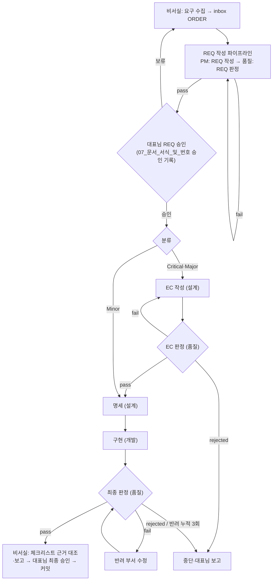

# 03. 라이프사이클

> 이 문서가 정하는 것: 등급별 흐름, 두 파이프라인(REQ 작성, 원스톱 실행)의 단계와 통과 조건, 판정 기준, 중단 조건, 반려와 격상, 파생 안건, 핫픽스 트랙.
> 다른 문서가 정하는 것: 실행 명령과 인수인계 → `Workflow/05_인수인계_및_실행명령`, 모델·effort → `Workflow/04_모델_운용`, 문서 이름·버전 → `Workflow/07_문서_서식_및_번호`.

## 1. 전체 흐름 (REQ-010_v04)

대표님은 REQ 승인과 최종 승인 두 시점에만 개입한다. 그 사이는 「중단 조건」에 해당할 때만 멈춘다.

## 2. 분류별 단계

| 분류 | 적용 대상 | 원스톱 파이프라인 단계 |
| :---: | :--- | :--- |
| Critical | 거버넌스 파일, 보안·권한, 코어 구조 | EC 작성 → EC 판정 → 명세 → 구현 → 최종 판정 |
| Major | 신규 기능, 여러 모듈 수정, API 규격 | Critical과 같다 |
| Minor | 단순 오탈자, 단일 파일 수정, 문서 보완 | 명세(필요한 경우만) → 구현 → 최종 판정 |

- 모든 분류는 REQ 작성 파이프라인(REQ 판정 포함)을 거친다.
- 운영·마케팅·비주얼의 지원 작업은 REQ `workflow:`가 정한 위치에 넣는다.
- 단계는 번호가 아니라 단계명으로 부른다.

## 3. REQ 작성 파이프라인 (REQ-010_v04)

1. PM이 ORDER 경로를 받아 메인 세션에서 서식 `Workflow/templates/REQ_TEMPLATE.md`로 REQ를 직접 작성한다(`approved: ""`). REQ 작성용 서브에이전트는 기동하지 않는다. REQ를 처음 작성하면 ORDER 머리말 `related_req`에 그 REQ 이름을 더한다(필드 규칙은 `Workflow/07_문서_서식_및_번호` 「머리말」). PM은 아래 작성 기준을 지킨다.
   - **구현 방법(Critical·Major)**: Critical·Major REQ는 구현 방법을 정하지 않는다. 구현 방법은 EC에서 정한다. 아래 표에서 「대상」인 위치에는 구현 방법을 요구·권고·선택지로 적지 않는다. Minor REQ는 이 기준의 대상이 아니다.
     - 구현 방법: 요청한 결과를 만들기 위해 산출물에 넣거나 산출물을 만들 때 쓰는 수단이다. 바꿀 문서의 문구안, 파일·폴더의 내부 구성, 코드·검사의 로직, 산출물을 만들 때 쓸 명령·도구·설정 규칙이 여기에 해당한다.
     - 구현 방법이 아닌 것: 무엇을 바꾸는지(대상 파일·절, 범위), 무엇을 달성하는지(요구·목적·완료 기준), 대표님이 정할 정책·범위·effort의 선택, 표준 매뉴얼이 이미 정한 절차를 따른다는 기재(예: 「거버넌스 파일은 적용본으로 작성한다」).

     | 서식 절 | 적용 | 근거 |
     | :--- | :--- | :--- |
     | 1. 요청 원문 | 대상 아님 | 대표님 원문을 원형 그대로 인용한다. 원문이 수단을 담아도 그대로 둔다 |
     | 2. 배경 및 목적 | 「목적」만 대상 | 「배경」은 현재 상태와 사례의 사실이다. 현행 파일·함수·명령을 서술해도 구현 방법이 아니다 |
     | 3. 결정 사항 및 선택지 | 대상 | 「정할 일」·「권고안」·「대안」에는 대표님이 정할 정책·범위·완료 기준·effort의 선택만 적는다 |
     | 4. 실행 계획 | 「작업」 열만 대상 | 「작업」 열에는 단계에서 할 일과 산출물의 이름(예: 「적용본 작성」, 「우회 재현 시험」, 「반영 명령을 결과서에 기재」)을 적고, 그 일을 하는 수단은 적지 않는다. 단계·부서·대상 경로 열과 표 아래 안내(적용본 작성 원칙, 중단 조건 참조 등)는 대상이 아니다 |
     | 5. 체크리스트 | 대상 아님 | 확인 방법은 완료를 확인하는 수단이며, 확인에 쓰는 명령·시험을 적어도 구현 방법이 아니다 |
     | 6. 실행 명령 | 대상 아님 | 서식이 정한 파이프라인 실행 명령이다 |

   - **결정과 체크리스트(모든 분류)**: 체크리스트(서식 5절)와 실행 계획(서식 4절)은 서식 3절 결정 표에서 어느 선택지를 택하느냐에 따라 뜻이 달라지게 쓰지 않는다(예: 「D1 결정대로」). 선택지에 따라 달라지는 항목은 어느 선택지를 택해도 그대로 확인할 수 있게 쓰거나, 권고안을 전제로 쓰고 그 전제와 「대안을 택하면 REQ 새 버전을 작성한다」는 사실을 REQ에 적는다.
2. 오케스트레이터가 `quality`를 새로 기동한다. 품질 서브에이전트는 아래 기준으로 REQ를 판정하고 `RES-xxx-REQ`를 발행한다.
   - ① 요청 원문의 요구가 빠지거나 바뀌지 않았다 ② 체크리스트가 요청 원문 항목과 1:1로 대응한다 ③ scope가 요구를 모두 덮고 요구 밖 경로가 없다 ④ 분류와 `workflow:`가 2절과 맞다 ⑤ 완료 기준을 실행이나 열람으로 확인할 수 있다 ⑥ 뜻이 둘 이상으로 읽히는 문장이 없다 ⑦ Critical·Major REQ는 1항 「구현 방법」 기준의 「대상」 위치에 구현 방법이 없다 ⑧ 체크리스트와 실행 계획의 뜻이 REQ 3절 결정 표의 선택에 따라 달라지지 않는다. 권고안을 전제로 쓰고 그 전제와 대안 선택 시 REQ 새 버전 작성을 REQ에 적은 항목은 이 기준에 맞는 것으로 본다(1항 「결정과 체크리스트」)
3. `fail`이면 PM이 REQ 새 버전을 작성하고 품질 서브에이전트가 변경분을 다시 판정한다. 재판정 한도는 8절을 따른다.
4. `pass`이면 오케스트레이터가 REQ 경로와 판정서 경로를 보고하고 끝낸다. 대표님이 REQ를 검토하고 승인한다(`Workflow/07_문서_서식_및_번호` 「승인 기록」).

## 4. 원스톱 파이프라인

1. 오케스트레이터가 REQ 머리말 `approved:`, `classification:`, `workflow:`, `scope:`를 읽는다. `approved:`가 비어 있으면 시작하지 않고 보고한다.
2. `workflow:`에 기재된 단계만 기재된 순서대로 실행한다. 항목 형식은 `<부서>: <단계명>`이다(예: `Design: EC 작성`). 단계마다 해당 부서의 서브에이전트를 새로 기동한다.
3. 지시문에는 `Workflow/04_모델_운용` 「타깃 컨텍스트 규칙」대로 경로와 단계명만 넣는다.
4. 각 단계 산출물과 통과 조건(5절)을 확인한 뒤 다음 단계로 넘긴다. 판정 결과는 판정서 머리말 `result:`로만 판단한다. 판정서 머리말 `auditor.model`이 `Workflow/04_모델_운용`의 판정 모델과 다르면 그 판정서를 무효로 보고 판정을 다시 실행한다.
5. 진행 상태는 `Workflow/05_인수인계_및_실행명령` 「진행 상태 보고」대로 알린다.
6. 최종 판정이 `pass`이면 최종 판정서 경로, `git status --porcelain -uall`과 `git diff --stat` 결과, 적용본 경로(있으면)를 보고하고 끝낸다. 커밋하지 않는다.

## 5. 단계별 통과 조건과 판정 기준

| 단계 | 부서 | 입력 | 산출물 | 통과 조건 |
| :--- | :--- | :--- | :--- | :--- |
| EC 작성 | 설계 | 승인된 REQ | `EC-xxx`(`status: draft`) | EC `scope:`가 REQ `scope:` 안에 있다 |
| EC 판정 | 품질 | REQ, EC | `RES-xxx-EC` | ① REQ 목적의 누락·왜곡 없음 ② EC scope가 REQ scope 안 ③ 요청하지 않은 기능·추상화 없음 ④ 완료 기준을 확인할 수 있음 |
| 명세 | 설계 | 판정 `pass`인 EC(Minor는 REQ) | PRD·TAD, 적용본, 설계 결과서 | 시작할 때 EC 머리말을 `Workflow/07_문서_서식_및_번호` 「머리말」의 EC 상태 전이대로 바꾼다 |
| 구현 | 개발 | EC(Minor는 REQ), 명세, 적용본 | 코드, 테스트, `DEV-xxx` | 테스트 통과, `check_standard.py` 종료 코드 0. 적용본이 있으면 규칙과 검사·설정 적용본의 일치를 `DEV-xxx`에 적는다 |
| 지원 작업 | 운영·마케팅·비주얼 | 승인된 REQ(EC가 있으면 EC) | 자기 부서 `docs/`·`assets/` 산출물, 결과서 | 산출물이 REQ `scope:` 안에 있다 |
| 최종 판정 | 품질 | REQ, EC, 산출물, `git diff` | `RES-xxx` | 아래 판정 기준 |

**최종 판정 기준**
1. **REQ 원점 대조**: 체크리스트 번호마다 근거(파일·절·검증 결과)를 판정서에 적는다.
2. **범위 대조**: `git status --porcelain -uall`의 변경 파일이 REQ·EC `scope:`, 부서 `results/`·`workspace/`, REQ 승인 전 구역(`Workflow/02_부서_구조_및_작업구역` 「작업 구역」) 안에 있다.
3. **명세 정합성**: 코드와 명세가 일치하고 테스트와 `check_standard.py`가 통과한다. 요구사항·구현 파일·테스트의 양방향 추적성을 확인한다.
4. **요청하지 않은 기능 없음**: REQ·EC에 없는 기능이 있으면 `fail`이다.
5. **기록 규칙**: 변경된 문서의 리비전 태그와 개정 이력이 `Workflow/07_문서_서식_및_번호` 「개정 이력과 리비전 태그」를 지켰다.
6. **사본 대조**: 바뀐 규칙·값을 다시 적은 다른 문서가 없는지 `grep`으로 확인한다. 쓰지 않는 말(`Workflow/01_표준_개요` 「용어」)을 괄호 안의 맥락대로 쓴 곳이 있으면 `fail`이다. 「용어」 표 자체와 개정 이력 표는 대조에서 뺀다.

- 승인된 REQ와 EC는 동결 문서다. 작업 중 내용을 바꿔야 하면 6절을 따른다. 판정 결과 값의 뜻은 `Workflow/07_문서_서식_및_번호` 「머리말」을 따른다.

## 6. 진행 중 변경과 파생 안건

| 상황 | 처리 |
| :--- | :--- |
| 진행 중인 안건의 요구가 바뀜 | 파이프라인을 멈추고 REQ 새 버전(`_v02`)을 작성해 REQ 판정과 대표님 재승인을 받는다 |
| 원 안건에서 미결로 남은 작업, 원 안건에서 새로 생긴 작업 | 파생 안건 `REQ-xxx-n`으로 따로 진행한다. 결과서도 같은 번호(`RES-xxx-n`)를 쓴다 |
| 종결된 안건의 사후 결함 | 파생 안건으로 진행한다 |

## 7. 중단 조건

오케스트레이터는 아래 경우에만 멈추고 상태·사유·필요한 결정을 보고한다.

1. scope 밖 변경이 필요한 경우
2. 판정이 `rejected`인 경우(REQ가 여러 뜻으로 읽히거나 요구가 서로 모순됨)
3. 최종 판정 반려 누적 3회(8절)
4. 거버넌스 적용본의 원본 반영이 필요한 경우. 파이프라인은 적용본 판정까지 마치고, 반영은 최종 승인 때 대표님이 한다
5. `ask` 목록 명령 또는 `allow` 목록 밖 명령의 권한 확인 요청이 생긴 경우(`Workflow/06_통제장치_및_배포` 「무인 실행 권한」)
6. 판정 모델이 맞지 않는 판정서가 두 번 연속 나온 경우
7. REQ 판정·EC 판정의 재판정 한도(8절)를 넘긴 경우

## 8. 반려와 격상 (REQ-010_v04)

- **재판정 한도**: REQ 판정과 EC 판정은 최초 판정 뒤 재판정을 3회까지 한다. 세 번째 재판정도 `fail`이면 중단하고 보고한다. 재판정은 변경분만 판정한다.
- EC 판정 `fail`: 설계가 EC 새 버전을 작성하고 다시 판정한다. 격상 횟수에 넣지 않는다.
- 최종 판정 `fail`: 판정서에 적힌 반려 부서가 고친 뒤 판정서 새 버전으로 변경분을 다시 판정한다.
- 최종 판정 `fail` 누적 3회: 중단하고 보고한다. 대표님이 차상위 분류(`Minor → Major → Critical`)로 격상하기로 정하면 PM이 분류를 바꾼 REQ 새 버전을 작성하고, REQ 판정과 대표님 재승인을 거쳐 원스톱 파이프라인을 처음부터 다시 실행한다. Critical은 대표님이 처리 방법을 정한다.

## 9. 핫픽스 트랙 (REQ-010_v04)

- **대상 조건(모두 충족)**: 기존 기능의 결함 또는 오탈자, 수정 파일 3개 이하, 거버넌스 파일·`CEO/`·`_archive/` 제외, 새 기능·새 파일 없음. 하나라도 어긋나면 정규 REQ로 전환한다.
- **절차**
  1. **사전 승인**: 비서실이 원인, 변경 요지, 대상 파일 목록을 대표님께 제시해 승인을 받는다. 승인된 목록이 사용자 전역 지침 「파일 삭제·덮어쓰기 전 사용자 승인」의 승인 목록이다.
  2. **수정과 검증**: 비서실이 대상 파일을 수정하고 `check_standard.py`와 관련 테스트를 실행한 뒤 HOTFIX를 작성한다. 셸을 실행할 수 없는 비서실은 검증 명령문을 대표님께 제시하고, 대표님이 실행한 결과 원문을 HOTFIX에 적는다.
  3. **사후 확인**: 대표님이 확인하고 `confirmed:`를 기재하거나 `Workflow/07_문서_서식_및_번호` 「승인 기록」대로 기재하게 한다. 대표님 확인이 독립 판정을 대신한다.

---

## 개정 이력

| 안건 | 일자 | 변경 요지 |
| :--- | :--- | :--- |
| REQ-010_v04 | 2026-10-08 | 역할 재편(REQ-009) 반영. 1절 흐름도의 창구를 비서실로, 요구 메모를 ORDER로, 비서실 세션을 PM으로 변경. 3절 1항을 PM이 ORDER 경로를 받아 메인 세션에서 REQ를 직접 작성하고 ORDER `related_req`를 갱신하는 절차로 변경(서브에이전트 기동 삭제), 3항의 REQ 새 버전 작성 주체를 PM으로 변경. 8절 격상 시 REQ 새 버전 작성 주체를 PM으로 변경. 9절 1·2항의 사전 승인·수정·검증·HOTFIX 작성 주체를 비서실로 바꾸고, 셸을 실행할 수 없는 비서실의 검증 방법 추가 |
| REQ-008_v03 | 2026-10-08 | 3절 1항에 REQ 작성 기준 추가(Critical·Major는 구현 방법을 REQ에 적지 않고 EC로 넘긴다는 기준과 구현 방법의 뜻, 서식 절별 적용 표, 결정 표의 선택에 따라 뜻이 달라지는 체크리스트·실행 계획 금지). 2항 REQ 판정 기준에 ⑦(구현 방법)·⑧(결정 선택에 따른 뜻 변화) 추가 |
| v04 하드포크 | 2026-10-07 | 흐름도, 3절 4항, 9절 3항의 승인 기재를 `Workflow/07` 「승인 기록」 참조로 변경 |
| v03 재편 | 2026-10-06 | v02 `03_라이프사이클_및_워크플로우`를 재편. REQ 작성 파이프라인(REQ 판정) 신설, 판정 모델 확인, 진행 중 변경·파생 안건 규칙(RP 폐지), 최종 판정 기준에 사본 대조 추가, 리비전 SOP를 `07`로 이전, 핫픽스 수정 주체를 비서실 세션으로 명시 |
