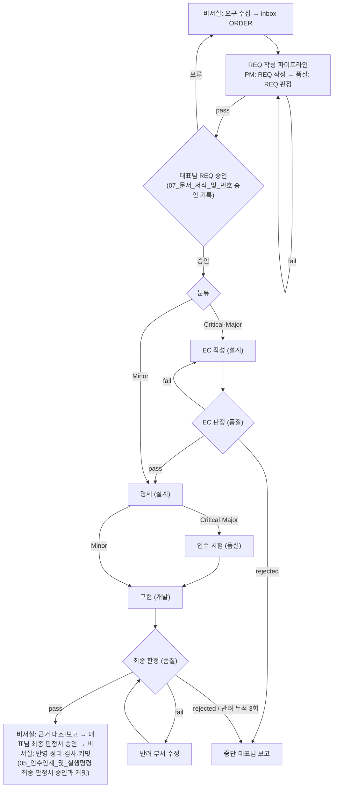

# 03. 라이프사이클

> 이 문서가 정하는 것: 등급별 흐름, 두 파이프라인(REQ 작성, 원스톱 실행)의 단계와 통과 조건, 판정 기준, 판정 지적의 구분, 판정 세션이 명령을 실행하지 못했을 때의 처리, 중단 조건, 반려와 격상, 파생 안건, 핫픽스 트랙, 기획 트랙, 실험실과 실험 단계, 시험실(인수 시험), 부적합 관리.
> 다른 문서가 정하는 것: 실행 명령과 인수인계 → `Workflow/05_인수인계_및_실행명령`, 모델·effort → `Workflow/04_모델_운용`, 문서 이름·버전 → `Workflow/07_문서_서식_및_번호`.

## 1. 전체 흐름

대표님은 REQ 승인과 최종 승인 두 시점에만 개입한다. 그 사이는 「중단 조건」에 해당할 때만 멈춘다. ORDER는 기획 트랙(10절)에서 대표님이 Go로 정한 기획안에서 발행될 수도 있다. 기획 트랙의 대표님 결정은 ORDER 발행 전의 일이며 이 흐름의 개입 시점이 아니다.

## 2. 분류별 단계

| 분류 | 적용 대상 | 원스톱 파이프라인 단계 |
| :---: | :--- | :--- |
| Critical | 거버넌스 파일, 보안·권한, 코어 구조 | (실험) → EC 작성 → EC 판정 → 명세 → 인수 시험 → 구현 → 최종 판정 |
| Major | 신규 기능, 여러 모듈 수정, API 규격 | Critical과 같다 |
| Minor | 단순 오탈자, 단일 파일 수정, 문서 보완 | (실험) → 명세(필요한 경우만. 실험 단계가 있으면 반드시 둔다) → 구현 → 최종 판정 |

- 괄호 안의 실험 단계는 선택 단계이며 실험이 필요한 REQ에만 넣는다(11.2절).
- 인수 시험 단계는 Critical·Major에 늘 두고 Minor에는 두지 않는다(12절).
- 모든 분류는 REQ 작성 파이프라인(REQ 판정 포함)을 거친다.
- 운영·마케팅·비주얼의 지원 작업은 REQ `workflow:`가 정한 위치에 넣는다.
- 단계는 번호가 아니라 단계명으로 부른다.

## 3. REQ 작성 파이프라인

1. PM이 ORDER 경로를 받아 메인 세션에서 서식 `Workflow/templates/REQ_TEMPLATE.md`로 REQ를 직접 작성한다(`approved: ""`). REQ 작성용 서브에이전트는 기동하지 않는다. REQ를 처음 작성하면 ORDER 머리말 `related_req`에 그 REQ 이름을 더한다(필드 규칙은 `Workflow/07_문서_서식_및_번호` 「머리말」). PM은 아래 작성 기준을 지킨다.
   - **구현 방법(Critical·Major)**: Critical·Major REQ는 구현 방법을 정하지 않는다. 구현 방법은 EC에서 정한다. 아래 표에서 「대상」인 위치에는 구현 방법을 요구·권고·선택지로 적지 않는다. Minor REQ는 이 기준의 대상이 아니다.
     - 구현 방법: 요청한 결과를 만들기 위해 산출물에 넣거나 산출물을 만들 때 쓰는 수단이다. 바꿀 문서의 문구안, 파일·폴더의 내부 구성, 코드·검사의 로직, 산출물을 만들 때 쓸 명령·도구·설정 규칙이 여기에 해당한다.
     - 구현 방법이 아닌 것: 무엇을 바꾸는지(대상 파일·절, 범위), 무엇을 달성하는지(요구·목적·완료 기준), 대표님이 정할 정책·범위·effort의 선택, 표준 매뉴얼이 이미 정한 절차를 따른다는 기재(예: 「거버넌스 파일은 적용본으로 작성한다」).

     | 서식 절 | 적용 | 근거 |
     | :--- | :--- | :--- |
     | 1. 요청 원문 | 대상 아님 | 대표님 원문을 원형 그대로 인용한다. 원문이 수단을 담아도 그대로 둔다 |
     | 2. 배경 및 목적 | 「목적」만 대상 | 「배경」은 현재 상태와 사례의 사실이다. 현행 파일·함수·명령을 서술해도 구현 방법이 아니다 |
     | 3. 결정 사항 및 선택지 | 대상 | 「정할 일」·「권고안」·「대안」에는 대표님이 정할 정책·범위·완료 기준·effort의 선택만 적는다 |
     | 4. 실행 계획 | 「작업」 열만 대상 | 「작업」 열에는 단계에서 할 일과 산출물의 이름(예: 「적용본 작성」, 「우회 재현 시험」, 「반영 명령을 결과서에 기재」)을 적고, 그 일을 하는 수단은 적지 않는다. 단계·부서·대상 경로 열과 표 아래 안내(적용본 작성 원칙, 중단 조건 참조 등)는 대상이 아니다 |
     | 5. 체크리스트 | 대상 아님 | 확인 방법은 완료를 확인하는 수단이며, 확인에 쓰는 명령·시험을 적어도 구현 방법이 아니다 |
     | 6. 실행 명령 | 대상 아님 | 서식이 정한 파이프라인 실행 명령이다 |

   - **결정과 체크리스트(모든 분류)**: 체크리스트(서식 5절)와 실행 계획(서식 4절)은 서식 3절 결정 표에서 어느 선택지를 택하느냐에 따라 뜻이 달라지게 쓰지 않는다(예: 「D1 결정대로」). 선택지에 따라 달라지는 항목은 어느 선택지를 택해도 그대로 확인할 수 있게 쓰거나, 권고안을 전제로 쓰고 그 전제를 REQ에 적는다. 대표님이 REQ 승인 문구에서 권고안이 아닌 선택지나 수정안을 골라도 REQ 새 버전을 작성하지 않는다(`Workflow/07_문서_서식_및_번호` 「승인 기록」 8항). 승인 필드를 기재한 뒤의 결정 변경은 같은 절 6항대로 REQ 새 버전을 작성한다. 대표님이 권고안이 아닌 결정을 고르면 「결정」 열의 결정이 그 결정에 따라 달라지는 체크리스트 항목·실행 계획보다 우선한다. 결정의 이행은 Critical·Major는 EC가 「결정」 열대로 반영하고 EC 판정에서 확인하며(5절 표 「EC 판정」 행 ⑤), 모든 분류에서 최종 판정이 체크리스트와 함께 「결정」 열과 대조한다(5절 「최종 판정 기준」 1).
2. 오케스트레이터가 `quality`를 새로 기동한다. 품질 서브에이전트는 아래 기준으로 REQ를 판정하고 `RES-xxx-REQ`를 발행한다.
   - ① 요청 원문의 요구가 빠지거나 바뀌지 않았다 ② 체크리스트가 요청 원문 항목과 1:1로 대응한다 ③ scope가 요구를 모두 덮고 요구 밖 경로가 없다 ④ 분류와 `workflow:`가 2절과 맞다 ⑤ 완료 기준을 실행이나 열람으로 확인할 수 있다 ⑥ 뜻이 둘 이상으로 읽히는 문장이 없다 ⑦ Critical·Major REQ는 1항 「구현 방법」 기준의 「대상」 위치에 구현 방법이 없다 ⑧ 체크리스트와 실행 계획의 뜻이 REQ 3절 결정 표의 선택에 따라 달라지지 않는다. 권고안을 전제로 쓰고 그 전제를 REQ에 적은 항목은 이 기준에 맞는 것으로 본다(1항 「결정과 체크리스트」)
3. `fail`이면 PM이 REQ 새 버전을 작성하고 품질 서브에이전트가 변경분을 다시 판정한다. 재판정 한도는 8절을 따른다.
4. `pass`이면 오케스트레이터가 `Workflow/05_인수인계_및_실행명령` 「완료 보고」대로 보고하고 끝낸다. 보고에는 REQ 경로와 판정서 경로를 적는다. 대표님이 REQ를 검토하고 승인한다(`Workflow/07_문서_서식_및_번호` 「승인 기록」).

## 4. 원스톱 파이프라인

1. 오케스트레이터가 REQ 머리말 `approved:`, `classification:`, `workflow:`, `scope:`를 읽는다. `approved:`가 비어 있으면 시작하지 않고 보고한다. 그 REQ의 승인에 「문체 반영」이 있으면(확인 방법은 5.1절 5항 1) 첫 단계 전에 5.1절 5항을 실행하고, 대조 `pass`와 승인 필드 기재를 마친 문체 반영본으로 진행한다. 다시 실행했을 때 최신 REQ가 승인 필드를 기재하기 전의 문체 반영본이면, 첫 문장의 예외로 보고하지 않고 5.1절 5항의 남은 단계부터 이어서 한다.
2. `workflow:`에 기재된 단계만 기재된 순서대로 실행한다. 항목 형식은 `<부서>: <단계명>`이다(예: `Design: EC 작성`). 실험 단계의 항목은 `<부서>: 실험`이다(11.2절). 인수 시험 단계의 항목은 `Quality: 인수 시험`이다(12절). 단계마다 해당 부서의 서브에이전트를 새로 기동한다. 예외로, 5.1절의 문체 반영과 대조, 12절의 인수 시험 수정, 13절의 중단 때 부적합 기록은 `workflow:`에 적지 않아도 실행한다. 최종 판정서 승인의 「문체 반영」으로 원스톱 실행 명령을 다시 실행한 경우, 오케스트레이터는 진행 위치를 산출물(최종 판정서 승인 기록, 최신 판정서)로 판단해 5.1절 5항의 반영과 대조만 하고, 대조 `pass`면 `Workflow/05_인수인계_및_실행명령` 「완료 보고」대로 보고하고 끝낸다.
3. 지시문은 `Workflow/04_모델_운용` 「타깃 컨텍스트 규칙」대로 만든다.
4. 각 단계 산출물과 통과 조건(5절)을 확인한 뒤 다음 단계로 넘긴다. 판정 결과는 판정서 머리말 `result:`로만 판단한다. 판정서 머리말 `auditor.model`이 `Workflow/04_모델_운용`의 판정 모델과 다르면 그 판정서를 무효로 보고 판정을 다시 실행한다.
5. 진행 상태는 `Workflow/05_인수인계_및_실행명령` 「진행 상태 보고」대로 알린다.
6. 최종 판정이 `pass`이면 `Workflow/05_인수인계_및_실행명령` 「완료 보고」대로 보고하고 끝낸다. 보고에는 최종 판정서 경로와 적용본 경로(있으면)를 적는다. `git status --porcelain -uall`·`git diff --stat` 결과는 원문 대신 그 결과가 적힌 최종 판정서 경로로 대신한다. 커밋하지 않는다.

## 5. 단계별 통과 조건과 판정 기준

| 단계 | 부서 | 입력 | 산출물 | 통과 조건 |
| :--- | :--- | :--- | :--- | :--- |
| 실험 | REQ가 정한 부서 | 승인된 REQ | REQ `scope:`의 실험 폴더 안 실험 파일, 결과서 6절 「실험 결과」 | 산출물이 REQ `scope:`의 실험 폴더 안에 있고 결과서 6절이 있다. 실험 단계는 판정하지 않는다(11.2절) |
| EC 작성 | 설계 | 승인된 REQ(실험 단계가 있으면 실험 결과서 포함) | `EC-xxx`(`status: draft`) | EC `scope:`가 REQ `scope:` 안에 있다 |
| EC 판정 | 품질 | REQ, EC | `RES-xxx-EC` | ① REQ 목적의 누락·왜곡 없음 ② EC scope가 REQ scope 안 ③ 요청하지 않은 기능·추상화 없음 ④ 완료 기준을 확인할 수 있음 ⑤ REQ 「결정」 열의 결정이 반영되었다 |
| 명세 | 설계 | 판정 `pass`인 EC(Minor는 REQ와, 실험 단계가 있으면 실험 결과서) | PRD·TAD, 적용본, 설계 결과서 | 시작할 때 EC 머리말을 `Workflow/07_문서_서식_및_번호` 「머리말」의 EC 상태 전이대로 바꾼다 |
| 인수 시험 | 품질 | 승인된 REQ, 판정 `pass`인 EC, 명세 산출물(적용본, 설계 결과서) | 인수 시험 폴더, `ACC-xxx` | ACC에 체크리스트 항목마다 확인 구분이 있고, 실행으로 확인하는 항목마다 시험과 구현 전 실행 결과가 있다. 「대상 없음」이면 사유가 있다(12절) |
| 구현 | 개발 | EC(Minor는 REQ), 명세, 적용본, 인수 시험(있으면) | 코드, 테스트, `DEV-xxx` | 인수 시험 단계가 있으면 현행 인수 시험 통과(「대상 없음」이면 해당 없음), 테스트 통과, `check_standard.py` 종료 코드 0. 거버넌스 적용본이 있으면 `Workflow/06_통제장치_및_배포` 「거버넌스 파일 개정 절차」 3항의 대조 결과가 `DEV-xxx`에 있다 |
| 지원 작업 | 운영·마케팅·비주얼 | 승인된 REQ(EC가 있으면 EC) | 자기 부서 `docs/`·`assets/` 산출물, 결과서 | 산출물이 REQ `scope:` 안에 있다 |
| 최종 판정 | 품질 | REQ, EC, 산출물, `git diff`, 인수 시험·ACC(있으면) | `RES-xxx` | 아래 판정 기준 |

**최종 판정 기준**
1. **REQ 원점 대조**: 체크리스트 번호마다 근거(파일·절·검증 결과)를 판정서에 적는다. 「결정」 열의 결정마다 반영 근거를 함께 적고, 권고안을 전제로 쓴 체크리스트 항목이 결정과 다르면 결정을 기준으로 대조한다.
2. **범위 대조**: `git status --porcelain -uall`의 변경 파일이 REQ·EC `scope:`, 부서 `results/`·`workspace/`, 품질의 인수 시험·부적합 기록 경로(12·13절), REQ 승인 전 구역(`Workflow/02_부서_구조_및_작업구역` 「작업 구역」) 안에 있다. `CEO/` 아래 변경(커밋하지 않은 변경 포함)은 대조에서 뺀다. 이름 변경은 원래 경로와 새 경로를 따로 따져 `CEO/` 아래인 경로만 뺀다(`Workflow/06_통제장치_및_배포` 「커밋 전 검사」 순서 3의 작업 트리 검사와 같다). `Lab/` 아래 변경 가운데 REQ `scope:` 밖의 것(파이프라인 밖 실험)은 대조에서 빼고, 판정서 「범위 대조」 근거에 경로를 참고로 적는다.
3. **명세 정합성**: 코드와 명세가 일치하고 테스트와 `check_standard.py`가 통과한다. 요구사항·구현 파일·테스트의 양방향 추적성을 확인한다.
4. **요청하지 않은 기능 없음**: REQ·EC에 없는 기능이 있으면 `fail`이다.
5. **기록 규칙**: 변경된 문서의 리비전 태그와 개정 이력이 `Workflow/07_문서_서식_및_번호` 「개정 이력과 리비전 태그」를 지켰다.
6. **사본 대조**: 바뀐 규칙·값을 다시 적은 다른 문서가 없는지 `grep`으로 확인한다. 쓰지 않는 말(`Workflow/01_표준_개요` 「용어」)을 괄호 안의 맥락대로 쓴 곳이 있으면 `fail`이다. 「용어」 표 자체와 개정 이력 표는 대조에서 뺀다.
7. **삭제 대상**: 일회성 파일은 부서 직속 `workspace/` 바로 아래에서 이름이 그 안건의 REQ 번호와 `_`로 시작하는 파일과 폴더(폴더는 그 아래 파일 전체)다. 그 안건의 적용본 폴더(`<REQ 번호>_적용본_vNN/`)는 뺀다. PM 실행 기록(`실행기록_REQ-xxx.md`)은 이름이 REQ 번호로 시작하지 않으므로 해당하지 않는다. 접두어는 `_`까지 비교한다(`REQ-014_`는 `REQ-014-1_`과 일치하지 않는다). 품질 서브에이전트는 최종 판정서 「삭제 대상」 절에 「범위 대조」(기준 2) 때 조회한 작업 트리에서 이 기준으로 찾은 파일(추적·미추적 모두)과, 그 판정을 위해 자신이 부서 `workspace/`에 만든 파일을 적는다. 경로는 파일마다 적고(폴더는 그 아래 파일을 하나씩 적는다), 경로마다 추적 여부를 적는다. 없으면 「없음」으로 적는다. 이 목록은 판정 결과(`result`)를 정하지 않는다. REQ 판정·EC 판정의 판정서는 이 절에 「해당 없음」을 적는다. 이름 규칙은 `Workflow/07_문서_서식_및_번호` 「번호와 버전」의 「부서 `workspace/` 파일」 항, 삭제 승인과 정리는 `Workflow/05_인수인계_및_실행명령` 「최종 판정서 승인과 커밋」을 따른다.
8. **인수 시험**: 인수 시험 단계가 있는 REQ만 적용한다. ① 체크리스트의 실행으로 확인하는 항목을 빠짐없이 덮고, 열람으로 확인하는 항목의 구분이 맞다 ② 결과가 늘 같은 시험이 아니다. 구현 전 실행에서 통과한 시험은 ACC에 사유가 있어야 하고, 구현 결과와 관계없이 통과·실패가 정해지는 시험(예: 비교 대상 없이 `assert True`, 시험 안에서 기대값을 결과로 다시 만드는 시험)은 결함이다 ③ 판정자가 현행 인수 시험(현행 ACC `test_dir`의 폴더)을 다시 실행해 통과한다 ④ 시험 파일의 해시가 현행 ACC에 적힌 값과 같다(12절 4항) ⑤ 「대상 없음」이면 실행으로 확인하는 항목이 없다는 판단이 맞다 ⑥ 인수 시험의 결함은 반려 부서를 품질로 적는다(12절 7항). 결과는 판정서 서식의 「인수 시험 판정」 절에 적는다.

- 승인된 REQ와 EC는 동결 문서다. 작업 중 내용을 바꿔야 하면 6절을 따른다. 판정 결과 값의 뜻은 `Workflow/07_문서_서식_및_번호` 「머리말」을 따른다.

### 5.1 판정 지적의 구분과 문체 지적 처리

판정 지적의 구분 기준과 문체 지적의 처리는 이 절이 원천이다.

1. **구분 기준**: 판정자는 지적을 「결함」과 「문체」로 나눈다. 결함은 판정 기준에 어긋나거나 실행 실패·반려·오독을 일으킬 수 있는 지적(사실 오류, 모순, 누락, 지칭 불명확, 중의성 포함)이고, 문체는 그 밖의 표현 지적이다. 분류는 판정자가 정한다. `result`는 결함으로만 정하며, 문체 지적만 있으면 `pass`다.
2. **기재**: 판정서는 문체 지적마다 위치, 원문, 수정 문안, 대상 부서를 서식 `RES_TEMPLATE.md`의 「문체 지적」 절에 적는다.
3. **`pass` 판정서의 문체 지적**: 반영하지 않고 이월한다. 같은 문서의 다음 버전이 다른 사유로 생기면 그 버전에 함께 반영한다. 대표님이 승인 문구에 「문체 반영」을 덧붙이면 그 승인 때 반영한다(5항).
   - 「같은 문서의 다음 버전」은 파일명에 버전(`_vNN`)이 있는 기록 문서(REQ·EC·결과서)와 적용본 폴더의 다음 버전만 가리킨다. 버전 없이 고쳐 쓰는 원본(`AGENTS.md`, `Workflow/` 등)을 다른 안건이 개정하는 것은 다음 버전이 아니다. 그 안건이 커밋으로 끝나면 이월한 문체 지적은 반영하지 않고 종결한다.
   - 적용본 폴더의 다음 버전을 만들면 그 적용본의 반영 명령을 적은 결과서(RPT·DEV)도 다음 버전을 만들고 기계적 갱신을 함께 한다. 기계적 갱신은 적용본 폴더 경로가 들어간 적용본 경로와 반영 명령의 경로를 새 폴더로 바꾸고, 「원본과의 차이」 명령을 새 폴더로 다시 실행해 그 결과로 바꾸는 것이다.
4. **EC 판정 `pass`의 문체 지적**: 이월하고, EC의 다음 버전이 다른 사유로 생기지 않으면 반영하지 않고 종결한다. EC 판정에는 대표님 승인이 없으므로 「문체 반영」이 적용되지 않는다.
5. **「문체 반영」 승인의 처리**
   1. **확인**: 대리 기재한 REQ 승인은 승인 기록의 「승인 문구 원문」으로, 대표님 본인이 기재한 REQ 승인은 승인 필드 줄 끝 주석 `# 문체 반영`으로, 최종 판정서 승인은 그 승인 기록으로 확인한다(`Workflow/07_문서_서식_및_번호` 「승인 기록」). 어디에도 「문체 반영」이 없으면 「문체 반영」이 없는 승인으로 본다.
   2. **반영 대상**: 그 승인의 근거 판정서(REQ 승인은 최신 `RES-xxx-REQ`, 최종 판정서 승인은 그 `RES-xxx`)의 문체 지적이다.
   3. **반영 주체와 시점**: REQ 승인이면 원스톱 파이프라인 첫 단계 전에 PM이 REQ 새 버전(문체 반영본)을 작성한다. 최종 판정서 승인이면 비서실이 원스톱 실행 명령을 다시 실행하고, PM이 판정서에 적힌 대상 부서의 서브에이전트를 기동해 반영하게 한다. 대상이 적용본이면 그 부서가 적용본 폴더의 다음 버전과 결과서의 다음 버전(기계적 갱신 포함)을 만든다.
   4. **반영 범위**: 수정 문안 그대로만 고친다. 결과서에는 기계적 갱신만 더한다.
   5. **대조**: 품질 서브에이전트가 변경이 수정 문안과 같은지만 대조하고, 대표님 재승인은 받지 않는다. 대조는 판정서 새 버전으로 발행한다. `gate:`는 대상 판정과 같고, 1절 「판정 차수」에 「문체 반영 대조」와 직전 판정서 경로를 적는다. 변경 전체가 직전 판정서의 수정 문안과 같으면 `pass`, 다르거나 수정 문안 밖 변경이 있으면 `fail`이다. 기계적 갱신은 수정 문안 밖 변경으로 보지 않는다. 대신 품질 서브에이전트는 ① 직전 적용본 폴더와 새 폴더의 `git diff --no-index` 결과가 수정 문안과 같고 ② 새 결과서의 적용본 경로·반영 명령이 새 폴더를 가리키며 ③ 「원본과의 차이」 결과가 새 폴더로 다시 실행한 결과와 같은지 확인한다.
   6. **대조 `fail`**: 수정 문안과 다른 곳을 고친 새 버전으로 다시 대조한다. 수정 문안 밖 변경을 남기려면 현행대로 판정과 대표님 재승인을 받는다.
   7. **문체 반영본 REQ의 승인 필드**: `Workflow/07_문서_서식_및_번호` 「승인 기록」 7항대로 기재한다.
6. **`fail` 판정서의 문체 지적**: 결함을 고치는 같은 새 버전에 함께 반영한다. 수정 문안 그대로 반영한 곳은 결함 재판정 대상에서 빼고 수정 문안과 같은지만 대조한다. 수정 문안과 다르게 고친 곳은 변경분으로 재판정한다.

### 5.2 판정 세션의 명령 실행 (REQ-019_v03)

판정 세션이 판정에 필요한 명령을 실행하지 못했을 때의 처리는 이 절이 원천이다. 명령 도구와 형태, 권한은 `Workflow/06_통제장치_및_배포` 「무인 실행 권한」을 따른다.

1. **대상**: 품질 서브에이전트가 REQ 판정, EC 판정, 최종 판정, 5.1절 5항의 문체 반영 대조에서 판정 기준이 요구하는 확인을 위해 실행하는 명령이다. 시각 조회, Git 조회(`git diff --no-index` 포함), 커밋 전 검사 실행, 인수 시험 재실행(`python -m pytest`)이 여기에 든다.
2. **실행하지 못함**: 명령이 권한 거부되었거나, 권한 확인 요청이 승인되지 않아 실행되지 않은 경우다. 명령이 실행되어 실패한 경우(종료 코드가 0이 아님)는 판정 근거이며 여기에 들지 않는다. 권한 확인 요청이 승인되어 실행된 명령은 실행한 명령으로 보고 판정을 계속하며, 판정서 「검증 기록」의 그 명령 행에 확인 요청이 있었다는 사실과 메시지 원문을 적는다.
3. **대신할 수 있을 때**: 판정 기준이 요구하는 값(시각, 변경 목록, 종료 코드와 출력, 해시)을 같게 얻는 다른 허용 명령·도구로 다시 실행한다. 판정서 「검증 기록」 절에 실행하지 못한 명령, 메시지 원문, 대신한 명령과 그 결과 원문을 적은 뒤 판정을 계속한다(예: Bash `date` 대신 PowerShell `Get-Date -Format o`). 시각 조회를 다른 허용 명령·도구로 대신한 경우도 여기에 든다. 파일 열람이나 추정으로 값을 채우는 것은 대신이 아니다.
4. **대신할 수 없을 때**: 판정서를 발행하지 않고, 오케스트레이터에 실행하지 못한 명령, 메시지 원문, 시도한 대신 수단과 그 결과를 보고한다. 어떤 허용 명령·도구로도 시각을 조회하지 못해 머리말 `completed_at`을 적을 수 없는 경우도 여기에 든다. `completed_at`에 「확인 불가」를 적지 않는다. 오케스트레이터는 7절 8항으로 멈춘다.
5. **이유**: 판정 근거가 빠진 판정서로 다음 단계에 넘어가지 않게 하기 위해서다. 판정 모델을 확인할 수 없을 때의 처리는 `Workflow/04_모델_운용` 「모델 메타데이터 기록」을 따른다.

## 6. 진행 중 변경과 파생 안건

| 상황 | 처리 |
| :--- | :--- |
| 진행 중인 안건의 요구가 바뀜 | 파이프라인을 멈추고 REQ 새 버전(`_v02`)을 작성해 REQ 판정과 대표님 재승인을 받는다 |
| 원 안건에서 미결로 남은 작업, 원 안건에서 새로 생긴 작업 | 파생 안건 `REQ-xxx-n`으로 따로 진행한다. 결과서도 같은 번호(`RES-xxx-n`)를 쓴다 |
| 종결된 안건의 사후 결함 | 파생 안건으로 진행한다 |

## 7. 중단 조건 (REQ-019_v03)

오케스트레이터는 아래 경우에만 멈추고 상태·사유·필요한 결정을 보고한다.

1. scope 밖 변경이 필요한 경우
2. 판정이 `rejected`인 경우(REQ가 여러 뜻으로 읽히거나 요구가 서로 모순됨)
3. 최종 판정 반려 누적 3회(8절)
4. 거버넌스 적용본의 원본 반영이 필요한 경우. 파이프라인은 적용본 판정까지 마치고, 반영은 최종 판정서 승인 뒤 `Workflow/05_인수인계_및_실행명령` 「최종 판정서 승인과 커밋」대로 한다
5. `ask` 목록 명령 또는 `allow` 목록 밖 명령의 권한 확인 요청이 생긴 경우(`Workflow/06_통제장치_및_배포` 「무인 실행 권한」). 다만 판정 세션 안에서 생긴 권한 확인 요청은 이 항의 멈춤 사유에 들지 않으며 5.2절을 따른다(멈추는 경우는 8항)
6. 판정 모델이 맞지 않는 판정서가 두 번 연속 나온 경우
7. REQ 판정·EC 판정의 재판정 한도(8절)를 넘긴 경우
8. 판정 세션이 판정에 필요한 명령을 실행하지 못하고 대신할 수단도 없어 판정서를 발행하지 않은 경우(5.2절 4항)

멈출 때의 부적합 기록은 13절을 따른다.

## 8. 반려와 격상

- **재판정 한도**: REQ 판정과 EC 판정은 최초 판정 뒤 재판정을 3회까지 한다. 세 번째 재판정도 `fail`이면 중단하고 보고한다. 재판정은 변경분만 판정한다. 5.1절의 문체 반영 대조는 재판정 횟수에 넣지 않는다.
  - **목적**: 재판정 한도는 무인으로 진행되는 동안 대표님께 빨리 보고하기 위한 장치다.
  - **초기화**: 오케스트레이터가 중단 조건(7절)으로 멈춰 보고하거나 대표님께 의결을 요청하고 대표님이 답하면, 그 뒤의 REQ 판정·EC 판정은 재판정 횟수를 새로 센다. 답을 받아 같은 세션에서 계속하는 경우와 `Workflow/05_인수인계_및_실행명령` 1절대로 같은 명령을 다시 실행하는 경우 모두 같다. 대표님 답 뒤 처음 하는 재판정이 1회다.
  - **기록**: 오케스트레이터는 그 재판정의 지시문에 횟수를 새로 센다는 사실과 직전 판정서 경로를 적는다(`Workflow/04_모델_운용` 「타깃 컨텍스트 규칙」 3항). 품질 서브에이전트는 판정서 1절 「판정 차수」에 「재판정 1차(대표님 답 뒤 다시 셈, 직전 판정서 <경로>)」 형태로 적는다. 횟수는 판정서의 「판정 차수」로 판단한다.
  - **적용 제외**: 최종 판정 반려 누적 3회는 격상을 판단하는 장치이므로 초기화하지 않는다. ORDER 변경으로 생긴 REQ 새 버전은 최초 판정부터 다시 센다.
- EC 판정 `fail`: 설계가 EC 새 버전을 작성하고 다시 판정한다. 격상 횟수에 넣지 않는다.
- 최종 판정 `fail`: 판정서에 적힌 반려 부서가 고친 뒤 판정서 새 버전으로 변경분을 다시 판정한다.
- 최종 판정 `fail` 누적 3회: 중단하고 보고한다. 대표님이 차상위 분류(`Minor → Major → Critical`)로 격상하기로 정하면 PM이 분류를 바꾼 REQ 새 버전을 작성하고, REQ 판정과 대표님 재승인을 거쳐 원스톱 파이프라인을 처음부터 다시 실행한다. Critical은 대표님이 처리 방법을 정한다.

## 9. 핫픽스 트랙

- **대상 조건(모두 충족)**: 기존 기능의 결함 또는 오탈자, 수정 파일 3개 이하, 거버넌스 파일·`CEO/`·`_archive/` 제외, 새 기능·새 파일 없음. 하나라도 어긋나면 정규 REQ로 전환한다.
- **절차**: 비서실의 실행 순서·예외·보고는 `Workflow/05_인수인계_및_실행명령` 「비서실 실행 절차」의 「핫픽스」 절차를 따른다.
  1. **사전 승인**: 비서실이 원인, 변경 요지, 대상 파일 목록을 대표님께 제시해 승인을 받는다. 승인된 목록이 사용자 전역 지침 「파일 삭제·덮어쓰기 전 사용자 승인」의 승인 목록이다.
  2. **수정과 검증**: 저장소 파일을 수정할 수 있는 비서실 서비스(예: 코워크, Antigravity)가 대상 파일을 수정하고 `check_standard.py`와 관련 테스트를 실행한 뒤 HOTFIX를 작성한다. 저장소 파일을 수정할 수 없는 비서실 서비스는 1항의 사전 승인까지만 받고, 이 항의 수정·검증·HOTFIX 작성은 수정할 수 있는 비서실 서비스가 이어받는다. 이어받는 서비스는 대표님이 승인한 대상 파일 목록을 그대로 쓰며, 목록을 바꾸려면 1항의 사전 승인을 다시 받는다. 셸을 실행할 수 없는 비서실은 검증 명령문을 대표님께 제시하고, 대표님이 실행한 결과 원문을 HOTFIX에 적는다.
  3. **사후 확인**: 대표님이 확인하고 `confirmed:`를 기재하거나 `Workflow/07_문서_서식_및_번호` 「승인 기록」대로 기재하게 한다. 대표님 확인이 독립 판정을 대신한다.

## 10. 기획 트랙

기획 트랙의 절차는 이 절이 원천이다.

1. **수행 조건**: 대표님이 아이디어 덤프, 기획 단계, 기획을 요청하면 비서실이 수행한다.
2. **단계**
   1. **쏟아내기**: 대표님 말을 원문 그대로 아이디어 백로그에 기록한다.
   2. **정리**: 분류하고 중복을 묶으며, 빈 곳은 객관식으로 대표님께 질의한다.
   3. **프로젝트화**: 기획안과 기획 브리핑(`Workflow/05_인수인계_및_실행명령` 「브리핑」)을 작성한다.
   4. **대표님 결정**: 기획안 항목마다 Go / Hold / Kill로 정한다.
3. **결정 기록**: 기획안 「대표님 결정」 표에 항목마다 결정, 대표님 문구 원문, 문구를 받은 시각, 발행한 ORDER(Go일 때)를 적고, 아이디어 백로그 「정리」 표의 「상태」 열에도 결정을 적는다. 이 결정은 승인 필드와 승인 기록(`Workflow/07_문서_서식_및_번호` 「승인 기록」)의 대상이 아니다. 착수 승인은 REQ `approved:` 하나뿐이다. Hold 항목은 아이디어 백로그에 남긴다.
4. **정규 흐름 연결**: Go로 정한 항목마다 비서실이 기획안에서 ORDER를 발행하고, ORDER 「출처 기획안」에 기획안 경로와 항목 번호를 적는다. 그 뒤는 정규 흐름(3절 REQ 작성 파이프라인 → 4절 원스톱 파이프라인)을 탄다.
5. **판정**: 아이디어 백로그와 기획안은 판정하지 않는다. 기획안은 대표님이 Go / Hold / Kill로 직접 판단하고, Go 뒤에는 ORDER → REQ 판정을 거치기 때문이다. 이 규정은 사용자 전역 지침 「생성과 판정의 분리」에 대한 이 저장소의 예외다.
6. **`CEO/` 경계**: `CEO/`는 대표님 원자료 구역이다. 비서실은 `CEO/` 자료를 기획의 입력으로 읽기만 하고 고치지 않는다. 아이디어 백로그, 기획안, 기획 브리핑은 `CEO/`에 두지 않는다.
7. **위치·이름·서식·버전**: `Workflow/07_문서_서식_및_번호` 「문서 체계」·「번호와 버전」을 따른다.
8. **실험실 시안**: 기획 트랙 중에도 비서실이 `Lab/`에서 시안을 만들 수 있다(11.1절). 기획안에는 시안의 요지와 `Lab/` 경로를 적는다. 6항의 `CEO/` 경계와 `CEO/`·`Lab/`의 구분은 11.1절 8항을 따른다.

## 11. 실험실

실험실(`Lab/`)의 사용 절차와 실험 단계는 이 절이 원천이다. 실험실의 권한 한계는 `AGENTS.md` 「조직·구역과 권한 한계」의 구역 표를 따른다.

### 11.1 파이프라인 밖 사용

1. **사용 주체와 승인**: 대표님 본인의 사용에는 승인이 필요 없다. 비서실 자신의 사용은 대표님 지시가 있을 때만 하며 그 지시를 승인으로 본다. 그 밖의 조직(대표님이 파이프라인 밖에서 띄운 Claude Code 세션 등)은 쓰기 전에 비서실 승인을 받는다. 비서실은 스스로 승인하지 않는다.
2. **승인 범위**: 실험 하나, 곧 실험 폴더 하나다. 승인받은 조직은 그 폴더 안만 수정한다.
3. **실험 폴더 이름**: 실험 하나는 `Lab/` 바로 아래 폴더 하나다. 파이프라인 밖은 `Lab/<YYYYMMDD>_<주제>/`(승인 날짜. 대표님 본인의 사용은 시작 날짜), 파이프라인 안은 `Lab/<REQ 번호>_<주제>/`(예: `Lab/REQ-019_로그인시안`)다. REQ `scope:`에는 이 폴더를 끝에 `/` 없이 적는다. 새 실험 폴더를 만들기 전에 같은 이름이 있는지 확인하고, 있으면 만들지 않고 보고한다.
4. **승인 기록**: 승인한 비서실이 실험 폴더 바로 아래에 `실험승인.md`를 만든다. 머리말 없이 아래 항목만 목록으로 적는다. 작성 뒤 고치지 않으므로 버전을 붙이지 않는다. 범위를 바꾸려면 새 실험 폴더로 승인을 받는다. 대표님 본인의 사용과 파이프라인 안 실험 단계(`Workflow/07_문서_서식_및_번호` 「승인 기록」 9항)에는 이 파일을 두지 않는다.
   - 승인 세션: 세션 식별자(`Workflow/05_인수인계_및_실행명령` 「비서실 동시 운용」)
   - 승인 시각: `YYYY-MM-DDTHH:MM:SS+09:00`
   - 사용 조직: 서비스·세션 식별자 또는 부서
   - 범위: 실험 폴더 경로
   - 근거: 비서실 자신의 사용은 대표님 지시 원문, 그 밖은 사용 요청의 요지
5. **상위 규정**: 사용자 전역 지침의 하위 지침으로 바꿀 수 없는 항목의 적용은 `AGENTS.md` 「조직·구역과 권한 한계」 구역 표의 실험실 행을 따른다. 이 절은 그 항목을 완화하지 않는다.
6. **결과물 처리**: 실험 파일은 정규 경로로 복사하거나 옮기지 않는다. 쓸 만하면 비서실이 ORDER를 발행해 정규 흐름에 올리며, ORDER에 실험 폴더 경로와 요지를 적는다. 기획 트랙(10절)을 거치지 않고 바로 ORDER를 쓸 수 있다. 정규 코드는 그 REQ의 구현 단계에서 새로 작성한다.
7. **커밋과 배포본**: 대표님이 요청하면 비서실이 `Lab/` 변경만 담은 커밋으로 커밋한다(`Workflow/05_인수인계_및_실행명령` 「요청 커밋」). 커밋 전 검사의 처리와 배포본 제외는 `Workflow/06_통제장치_및_배포` 「커밋 전 검사」·「배포본과 업데이트 패키지」를 따른다.
8. **`CEO/`와 `Lab/`의 구분**: 대표님 본인이 만들어 AI가 읽기만 하는 자료는 `CEO/`에, AI가 함께 만들거나 고치는 시안은 `Lab/`에 둔다. 이미 `CEO/References/`에 있는 시안은 옮기지 않는다.
9. **정리**: 보관 기간은 정하지 않는다. 정리 책임은 비서실이 진다. 비서실은 실험 결과로 ORDER를 발행했거나 대표님이 폐기를 정한 실험 파일을, 대상 경로 목록을 대표님께 제시해 승인을 받은 뒤 파일마다 지운다(`Workflow/05_인수인계_및_실행명령` 「공통 규칙」 금지 명령 ⑤). 추적 중인 파일의 삭제 커밋은 7항의 커밋으로 한다.

### 11.2 실험 단계

1. **성격**: 선택 단계다. PM이 REQ를 작성할 때 실험이 필요한 REQ에만 넣는다.
2. **REQ 기재**: `workflow:`에 `<부서>: 실험`(예: `Design: 실험`)을 적는다. 실험 단계를 맡는 부서는 설계·개발·운영·마케팅·비주얼 가운데 REQ마다 정한다. 품질은 실험 단계를 맡지 않는다. 실험 결과는 EC(Minor는 명세)에 인용되어 품질이 판정하므로, 품질이 실험하면 자기 결과를 판정하게 되기 때문이다(`AGENTS.md` 「불변 원칙」 4항). 실험 단계는 하나 이상 둘 수 있고 모두 그 REQ의 실험 폴더 하나(11.1절 3항의 파이프라인 안 이름)를 쓴다. `scope:`에 그 실험 폴더를 넣는다. 실행 계획 표에 실험 단계의 목적과 대상 경로를 적는다.
3. **위치**: Critical·Major는 EC 작성 전, Minor는 명세 전이다. 실험 단계가 있는 Minor REQ는 명세 단계를 반드시 둔다.
4. **승인**: `Workflow/07_문서_서식_및_번호` 「승인 기록」 9항을 따른다.
5. **결과 연결**: 실험한 부서는 자기 결과서(설계·운영·마케팅·비주얼은 RPT, 개발은 DEV)에 DEV 서식 6절 「실험 결과」(실험 목적, `Lab/` 경로, 요지, 정규 경로로 복사·이동하지 않았다는 확인)를 적는다. 같은 부서가 뒤 단계에서 결과서를 다시 쓰면 다음 버전으로 저장하고 6절을 그대로 옮긴다. EC(Minor는 명세)는 그 결과서 경로와 6절을 근거로 인용한다. 실험 파일은 정규 경로로 복사하거나 옮기지 않고, 구현 단계에서 정규 경로에 새로 작성한다. 최종 판정은 정규 경로의 산출물로 판정하고 `Lab/` 파일은 범위 대조(5절 기준 2)로만 확인한다.
6. **판정**: 실험 단계는 판정하지 않는다. 그 결과를 인용한 EC의 EC 판정(Minor는 최종 판정)에서 확인한다.
7. **실험 단계가 없는데 실험이 필요해진 경우**: 7절 1항(scope 밖 변경 필요)으로 멈추고 보고한다. 대표님이 실험을 정하면 PM이 실험 단계를 더한 REQ 새 버전을 작성하고 REQ 판정과 대표님 재승인을 받는다(6절 「진행 중인 안건의 요구가 바뀜」). 7절의 항목은 바꾸지 않는다.
8. **커밋**: 실험 파일은 그 안건의 최종 판정서 승인 뒤 커밋에 함께 들어간다(`Workflow/05_인수인계_및_실행명령` 「최종 판정서 승인과 커밋」 6번 ⑥).

## 12. 시험실

시험실의 인수 시험은 이 절이 원천이다. 판정 기준은 5절 최종 판정 기준 8, 문서 이름·머리말은 `Workflow/07_문서_서식_및_번호`를 따른다.

1. **성격**: 시험실은 품질의 기능이며 별도 부서나 구역이 아니다. 산출물(인수 시험, 인수 시험 결과서)은 품질 폴더(`Departments/Quality/`)에 둔다. 명세 전의 실험은 실험실(11절)에서, 명세 뒤의 시험은 시험실에서 한다. 실험 단계가 있으면 실험은 EC 작성 전, 인수 시험은 명세 뒤에 한다.
2. **적용**: Critical·Major REQ의 `workflow:`에는 `Quality: 인수 시험`을 명세와 구현 사이에 늘 둔다. Minor에는 두지 않으며 개발의 단위 테스트와 최종 판정으로 확인한다.
3. **대상 항목**: REQ 체크리스트 가운데 확인 방법이 명령·시험의 실행 결과인 항목이다. 열람으로 확인하는 항목은 인수 시험의 대상이 아니며 최종 판정에서 확인한다. 한 항목에 실행과 열람이 섞이면 실행 부분만 대상이다. 항목마다 구분을 ACC에 적는다.
4. **작성과 구현 전 실행**: 인수 시험 단계에서 품질 서브에이전트를 새로 기동한다. 품질은 REQ·EC·명세 산출물을 입력으로 인수 시험을 작성하고, 구현 전 상태에서 한 번 실행해 명령·시각·결과 원문을 ACC에 적는다.
   - 형식: pytest 파일로 쓴다. 시험 함수 이름은 `test_c<체크리스트 번호>_<요지>`(하위 항목은 `test_c3_2_<요지>`처럼 하위 번호를 붙인다)다.
   - 실행: `python -m pytest Departments/Quality/assets/acceptance/<REQ 번호>_vNN`으로 현행 인수 시험 폴더(현행 ACC 머리말 `test_dir`이 가리키는 폴더) 하나만 실행한다. 여러 버전 폴더를 한꺼번에 실행하면 같은 이름의 시험 파일이 충돌하기 때문이다.
   - 시험은 저장소 파일을 만들거나 고치지 않는다. 임시 파일과 임시 Git 저장소는 pytest `tmp_path` 아래에 만든다. 시험에는 검사 로직만 둔다.
   - 구현 전 실행에서 통과한 시험은 ACC에 시험마다 사유를 적는다. 구현 전에는 실패하고 구현 뒤 통과해야 체크리스트를 가리는 시험이기 때문이다.
   - 시험 파일마다 `git diff --no-index --full-index /dev/null <파일>`을 실행해 출력의 `index` 줄에서 `..` 뒤의 해시를 ACC 「시험 파일」 표에 적는다. 최종 판정은 같은 명령으로 다시 구한 해시가 같은지 대조해 개발이 인수 시험을 고치지 않았음을 확인한다.
5. **대상 없음**: 실행으로 확인하는 항목이 없으면 인수 시험 폴더를 만들지 않고 ACC(`has_tests: "no"`)에 「대상 없음」과 사유를 적는다. 최종 판정이 그 판단을 확인한다(기준 8 ⑤).
6. **개발의 통과 의무**: 개발은 단위 테스트를 작성하고, 인수 시험은 고치지 않는다. 구현 단계의 통과 조건에 현행 인수 시험 통과가 있다(5절 표). 실행 결과는 DEV 3절에 적는다.
7. **결함 보고와 수정**
   - 개발은 인수 시험에 결함이 있다고 보면 시험을 고치지 않고 DEV 7절 「인수 시험 결함 보고」에 시험, 사유, 체크리스트 번호를 적어 구현 단계를 멈추고 PM에 보고한다.
   - PM은 품질 서브에이전트를 새로 기동한다. 지시문의 단계명은 `인수 시험 수정`, 대상 파일 경로는 그 DEV와 현행 ACC다.
   - 품질은 결함이면 인수 시험 폴더의 다음 버전(직전 폴더 버전에 1을 더한 번호)과 ACC의 다음 버전을 만들고, 새 ACC의 `test_dir`이 새 폴더를 가리키게 한다. 결함이 아니면 새 폴더를 만들지 않고 ACC 다음 버전에 판단과 사유를 적으며, 그 ACC의 `test_dir`은 직전 폴더를 그대로 가리키고 「시험 파일」 표에는 같은 명령으로 다시 구한 해시를 적는다.
   - 그 뒤 PM이 개발 서브에이전트를 새로 기동해 구현을 잇는다. 품질이 결함이 아니라고 본 시험은 개발이 통과시켜야 하며, 남은 이견은 최종 판정이 기준 8로 판정한다.
   - 최종 판정이 인수 시험의 결함(기준 8)을 지적하면 반려 부서를 품질로 적는다. 품질이 같은 방법으로 다음 버전을 만든 뒤 개발이 다시 실행해 DEV 다음 버전에 적고, 최종 판정이 다시 판정한다.
8. **최종 판정**: 최종 판정 단계는 품질 서브에이전트를 새로 기동하며, 구현 결과와 함께 인수 시험 자체를 기준 8로 판정한다. 인수 시험은 판정서가 아니므로 `AGENTS.md` 「불변 원칙」 4항의 판정서 작성 주체 규정과 관계없다.

## 13. 부적합 관리 (REQ-019_v03)

부적합 기록의 대상, 기록 주체와 시점, 원인 분류, 표준 개정 제안은 이 절이 원천이다. 문서 이름·머리말은 `Workflow/07_문서_서식_및_번호`를 따른다.

1. **대상**: ① 모든 판정(REQ 판정, EC 판정, 최종 판정. 5.1절 5항의 문체 반영 대조 포함)의 `fail` ② `rejected` ③ 7절 「중단 조건」 1·3·5·6·7·8. 7절 4항과 「문체」 지적만 있는 `pass`는 대상이 아니다. 문체 반영 대조를 넣는 이유는 대조도 판정서로 발행되며 그 `gate:`가 대상 판정과 같기 때문이다.
2. **적용 시점**: `REQ-017` 커밋 뒤에 나온 판정·중단부터 기록하고 소급하지 않는다. 표준 개정을 제안할 때 기존 판정서를 참고 자료로 읽을 수 있다.
3. **기록 주체와 시점**
   - 판정 결과의 부적합(`fail`, `rejected`, 그 판정으로 생긴 중단 3·7)은 그 판정을 한 품질 서브에이전트가 판정서와 함께 기록한다. 판정서 1절 「부적합 기록」에 그 경로를 적는다.
   - 중단 3·7은 그 `fail` 기록 하나에 중단 조건 번호를 함께 적고 기록을 따로 만들지 않는다. 같은 사건을 두 번 세지 않기 위해서다. 품질은 판정서 「판정 차수」(REQ 판정·EC 판정의 재판정 3차 `fail`이면 7)와 그 안건의 최종 판정 `fail` 판정서 수(이번을 포함해 3건이면 3)로 중단 여부를 판단한다.
   - 판정 없이 멈춘 중단(1·5·6·8)은 PM이 멈춰 보고하기 직전에 기록하게 한다. PM은 먼저 실행 기록에 중단 행을 적고(`Workflow/05_인수인계_및_실행명령` 「PM 실행 기록」 6항 ④), 품질 서브에이전트를 새로 기동한다. 지시문의 단계명은 `부적합 기록(중단 조건 <번호>)`, 대상 파일 경로는 PM 실행 기록과 멈춘 단계의 최신 산출물이다. 품질 서브에이전트는 부적합 기록만 작성하고 판정서를 쓰지 않는다.
4. **기록 내용**: 부적합 하나에 기록 하나이며, 결함·사유마다 원인과 원인 분류, 재발 방지책을 적는다. 작성 뒤 고치지 않는다. 서식은 `NCR_TEMPLATE.md`다.
5. **원인 분류**: 결함·사유마다 아래 코드 하나를 붙인다. 「같은 원인」은 같은 코드다.

   | 코드 | 원인 분류 | 해당하는 결함·사유 |
   | :---: | :--- | :--- |
   | `C1` | 요구 반영 | 요청 원문·결정의 누락·왜곡, 체크리스트 대응 오류 |
   | `C2` | 범위 | scope 누락·초과, 범위 밖 변경 |
   | `C3` | 단일 원천 | 규칙·값의 중복 기재, 참조 불일치 |
   | `C4` | 기록 규칙 | 머리말, 파일명·버전, 리비전 태그, 개정 이력 |
   | `C5` | 표현 | 중의성, 지칭 불명확, 쓰지 않는 말 |
   | `C6` | 통제 장치 불일치 | 규칙과 검사·설정·서브에이전트 정의의 어긋남 |
   | `C7` | 검증 | 검사·시험의 미실행, 결과의 오류·누락, 인수 시험 실패 |
   | `C8` | 실행 절차 | 권한 확인 요청, 판정 모델 불일치, 절차 위반 |
   | `C9` | 기타 | 위에 해당하지 않는 원인(사유를 적는다) |

   - 건수는 그 코드가 머리말 `causes:`에 있는 부적합 기록의 수다. 그 코드를 `proposals:`에 적은 가장 최근 기록 뒤(`recorded_at` 기준)의 기록만 센다. 한 번 제안한 원인으로 기록마다 같은 제안이 반복되지 않게 하기 위해서다.
   - `C9`는 원인이 서로 다르므로 세지 않는다.
6. **표준 개정 제안**: 기록하는 품질 서브에이전트가 기존 기록과 대조해, 이번 기록을 포함한 건수가 2건 이상인 코드가 있으면 그 기록 「표준 개정 제안」 절에 제안을 적고 `proposals:`에 그 코드를 적는다. PM은 `Workflow/05_인수인계_및_실행명령` 「완료 보고」 7항대로 보고한다. 비서실이 대표님께 보고하고, 대표님이 ORDER 발행 여부를 정한다. 품질은 ORDER·REQ를 작성하지 않는다.

---

## 개정 이력

| 안건 | 일자 | 변경 요지 |
| :--- | :--- | :--- |
| REQ-019_v03 | 2026-10-10 | 판정 세션이 명령을 실행하지 못했을 때의 처리 반영. 머리 「이 문서가 정하는 것」에 판정 세션이 명령을 실행하지 못했을 때의 처리 추가. 5.2절 「판정 세션의 명령 실행」(대상, 실행하지 못함의 뜻과 확인 요청이 승인되어 실행된 명령의 처리, 대신할 수 있을 때 판정서 「검증 기록」에 적고 계속, 대신할 수 없을 때 판정서를 발행하지 않고 보고하며 `completed_at`에 「확인 불가」를 적지 않음, 이유) 신설. 7절 5항 끝에 판정 세션 안의 권한 확인 요청은 5항의 멈춤 사유에 들지 않고 5.2절을 따른다는 문장 추가, 8항(대신할 수단이 없어 판정서를 발행하지 않은 경우) 신설. 13절 1항 ③과 3항 셋째 항목의 중단 조건 번호에 8 추가. 7·13절 제목의 이전 리비전 태그를 현행 태그로 교체, 5.2절 제목에 현행 태그 부착(신설), 이전 리비전 태그 제거(1·2·4·5·12절 제목. 본문 변경 없음) |
| REQ-017_v04 | 2026-10-09 | 품질팀 책무 개편(시험실, 부적합 관리) 반영. 머리 「이 문서가 정하는 것」에 시험실(인수 시험)과 부적합 관리 추가. 1절 흐름도에서 명세 뒤를 Critical·Major는 인수 시험(품질)을 거쳐 구현으로, Minor는 바로 구현으로 나눔. 2절 표 Critical 행에 명세와 구현 사이의 인수 시험 단계 추가(Major는 Critical과 같음), 표 아래에 인수 시험 단계는 Critical·Major에 늘 두고 Minor에는 두지 않는다는 항목 추가. 4절 2항에 인수 시험 단계의 항목 형식(`Quality: 인수 시험`) 추가, `workflow:` 밖 실행 예외에 12절의 인수 시험 수정과 13절의 중단 때 부적합 기록 추가. 5절 표에 「인수 시험」 행 신설, 「구현」 행 입력에 인수 시험과 통과 조건에 현행 인수 시험 통과 추가, 「최종 판정」 행 입력에 인수 시험·ACC 추가, 최종 판정 기준 2의 허용 경로에 품질의 인수 시험·부적합 기록 경로 추가, 기준 8 「인수 시험」 신설. 7절 목록 아래에 멈출 때의 부적합 기록은 13절을 따른다는 문장 추가. 12절 「시험실」(성격, 적용, 대상 항목, 작성과 구현 전 실행, 대상 없음, 개발의 통과 의무, 결함 보고와 수정, 최종 판정), 13절 「부적합 관리」(대상, 적용 시점, 기록 주체와 시점, 기록 내용, 원인 분류, 표준 개정 제안) 신설. 1·7절 제목에 현행 태그 부착, 2·4·5절 제목의 이전 리비전 태그를 현행 태그로 교체, 이전 리비전 태그 제거(10·11·11.1·11.2절 제목. 본문 변경 없음) |
| REQ-016_v05 | 2026-10-09 | 실험실 신설과 실험 단계 반영. 머리 「이 문서가 정하는 것」에 실험실과 실험 단계 추가. 2절 표의 Critical·Minor 단계 앞에 선택 단계 「(실험)」을 두고 Minor 명세에 실험 단계가 있으면 반드시 둔다는 괄호 추가, 표 아래에 실험 단계는 실험이 필요한 REQ에만 넣는 선택 단계라는 항목 신설. 4절 2항에 실험 단계의 항목 형식(`<부서>: 실험`) 추가. 5절 표에 「실험」 행 신설, 「EC 작성」·「명세」 행의 입력에 실험 결과서 추가, 최종 판정 기준 2에 REQ `scope:` 밖의 `Lab/` 변경(파이프라인 밖 실험)은 대조에서 빼고 판정서에 경로를 참고로 적는다는 문장 추가. 10절에 8항 「실험실 시안」 신설. 11절 「실험실」(11.1 파이프라인 밖 사용: 사용 주체와 승인, 승인 범위, 실험 폴더 이름, 승인 기록, 상위 규정, 결과물 처리, 커밋과 배포본, `CEO/`와 `Lab/`의 구분, 정리. 11.2 실험 단계: 성격, REQ 기재와 맡는 부서, 위치, 승인, 결과 연결, 판정, 실험 단계가 없는데 실험이 필요해진 경우, 커밋) 신설. 2·4·10절 제목에 현행 태그 부착, 5절 제목의 이전 리비전 태그를 현행 태그로 교체, 이전 리비전 태그 제거(9절 제목. 본문 변경 없음) |
| REQ-015_v02 | 2026-10-09 | 비서실 실행 절차 고정과 일회성 파일 정리 반영. 5절 「최종 판정 기준」에 7 「삭제 대상」(일회성 파일의 판단·식별 기준, 최종 판정서 「삭제 대상」 절의 기재 방법, 판정 결과와 무관함, REQ·EC 판정서는 「해당 없음」) 신설. 9절 「절차」 항 첫머리에 비서실의 실행 순서·예외·보고는 `Workflow/05` 「비서실 실행 절차」의 「핫픽스」 절차를 따른다는 문장 추가. 5절 제목의 이전 리비전 태그를 현행 태그로 교체, 이전 리비전 태그 제거(1·3·8·10절 제목. 본문 변경 없음) |
| REQ-014_v01 | 2026-10-09 | 비서실 역할 정의 반영. 머리 「이 문서가 정하는 것」에 기획 트랙 추가. 1절 흐름도 아래 문단에 ORDER가 기획 트랙에서 Go로 정한 기획안에서 발행될 수 있고 기획 트랙의 대표님 결정은 이 흐름의 개입 시점이 아니라는 문장 추가. 3절 1항 「결정과 체크리스트」에서 대안 선택 시 REQ 새 버전 작성을 지우고, 승인 문구에서 권고안이 아닌 결정을 골라도 REQ 새 버전을 작성하지 않는다는 문장(`Workflow/07` 「승인 기록」 8항), 승인 필드 기재 뒤 결정 변경은 같은 절 6항을 따른다는 문장, 「결정」 열의 우선과 이행 확인(EC 반영·EC 판정, 최종 판정 대조) 추가. 2항 ⑧의 둘째 문장을 같은 뜻으로 변경. 5절 표 「EC 판정」 행 통과 조건에 ⑤(「결정」 열 반영) 추가, 최종 판정 기준 1에 「결정」 열 대조 추가. 8절 「재판정 한도」에 목적, 초기화, 기록, 적용 제외 추가. 10절 「기획 트랙」 신설. 5절 제목의 이전 리비전 태그를 현행 태그로 교체 |
| REQ-013_v01 | 2026-10-09 | `CEO/` 변경 처리 반영. 5절 최종 판정 기준 2 「범위 대조」에 `CEO/` 아래 변경(커밋하지 않은 변경 포함)은 대조에서 빼고 이름 변경은 원래 경로와 새 경로를 따로 따진다는 문장 추가. 이전 리비전 태그 제거(1·3·4·5.1·7·8절 제목. 본문 변경 없음) |
| REQ-012_v04 | 2026-10-09 | 판정·보고 운영 개선 반영. 머리 「이 문서가 정하는 것」에 판정 지적의 구분 추가. 1절 흐름도의 최종 판정 `pass` 뒤 노드를 비서실 근거 대조·보고, 대표님 최종 판정서 승인, 비서실 반영·정리·검사·커밋으로 변경. 3절 4항을 `Workflow/05` 「완료 보고」대로 보고하는 문장으로 변경. 4절 1항에 REQ 승인의 「문체 반영」 처리(첫 단계 전 문체 반영본 작성과 대조, 다시 실행할 때 이어서 진행), 2항에 문체 반영·대조의 `workflow:` 예외와 최종 판정서 승인의 「문체 반영」으로 다시 실행한 경우의 처리 추가, 3항을 `Workflow/04` 「타깃 컨텍스트 규칙」 참조로 변경, 6항을 「완료 보고」대로 보고하고 `git status`·`git diff --stat` 결과를 최종 판정서 경로로 대신하는 문장으로 변경. 5.1절 「판정 지적의 구분과 문체 지적 처리」 신설. 7절 4항의 반영 주체를 최종 판정서 승인 뒤 `Workflow/05` 「최종 판정서 승인과 커밋」 절차로 변경. 8절 재판정 한도에 문체 반영 대조 제외 추가. 이전 리비전 태그 제거(5·9절 제목. 본문 변경 없음) |
| REQ-010-1_v02 | 2026-10-08 | 5절 표 구현 행 「통과 조건」의 규칙·검사·설정 대조 문장을 `Workflow/06` 「거버넌스 파일 개정 절차」 3항의 대조 결과 참조로 변경(대조 절차의 원천을 06으로 일원화). 9절 「절차」 2항의 수정·검증·HOTFIX 작성 주체를 저장소 파일을 수정할 수 있는 비서실 서비스로 한정하고, 수정할 수 없는 서비스는 사전 승인까지만 받은 뒤 수정할 수 있는 서비스가 승인된 대상 파일 목록 그대로 이어받는다는 내용 추가. 이전 리비전 태그 제거(1·3·8절 제목. 본문 변경 없음) |
| REQ-010_v04 | 2026-10-08 | 역할 재편(REQ-009) 반영. 1절 흐름도의 창구를 비서실로, 요구 메모를 ORDER로, 비서실 세션을 PM으로 변경. 3절 1항을 PM이 ORDER 경로를 받아 메인 세션에서 REQ를 직접 작성하고 ORDER `related_req`를 갱신하는 절차로 변경(서브에이전트 기동 삭제), 3항의 REQ 새 버전 작성 주체를 PM으로 변경. 8절 격상 시 REQ 새 버전 작성 주체를 PM으로 변경. 9절 1·2항의 사전 승인·수정·검증·HOTFIX 작성 주체를 비서실로 바꾸고, 셸을 실행할 수 없는 비서실의 검증 방법 추가 |
| REQ-008_v03 | 2026-10-08 | 3절 1항에 REQ 작성 기준 추가(Critical·Major는 구현 방법을 REQ에 적지 않고 EC로 넘긴다는 기준과 구현 방법의 뜻, 서식 절별 적용 표, 결정 표의 선택에 따라 뜻이 달라지는 체크리스트·실행 계획 금지). 2항 REQ 판정 기준에 ⑦(구현 방법)·⑧(결정 선택에 따른 뜻 변화) 추가 |
| v04 하드포크 | 2026-10-07 | 흐름도, 3절 4항, 9절 3항의 승인 기재를 `Workflow/07` 「승인 기록」 참조로 변경 |
| v03 재편 | 2026-10-06 | v02 `03_라이프사이클_및_워크플로우`를 재편. REQ 작성 파이프라인(REQ 판정) 신설, 판정 모델 확인, 진행 중 변경·파생 안건 규칙(RP 폐지), 최종 판정 기준에 사본 대조 추가, 리비전 SOP를 `07`로 이전, 핫픽스 수정 주체를 비서실 세션으로 명시 |
