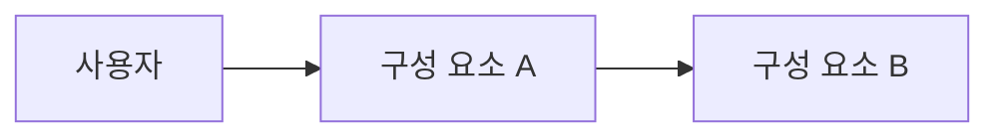

# TAD: 기술 아키텍처 명세서 제목

> 작성 방법: 이 파일을 복사해 `Departments/Design/Spec/docs/tad/<번호>_<주제>.md`(예: `01_아키텍처.md`)로 저장한다. 파일명에 버전 번호를 붙이지 않는다. 머리말 규격은 `Workflow/07_문서_서식_및_번호` 「머리말」을 따른다.

## 1. 아키텍처 개요
시스템 전체 구성과 주요 데이터 흐름을 적는다.

## 2. 구성 요소
| 구성 요소 | 책임 | 파일 위치 | 의존 대상 |
| :--- | :--- | :--- | :--- |
| 구성 요소 A | 담당 기능 | `Departments/Development/Implementation/assets/src/<파일>` | 구성 요소 B |

## 3. 데이터 모델
| 엔터티 | 필드 | 타입 | 제약 | 설명 |
| :--- | :--- | :--- | :--- | :--- |
| 엔터티 이름 | 필드 이름 | 타입 | 필수·고유 등 | 의미 |

## 4. 인터페이스
| 번호 | 이름 | 입력 | 출력 | 오류 |
| :---: | :--- | :--- | :--- | :--- |
| IF-01 | 함수 또는 API 이름 | 입력 형식 | 출력 형식 | 오류 조건과 응답 |

## 5. 오류 처리 및 로깅
- 실패를 알리지 않고 넘어가지 않는다. 오류 메시지에는 원인과 해결 방법을 포함한다.
- 외부 입력은 구조와 형태(스키마, 타입, 길이)만 기록하고 실제 값은 기록하지 않는다.
- 출력 문자 인코딩: UTF-8

| 오류 상황 | 처리 방식 | 기록 항목 |
| :--- | :--- | :--- |
| 오류 상황 | 처리 방식 | 기록하는 구조 정보 |

## 6. 보안 고려 사항
- 인증 정보(API 키, 토큰)의 보관 위치와 접근 방식을 적는다. 인증 정보를 소스코드와 문서에 기재하지 않는다.
- 개인정보 처리 범위를 적는다.

## 7. 설계 결정 기록
| 번호 | 결정 | 검토한 대안 | 결정 사유 |
| :---: | :--- | :--- | :--- |
| ADR-01 | 채택한 방식 | 검토한 다른 방식 | 채택 이유 |

## 8. 요구사항 추적표
| 요구사항 | 구성 요소 | 인터페이스 | 테스트 |
| :---: | :--- | :---: | :--- |
| FR-01 | 구성 요소 A | IF-01 | `Departments/Development/Implementation/assets/tests/test_<이름>.py` |

---

## 개정 이력

| 안건 | 일자 | 변경 요지 |
| :--- | :--- | :--- |
| REQ-007_v01 | YYYY-MM-DD | 최초 작성 |
