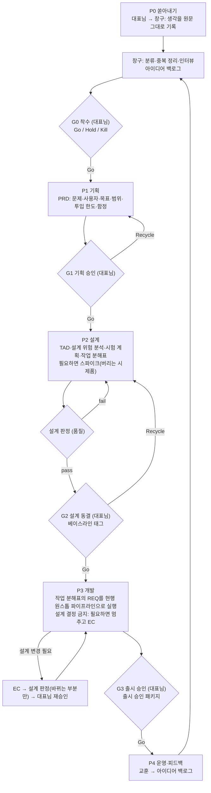

# AUDIT_20261008_설계선행체계도입검토_v01: 외부 검토 보고서

## 결론 요약

- **진단**: 현행 v04 체계는 안건 하나(REQ) 안에서 설계(EC·명세)와 구현을 한 번에 실행하는 변경 통제 체계입니다. 제품 전체를 먼저 설계하고 승인받는 단계가 없습니다. EC는 판정하지만, EC에 따라 작성한 PRD·TAD는 판정과 대표님 승인 없이 같은 실행 안에서 구현으로 넘어갑니다. 「설계와 개발을 동시에 진행해야 하는」 약점의 구조적 원인은 이 두 가지입니다.
- **제안**: APQP의 단계·게이트 구조를 소프트웨어용으로 줄인 「APQP-lite」를 현행 REQ 파이프라인 위에 얹습니다. 아이디어 쏟아내기 → 착수(G0) → 기획 승인(G1) → 설계 동결(G2) → 개발(현행 원스톱 파이프라인) → 출시 승인(G3, PPAP 대응 패키지) 순서입니다. 서식(PRD·TAD·EC)은 주요 항목을 이미 갖추고 있으므로(3.1.3절) 새 서식은 최소로 하고, 실행 순서와 승인 시점을 바꿉니다.
- **대표님 결정 필요**: 도입 수준, 도입 순서, 시범 대상 제품, 표준 자체 개정에도 적용할지 여부, 출시 승인 패키지 등급(5.2절 결정 표). 권고는 「설계 전용 단계를 여는 최소 개정 → 제품 하나로 시범 → 결과로 본 개정」입니다.

---

## 1. 검토 개요

- **지시 원문**:
  > 우리 시스템의 약점은, 설계와 개발을 동시에 진행해야하는 것임.
  > 나는 머릿속에 굴러돌아다니는 것들을,
  > 우다다다 쏟아내서,
  > 설계먼저 쫙~~해놓고, 설계가 탄탄해지면 개발을 하고 싶음.
  >
  > 이런 방안에 대해서 외부소스나 절차 표준들 조사해보고, 제안해봐.
  > APQP/PPAP 시스템 도입도 좋고.
- **검토 대상**: `D:\Vibe Coding\Vibe Standard_v04`의 `AGENTS.md`, `Workflow/01`~`07`, `Workflow/templates/`(PRD·TAD·REQ·EC·AUDIT 서식), `Departments/` 폴더 목록(`Departments/Quality/results/` 파일 목록 포함), `Departments/Secretariat/assets/inbox/` 요구 메모 두 건. 확인 시각 2026-10-08 14시경(KST).
- **검토 범위**: 현행 라이프사이클에서 설계와 구현이 섞이는 지점의 진단, 외부 표준·절차 조사, 도입 방안 제안.
- **제외 범위**: 개별 안건(REQ-007~011)의 내용 판정, 검사 스크립트(`check_standard.py`)와 서브에이전트 정의(`.claude/agents/`)의 내용 확인.
- **해석**: 「우리 시스템」은 이 표준으로 만드는 고객 제품의 개발 절차로 해석했습니다. 표준 자체의 개정 절차에도 적용할지는 5.2절 결정 표의 D4로 남깁니다.

## 2. 승인 기록 점검

이번 검토는 절차 제안이 목적이므로 승인 기록 점검은 범위 밖입니다. 점검하지 않았습니다.

---

## 3. 검토 내용

### 3.1 현행 체계 진단

#### 3.1.1 구조적 원인

| 번호 | 확인한 사실 | 근거 | 결과 |
| :---: | :--- | :--- | :--- |
| C1 | 대표님 개입 시점은 REQ 승인과 최종 승인 두 번뿐입니다 | `Workflow/03_라이프사이클` 1절 「대표님은 REQ 승인과 최종 승인 두 시점에만 개입한다」 | 명세(PRD·TAD)를 대표님이 보고 승인하는 시점이 없습니다 |
| C2 | EC는 판정하지만, 「명세」 단계의 통과 조건은 EC 머리말 상태 변경뿐이고 PRD·TAD 자체를 판정하는 단계가 없습니다 | `Workflow/03_라이프사이클` 5절 표 「EC 판정」·「명세」 행 | PRD·TAD는 품질 확인 없이 같은 실행 안에서 구현으로 넘어갑니다 |
| C3 | 원스톱 파이프라인은 EC 작성 → EC 판정 → 명세 → 구현 → 최종 판정을 한 번에 실행합니다 | `Workflow/03_라이프사이클` 2절, 4절 | 설계와 구현이 같은 안건, 같은 실행 안에 묶여 있습니다 |
| C4 | 아이디어 단계를 담는 문서가 없습니다. 요구 메모는 REQ 작성 파이프라인의 입력이며, 관행상 해결 방법을 담지 않습니다. `Workflow/07` 1절 문서 체계에도 요구 메모는 없습니다 | `Workflow/03_라이프사이클` 3절 1항, `요구메모_20261006_표준보완_v01.md` 머리 「용도」 문장(관행) | 정리되지 않은 생각을 쌓아 둘 곳이 없어, 생각이 곧바로 안건이 됩니다 |
| C5 | 승인된 REQ와 EC는 동결 문서이지만, PRD·TAD의 동결 시점(기준선)을 지정하는 방법은 없습니다. PRD·TAD는 버전 없는 파일 하나로 유지합니다 | `Workflow/03_라이프사이클` 5절 단서, `Workflow/07_문서_서식_및_번호` 2절 「PRD·TAD」 | 어느 시점의 설계를 기준으로 개발하는지 지정할 수 없습니다 |
| C6 | 표준 자체의 설계는 PRD·TAD로 작성하지 않습니다 | `Workflow/01_표준_개요` 3절 | 표준 개정 안건에서는 REQ 본문에 설계 논의가 섞이기 쉽습니다 |

#### 3.1.2 참고 정황

아래 사례는 모두 표준 개정 안건이며, 제품 개발 안건의 사례는 확인하지 못했습니다. 판정 반복이 설계·구현 혼재 때문인지도 분석하지 않았으므로 참고 정황으로만 제시합니다.

- 요구 메모 `요구메모_20261006_표준보완_v01.md` 2절 6번에 「REQ 서식에 Critical·Major는 구현 방법을 REQ에 적지 않고 EC로 넘긴다는 기준이 없음」이 지적되어 있습니다. 설계 논의가 안건 문서로 새어 들어간 사례입니다.
- 2026-10-08 14시경 `Departments/Quality/results/`의 `RES-*-REQ_v*.md` 파일 목록 기준으로 REQ 판정서는 REQ-007 9건(`RES-007-REQ_v01`~`v09`), REQ-009 7건, REQ-010 7건, REQ-008 5건, REQ-011 2건입니다.
- 요구 메모 `요구메모_20261007_판정및보고개선_v03.md` 1절 1번에 대표님이 문체 지적으로 생기는 판정 사이클을 줄이라고 지시한 기록이 있어, 판정 반복 비용의 일부는 이미 문제로 인식된 상태입니다.

#### 3.1.3 이미 갖춘 것

PRD 서식에는 범위(포함·제외), 사용자 시나리오, 기능·비기능 요구사항과 수용 기준, 미결 사항이 있고, TAD 서식에는 구성 요소, 데이터 모델, 인터페이스, 설계 결정 기록(ADR), 요구사항 추적표가 있습니다. 설계 문서의 **내용**은 3.2절에서 조사한 외부 표준의 주요 항목(범위, 요구, 아키텍처, 설계 결정, 추적표)을 갖추고 있습니다. 부족한 것은 설계를 **언제, 누가 승인하고 언제 고정하는지**입니다. 따라서 해결책도 새 서식보다 단계와 게이트를 다시 배치하는 쪽이 비용이 적습니다.

### 3.2 외부 표준·절차 조사

| 출처 | 핵심 내용 | 가져올 점 | 버릴 점 |
| :--- | :--- | :--- | :--- |
| AIAG APQP 3판(2024-03) | 5단계: 계획·정의 → 제품 설계·개발 → 공정 설계·개발 → 제품·공정 타당성 확인 → 양산·피드백. 3판에서 단계마다 게이트 관리와 체크리스트를 강조하고, 착수 체크리스트(Gate 0)를 새로 넣었습니다. Control Plan은 별도 코어 툴로 분리되었습니다 | 단계·게이트 구조, Gate 0, 단계별 체크리스트, 설계 위험 분석(DFMEA) | 공급망·금형·양산 설비 관련 항목 |
| AIAG PPAP(18요소, 제출 레벨 5단계) | APQP를 수행했다는 증거 묶음. 표지는 부품 제출 보증서(PSW). 고객이 레벨 1(PSW만)~5(현장 검토)를 지정합니다 | 「출시 전 증거 묶음 + 서명 한 장」 구조, 위험도에 따른 제출 범위 차등 | 물리 샘플·계측 관련 요소 다수 |
| ISO 9001:2015 8.3 | 설계·개발을 계획(8.3.2) → 입력(8.3.3) → 관리: 검토·검증·타당성 확인(8.3.4) → 출력(8.3.5) → 변경(8.3.6)으로 나누고, 입력은 「완전하고 모호하지 않아야」 합니다 | 설계 입력의 완전성 요구, 설계 검토와 검증의 구분, 설계 변경 관리 | — |
| ISO/IEC/IEEE 15288:2023 | 기술 프로세스 14가지 중 앞의 다섯 가지(사업·임무 분석, 이해관계자 요구, 시스템 요구, 아키텍처 정의, 설계 정의)가 구현(6.4.7)보다 앞에 있습니다 | 「무엇을 왜」(요구)와 「어떻게」(아키텍처·설계)를 다른 단계로 나누는 원칙 | 대형 시스템용 프로세스 전체 |
| EARS(Rolls-Royce, 2009) | 요구사항 문장을 다섯 가지 틀(상시, 이벤트 WHEN, 상태 WHILE, 선택 WHERE, 비정상 IF/THEN)로 씁니다. 제트엔진 제어 요구 분석에서 나왔습니다 | PRD 수용 기준을 모호하지 않게 쓰는 문장 틀 | — |
| ADR(Michael Nygard) | 설계 결정마다 제목·상태·맥락·결정·결과를 짧게 기록합니다 | TAD 7절에 이미 있음. 설계 동결 뒤 바뀐 결정의 이력 관리에 활용 | — |
| Stage-Gate(Robert Cooper, 1988) | 단계 사이 게이트에서 Go / Kill / Hold / Recycle 중 하나를 결정합니다 | 게이트 결정 값 네 가지(특히 Kill·Hold: 아이디어를 버리거나 묵히는 공식 선택지) | 사업성 평가 항목 대부분 |
| Double Diamond(Design Council, 2004) | Discover → Define → Develop → Deliver. 마름모마다 넓게 펼치는 발산과 좁히는 수렴을 짝지웁니다 | 「쏟아내기(발산)」와 「정리(수렴)」를 다른 활동으로 나누는 원칙 | — |
| Shape Up(Basecamp) | 시니어가 별도 트랙에서 작업을 「다듬은(shaping)」 뒤 팀이 만듭니다. 피치는 문제·투입 한도(appetite)·해법·함정(rabbit holes)·제외 항목(no-gos) 다섯 요소입니다. 기한을 넘기면 연장하지 않습니다 | 설계 트랙 분리, 투입 한도, 함정을 설계 단계에서 미리 제거, 제외 항목 명시 | 6주 주기 고정 |
| Dual-track Agile(Marty Cagan, 2012) | 발견 트랙(검증된 백로그 생성)과 전달 트랙(출시 가능한 소프트웨어)을 나란히 운영합니다. 만들기 전에 가장 싸게 검증하라고 권합니다 | 설계 단계에서 시제품으로 가정을 검증 | 두 트랙의 상시 병행(1인 운영에는 과함) |
| Spec-driven development(GitHub Spec Kit, Amazon Kiro) | AI 코딩용 「명세 먼저」 도구. Spec Kit은 constitution → specify → clarify → plan → tasks → analyze → implement, Kiro는 requirements.md(EARS) → design.md → tasks.md 순서이며 단계 사이에 결정 지점이 있습니다 | clarify(모호점 질의), analyze(구현 전 문서 간 일관성 점검), tasks(작업 분해) 단계 | 도구 자체의 도입(현행 서브에이전트 체계와 겹침) |
| Böckeler, 「Understanding Spec-Driven-Development: Kiro, spec-kit, and Tessl」(martinfowler.com, 2025-10-15) | SDD 도구를 실사용한 비판. 작은 작업에 과한 문서, 코드보다 검토가 어려운 마크다운 분량, 에이전트가 명세를 무시하는 「통제의 착각」, 모델 주도 개발(MDD)의 실패 반복 위험을 지적합니다 | 문제 크기에 맞춘 유연한 절차, 검토하기 쉬운 분량 | — |
| Claude Code 공식 모범 사례 | Explore → Plan → Implement → Commit. 큰 기능은 Claude가 사용자를 인터뷰한 뒤 SPEC.md를 쓰고, 새 세션에서 구현하라고 권합니다. 한 문장으로 설명되는 변경은 계획을 건너뛰라고 권합니다 | 인터뷰 방식의 아이디어 정리, 설계 세션과 구현 세션 분리 | — |

### 3.3 APQP/PPAP 적용 검토

#### 3.3.1 APQP 단계 대응

| APQP 단계 | 소프트웨어 대응 | 이 표준의 단계와 산출물 | 게이트 |
| :--- | :--- | :--- | :--- |
| (착수) | 아이디어 쏟아내기와 분류 | P0, 아이디어 백로그(신설) | G0 착수: 대표님 한마디(「이 건 기획 시작」)로 충분 |
| 1. 계획·정의 | 문제, 사용자, 목표, 범위, 제외 항목, 투입 한도, 함정 목록 | P1, PRD(현행 서식 + 투입 한도·함정 항목 보강) | G1 기획 승인: 대표님 |
| 2. 제품 설계·개발 | 아키텍처, 데이터 모델, 인터페이스, 설계 결정, 설계 위험 분석, 시험 계획, 필요한 경우 버리는 시제품(스파이크) | P2, TAD, 설계 위험 분석(DFMEA 축약), 시험 계획 | G2 설계 동결: 설계 판정 `pass` + 대표님 승인 |
| 3. 공정 설계·개발 | 작업 분해, 빌드·테스트·배포 절차, 운영 관리 계획 | P2, 작업 분해표 | G2와 함께 승인(1인 운영이므로 게이트를 합침) |
| 4. 제품·공정 타당성 확인 | 구현, 시험, 출시 준비 | P3, 현행 원스톱 파이프라인(REQ별), 출시 승인 패키지 | G3 출시 승인: 대표님 |
| 5. 양산·피드백 | 운영, 결함 처리, 교훈 | P4, 핫픽스, 파생 안건, 교훈 기록 | 다음 사이클 G0의 입력 |

#### 3.3.2 PPAP 18요소 대응(출시 승인 패키지, 가칭 RAP)

| 번호 | PPAP 요소 | 소프트웨어 대응 | 이 표준에 있는가 |
| :---: | :--- | :--- | :--- |
| 1 | 설계 기록 | 동결된 PRD·TAD(설계 베이스라인 태그) | 문서는 있음, 동결 표시 없음 |
| 2 | 설계 변경 문서 | 동결 이후 EC 목록 | 있음(EC) |
| 3 | 고객 엔지니어링 승인 | G2 대표님 설계 승인 기록 | 없음 |
| 4 | DFMEA | 설계 위험 분석 | EC 4절 「위험 분석」이 안건 단위로만 있음 |
| 5 | PFMEA | 빌드·배포 위험 분석 | 없음(Critical 제품만 권고) |
| 6 | 공정 흐름도 | 빌드·배포 흐름도 | 없음 |
| 7 | 관리 계획(Control Plan) | 운영 관리 계획: 감시 항목, 주기, 이상 시 조치 | 없음 |
| 8 | MSA | 시험 자체의 신뢰성(반복 실행 시 결과 일치, 불안정 테스트 확인) | 없음 |
| 9 | 치수 결과 | 요구사항별 시험 결과(추적표) | TAD 8절 추적표, 최종 판정 기준 3 |
| 10 | 재료·성능 시험 결과 | 비기능 요구(성능·보안) 시험 결과 | PRD 5절 NFR에 측정 기준만 있음 |
| 11 | 초기 공정 능력 연구 | 초기 안정성(일정 기간 무결함 운영) | 없음 |
| 12 | 공인 시험소 문서 | 시험 환경 기록(OS, 런타임, 의존성 버전) | 없음 |
| 13 | 외관 승인 보고서 | UI 화면 승인(UI 제품만) | 없음 |
| 14 | 샘플 부품 | 실행 가능한 빌드 산출물 | 운영 `assets/releases/` 자리만 있음 |
| 15 | 마스터 샘플 | 기준 릴리스 태그 | 없음 |
| 16 | 검사 보조구 | 테스트 픽스처, `check_standard.py` | 있음 |
| 17 | 고객별 요구사항 | 대표님 전역 지침 준수 확인 | 판정 기준에 일부 반영 |
| 18 | PSW | 출시 승인서 한 장(요약 + 대표님 서명란) | 없음(최종 판정서가 일부 대신함) |

**제출 범위 등급(권고)**: PPAP의 제출 레벨은 그대로 옮기지 않고 독자 등급 RAP-A·B·C를 둡니다(PPAP 레벨 3은 전 요소 제출이므로 이름을 빌리면 오독의 소지가 있습니다). 현행 분류에 대응시켜 Minor는 RAP-A(출시 승인서만), Major는 RAP-B(출시 승인서 + 1·2·3·4·9·10·14·16번), Critical은 RAP-C(RAP-B + 대표님이 직접 실행해 보는 시연 확인, PPAP 레벨 5의 현장 검토에 해당)로 둡니다. 18요소를 모든 제품에 다 적용하면 3.4절의 과잉 문서 문제가 그대로 생깁니다.

### 3.4 반대 논리와 한계

「설계를 먼저 쫙 해놓는」 방식은 업계에서 BDUF(Big Design Up Front)라고 부르며, Böckeler도 3.2절에 인용한 글에서 같은 위험을 지적했습니다. 그대로 도입하면 아래 문제가 예상됩니다.

1. **만들어 봐야 알 수 있는 것이 있습니다.** 외부 API의 실제 동작, 성능, 화면 사용감은 설계만으로 확정되지 않습니다. APQP도 2단계에 시제품과 타당성 검토를 넣어 둡니다. 따라서 설계 단계 안에 「버리는 시제품(스파이크)」을 허용해야 하며, 금지하면 설계가 오히려 추측으로 채워집니다.
2. **문서 검토 부담이 커집니다.** Böckeler의 실사용 보고에서 Spec Kit은 많은 마크다운 파일을 만들었고, 작성자는 그 문서보다 코드를 검토하는 편이 낫다고 평가했습니다. 1인 대표 체계에서는 대표님 검토 시간이 가장 부족한 자원이므로, 게이트 문서는 한 장 요약을 원칙으로 해야 합니다.
3. **설계 동결이 바뀐 상황을 막지 못합니다.** 동결은 「바꾸지 않는다」가 아니라 「바꿀 때는 기록하고 승인받는다」(ISO 9001 8.3.6)입니다. 변경 경로(EC)를 가볍게 유지하지 않으면, 개발 중 몰래 설계를 바꾸는 우회가 생깁니다.
4. **규칙 비대화 원칙과 충돌할 수 있습니다.** `AGENTS.md` 「불변 원칙」 8항에 따르면 사고의 근본 원인이 입증되고 플랫폼 기본 기능으로 막을 수 없을 때만 새 규칙을 더합니다. 현재 근거는 3.1절의 구조 분석과 대표님의 체감이며, 제품 개발에서의 사고 기록은 확인하지 못했습니다(확인 불가). 기본 기능으로 대신할 수 있는 부분(예: 베이스라인 지정은 Git 태그, 설계와 구현의 분리는 Claude Code plan 모드와 명세 작성 뒤 새 세션 시작)은 규칙으로 만들지 않아야 합니다. 그래서 본 개정 전에 시범으로 근거를 먼저 모으는 순서를 권고합니다.

### 3.5 제안: 설계 선행 체계(APQP-lite)

#### 3.5.1 전체 흐름

#### 3.5.2 단계별 내용

| 단계 | 담당 | 하는 일 | 산출물 | 끝나는 조건 |
| :--- | :--- | :--- | :--- | :--- |
| P0 쏟아내기 | 대표님, 창구 | 대표님은 순서·형식 없이 말합니다. 창구는 원문을 보존해 기록하고, 문제·사용자·기능·제약·의문·보류로 분류하고, 빈 곳을 객관식 인터뷰로 묻습니다 | 아이디어 백로그 | G0에서 항목별 Go·Hold·Kill 결정 |
| P1 기획 | 비서실 세션(REQ 작성) → 설계(PRD 작성) | 백로그에서 이번에 만들 것만 골라 PRD로 씁니다. 수용 기준은 EARS 문장 틀로 씁니다. 투입 한도(예: 2주)와 함정 목록을 적고, 제외 항목은 PRD 2절 「범위」의 「제외」 행에 적습니다 | PRD | G1 대표님 승인 |
| P2 설계 | 설계(스파이크는 개발 `workspace/`) | TAD, 설계 위험 분석, 시험 계획, 작업 분해표를 씁니다. 함정은 스파이크나 범위 축소로 미리 해소합니다. 스파이크 코드는 제품 코드로 옮기지 않고 결과만 ADR로 남깁니다 | TAD, 위험 분석, 시험 계획, 작업 분해표 | 설계 판정 `pass` + G2 대표님 승인 → Git 태그로 베이스라인 지정 |
| P3 개발 | 현행 원스톱 파이프라인, 품질 | 작업 분해표의 항목마다 REQ를 만들고 실행합니다. REQ는 베이스라인을 참조하고, 「명세」 단계에서 새 설계 결정을 하지 않습니다. 끝나면 출시 승인 패키지를 묶습니다 | 코드, 테스트, DEV, RES, 출시 승인 패키지 | 모든 REQ 최종 판정 `pass` + G3 대표님 승인 |
| P4 운영·피드백 | 운영, 창구 | 운영 관리 계획대로 감시하고, 결함은 핫픽스·파생 안건으로 처리하고, 교훈은 아이디어 백로그로 돌려보냅니다 | 운영 기록, 교훈 | 없음(다음 사이클의 입력) |

#### 3.5.3 설계 판정 기준(신설 제안)

ISO 9001 8.3.3·8.3.4와 Spec Kit의 analyze 단계, ISO/IEC/IEEE 29148의 요구사항 품질 특성을 묶어 아래 여섯 가지로 제안합니다. 29148 원문은 이번에 열람하지 못해 특성 목록은 확인 불가이며, 아래 기준은 그 취지를 이 표준에 맞게 줄인 것입니다. 이 기준은 최소 개정(5.1절 1항) 전에는 효력이 없습니다.

- 적용 범위: PRD만 다루는 설계 REQ(G1 전)는 기준 1·3·5만 적용하고, TAD를 포함하는 설계 REQ(G2 전)는 여섯 가지를 모두 적용합니다.

1. PRD의 모든 기능 요구에 확인할 수 있는 수용 기준이 있다(EARS 틀 권고).
2. 모든 기능 요구가 TAD 추적표의 구성 요소·인터페이스·시험에 연결되고, 연결되지 않은 구성 요소가 없다.
3. PRD 미결 사항과 함정 목록에 「해소」 또는 「제외」 표시가 없는 항목이 남아 있지 않다.
4. PRD와 TAD, TAD 안의 절끼리 서로 어긋나는 내용이 없다.
5. 제외 항목과 투입 한도를 넘는 설계가 없다(요청하지 않은 기능 금지 원칙의 설계판).
6. 작업 분해표의 각 항목이 REQ 하나(목적 하나)로 옮길 수 있는 크기다.

#### 3.5.4 「쏟아내기」 운영 방법

아이디어 백로그는 네 절로 구성합니다: 1. 원문 기록, 2. 분류표, 3. 질의와 답, 4. G0 결정. 본 개정 전(시범 중)에는 창구가 작성할 수 있는 문서 가운데 백로그에 맞는 것이 요구 메모뿐이므로, 백로그를 `Departments/Secretariat/assets/inbox/`의 요구 메모(`요구메모_<YYYYMMDD>_<제품>아이디어_vNN.md`)로 작성합니다.

1. 대표님은 창구(코워크 등)에 「아이디어 덤프, 제품 <이름>」이라고 시작해 생각나는 대로 말합니다. 음성 받아쓰기, 메모 붙여넣기 모두 됩니다.
2. 창구는 대화 중 정리하지 않고 원문을 그대로 백로그의 원문 기록 절에 쌓습니다(전역 지침 「외부 원자료는 원형 보존」과 같은 취지).
3. 덤프가 끝나면 창구가 분류표 절을 만들고, 중복을 묶고, 빈 곳을 객관식 질문 몇 개로 묻습니다. Claude Code 모범 사례의 「Claude가 사용자를 인터뷰한 뒤 명세를 쓰는」 방식입니다.
4. 대표님이 G0에서 항목마다 Go / Hold / Kill을 고릅니다. Hold 항목은 백로그에 남겨 다음 덤프 때 다시 봅니다.

#### 3.5.5 현행 표준에서 바뀌는 곳

「최소 개정」은 시범 전에 필요한 항목, 「본 개정」은 시범 뒤 반영할 항목입니다.

| 대상 | 변경 요지 | 시기 |
| :--- | :--- | :--- |
| `Workflow/03_라이프사이클` | 2절 표에 「설계」 분류 행(단계: 명세 → 설계 판정, 구현 없음) 추가, 3.5.3절 설계 판정 기준 신설, 4절 6항(종료 보고)·5절 「명세」 행(입력·통과 조건)·8절(격상)에 「설계」 분류 처리 추가 | 최소 개정 |
| `AGENTS.md` | 「불변 원칙」 5항의 커밋 전제에 「「설계」 분류는 설계 판정 `pass`」 추가 | 최소 개정 |
| `Workflow/07_문서_서식_및_번호`, `Workflow/templates/REQ_TEMPLATE.md` | 설계 판정서 이름(예: `RES-xxx-DSN`), RES `gate` 값에 `DSN` 추가, 1절 추적 관계에 설계 판정 추가, 3절 REQ `classification` 허용 값과 서식 주석에 「설계」 추가 | 최소 개정 |
| `.claude/agents/`(품질 서브에이전트 정의), `Workflow/06_통제장치_및_배포`·`check_standard.py` | 설계 판정 수행 근거 추가. 검사 스크립트가 판정서 이름이나 `gate` 값을 검사하는지 확인한 뒤 필요하면 반영(이번에 확인하지 않음) | 최소 개정 |
| `Workflow/03_라이프사이클` | 1절 앞에 「제품 단계와 게이트」 절 신설, 「명세」 단계를 「베이스라인 참조」로 변경, 개발 중 설계 결정이 필요하면 멈추는 중단 조건 추가 | 본 개정 |
| `Workflow/07_문서_서식_및_번호` | 아이디어 백로그, 출시 승인서 문서 종류 추가, 베이스라인 태그 형식 | 본 개정 |
| `Workflow/templates/` | PRD에 투입 한도·함정 항목 추가(제외 항목은 2절 「범위」의 「제외」 행 활용), 수용 기준 EARS 예시, 아이디어 백로그·출시 승인서 서식 신설 | 본 개정 |
| `Workflow/01_표준_개요` | 「용어」에 게이트·베이스라인·설계 판정·아이디어 백로그 추가, 창구 정의의 수정 범위에 아이디어 백로그 추가 | 본 개정 |
| `Workflow/02_부서_구조_및_작업구역` | 2.1절 창구 책무와 단서, 4절 「작업 구역」에 아이디어 백로그 기록·인터뷰 추가, 스파이크 작업 위치 | 본 개정 |
| `AGENTS.md` | 불변 원칙에 「동결된 설계 없이 구현 금지(Minor 제외)」 한 줄 추가 여부 | 본 개정, 대표님 결정 |

### 3.6 대안 비교

| 대안 | 내용 | 장점 | 단점 |
| :--- | :--- | :--- | :--- |
| A. 경량 | 서식은 그대로 두고 「명세 판정」과 「명세 후 대표님 승인」 게이트만 원스톱 파이프라인 중간에 추가 | 개정량이 가장 적습니다 | 안건 단위 설계라서 제품 전체를 먼저 설계하는 요구는 채우지 못합니다 |
| **B. APQP-lite(권고)** | 3.5절 제안. 제품 단위 단계·게이트를 현행 파이프라인 위에 얹음 | 요구(쏟아내기 → 설계 먼저 → 개발)를 그대로 채우고, 현행 REQ 체계를 P3에서 재사용합니다 | `03` 대폭 개정(Critical) 필요, 시범 없이 넣으면 과잉 문서 위험 |
| C. 외부 도구 | Spec Kit이나 Kiro를 그대로 도입 | 바로 쓸 수 있습니다 | 현행 서브에이전트·판정·승인 체계와 겹치고, Böckeler가 지적한 문서 과잉 문제도 그대로 생깁니다 |

---

## 4. 지적 사항 (체크리스트)

| 번호 | 지적 | 근거 | 권고 |
| :---: | :--- | :--- | :--- |
| 1 | PRD·TAD를 판정하는 단계가 없음(EC 판정만 있음) | `Workflow/03_라이프사이클` 5절 「EC 판정」·「명세」 행 | 설계 판정 신설(3.5.3절) |
| 2 | 대표님이 설계를 승인하는 시점이 없음 | `Workflow/03_라이프사이클` 1절 | G1·G2 게이트 신설 |
| 3 | 설계와 구현이 같은 실행 안에 묶여 있음 | `Workflow/03_라이프사이클` 4절 | 제품 단위 P2(설계)와 P3(개발) 분리 |
| 4 | 아이디어 단계를 담을 문서가 없음 | 요구 메모의 쓰임(REQ 입력, 관행상 해결 방법 미기재), `Workflow/07` 1절 문서 체계 | 아이디어 백로그 신설. 시범 중에는 요구 메모로 대신(3.5.4절) |
| 5 | PRD·TAD의 베이스라인(동결 시점) 지정 방법이 없음 | `Workflow/07_문서_서식_및_번호` 2절 「PRD·TAD」 | G2 승인 때 Git 태그로 지정 |
| 6 | 출시 전 증거 묶음과 승인서가 없음 | PPAP 대응표(3.3.2절) | 분류별 등급을 둔 출시 승인 패키지 |
| 7 | 현행 규정으로는 구현 없는 설계 전용 REQ를 실행할 수 없음 | `Workflow/03_라이프사이클` 2절 표(모든 분류에 구현 단계 있음), 3절 2항 판정 기준 ④, 5절 최종 판정 기준 3 | 시범 전에 「설계」 분류와 설계 판정 기준을 여는 최소 개정(3.5.5절) |

## 5. 결론

### 5.1 권고 순서

1. **최소 개정(Critical 안건)**: 지적 7번 때문에 현행 규정 안에서는 설계 전용 시범을 할 수 없습니다. `Workflow/03` 2절에 「설계」 분류(명세 → 설계 판정)와 설계 판정 기준을 넣는 최소 개정만 먼저 합니다(3.5.5절 「최소 개정」 행). 「설계」 분류에는 개발 단계가 없으므로 시범에서는 스파이크를 하지 않거나, 필요하면 해당 함정만 별도 Minor REQ로 실행합니다. 안건 번호는 REQ-010 커밋 뒤 작성할 REQ-012(판정·보고 개선) 다음 번호로 진행합니다(`요구메모_20261007_판정및보고개선_v03.md` 2절 5항, `Workflow/07` 2절 「번호」). 업데이트 패키지는 `Workflow/06_통제장치_및_배포` 6절에 따라 보류 상태이므로, 진행 중인 제품으로 시범하면 개정한 거버넌스 파일을 대표님이 시범 제품 저장소에 직접 복사해 반영합니다. 신규 제품으로 시범하면 개정 뒤 `06` 6.1절 배포본으로 시작합니다.
2. **시범**: 제품 하나를 골라 P0~P3를 진행합니다. G0은 창구 대화에서 대표님 결정, G1은 PRD 작성용 설계 REQ의 승인(설계 판정 기준 1·3·5 적용), G2는 TAD 작성용 설계 REQ의 승인(기준 여섯 가지 적용)으로 대신하고, P3는 현행 원스톱 파이프라인(Minor·Major)으로 실행합니다. 아이디어 백로그는 요구 메모로 작성합니다(3.5.4절). 시범에서는 G1 앞에도 설계 판정을 두므로 3.5.1절 목표 흐름(G1 앞 판정 없음)과 다릅니다. 이 차이도 평가 대상에 넣습니다.
3. **평가**: 시범 뒤 대표님 검토 시간, 판정 반복 횟수, 개발 중 설계 변경(EC) 건수를 기존 안건과 비교합니다.
4. **본 개정**: 효과가 확인되면 3.5.5절 「본 개정」 범위를 Critical 안건으로 개정합니다.

### 5.2 대표님 결정 필요 사항

| 정할 일 | 권고안 | 대안 | 근거 |
| :--- | :--- | :--- | :--- |
| D1 도입 수준 | B. APQP-lite | A 경량, C 외부 도구 | 3.6절 |
| D2 도입 순서 | 최소 개정 → 시범 → 평가 → 본 개정 | (가) 본 개정을 한 번에, (나) 개정 없이 시범 REQ의 구현 단계를 골격 코드·테스트로 한정해 우회 | 3.4절 4항, 4절 지적 7. (나)는 개정 없이 가능하나 설계와 구현이 다시 섞여 시범 취지가 흐려집니다 |
| D3 시범 대상 제품 | 대표님 지정(신규 제품 권고) | 진행 중인 제품(개정 파일 수동 반영 필요) | 신규 제품은 개정 뒤 배포본으로 바로 시작할 수 있습니다(5.1절 1항) |
| D4 표준 자체 개정에도 적용 | 적용하지 않음(제품에만) | 적용 | `Workflow/01_표준_개요` 3절이 표준 설계의 PRD·TAD 작성을 금지 |
| D5 출시 승인 패키지 등급 | Minor RAP-A / Major RAP-B / Critical RAP-C | 전 제품 RAP-B | 3.3.2절 |

### 5.3 결론(재기재)

현행 체계의 약점은 서식이 아니라 순서와 승인 시점에 있습니다. 설계를 먼저 끝내려면 제품 단위 설계 단계와 대표님 설계 승인(G1·G2)이 필요하며, APQP 단계 구조와 PPAP의 출시 증거 묶음을 그 뼈대로 쓸 수 있습니다. 다만 BDUF의 부작용을 막기 위해 스파이크 허용, 한 장 요약 게이트, 분류별 등급 차등을 함께 넣고, 최소 개정 뒤 시범으로 효과를 확인한 다음 본 개정할 것을 권고합니다.

---

## 출처

- AIAG APQP 3판 변경 요지: [Bassetti, 3rd edition of the AIAG manual](https://www.bassetti-group.com/en/3rd-edition-of-the-aiag-manual-key-changes-under-the-new-apqp/), [DQS, Coming Launch of New APQP and Control Plan](https://www.dqsglobal.com/en/explore/blog/hk/coming-publication-of-apqp-ed3-and-control-plan-ed1), [ANSI Webstore, AIAG APQP 2024](https://webstore.ansi.org/standards/aiag/aiagapqp2024)
- APQP 단계별 산출물: [Excedify, APQP](https://www.excedify.com/pages/apqp)
- PPAP 요소와 제출 레벨: [Fabrico, PPAP guide](https://www.fabrico.io/blog/ppap-production-part-approval-process-guide/), [Kaizen Institute, PPAP explained](https://kaizen.com/insights/production-part-approval-process/)
- ISO 9001:2015 8.3: [Auditor Training Online, Understanding Clause 8.3](https://blog.auditortrainingonline.com/blog/understanding-iso-90012015-clause-8.3-design-and-development)
- ISO/IEC/IEEE 15288:2023 기술 프로세스: [Wikipedia, ISO/IEC 15288](https://en.wikipedia.org/wiki/ISO/IEC_15288)
- EARS: [Wikipedia, Easy Approach to Requirements Syntax](https://en.wikipedia.org/wiki/Easy_Approach_to_Requirements_Syntax)
- ADR: [GDS Way, Architecture decisions](https://gds-way.digital.cabinet-office.gov.uk/standards/architecture-decisions.html)
- Stage-Gate: [Asana, Stage-gate process](https://asana.com/resources/stage-gate-process)
- Double Diamond: [Design Council, Framework for Innovation](https://www.designcouncil.org.uk/our-resources/framework-for-innovation)
- Shape Up: [Jade Rubick, Shape Up](https://www.rubick.com/wiki/process/shape-up)
- Dual-track Agile: [SVPG, Dual-Track Agile](https://svpg.com/dual-track-agile)
- Spec Kit: [GitHub Spec Kit 공식 문서, Agentic SDD](https://github.github.io/spec-kit/reference/agentic-sdd.html), [CodeMySpec, GitHub Spec Kit guide](https://codemyspec.com/blog/github-spec-kit-guide)
- Kiro: [Kiro Docs, Specs concepts](https://kiro.dev/docs/specs/concepts)
- SDD 비판: [Birgitta Böckeler, Understanding Spec-Driven-Development: Kiro, spec-kit, and Tessl (martinfowler.com)](https://www.martinfowler.com/articles/exploring-gen-ai/sdd-3-tools.html)
- Claude Code 모범 사례: [Claude Code Docs, Best practices](https://code.claude.com/docs/en/best-practices)
