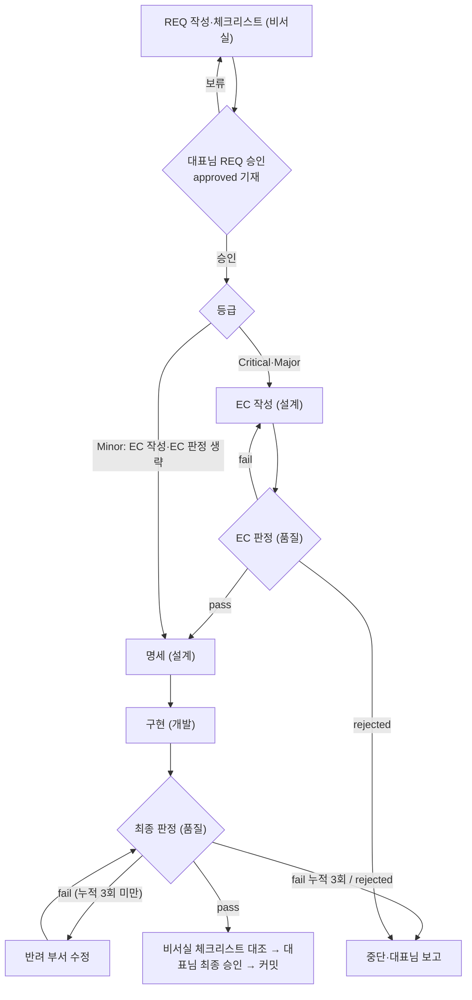

# 03. 라이프사이클 및 워크플로우 (Lifecycle & Workflow)

> 본 문서는 안건 등급별 흐름, 원스톱 파이프라인, 단계별 기준, 중단 조건, 반려와 격상, 핫픽스 트랙, 후속 절차를 정의한다. 원칙의 원천은 `AGENTS.md` 「원스톱 단일 승인제」와 「비서실 책무와 핫픽스」다.

## 1. 등급별 흐름

단계는 번호 대신 단계명(EC 작성, EC 판정, 명세, 구현, 최종 판정)으로 부른다. Minor에는 EC 단계가 없어 번호가 등급마다 달라지기 때문이다.

| 등급 | 적용 대상 | 단계 | 대표님 승인 |
| :---: | :--- | :--- | :--- |
| Critical | 거버넌스 헌장, 보안·권한, 코어 구조 | REQ 승인 → EC 작성 → EC 판정 → 명세 → 구현 → 최종 판정 → 최종 승인 | REQ 승인, 최종 승인 |
| Major | 신규 기능, 다중 모듈 수정, API 규격 | Critical과 같다 | REQ 승인, 최종 승인 |
| Minor | 단순 오탈자, 단일 파일 패치, 문서 보완 | REQ 승인 → 명세(약식) → 구현 → 최종 판정 → 최종 승인 | REQ 승인, 최종 승인 |

REQ 승인부터 최종 판정까지는 대표님 개입 없이 진행한다. 「중단 조건」에 해당할 때만 멈춘다.

## 2. 원스톱 파이프라인

대표님이 `Workflow/05_비서실_클로드cli_인수인계_정책` 「원스톱 실행 명령」을 저장소 루트에서 한 번 실행하면, 메인 세션이 오케스트레이터로서 아래 순서를 따른다. 서브에이전트는 다른 서브에이전트를 기동할 수 없으므로(`disallowedTools: Agent`) 인계는 메인 세션이 맡는다.

1. REQ 머리말의 `approved:`, `classification:`, `workflow:`, `scope:`를 읽는다. `approved:`가 비어 있으면 시작하지 않고 보고한다.
2. `workflow:`에 기재된 부서만 기재된 순서대로 기동한다. 기재되지 않은 부서의 단계는 실행하지 않는다. 한 부서가 여러 단계를 맡으면(설계: EC 작성·명세, 품질: EC 판정·최종 판정) 「등급별 흐름」의 순서를 따른다.
3. 단계마다 해당 부서 서브에이전트(`design`, `development`, `quality` 등)를 새로 기동한다. 지시문은 `Workflow/04_모델_운용_기준` 「타깃 컨텍스트 규칙」대로 REQ 경로, EC 경로, 대상 파일 경로, 단계명만 담는다.
4. 각 단계의 산출물과 통과 조건(「단계별 기준」)을 확인한 뒤 다음 단계로 인계한다. 판정 결과는 판정서 머리말 `result:`로만 판단한다.
5. 최종 판정이 `pass`이면 대표님께 최종 판정서 경로, `git status --porcelain -uall`과 `git diff --stat` 결과, 거버넌스 적용본 경로(있으면)를 보고하고 종료한다. 커밋은 하지 않는다.

## 3. 단계별 기준 (v03)

| 단계 | 부서 | 입력 | 산출물 | 통과 조건 |
| :--- | :--- | :--- | :--- | :--- |
| EC 작성 | 설계 | 승인된 REQ | `Departments/Design/docs/tad/EC-xxx.md` (`status: "draft"`) | EC `scope:`가 REQ `scope:` 안에 있고, REQ `scope:`가 EC 경로를 포함한다 |
| EC 판정 | 품질 | REQ, EC | `Departments/Quality/results/RES-xxx-EC.md` | ① REQ 목적의 누락·왜곡 없음 ② EC scope가 REQ scope 안 ③ 요청하지 않은 기능·추상화 없음 ④ 완료 기준 검증 가능 |
| 명세 | 설계 | 판정 `pass`인 EC (Minor는 REQ) | PRD·TAD, 거버넌스 적용본, `Departments/Design/results/` 설계 결과서 | 시작 시 EC `status:`를 `"approved"`로, `gate:`를 판정서 경로로 바꾼다. Minor의 약식 명세는 REQ가 요구하는 명세 변경만 작성한다 |
| 구현 | 개발 | EC(Minor는 REQ), 명세 | 코드, 테스트, `Departments/Development/results/DEV-xxx.md` | 테스트 통과, `python Departments/Development/assets/scripts/check_standard.py` 종료 코드 0 |
| 최종 판정 | 품질 | REQ, EC, 산출물, `git diff` | `Departments/Quality/results/RES-xxx.md` | 아래 세 가지 대조와 체크리스트 번호별 근거 |

최종 판정은 독립 세션에서 ① REQ 원점 대조(「요청 원문」·「배경 및 목적」의 요구 반영, 체크리스트 번호별 근거) ② 범위 대조(`git status --porcelain -uall`의 변경 파일이 REQ·EC `scope:`와 부서 `results/`·`workspace/` 안에 있는가) ③ 명세 정합성 대조(코드·명세 일치, 테스트·`check_standard.py` 통과)를 수행한다. 요구사항·구현 파일·테스트의 양방향 추적성을 확인하고, REQ·EC에 없는 기능은 `fail`로 판정한다. 승인된 REQ와 EC는 동결 문서이므로 작업 중 수정하지 않는다.

### 3.1 섹션별 리비전 관리 엔지니어링 표준 절차(SOP) (v03)
문서 개정 시 대표님이 변경 위치를 직관적으로 파악할 수 있도록 아래 4단계 엔지니어링 절차(SOP)를 엄수한다.
1. **[1단계: 실변경 식별]**: 개발 단계 완료 후 `git diff HEAD`를 확인하여 실제 텍스트가 변경된 H2/H3 섹션을 추출한다.
2. **[2단계: 구 태그 청소]**: 문서 전체에서 정규식 `\s*\([vV]\d+\)`를 적용하여 이전 버전 마크를 일괄 제거한다.
3. **[3단계: 현행 태그 부착]**: 실변경이 발생한 H2/H3 섹션 제목 끝에만 1칸 공백 후 현행 버전 태그(예: ` (v03)`)를 부착한다. 미변경 섹션에는 절대 부착하지 않는다.
4. **[4단계: 품질 검증 강제]**: 품질팀(RES)은 `git diff` 실변경 섹션과 헤더 태그를 1:1 대조하여, 미변경 섹션에 태그가 부착되었거나 실변경 섹션에 태그가 누락된 경우 즉시 `fail` 판정한다.

## 4. 중단 조건

오케스트레이터는 아래 경우에만 멈추고 상태·사유·필요한 결정을 대표님께 보고한다. 이 밖의 판단은 묻지 않고 진행한다.

- ① scope 밖 변경이 필요한 경우
- ② REQ가 여러 뜻으로 읽혀 `rejected`로 판정된 경우
- ③ 최종 판정 누적 3회 반려(「반려와 격상」)
- ④ 거버넌스 적용본의 원본 반영이 필요한 경우. 파이프라인은 적용본 판정까지 마치고, 반영은 최종 승인 때 대표님이 한다
- ⑤ `ask` 목록 명령(삭제·이동·커밋·푸시) 또는 `allow` 목록 밖 명령의 권한 확인 요청. 검증 명령은 `Workflow/06_거버넌스_엔지니어링_아키텍처` 「무인 실행 권한」 목록 안에서 Bash 도구로 실행한다

## 5. 반려와 격상

- EC 판정 `fail`: 설계가 EC를 고친 뒤 다시 판정한다. 격상 횟수에 넣지 않는다. 재판정 횟수 한도는 사용자 전역 지침 「생성과 판정의 분리」를 따른다.
- 최종 판정 `fail`: 판정서에 적힌 반려 부서가 고친 뒤 변경분만 다시 판정한다. 같은 판정서(`RES-xxx.md`)에 차수를 누적하고 반려 횟수를 센다.
- 누적 3회 반려 또는 거버넌스 충돌: 작업을 중단하고 차상위 등급(`Minor → Major → Critical`)의 절차로 처음부터 다시 진행한다. Critical은 격상할 등급이 없으므로 중단하고 보고한다.

## 6. 핫픽스 트랙

- **대상 조건 (모두 충족)**: 기존 기능의 결함 또는 오탈자, 수정 파일 3개 이하, 거버넌스 파일·`CEO/`·`.claude/` 제외, 새 기능·새 파일 없음. 하나라도 어긋나면 정규 REQ로 전환한다.
- **절차**:
  1. **사전 승인**: 비서실은 수정 내용(원인, 변경 요지)과 대상 파일 목록을 대표님께 제시하고 승인을 받은 뒤에만 착수한다. 대표님이 지시하며 대상 파일을 확정한 경우 그 확정을 사전 승인으로 본다. 승인된 목록이 사용자 전역 지침 「파일 삭제·덮어쓰기 전 사용자 승인」의 승인 목록이 된다. 비서실은 수정 전에 지시 원문과 승인 내역을 `HOTFIX-xxx.md` 1절에 기록한다.
  2. **수정과 검증**: 비서실이 수정하고 `check_standard.py`와 관련 테스트를 실행한 뒤 `HOTFIX-xxx.md` 2·3절을 작성한다.
  3. **사후 확인**: 대표님이 머리말 `confirmed:`를 기재한다. 대표님 확인이 독립 판정을 대신하므로 작성 세션 자기 판정 금지 원칙과 충돌하지 않는다.
- 서식과 커밋 연동은 `Workflow/07_엔지니어링_변경통제_및_서식_명세` 「HOTFIX」를 따른다.

## 7. 후속 절차

1. 비서실이 최종 판정서의 점검표 번호별 근거를 대조해 대표님께 보고한다.
2. 대표님은 최종 판정서와 `git diff`를 확인해 최종 승인하고, 거버넌스 적용본이 있으면 원본에 반영한다.
3. 커밋은 대표님의 명시적 요청이 있을 때만 한다. 커밋 시 `.githooks/pre-commit`이 `check_standard.py`를 실행하고, 검사가 실패하면 커밋이 중단된다.
4. 배포본 동기화는 `Workflow/01_vibe_standard_overview` 「배포본 복제 규칙」을 따른다. 푸시는 대표님의 명시적 요청이 있을 때만 한다.

---

## 📝 개정 이력

| REQ | 변경 요지 |
| :--- | :--- |
| REQ-002 | 최초 작성 |
| REQ-002 | 등급별 흐름도 통합, 단계명 체계, 원스톱 파이프라인·중단 조건·핫픽스 트랙 신설, 중간 승인 폐지 |
